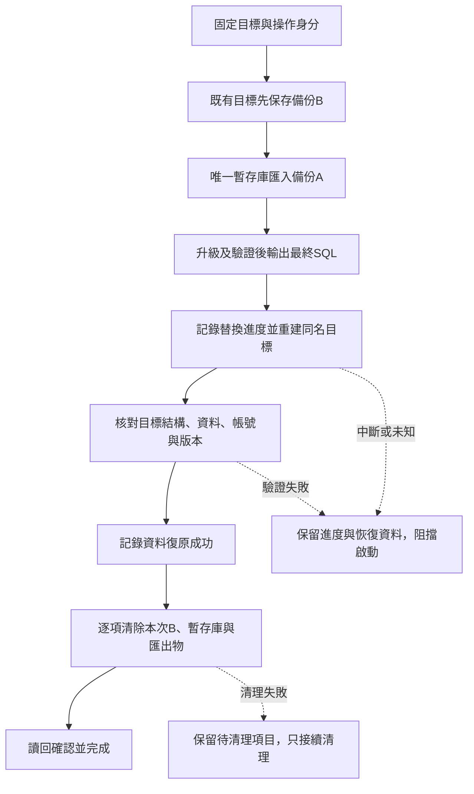

# Module: preserved-database-upgrade

## Parent
- domain: `global`
- subsystem: `migration`

## Responsibility
- 服務日期調整的 `1082_service_date_adjustments.sql` 由 `db/migration_releases/labor_union_2026_11_23_service_date_adjustments_v1.json` 與同名 descriptors 登錄。新增 nullable 逐日時數、事前指定人員與調整回執；保留舊列及原工時計算，不回填歷史班次。有效班次唯一索引納入 effective marker，停用來源可留存。fresh assembly、compact fresh 與 preserve 共用該 artifact。反向 contract 見 `tests/domains/global/subsystems/migration/modules/preserved-database-upgrade/contract/test_service_date_adjustments_schema.py`。資格 `validation/receipts/PROV-service-date-adjustments-local-additive-qualification-20261123.json` 已綁定 synthetic MySQL fresh／備份／保留資料候選與原欄位逐表驗證，developer 唯讀預覽為 `ready / daily_additive`；不代表現用或正式資料庫已套用。
對既有 development database 建立零寫入 ordered plan，並在既有正式 release／descriptor
邊界內協調 preserve-data candidate、additive progression、replacement verification與resume；
不得修改 source root facts或繞過非schema data-effect。

## Implementation
- `db/schema_parts/1084_staff_payable_projection_zero.sql` 由 `db/migration_releases/labor_union_2026_11_24_staff_payable_projection_zero_v1.json` 及同名 descriptors 登錄。Fresh 與保留資料升級共用有效應付可為 0 元的金額 CHECK。驗證舊、新 CHECK 時同時核對既有投影表結構與狀態 CHECK。升級不改寫出款、核銷或既有投影列。Contract 位於 `tests/domains/global/subsystems/migration/modules/preserved-database-upgrade/contract/test_staff_payable_projection_zero_schema.py`。
- `db/schema_parts/1082_service_date_adjustments.sql` — 逐日時數、事前人員及復原回執的共用 fresh／preserve artifact。
- Schema predecessor `db/schema_parts/1081_order_established_unserved_status.sql` is a shared fresh/preserve artifact. The release manifest `db/migration_releases/labor_union_2026_11_23_order_established_unserved_v1.json` and its descriptors register the artifact.
- LINE 六個月寄送明細清理 guard：`db/schema_parts/1079_line_delivery_retention_guards.sql`，`db/migration_releases/labor_union_2026_11_18_line_delivery_retention_v1.json` 及對應 descriptors。fresh／preserve 同 artifact；保留原 registry-delete 分支，追加精確 receipt、合法終態、無租約及 DB 臺灣六個月 cutoff 上限。完整 guard normalization、fresh assembly及 NAS compact 沿原生成入口。
- `db/schema_parts/1076_staff_availability_optional_reason.sql` 由 `db/migration_releases/labor_union_2026_11_13_staff_availability_optional_reason_v1.json` 與同名 descriptors 登錄，供新庫初始化與保留資料升級共用。不可服務期間原因可留空，建立者仍必填。驗證回條為 `validation/receipts/PROV-STAFF-AVAILABILITY-OPTIONAL-REASON-local-additive-qualification-20261113.json`。
- The client passbook cover release uses `db/migration_releases/labor_union_2026_11_13_controlled_file_client_passbook_cover_v1.json` and its descriptors. Shared fresh/preserve artifact `db/schema_parts/1075_controlled_file_client_passbook_cover.sql` brings both controlled-file tables into the existing client passbook contract and preserves their rows and version references. Qualification is recorded in `validation/receipts/PROV-CONTROLLED-FILE-CLIENT-PASSBOOK-local-additive-qualification-20261113.json`.
- `db/migration_releases/labor_union_2026_11_11_registry_save_receipts_v1.json` 以 `db/schema_parts/1071_pending_order_terms_receipt_status.sql` 在 Terms 回執列舉尾端追加待補件。接續的 `db/migration_releases/labor_union_2026_11_11_registry_bootstrap_reason_v1.json` 以 `db/schema_parts/1072_case_architecture_bootstrap_reason_optional.sql` 允許初始資料事件保存空白備註。兩版各有同名 descriptors，沿 canonical chain 同步保留資料升級及 compact fresh，無業務資料回填。
- `db/schema_parts/1070_historical_order_terms_receipt_status.sql` 與 `db/migration_releases/labor_union_2026_11_09_historical_accounting_corrections_v1.json`／同名 descriptors：原 Terms 收據 enum 尾端追加歷史服務／帳務完成，保留原順序與全部資料；fresh／preserve 共用，canonical chain、compact fresh 及 full validation release 同步。資格 `validation/receipts/PROV-HISTORICAL-ACCOUNTING-local-additive-qualification-20261109.json`；靜態 contract `tests/domains/global/subsystems/migration/modules/preserved-database-upgrade/contract/test_historical_terms_receipt_status.py`。
- The HCM review status release uses `db/migration_releases/labor_union_2026_11_06_hcm_review_status_v1.json` and its descriptors, with shared fresh/preserve artifact `db/schema_parts/1069_hcm_review_status.sql`. The additive release initializes existing cases to NULL. `scripts/backfill_hcm_review_status.py` is the opt-in Excel preview/apply entry point that fills missing decisions only.
- The BeClass multi-case release uses `db/migration_releases/labor_union_2026_11_12_client_beclass_query_case_v1.json` and its descriptors. Shared fresh/preserve artifact `db/schema_parts/1073_client_beclass_query_case_uniqueness.sql` replaces the source-wide unique index with a questionnaire and case key and preserves existing rows.
- The historical open Terms receipt release uses `db/migration_releases/labor_union_2026_11_12_historical_open_terms_receipts_v1.json`. Shared fresh/preserve artifact `db/schema_parts/1074_historical_open_order_terms_receipt_status.sql` appends the two open historical lifecycle values to the receipt enum.
- `validation/receipts/PROV-HCM-REVIEW-STATUS-local-additive-qualification-20261106.json` qualifies the schema-only local update using synthetic fresh and preserved-data evidence.
- Current schema-only successor: `db/migration_releases/labor_union_2026_11_05_scheduling_shift_occupancy_v1.json` and its descriptors; shared fresh and preserve artifact `db/schema_parts/1068_scheduling_shift_occupancy_indexes.sql`. It changes four index definitions while preserving existing rows.
- `validation/receipts/PROV-SCHEDULING-SHIFT-local-additive-qualification-20261105.json` records the synthetic MySQL fresh and preserve qualification used by the developer updater. Apply still requires a backup of the target database.
- Predecessor: `db/migration_releases/labor_union_2026_11_05_finance_case_subsidy_plans_v1.json` and its descriptors, fresh `db/schema_parts/245_finance_case_subsidy_plans.sql`, and preserve `db/schema_parts/1067_finance_case_subsidy_plans.sql`. Qualification: `validation/receipts/PROV-FINANCE-COMPACT-20261105-local-additive-qualification-plans.json`.
- `db/schema_parts/244_finance_case_arrangements.sql`／`1066_finance_case_arrangements.sql`、`db/migration_releases/labor_union_2026_11_04_finance_case_arrangements_v1.json` 與同名 descriptors：Finance Import workspace 的逐案直付安排版本／操作鍵與不可變更正事件，schema-only、零 backfill／seed；原金額、日期與核銷保留。fresh assembly／v60 full release `db/releases/labor_union_validation_schema_finance_case_arrangements_v1.sql`／compact fresh 沿原工具生成，資格為 `validation/receipts/PROV-FINANCE-DIRECT-20261104-local-additive-qualification-arrangements.json`。
- 每日排程備份滾動保存：`scripts/nas_database_maintenance.py` 沿原 maintenance lock，在新備份完整驗證後，僅淘汰同目標且新版標記的 ZIP；14 日／8 週／12 月聯集保存，沿 `10A` §5.2。既有未標記、手動、升級前及 legacy 備份保留。
- Windows SQL maintenance: `scripts/nas_database_maintenance.py`; `scripts/launchers/backup_nas_database.bat`, `scripts/launchers/initialize_nas_schema.bat`, `scripts/launchers/restore_nas_database.bat`; optional settings template `scripts/launchers/nas_database_maintenance.env.example`. The initializer delegates safe upgrade, never reset. Upgrade retains its source/candidate and `DB_DATABASE` switch flow. Restore is owned by [同名復原契約](../../../../../requirements/10A_NAS_Fresh初始化與維護復原規格.md#windows-same-name-restore). TLS, separate reader/writer connections and original runtime credentials remain in use. Native canonical migration owns compatible schema/backfill and current-version verification; immutable releases are unchanged.
- Account receipt protection: the Windows NAS maintenance adapter routes `protect-account-receipts` to the Access owner and converts restored fingerprints before activating a backup candidate. Preserve-data upgrade refuses a source or candidate with unconverted password-bearing receipts.
- Windows 管理器的呼叫方式與維護交接見 [Windows NAS 維護交接](#windows-nas-維護交接)；設定、備份位置與流程結果以 [NAS 維護規格 §5](../../../../../requirements/10A_NAS_Fresh初始化與維護復原規格.md#windows-nas-maintenance) 為準。
- `scripts/migrate_preserved_database_additive_schema.py:qualify_registry_signing_source_recovery` 只讀核對 1080 原始 journal／備份，以已驗證 dump 的原始 trigger 定義及 MySQL metadata 名稱順序重建基線完整 schema SHA，含已被 DROP 的名稱。歷史備份的完整性、身分及 journal 指紋仍核對；僅此副本恢復資格檢查不要求目前資料列等於歷史備份，改由目前來源的全新備份與副本資料驗證保護維護期間修正，一般直連升級及接續仍核對原備份資料列。已套用 trigger 以 canonical 契約比較，再使用現況原始定義及快照原順序核對前綴完整 SHA，避免 SQL 匯入排版及 Python 排序差異誤擋。`build_plan` 與 `apply_schema` 的 `source_recovery_root` 僅授權該次、該 guard family 的已證明 partial；Apply 重新驗證同一份原始證據，只有新副本執行修復 DDL，未知結構與結果未明仍拒絕。
- `_schema_snapshot` 的 trigger-only 步驟不讀取投影必為空的其他 metadata，trigger 條件下推至參數化 SQL，保留排序、定義及原快照 SHA。`_table_evidence` 每次呼叫批次取得主鍵定義；各表 count、checksum、完整主鍵雜湊及切換前 fresh-read 仍保留，不跨階段快取，不改變原庫唯讀與副本升級邊界。
- `scripts/nas_database_maintenance.py:source_answer_preflight` 在來源具備 1037 與綁定查詢前提時，於備份前以唯讀連線呼叫 Case Import `project_order_information` 檢查單一綁定問卷胎數。沿 owner 將已確認舊標籤 `雙胞胎(+150時薪)` 投影為 `雙胞胎`，保留原問卷、費率與標準回填規則；錯誤只回報筆數及原因碼。
- Windows resolves the backup destination in this order: `NAS_BACKUP_DIR` in `.env`, then `NAS_BACKUP_DIR` in the optional maintenance settings file. If neither sets a destination, it uses the [Controlled File Storage](../../../../../requirements/30_Controlled_File_Storage_NAS正式規格.md) §8.2 reserved child `CONTROLLED_FILE_STORAGE_ROOT/05_資料庫冷備份 (db_backups)`. If the storage root is unset, it uses the same child under the project backup root: `backups/05_資料庫冷備份 (db_backups)`. Local, mapped and UNC destinations may create required directories; read-only status and dry runs do not create them. Uses Taipei-month directories, `union_db_YYYYMMDD_HHMMSS.zip` (packaging `.sql.gz`, `.sql.gz.sha256`, and receipt `.json` into one deletable archive while retaining backward-compatible discovery/restore for legacy three-file `.sql.gz` + `_receipts/` sets). Reuses `infrastructure/file/controlled_file_storage.py:DATABASE_BACKUP_DIRECTORY` and `FileSystemControlledFileStorage.readiness`; the business-file adapter excludes this reserved backup subtree from discovery and direct reads. Unwritable destinations fail without silently selecting another directory. Restore defaults to this backup area; if unavailable/empty, a native Windows OpenFileDialog selects an existing alternate archive (`.zip` or legacy `.sql.gz`), including local copies, without typed-path input or an interaction timeout. Cancel stops before DB connection; technical `--backup-file` remains available. Full v2 integrity/receipt validation and no symlink/junction chain remain mandatory. Source selection never changes the default destination and keeps journal writes beside the configured backups. `_partial/` and `_maintenance/` use that destination. Canonical `restore_sql_dump` streams gzip/zip bytes to the native client; raw dump consumers retain their existing path. Only sanitized task/result state remains local, and status never claims disaster recovery readiness from configuration or a same-NAS copy.

- Schedule transport/presentation: `api/routes/database_backup.py`, `ui_react/src/api/database_backup_client.ts`, `ui_react/src/pages/DatabaseBackupPage.tsx`, `ui_react/src/pages/DatabaseBackupPage.css`. Enabled internal sessions can change the local Windows daily SQL backup time (default 18:00) using a version check; status is read-only and contains no credentials/raw SQL. Windows Task Scheduler owns execution; `scratch/nas_database_maintenance/schedule.json` records the current local setup, not Domain data. No schedule or NAS apply is installed by development checks.
- `db/schema_parts/240_order_reopen_reason_optional.sql`、`db/schema_parts/1062_order_reopen_reason_optional.sql`、`db/migration_releases/labor_union_2026_10_29_order_reopen_reason_optional_v1.json` 及同名 descriptors — 只移除重開事件複合 CHECK 的人工備註非空條件，保留命令、actor、correlation 與其他 guards；精確舊定義 pending、新定義 exact，缺少或未知定義 fail closed，所有既有列不變。Metadata contract 沿本 Module test root，業務空白備註寫入沿 Orders cancellation 的既有跨 owner MySQL integration test。
- `db/schema_parts/239_matching_manual_reason_optional.sql`／`db/schema_parts/1061_matching_manual_reason_optional.sql`、`db/migration_releases/labor_union_2026_10_29_matching_manual_reason_optional_v1.json` 及同名 descriptors — 移除已退役的人工媒合原因非空 CHECK，保留歷史列與其餘約束。原定義精確比對才 pending，已移除 exact，未知定義或 parent drift 停止；fresh／preserve 交易驗收在 matching-coordination integration root，metadata contract 在本 Module test root。
- `db/schema_parts/1060_registry_case_deletion_guards.sql` 建立 129 個 active claim scope 保護 trigger。`db/schema_parts/1080_registry_case_deletion_signing_guards.sql` 與 `db/migration_releases/labor_union_2026_11_20_registry_case_deletion_signing_v1.json` 及同名 descriptors 移除簽回條件，沿用 `1078`、`1079` 的 LINE 保護條件。Fresh 與 preserve-data 使用同一版 trigger。歷史 release 比較僅將完整匹配的 successor 投影為 predecessor，未知改寫仍為 drift。
- `db/schema_parts/1078_line_order_group_history_delete_guards.sql` 與 `db/migration_releases/labor_union_2026_11_15_line_order_group_history_delete_v1.json` 及同名 descriptors — 兩個 1060 群組事件刪除 trigger 的後繼版本。另接受同案、未完成的群組歷程清除命令及未綁定狀態。部署較早版本的結構比對使用精確後繼投影。
- `validation/receipts/PROV-REGISTRY-GUARDS-local-additive-qualification-20261029.json` — fresh／含簽回與未簽回資料的 preserve candidate 證據；實際 source apply 另建 release-scoped 備份。
- `validation/receipts/PROV-REGISTRY-SIGNING-local-additive-qualification-20261120.json` — 1080 的 fresh、備份及保留資料升級資格；本機 updater 由此識別可套用的案件刪除簽回條件變更。實際 source apply 仍需該目標的備份與確認。
- `db/schema_parts/237_non_citizen_case_sequences.sql`／`1059_non_citizen_case_sequences.sql`、`db/migration_releases/labor_union_2026_10_29_non_citizen_cases_v1.json` 及同名 descriptors — 核准交易內的非市民年度流水；schema-only，無既有案件回填；fresh／preserve 驗證由 Case Import integration owner 承接。
- `validation/receipts/PROV-RD1058-local-additive-qualification-20261029.json` — exact enum append qualification from synthetic fresh／preserve evidence; local apply still creates its own release-scoped backup.
- `validation/receipts/PROV-NON-CITIZEN-CASES-local-additive-qualification-20261029-restart-0951db92f6.json` — 1059 exact v53 fresh boundary plus native preserved candidate; future registry guards are absent at this qualification boundary.
- `validation/receipts/PROV-REGISTRY-CASE-GUARDS-local-additive-qualification-20261029-restart-0951db92f6.json` — 1060 corrected guarded triggers, complete fresh and native preserved-data evidence; selectable explicitly when multiple valid proofs exist.
- `db/migration_releases/labor_union_2026_10_29_client_refund_overage_receipt_v1.json`, `db/migration_releases/labor_union_2026_10_29_client_refund_overage_receipt_v1.descriptors.json` — existing Client Finance writer's missing receipt enum value; recognizes exact three-value predecessor and four-value successor, preserves existing records.
- `db/migration_releases/labor_union_2026_10_29_finance_statement_workspace_v1.json`, `db/migration_releases/labor_union_2026_10_29_finance_statement_workspace_v1.descriptors.json` — additive archive commands, manual statements, identity-only exclusions and accounting acknowledgements; byte-equivalent fresh 235 / preserve 1057, no accounting backfill.
- Accounting pricing additive release: `db/schema_parts/234_accounting_pricing.sql`, `db/schema_parts/1056_accounting_pricing.sql`, `db/migration_releases/labor_union_2026_10_29_accounting_pricing_v1.json` and `db/migration_releases/labor_union_2026_10_29_accounting_pricing_v1.descriptors.json`; no legacy finance backfill.
- Accounting pricing evidence: `validation/receipts/ACCOUNTING-PRICING-implementation-20261029.json` — synthetic fresh/preserve and implementation verification; shared-workspace failures are explicit.
- current subsidy identity preservation successor: `db/migration_releases/labor_union_2026_11_05_subsidy_identity_preservation_v5.json`及同名descriptors — 相同1055 schema，零backfill；不論舊marker／日誌是否存在，保留來源身分、政策及已成立金融資料。current manifest選取、執行及candidate驗證拒絕`subsidy-period-policy-v1`／原腳本／舊回填receipt（`subsidy_identity_backfill_retired`），其他backfill不變。v4及原腳本保留歷史bytes，不是current操作入口。
- subsidy policy database-name successor: `db/migration_releases/labor_union_2026_10_29_subsidy_policy_database_names_v3.json`、`db/migration_releases/labor_union_2026_10_29_subsidy_policy_database_names_v3.descriptors.json` — 依 2026-10-29 人工裁決移除 `lu_test_` 名稱限制；其餘本機環境／plan／backup gate 保留，v2 manifest 保留歷史。
- historical subsidy period policy: `scripts/migrate_subsidy_period_policy.py` — immutable evidence of the retired relabel/refund backfill. Current default and explicit selections reject it; source rows follow ordinary strict preservation. Active business backfills still select the preserve route before schema-only qualification.
- subsidy period hash successor: `db/migration_releases/labor_union_2026_10_27_government_subsidy_periods_hash_v2.json` and `db/migration_releases/labor_union_2026_10_27_government_subsidy_periods_hash_v2.descriptors.json` bind the unchanged 1055 SQL and unchanged policy backfill. The archived 2026-10-24 v1 manifest is excluded from default selection; schema, runtime grants and business behavior are unchanged. Preserve-data classification shares the approved fresh retirement projection, retaining the existing LINE append-only/successor contracts.
- primary:
  - `db/schema_parts/1053_line_order_group_invitation_url.sql` — nullable 私有群組網址，無資料回填。
  - `db/migration_releases/labor_union_2026_10_22_line_order_group_invitation_url_v1.json`
  - `db/migration_releases/labor_union_2026_10_22_line_order_group_invitation_url_v1.descriptors.json`
  - `validation/receipts/PROV-L07-GROUP-INVITATION-local-additive-qualification-20261022.json` — synthetic MySQL fresh／preserve qualification；既有綁定與成員歷史保留，網址保持 NULL，無 provider effect。
  - `db/schema_parts/1052_nas_registration_approval.sql` — additive 申請快照、版本及核准欄位；不回填既有客戶／表單。
  - `db/migration_releases/labor_union_2026_10_19_nas_registration_approval_v1.json`
  - `db/migration_releases/labor_union_2026_10_19_nas_registration_approval_v1.descriptors.json`
  - `db/schema_parts/232_candidate_weekly_information.sql` — fresh 候選週說明補充事件。
  - `db/schema_parts/1051_candidate_weekly_information.sql` — preserve schema-only；只在 enum 尾端新增值，舊 ordinal／事件不變。
  - `db/migration_releases/labor_union_2026_10_14_candidate_weekly_information_v1.json`
  - `db/migration_releases/labor_union_2026_10_14_candidate_weekly_information_v1.descriptors.json`
  - `db/schema_parts/231_staff_union_number.sql` — fresh Staff manual number，nullable binary text 與 unique index。
  - `db/schema_parts/1050_staff_union_number.sql` — schema-only preserve upgrade，既有人員保持 NULL。
  - `db/migration_releases/labor_union_2026_10_13_staff_union_number_v1.json`
  - `db/migration_releases/labor_union_2026_10_13_staff_union_number_v1.descriptors.json` — 必驗 column charset／collation 與 full-column unique index，partial／drift fail closed。
  - `scripts/migrate_preserved_database_additive_schema.py`
  - `scripts/fresh_schema_policy.py` — descriptor comparator 僅排除正式退役的 table-owned objects；舊表 present/absent 均不要求 DDL，保留物件仍嚴格驗證。
  - `scripts/local_database_additive_update.py`
  - `scripts/update_local_database.py`
  - `scripts/collect_local_additive_engine_evidence.py` — library-only；沒有獨立命令入口。
  - `shared_kernel/migration_release.py`
- entrypoints:
  - `scripts/launchers/update_local_database.bat`
  - `scripts/launchers/update_local_database.sh`
- config:
  - `db/schema_assembly/labor_union_fresh_table_retirements_v1.json` — current 逐表決策；既有表／資料不刪除。
  - `db/schema_parts/230_client_hcm_email.sql` — fresh nullable HCM email；BeClass email 獨立保存。
  - `db/schema_parts/1049_client_hcm_email.sql` — schema-only preserve-data email upgrade，無 backfill。
  - `db/migration_releases/labor_union_2026_10_13_client_hcm_email_v1.json`
  - `db/migration_releases/labor_union_2026_10_13_client_hcm_email_v1.descriptors.json`
  - `validation/receipts/PROV-HCM-EMAIL-local-additive-qualification-20261013.json` — synthetic MySQL fresh／preserve qualification；舊 Client／BeClass 資料保留，主檔新 email 為 NULL。
  - `db/schema_parts/1048_order_cancellation_optional_downstream.sql` — cancellation receipt optional downstream owners。
  - `db/schema_parts/229_order_cancellation_optional_downstream.sql` — fresh bootstrap successor。
  - `db/migration_releases/labor_union_2026_09_29_order_cancellation_optional_downstream_v1.json`
  - `db/migration_releases/labor_union_2026_09_29_order_cancellation_optional_downstream_v1.descriptors.json`
  - `db/schema_assembly/labor_union_fresh_schema_v1.json`
  - `db/cutover_releases/labor_union_validation_schema_v1.json`
  - `db/releases/labor_union_validation_schema_v1.sql`
  - `db/schema_parts/212_government_subsidy_return_excess_recovery.sql` (fresh bootstrap owner)
  - `db/schema_parts/214_historical_order_pairing_resolution_reused.sql` (fresh bootstrap successor)
  - `db/schema_parts/226_service_before_replacement.sql` (MySQL 8.4-compatible fresh bootstrap successor; immutable preserve release remains 1012)
  - `db/schema_parts/1047_scheduling_buffer_advisory.sql` — schema-only；保留 buffer facts／歷史 projection；實際 interval staff/date 仍唯一。
  - `db/migration_releases/labor_union_2026_09_29_scheduling_buffer_advisory_v1.json`
  - `db/migration_releases/labor_union_2026_09_29_scheduling_buffer_advisory_v1.descriptors.json`
  - `validation/receipts/PROV-SCHEDULING-BUFFER-ADVISORY-local-additive-qualification-20260929-lf.json` — current synthetic MySQL fresh／preserve qualification；與 Git LF artifact bytes 綁定，同日實際服務仍唯一，全部歷史資料逐欄保留。
  - `validation/receipts/PROV-SCHEDULING-BUFFER-ADVISORY-local-additive-qualification-20260929.json` — immutable 初次本機驗證紀錄；已由 LF 回條取代，僅保留驗證追溯，不代表 current artifact identity。
- current Task 96 release successor:
  - `db/schema_parts/1024_task96_line_identity_revocation_role_binding_fk.sql`
  - `db/migration_releases/labor_union_2026_09_01_task96_line_identity_revocation_role_binding_fk_v1.json`
  - `db/migration_releases/labor_union_2026_09_01_task96_line_identity_revocation_role_binding_fk_v1.descriptors.json`
  - `db/schema_parts/1025_task96_government_subsidy_return_excess_recovery.sql`
  - `db/migration_releases/labor_union_2026_09_01_task96_government_subsidy_return_excess_recovery_v1.json`
  - `db/migration_releases/labor_union_2026_09_01_task96_government_subsidy_return_excess_recovery_v1.descriptors.json`
  - `db/schema_parts/1026_task96_scheduling_service_day_attachment_kind.sql`
  - `db/migration_releases/labor_union_2026_09_01_task96_scheduling_service_day_attachment_kind_v1.json`
  - `db/migration_releases/labor_union_2026_09_01_task96_scheduling_service_day_attachment_kind_v1.descriptors.json`
  - `db/schema_parts/1027_historical_order_pairing_resolution_reused.sql`
  - `db/migration_releases/labor_union_2026_09_01_historical_order_pairing_resolution_reused_v1.json`
  - `db/migration_releases/labor_union_2026_09_01_historical_order_pairing_resolution_reused_v1.descriptors.json`
  - `db/schema_parts/1028_historical_service_accounting.sql`
  - `db/migration_releases/labor_union_2026_09_01_historical_service_accounting_v1.json`
  - `db/migration_releases/labor_union_2026_09_01_historical_service_accounting_v1.descriptors.json`
  - `db/schema_parts/1031_weekly_report_batches.sql`
  - `db/migration_releases/labor_union_2026_09_06_weekly_report_batches_v1.json`
  - `db/migration_releases/labor_union_2026_09_06_weekly_report_batches_v1.descriptors.json`
  - `db/schema_parts/1033_matching_holiday_work_agreements.sql`
  - `db/migration_releases/labor_union_2026_09_08_matching_holiday_work_agreement_plan_version_v1.json`
  - `db/migration_releases/labor_union_2026_09_08_matching_holiday_work_agreement_plan_version_v1.descriptors.json`
  - `db/schema_parts/1035_weekly_report_metrics.sql`
  - `db/migration_releases/labor_union_2026_09_09_weekly_report_metrics_v1.json`
  - `db/migration_releases/labor_union_2026_09_09_weekly_report_metrics_v1.descriptors.json`
  - `db/schema_parts/1034_contract_external_signing_final_pdf_completion.sql`
  - `db/migration_releases/labor_union_2026_09_09_contract_external_signing_final_pdf_completion_v1.json`
  - `db/migration_releases/labor_union_2026_09_09_contract_external_signing_final_pdf_completion_v1.descriptors.json`
- current Issue 276 registry owner release:
  - `db/schema_parts/219_registry_owner_mutations.sql` (fresh bootstrap successor)
  - `db/schema_parts/1036_registry_owner_mutations.sql`
  - `db/migration_releases/labor_union_2026_09_11_registry_owner_mutations_v1.json`
  - `db/migration_releases/labor_union_2026_09_11_registry_owner_mutations_v1.descriptors.json`
- current twins Payroll policy release:
  - `db/schema_parts/220_twins_payroll_policy.sql` (fresh bootstrap successor)
  - `db/schema_parts/221_twins_payroll_order_details_view.sql` (fresh view successor)
  - `db/schema_parts/1037_twins_payroll_policy.sql`
  - `db/schema_parts/1038_twins_payroll_order_details_view.sql`
  - `scripts/backfill_twins_payroll_rate_snapshots.py`
  - `db/migration_releases/labor_union_2026_09_11_twins_payroll_policy_v1.json`
  - `db/migration_releases/labor_union_2026_09_11_twins_payroll_policy_v1.descriptors.json`
  - `db/migration_releases/labor_union_2026_09_12_twins_payroll_policy_backfill_hash_v2.json` — current preserve-chain successor; repeats the immutable 1037／1038 schema contracts and binds the audited current backfill bytes. The 2026-09-11 v1 manifest／descriptor remains archived and is intentionally excluded from default selection because its protected backfill digest no longer matches the current artifact.
  - `db/migration_releases/labor_union_2026_09_12_twins_payroll_policy_backfill_hash_v2.descriptors.json`
- current order-details owner-date successor:
  - `db/schema_parts/1043_twins_payroll_order_details_view.sql`
  - `db/migration_releases/labor_union_2026_09_15_order_details_owner_dates_v1.json`
  - `db/migration_releases/labor_union_2026_09_15_order_details_owner_dates_v1.descriptors.json`
- current order service-hours half-hour precision release:
  - `db/schema_parts/223_order_service_hours_half_precision.sql` (fresh bootstrap successor)
  - `db/schema_parts/1040_order_service_hours_half_precision.sql`
  - `db/migration_releases/labor_union_2026_09_14_order_service_hours_half_precision_v1.json`
  - `db/migration_releases/labor_union_2026_09_14_order_service_hours_half_precision_v1.descriptors.json`
- current historical manual BeClass origin release:
  - `db/schema_parts/224_historical_manual_beclass_origin.sql` (fresh bootstrap successor)
  - `db/schema_parts/1041_historical_manual_beclass_origin.sql`
  - `db/migration_releases/labor_union_2026_09_14_historical_manual_beclass_origin_v1.json`
  - `db/migration_releases/labor_union_2026_09_14_historical_manual_beclass_origin_v1.descriptors.json`
- current order-terms optional downstream versions release:
  - `db/schema_parts/227_order_terms_optional_downstream_versions.sql` (fresh bootstrap successor)
  - `db/schema_parts/1044_order_terms_optional_downstream_versions.sql`
  - `db/migration_releases/labor_union_2026_09_22_order_terms_optional_downstream_versions_v1.json`
  - `db/migration_releases/labor_union_2026_09_22_order_terms_optional_downstream_versions_v1.descriptors.json`
- current order-terms optional Scheduling receipt release:
  - `db/schema_parts/228_order_terms_optional_scheduling_receipt.sql` (fresh bootstrap successor)
  - `db/schema_parts/1045_order_terms_optional_scheduling_receipt.sql`
  - `db/migration_releases/labor_union_2026_09_22_order_terms_optional_scheduling_receipt_v1.json`
  - `db/migration_releases/labor_union_2026_09_22_order_terms_optional_scheduling_receipt_v1.descriptors.json`

- current zero client obligation establishment release:
  - `db/schema_parts/1046_client_zero_obligation_establishment.sql` — shared fresh-bootstrap／preserve-data CHECK successor; only established zero amounts with both due dates null may remain unchanged.
  - `db/migration_releases/labor_union_2026_09_29_client_zero_obligation_establishment_v1.json`
  - `db/migration_releases/labor_union_2026_09_29_client_zero_obligation_establishment_v1.descriptors.json`
  - `validation/receipts/PROV-ZERO-OBLIGATION-local-additive-qualification-20260929.json` — reusable synthetic-MySQL fresh／preserve qualification; machine-local source backup remains mandatory.

- Only the new, unexposed NAS candidate may reuse its complete admission snapshot for exact/allowed retired-absent parts. Pending/partial statement checks and final whole-copy preservation/currentness/switch fresh reads remain canonical and mandatory; existing local/DSM callers retain their original path.

### 同名復原協調

本節描述依 [同名復原契約](../../../../../requirements/10A_NAS_Fresh初始化與維護復原規格.md#windows-same-name-restore) 接線的單次同名復原流程；行為驗證由下方既有 Windows maintenance 測試入口承接。

- `scripts/nas_database_maintenance.py:restore` 維持既有入口，採單次獨立執行（不寫入 `same-name-restore.json` 或備份區 `_maintenance/` 進度／暫存資料夾）：先驗證備份A，再於系統暫存目錄與唯一暫存庫完成升級、收據保護、固定程序及證據核對，通過後重建並匯入同名目標庫；不論成功或失敗，皆於 `finally` 撤銷暫存庫權限、刪除暫存庫並清除系統暫存目錄，失敗時只保留錯誤訊息。不更改 `.env`。
- `scripts/check_runtime_database.py` 呼叫 `restore_startup_blocked` 固定回傳 `False`。

### Windows NAS 維護交接

- [Windows 管理器四種走法與前置檢查](../../local-runtime/modules/runtime-supervision.md#windows-管理器的資料庫維護入口) 由 Local Runtime 記載；本模組從 `scripts.nas_database_maintenance` 對應 mode 接手。
- `scripts/launchers/initialize_nas_schema.bat` 名稱仍含初始化，但直接呼叫 `scripts.nas_database_maintenance upgrade` 並轉送參數，不經 Windows 管理器，也不走 fresh/reset。備份與備份復原用不同 mode。
- 升級由維護協調器選路；不能從管理器包裝方式推定採原庫直連或副本升級。待套用的來源遷移不要求原庫直連資格；本機副本仍須通過啟動版本檢查。遠端、loopback 測試及中斷恢復的行為以 [NAS 維護規格 §5](../../../../../requirements/10A_NAS_Fresh初始化與維護復原規格.md#windows-nas-maintenance) 為準。後續驗證由本頁 [Verification](#verification) 的 Windows 維護測試定位。

## Contracts

- 歷史訂單 reused pairing CHECK release：`db/schema_parts/1065_historical_order_reused_pairing_check.sql` 與 fresh `243_historical_order_reused_pairing_check.sql`、`db/migration_releases/labor_union_2026_11_03_historical_order_reused_pairing_check_v1.json` 及 descriptors；只允許精確舊 CHECK → 精確新 CHECK，schema-only、零業務資料改寫，較早 owning table descriptor 僅接受此宣告的精確 successor。
- 對應 release／descriptor／實際 MySQL CHECK 條件測試：`tests/domains/global/subsystems/migration/modules/preserved-database-upgrade/contract/test_historical_order_reused_pairing_check.py`。
- `validation/receipts/PROV-HISTORICAL-REUSED-PAIRING-CHECK-local-additive-qualification-20261103.json` — 真 MySQL fresh／保留資料資格；現場 Apply 仍須自己的備份及執行收據。

- Cancellation optional downstream receipt release：`db/schema_parts/1048_order_cancellation_optional_downstream.sql`、fresh successor `db/schema_parts/229_order_cancellation_optional_downstream.sql`、`db/migration_releases/labor_union_2026_09_29_order_cancellation_optional_downstream_v1.json` 及其 descriptors。
- 對應 schema-only nullability／predecessor／drift contract：`tests/domains/global/subsystems/migration/modules/preserved-database-upgrade/contract/test_order_cancellation_optional_downstream_schema.py`。
- Source read-only、candidate identity、release classification、backup／journal／resume及
  replacement boundary — `.arch-map/requirements/10_Global_保留資料Migration與Cutover_Subsystem.md`

## Verification
- contract: `tests/domains/global/subsystems/migration/modules/preserved-database-upgrade/test_nas_windows_maintenance.py` — explicit target、備份完整性、同名復原、升級與帳號保護失敗、逐階段接續、清理接續、原 credential、authenticated schedule 與 stale conflict、三支 Windows 批次。
- integration: `tests/domains/global/subsystems/migration/modules/preserved-database-upgrade/test_nas_windows_maintenance_mysql.py` — opt-in uniquely owned MySQL 容器、full canonical source、native SQL 備份與同名復原、重複復原不累積庫／B／匯出物、鄰庫與原 credential 保留。
- UI integration: `ui_react/src/tests/domains/global/subsystems/application-shell/modules/react-application-shell/database_backup.test.tsx` — shell navigation and schedule UI cross the migration transport boundary; uses the existing shell integration root.

- contract: `tests/domains/global/subsystems/migration/modules/preserved-database-upgrade/contract/test_line_group_invitation_url_schema.py` — additive 私有網址欄位、release／fresh／descriptor 一致與 drift 拒絕。
- contract: `tests/domains/global/subsystems/migration/modules/preserved-database-upgrade/contract/test_nas_registration_approval_schema.py` — canonical registry、四欄 descriptor、absent／exact／partial／drift。
- contract: `tests/domains/global/subsystems/migration/modules/preserved-database-upgrade/contract/test_candidate_weekly_information_schema.py` — exact predecessor／successor、順序／型別／nullability drift 與限定的 additive SQL effect。
- layout_status: `custom_current`
- contract: `tests/domains/global/subsystems/migration/modules/preserved-database-upgrade/contract/test_staff_union_number_schema.py`
- test_root: `tests/domains/global/subsystems/migration/modules/preserved-database-upgrade/`
- test_root: `tests/test_preserve_data_external_boundary.py` — 既有規格驗證依檔案位置定位 repository root。
- integration_root: `tests/test_collect_local_additive_engine_evidence.py`
- integration_root: `tests/test_local_database_maintenance.py`
- integration_root: `tests/test_schema_assembly.py` — 既有 fresh assembly 版本與分類驗證，沿原測試入口保存；新增 migration contract 使用 canonical module root。
- integration_root: `tests/test_order_lifecycle_pending_status_constraint_schema.py`
- contract: `tests/domains/global/subsystems/migration/modules/preserved-database-upgrade/contract/test_registry_owner_mutations_schema.py`
- contract: `tests/domains/global/subsystems/migration/modules/preserved-database-upgrade/contract/test_order_service_hours_half_precision_schema.py`
- contract: `tests/domains/global/subsystems/migration/modules/preserved-database-upgrade/contract/test_historical_manual_beclass_origin_schema.py`

- contract: `tests/domains/global/subsystems/migration/modules/preserved-database-upgrade/contract/test_finance_case_subsidy_plans_schema.py` — fresh245/preserve1067 byte identity, exact immutable metadata, ordered release/hash binding and zero backfill.

## Provenance
- Preserve-data upgrade is a Global Migration capability distinct from fresh reset —
  `architecture_declared` — `.arch-map/requirements/10_Global_保留資料Migration與Cutover_Subsystem.md`
- Current runner and launchers implement the bounded developer workflow — `source_observed` —
  `scripts/update_local_database.py`

## Change triggers
- Reconcile when source／candidate policy、ordered release classification、backup／journal／resume、
  replacement planning、launcher routing or canonical verification roots change.
