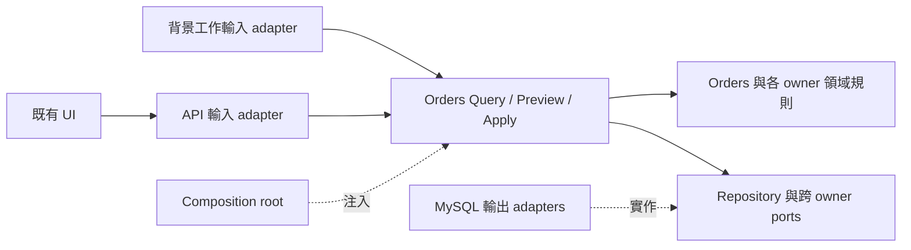
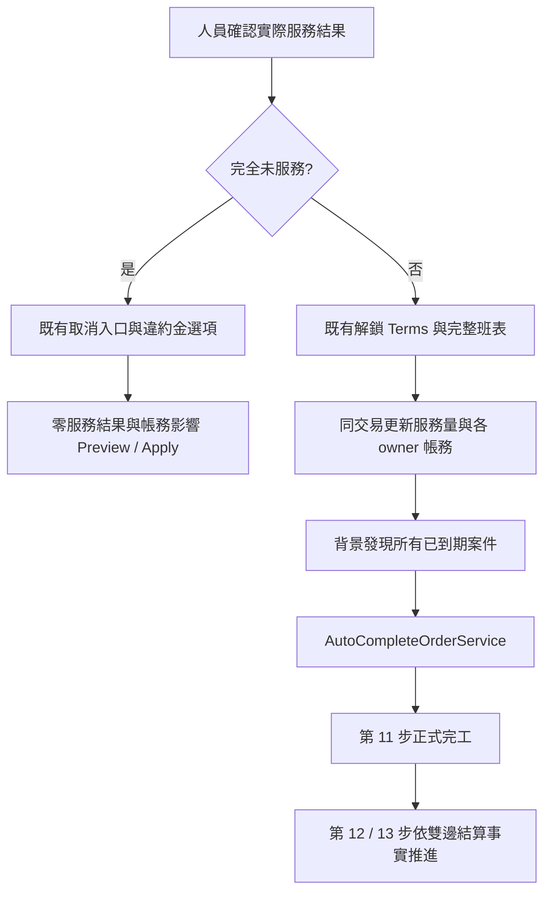

# Subsystem: orders

## Parent
- domain: `orders`

## Responsibility
將 Orders root facts 組成 read-only Query、zero-write Preview 與 fresh-lock Apply；負責 workflow composition，不重複定義 Domain rules。

## 分層與六角形邊界 ^orders-termination-design

結構採領域內核、應用流程與外層 adapters 的依賴方向。零服務終止沿用這些邊界，由 Orders 與帳務 owner 的既有命令保存結果。

| 層與角色 | 既有位置／介面 | 本次責任 |
|---|---|---|
| Domain 內核 | `domains/orders/` 與各帳務 owner | Orders 驗證成立歷程、零服務終止及完成條件；Client Finance、Payroll、Staff Payables 分別擁有各自義務與更正規則，無 UI、FastAPI 或 MySQL 依賴。 |
| Application／輸入 port | `subsystems/orders/` 的 Query／Preview／Apply、既有 Terms 與取消命令 | 編排有型別的領域結果、fresh-read／版本檢查與單一 outer UoW，不自行重定義金額或狀態規則。歷史零服務更正是受限業務意圖，不是任意狀態 setter。 |
| 輸出 ports | workflow 的 Repository／跨 owner typed 契約 | 定義必要的事實讀取、Scheduling replacement、帳務更正與狀態保存能力；子系統透過介面使用外部能力，沒有 raw SQL／row 穿透。 |
| Driving adapters | `api/`、`ui_react/`、durable job handler | UI 延用既有取消與 Terms 操作，傳送業務意圖並顯示正式讀回；背景 handler 呼叫唯一完工命令，不由排程器直接改狀態。 |
| Driven adapters／組裝 | `infrastructure/mysql/`、`api/dependencies/` | MySQL adapter 實作 ports，依 outer UoW 保存各 owner 結果；composition root 注入具體實作，adapter 不擁有業務裁決、hidden commit 或直接外部發送。 |

DB 讀取與持久化由 MySQL adapters 承接。`order_establishment_read_model.py` 從正式 lifecycle 事件及歷史採納關聯提供成立證據；`order_cancellation_read_model.py` 組成 typed owner facts，`order_cancellation_repository.py` 在 caller-owned UoW 保存 Orders 狀態、事件及收據，並委派各帳務 owner writer。Reporting 與看板使用各自的唯讀 adapters，不另保存統計 counter。



### 實作與驗證對應

- **既有能力**：Terms 解鎖／完整替代班表、跨 owner 交易、背景到期發現、`AutoCompleteOrderService` 及服務後結算入口均有 source mapping。這些 mappings 只證明位置，不代表本次案例已測試。
- [零服務取消分類](modules/cancellation.md#cancellation-unserved-design)、[歷史零服務更正](modules/historical-adoption.md#historical-unserved-design)與 [Reporting 分類](../../../global/subsystems/reporting/modules/weekly-operations-report.md#reporting-established-design)已有 Domain、workflow、MySQL 與 presentation 對應。`ESTABLISHED_UNSERVED` 是正式 lifecycle 值；schema part `1081` 對齊合法持久化狀態，實際資料庫啟用仍須依 migration 驗證入口確認。
- 看板的 `stage_projection_query.py` 與 `core_stage_filter_query.py` 消費 typed 狀態及原帳務 owner facts。「成立後未服務」有待退款、補收或既存月嫂更正時留在進行中，雙邊結清才歸已完成；抽屜保持此狀態、提供原帳務入口，不顯示服務流程的第 11～13 步。
- **既有流程的待驗情境**：[提前結束](modules/order-terms.md#terms-early-finish-design)修改後，由 [過期完工補抓](modules/lifecycle-authoritative-facts.md#completion-catchup-design)驗證昨日已結束仍能接續服務完工及雙邊結算。不得將該案例記為已有端到端證據。
- 實作 mapping 與驗證結果分開維護。下列 owner 測試入口核對實際行為；source mapping 不代表真實 MySQL、durable worker 或正式環境已驗收。



```yaml archmap-impact
- kind: implements_requirement
  source: orders-termination-design
  target: '.arch-map/requirements/01_Orders_Domain.md#^order-zero-service-termination'
- kind: implements_requirement
  source: orders-termination-design
  target: '.arch-map/requirements/01_Orders_Domain.md#^order-early-finish'
- kind: implements_requirement
  source: orders-termination-design
  target: '.arch-map/requirements/01_Orders_Domain.md#^order-completion-catchup'
```

## Modules
- `form-management-query` — 表單及身分統計的唯讀來源；path: `modules/form-management-query.md`
- `historical-adoption` — 既有 Order 的 historical workbook adoption／replay; path: `modules/historical-adoption.md`
- `historical-service-accounting` — 歷史逐月嫂服務天數、單薪帳務與跨 owner Q/P/A; path: `modules/historical-service-accounting.md`
- `historical-precision-restart` — 歷史未服務／服務中案件撤銷 current 服務根並回到正常訂單成立的單交易 Q/P/A; path: `modules/historical-precision-restart.md`
- `historical-adoption-presentation` — historical workbook typed API client／adapter 與狀態統計呈現; path: `modules/historical-adoption-presentation.md`
- `historical-stage-baseline` — 已採納歷史訂單的唯讀作業階段 baseline overlay; path: `modules/historical-stage-baseline.md`
- `actual-start` — Actual Start 正式服務日重建與跨 owner projection；path: `modules/actual-start.md`
- `service-date-confirmation` — 人工服務日期確認；Precision Restart 空 tombstone 時交由 Scheduling canonical writer 建立正式排班；path: `modules/service-date-confirmation.md`
- `official-service-date-correction` — 完工後正式排班日期更正、Scheduling 世代更換與 Orders 稽核事件；path: `modules/official-service-date-correction.md`
- `operational-stage-projection` — Orders 七階段唯讀投影；path: `modules/operational-stage-projection.md`
- `lifecycle-authoritative-facts` — lifecycle／自動完成所需的鎖定根事實；path: `modules/lifecycle-authoritative-facts.md`
- `historical-completion` — Orders-owned Step 11 cross-owner Query、typed referral及fresh settlement Preview／Apply; path: `modules/historical-completion.md`
- `historical-baseline-presentation` — Historical Operational Baseline唯讀Query的business-first presentation; path: `modules/historical-baseline-presentation.md`
- `historical-review-remediation-presentation` — 歷史訂單review更正的business-first呈現與技術詳情分層; path: `modules/historical-review-remediation-presentation.md`
- `order-card-projection` — Orders 管理端案件投影的 typed adaptation 與營運／技術資訊層級; path: `modules/order-card-projection.md`
- `service-completion-presentation` — Orders服務完成Preview／Confirm／Apply與closed business presentation; path: `modules/service-completion-presentation.md`
- `cancellation` — 訂單取消的跨 owner Preview／Apply 與 fresh readback；path: `modules/cancellation.md`
- `controlled-reopen` — 訂單受控重開的 Preview／fresh Apply／receipt；path: `modules/controlled-reopen.md`
- `terminal-closure-handoff` — terminal lifecycle event／receipt／outbox 的 LINE Identity typed handoff；path: `modules/terminal-closure-handoff.md`
- `order-information` — 既有案件訂單資訊的typed Query與管理端readback；path: `modules/order-information.md`
- `order-terms` — Orders Terms Query／Preview／fresh-lock Apply 與跨 owner 影響回執；path: `modules/order-terms.md`

## Dependencies
- outbound: `scheduling` — 服務日期／assignment 相關跨域協調只透過明確 contract。
- outbound: `anomalies` — owner result 可由 committed outbox 投影為 review/alert，不讓 Anomalies 改 Orders root。

## Contracts
- `domains/orders/` — Orders business rules
- `subsystems/orders/` — Orders workflows／queries
- `.arch-map/requirements/00_Global_共同契約.md` — outer UoW／receipt-outbox

## Verification routing
- default_boundary: Subsystem
- layout_status: `custom_current`
- test_root: `tests/domains/orders/subsystems/orders/`
- integration_root: `tests/domains/orders/subsystems/orders/integration/`
- integration_root: `tests/domains/orders/subsystems/orders/modules/historical-adoption/integration/test_wp80_disposable_mysql_e2e.py`（核對歷史採納、零服務更正、服務天數歸屬與完工後的帳務結果，以及週報 JSON／XLSX 和看板回讀。）
- integration_root: `ui_react/src/tests/domains/orders/subsystems/orders/modules/service-date-confirmation/order_workbench_v2_service_dates.test.tsx`
- integration_root: `ui_react/src/tests/write_readback_regression.cjs`
- integration_root: `ui_react/src/tests/orders_mutation_client.test.ts` — shared service-date／controlled-reopen typed API contract。
- integration_root: `ui_react/src/tests/orders_mutation_adapter.test.ts` — 既有服務日期／受控重開共用 adapter 的版本、指紋、冪等與回讀驗證。
- fixtures_root: `tests/fixtures/`
