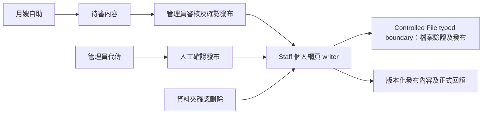

# Module: staff-roster-profile

## Parent
- domain: `staff`
- subsystem: `staff`

## Responsibility
提供選定單一月嫂的 bounded、authenticated 個人、聯絡與銀行帳戶投影及 owner-routed mutation；管理 UI 可讀完整身分證與緊急聯絡電話，但銀行帳號固定只讀末四碼，且不輸出 IP、LINE User ID 或 raw source。Staff Profile 與 Staff Bank Account 各自維持 version、Preview／Apply、稽核與 readback。

Staff 個人網頁擁有共用項目模板、待審照片及版本化發布。月嫂在原「我的資料」申請一併送件，管理員依目前版本裁切、退回或手動發布。客戶只看推薦授權範圍內的姓名與發布圖片。

## Implementation
- primary:
  - `subsystems/staff/summary_query.py`
  - `infrastructure/mysql/staff_summary_query_repository.py`
  - `api/schemas/staff_summary.py`
  - `ui_react/src/api/staff_directory/`
  - `ui_react/src/adapters/staff/staff_directory_adapter.ts`
  - `ui_react/src/components/StaffIdentityProvider.tsx`
  - `subsystems/staff/profile_query.py`
  - `domains/staff/profile.py`
  - `subsystems/staff/profile_workflow.py`
  - `subsystems/staff/profile_change_approval.py` — applies the reviewed Staff profile, bank and preference changes through one caller-owned transaction.
  - `api/dependencies/staff_profile_change.py`
  - `api/routes/staff_profile_change.py`
  - `infrastructure/redis/staff_profile_change_staging.py`
  - `domains/staff/web_profile.py`
  - `subsystems/staff/web_profile.py`
  - `api/dependencies/staff_web_profile.py`
  - `infrastructure/mysql/staff_web_profile_repository.py`
  - `api/routes/staff_web_profile.py`
  - `api/schemas/staff_web_profile.py`
  - `subsystems/line/staff_web_expiry_reminders.py`
  - `line/static/staff_profile_update.html`
  - `line/static/staff_profile_web_photos.js` — 原個人資料申請的批次照片、到期日與替換版本送件。
  - `line/static/staff_web_profile.html`、`line/static/staff_web_profile.js` — 客戶依推薦授權讀取姓名與已發布圖片。名冊同頁籤開啟時沿用管理端名冊讀取權限。
  - `ui_react/src/components/StaffProfileChangeReview.tsx`
  - `ui_react/src/api/staff/staff_web_profile_client.ts` — 模板、照片審核、資料夾 metadata、代傳發布與授權圖片的型別化傳輸。
  - `ui_react/src/components/StaffWebFileManagement.tsx`、`ui_react/src/components/StaffWebFileManagement.css` — 個人抽屜的「履歷網頁與照片」分組、資料夾、代傳與刪除確認。
  - `db/schema_parts/1085_staff_web_file_management.sql` — 目前內容關聯的移除時間與操作者。升級僅新增欄位，保留發布版本與受控檔案。
  - `ui_react/src/components/StaffWebProfileManagement.tsx`、`ui_react/src/components/StaffWebPhotoReview.tsx`、`ui_react/src/components/StaffWebProfilePreview.tsx` — 名冊「履歷網頁」、待審裁切及已發布預覽。
  - `infrastructure/mysql/staff_profile_mutation_repository.py`
  - `domains/staff/bank_account.py`
  - `subsystems/staff/bank_account_workflow.py`
  - `infrastructure/mysql/staff_bank_account_repository.py`
  - `infrastructure/mysql/staff_profile_query_repository.py`
  - `api/schemas/staff_profile.py`
  - `api/dependencies/staff_profile.py`
  - `api/dependencies/staff_registry_mutation.py`
  - `api/routes/staff.py`
  - `api/routes/staff_registry_mutation.py`
  - `api/schemas/staff_registry_mutation.py`
  - `ui_react/src/api/staff_profile/`
  - `ui_react/src/adapters/staff/staff_profile_adapter.ts`
  - `ui_react/src/pages/StaffPage.tsx`（含共用 `RosterTableLayout` 欄距、顯示與凍結排版，`lu.roster.layout.staff.v1`）
  - `ui_react/src/components/RosterTableLayout.tsx`、`ui_react/src/components/RosterTableLayout.css`
  - `ui_react/src/api/staff_registry/`
  - `ui_react/src/components/StaffRegistryEditor.tsx`
- entrypoint: `GET /api/v1/staff/{staff_id}/profile`
- entrypoint: `GET /api/v1/staff/roster` — 與單人 Profile 相同 reader；bounded cursor 批次個資／聯絡／銀行與服務接案主檔，一人一列，最多 200 人；借用 Qualification-owned 七 relation 與 care_babies 批次投影，查詢數不隨人數增加，保留 `/summaries` selector。
- entrypoint: `POST /api/v1/staff/{staff_id}/profile/{preview|apply}`
- entrypoint: `POST /api/v1/staff/{staff_id}/bank-accounts/{preview|apply}`
- entrypoint: `GET|POST /api/v1/admin/staff-web-profile/templates`、`PUT /api/v1/admin/staff-web-profile/templates/{item_id}`
- entrypoint: `GET /api/v1/admin/staff-web-profile/{staff_id}/folders`、`POST /{staff_id}/uploads`、`POST /{staff_id}/publications`、`DELETE /{staff_id}/folders/{template_item_id}/entries/{entry_id}`（同一 admin API prefix）。
- entrypoint: `GET /api/v1/admin/staff-web-profile/{staff_id}/website`、`GET /{staff_id}/website/images/{entry_id}/{version}`（同一 admin API prefix）。
- entrypoint: `POST /api/v1/line/staff-self-service/profile-change/{query|photos|submit}`
- entrypoint: `POST /api/v1/line/staff-web-profiles/{staff_id}/query`
- entrypoint: `GET /line-staff-web-profile` — 推薦訊息及 LIFF gateway 的客戶頁入口；頁面資料與圖片仍逐次經授權 API 讀取。

## Contracts
- 月嫂詳情提供 `#reports?staff_id=<canonical id>` 的表現分析捷徑，沿既有未儲存變更／busy navigation guard；分析屬 `global/reporting/staff-performance`，本頁不計算統計。
- 名冊先循既有 bounded Staff id cursor 讀取全部頁面，再以公會編號自然升冪呈現；未設定排最後、相同比較以 id 穩定排序。`staff_directory_adapter.ts` 共用排序與「公會編號 姓名」顯示，排班與候選呈現借用此規則，不改 Staff identity 或 writer。
- `StaffIdentityProvider` 在 authenticated 管理頁共用 bounded 摘要全頁讀取，只保留 id／姓名／公會編號，以 canonical id 提供標籤與選單排序；離頁中止讀取，錯誤可重讀，不以姓名比對或保存跨 session 快取。案件、財務、歷史帳務與 LINE 管理借用此唯讀 presentation，不改人員或段落命令。
- 名冊主頁預設「現役月嫂」，以「已退役月嫂」分頁分開呈現；`/roster` optional `lifecycle_state=active|retired` 在 cursor／limit 前依 Staff-owned lifecycle 篩選，省略維持原查詢，不增加回應欄位或逐人查詢。退役／復職的正式 readback 同步移除原分頁清單列；搜尋與排序沿用目前分頁。
- `/summaries` 同樣支援 optional `lifecycle_state=active|retired`，供排班及代班的新選項使用 active；省略仍保留全部人員，`StaffIdentityProvider` 不套用篩選，以保留歷史案件的退役人員名稱與公會編號。
- 既有 PDF 履歷沿受控檔案保存、版本管理與管理者下載。客戶確認使用個人網頁連結。姓名取自 Staff Profile，照片取自 Staff 個人網頁的目前發布版本。到期提醒由 LINE durable delivery 投遞。
- 規格 33 §3.2：Staff Profile 擁有 nullable `union_no`，以完整 binary 字串唯一性提供人工公會編號；不取代 Staff id／cursor。主頁使用表格列選取與公會編號搜尋，成功 Profile readback 同步清單。重複與 MySQL 編號更新死結分別為 typed `staff_union_no_collision`／`staff_profile_concurrent_conflict`，沿用既有 version／event／receipt／UoW。
- `.arch-map/requirements/24A_Staff_Roster_Case_Preference_Read_Model正式補充契約.md` §2.1
- `.arch-map/requirements/33_案件與月嫂整合名冊正式規格.md`
- `.arch-map/requirements/35_月嫂個人網頁與照片審核發布正式規格.md`
- Profile、Bank Account 與資格修改皆為一次點擊儲存；`reason` 為選填備註，省略預設空字串。內部仍使用既有 Preview／Apply，保留 actor／before／after／receipt／idempotency，無人工預覽或核對勾選門檻（Global §2.4）。

## Confirmed design / implementation gaps

以下是已確認設計，個人抽屜的 metadata-only 清單、代傳、刪除及其他類別每項唯一目前發布照片仍須與現有實作對齊。規則及驗收見[規格 35 §5](../../../../../requirements/35_月嫂個人網頁與照片審核發布正式規格.md#5-畫面設計邊界)、[STAFF-WEB-05](../../../../../requirements/35_月嫂個人網頁與照片審核發布正式規格.md#25-後台檔案管理staff-web-05) 與 [AC-13 至 AC-16](../../../../../requirements/35_月嫂個人網頁與照片審核發布正式規格.md#4-驗收標準)。

名冊抽屜和資料夾查詢只將必要 metadata 傳給 presentation，不傳照片 bytes；代傳選檔也不載入圖片供預覽。獨立審核保留按需原圖及裁切。月嫂自助申請受理後形成待審內容，不直接發布；管理員審核並確認發布後，才由共用的 Staff 個人網頁 writer 更新客戶可見狀態。管理員代傳須經人工確認發布，資料夾刪除須經確認，兩者使用同一 writer。writer 使用 typed owner／reference IDs、actor 與版本，經 Controlled File typed boundary 驗證及發布檔案，寫入版本化發布內容並回讀正式結果。刪除移除目前內容關聯，不代表刪除實體 bytes。每次 mutation 只有一個 outer commit owner。資料夾的實體儲存、資料表及新 API 命名不在此定義。

## Verification
- layout_status: `custom_current`
- test_root: `tests/domains/staff/subsystems/staff/modules/staff-roster-profile/`
- test_root: `ui_react/src/tests/domains/staff/subsystems/staff/modules/staff-roster-profile/`
- routing: `.arch-map/tests/domains/staff/subsystems/staff/modules/staff-roster-profile.md`
- integration_root: `tests/test_staff_summary_query.py` — 既有 bounded summary projection 契約。
- integration_root: `tests/test_staff_summary_routes.py` — 既有 authenticated cursor route 契約。
- integration_root: `ui_react/src/tests/staff_directory_adapter.test.ts`
- integration_root: `ui_react/src/tests/staff_directory_client.test.ts` — 既有模擬案例核對分頁游標未前進時拒絕結果，不自動重試。

## Change triggers
Reconcile when Staff personal-profile or bank-account fields, complete-value boundary, authenticated entrypoint, UI consumer, or test roots change.
