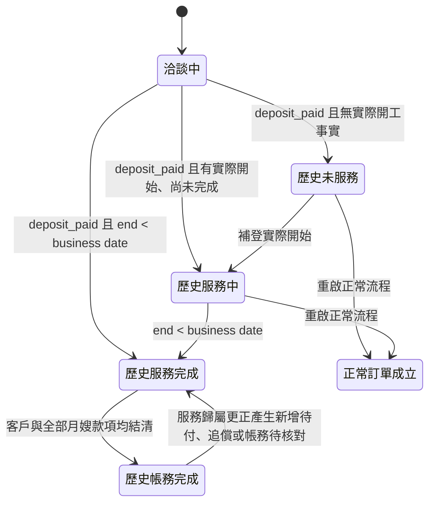

# 歷史訂單生命週期與服務天數帳務正式規格

## 1. 文件邊界與所有權

- 狀態：`current-spec`
- Owner：Orders（歷史採納與生命週期分支）／Client Finance・Payroll・Staff Payables（原帳務承接與差額更正）
- 單一負責範圍：Historical Orders workbook 採納規則、Orders 歷史生命週期分支、歷史實際服務天數與樓層費更正規則、歷史帳務承接、結清投影與重啟正常流程契約。
- 關聯引用：見 [Global 共同契約](00_Global_共同契約.md)、[Orders Domain](01_Orders_Domain.md)、[Client Finance Domain](04_Client_Finance_Domain.md)、[Global Migration 與 Cutover](10_Global_保留資料Migration與Cutover_Subsystem.md)、[Staff Payables 與 Client Refund](16_Staff_Payables與Client_Refund正式規格.md)、[銀行流水對帳與手動補登](22_銀行流水匯入與帳務異常處理正式規格.md)、[案件與月嫂整合名冊正式規格](33_案件與月嫂整合名冊正式規格.md)

本文件不改變既有 Domain owner：Orders 擁有 lifecycle 與歷史訂單來源採納，Scheduling 擁有逐日服務日期與歷史指派服務時段，Payroll 擁有月嫂義務，Client Finance 擁有客戶義務與核銷，Staff Payables 擁有月嫂出款與結清。跨 Domain mutation 由單一 application workflow 擁有 outer Unit of Work。

## 2. 目標與非目標

- **目標**：(1) 將可辨識舊系統訂單推進至明確歷史生命週期分支；(2) 歷史案件採納時承接可證實的原帳務與原有效付款條款；(3) 實際天數與登記天數不同時由人員透過「歷史訂單實際服務天數設定」建立新版天數並交原 owner 更正差額；(4) 只有客戶與全部月嫂款項實際結清後才進入 `historical_accounting_completed`。
- **非目標**：不以 `actual_service_days` 反推或偽造逐日 `staff_schedule`；不由歷史狀態偽造銀行流水或日期；不允許 UI 傳入任意 target status／費率／金額；不以重啟精算覆蓋既有義務或付款證據。

## 3. 名詞與根事實

### 3.1 歷史生命週期狀態

| 穩定識別 | 顯示文字 | 意義 |
|---|---|---|
| `historical_unserved` | 歷史訂單－未服務 | 斷言訂金已付，但無可採納的實際開工事實 |
| `historical_in_service` | 歷史訂單－服務中 | 已有實際開始事實，尚未到達歷史完成條件 |
| `historical_service_completed` | 歷史訂單－服務完成 | 歷史結束日嚴格早於目前 business date；原帳務依 §6 承接，缺項待確認 |
| `historical_accounting_completed` | 歷史訂單－帳務完成 | 歷史服務天數已確認，客戶與全部月嫂款項均已實際結清 |

整份與逐列匯入暫存於本次操作結束後清除，依 [01A §4.1 六欄來源與同檔重匯／檔外取消](01A_訂單看板與事前日期及歷史採納規格.md#41-六欄來源與同檔重匯檔外取消hist-import-0104) `HIST-IMPORT-03` 不保留永久快照。讀寫來源的切換與既有舊快照的清除另依 §10.2，不是本次暫存清理。

### 3.2 歷史服務天數事實與訂金斷言

- `HistoricalActualServiceDayCountFact` 以案件及採用版本保存，包含各歷史 assignment 的 `staff_id`、指派識別與正整數 `actual_service_days`，以及操作人、原因、版本、來源證據、事件與收據。未有採用版本時以原登記服務量及採納指派為基準。此事實供歷史帳務計算。總量與人員歸屬依 §6.3 更正，檔期占用依 [Scheduling 月曆規格](02_Assignments_Scheduling_Domain.md#31-同日分時占用與甘特月曆shift-0105)。
- `historical_deposit_paid_assertion` 僅供 Orders 進入歷史分支，不等於 Finance Import bank fact；客戶帳務結清仍只由 Client Finance ledger／allocation 或其 Historical Payment Evidence／Settlement 決定。
- 已確認終止且完全未服務的歷史案件，整案零服務事實依 [歷史零服務更正](#historical-unserved-correction) 保存，不以各 assignment 的正整數天數設定冒充零日；後續讀取不得因沒有正整數天數而回退採用原登記服務量。狀態語意由 [Orders](01_Orders_Domain.md#order-zero-service-termination) 擁有；「歷史訂單－未服務」仍表示尚未開工，不等於已終止。

## 4. Workbook 列分類與採納

每一來源列只可得到下列其中一種結果：

1. `not_adopted`：來源案號／狀態空白、舊系統取消不需補建，或無法唯一命中既有 Order → 0 Domain write、0 review，回傳筆數供核對。非空無效狀態、日期反轉、同名不唯一或來源班次衝突分別保留可區分的原因，錯誤碼見 §9。六欄採納依 [01A §4.1](01A_訂單看板與事前日期及歷史採納規格.md#41-六欄來源與同檔重匯檔外取消hist-import-0104)，班次衝突依 [01A §4.2](01A_訂單看板與事前日期及歷史採納規格.md#42-同日分時衝突與歷史警示修復hist-shift-01historical-order-001) `HIST-SHIFT-01`；檔案層級失敗全檔零寫入，任一寫入失敗整檔回滾。
2. `matching_pending_deposit`：洽談中、月嫂唯一且開始日空白 → Orders 維持 `洽談中`，Matching 推進為「配對中、未付訂金」，不寫實際日期或帳務。
3. `historical_unserved`：斷言 `deposit_paid`，且開始日空白或等於 `planned_start_date` → 維持 `actual_start_date`/`actual_end_date` 為 `NULL`。
4. `historical_in_service`：斷言 `deposit_paid`，開始日不等於 `planned_start_date`，且結束日空白或 `>= BusinessClock.today()` → 寫入 `actual_start_date`（及可解析的 `actual_end_date`）。
5. `historical_service_completed`：斷言 `deposit_paid`，開始日不等於 `planned_start_date`，結束日有效且嚴格小於系統日（`source_actual_end_date < BusinessClock.today()`）→ 直接保存來源實際起訖。

`historical_accounting_completed` 不是匯入結果，僅由 §7 結清投影產生。

## 5. 歷史生命週期轉換

任何 caller 不得直接提交 target status。歷史服務完成後不倒退為服務中；天數或帳務差異依 §6.3 發起更正。

## 6. 歷史帳務承接與更正

### 6.1 匯入承接原帳務

採納時承接可證實的原訂金、第一期、第二期、月嫂應付、退補助款及既有收付核銷關聯，並沿用原身分防重匯重複建帳。採納為歷史服務完成、歷史服務中推進至服務完成，或對既有歷史服務完成案件重新同步時，將已採納的月嫂指派及歷史工作簿結束日交由 [Payroll §3.2](03_Payroll_Domain.md#32-未核銷重建與已核銷追加rebuildpayrollforcase) 同步月嫂應付。同檔重匯須納入應付同步結果判定資料是否一致。歷史匯入結果分開列出已採納但月嫂應付略過的案件與原因。歷史服務完成採納及服務中推進至完成時，Client Finance 依現行方案、實際墊款與完工日期檢查是否建立客戶補助退款。客戶端只承接可證實原款項，禁止依歷史身分、登記天數或整案總額另建基準應收或重建一般分期。

### 6.2 原帳務資料不完整處理矩陣

| 來源情況 | 處理方式 |
|---|---|
| 期款與收款歸屬可證實 | 依原應收及有效已收款計算餘額。 |
| 收款可證實，期別待確認 | 保留原收款及來源；依 [銀行流水對帳與手動補登](22_銀行流水匯入與帳務異常處理正式規格.md) 能唯一配對時核銷，其餘待人員確認分配。 |
| 只有整案總額，缺少原期款紀錄 | 總額供查閱，無法證實的期款維持待確認；證據顯示未分期時依原款項處理。 |
| 只有舊「已付」標記或來源矛盾 | 保留標記與衝突證據，受影響款項列待確認；依 [Client Finance Domain](04_Client_Finance_Domain.md) Historical Payment Evidence／Settlement 確認。 |

人員可從案件帳務「待確認」開啟同案同款查核入口，依 [手動補登 §6](22_銀行流水匯入與帳務異常處理正式規格.md#case-manual-accounting-supplement) 或 Client Finance／Staff Payables 歷史付款證據契約查核原收付款。月嫂應付缺項依 [Payroll §3.2](03_Payroll_Domain.md#32-未核銷重建與已核銷追加rebuildpayrollforcase) 查核計算來源與同步結果。

歷史案件的免自備判定依 [全額補助免自備例外](22A_案件帳務三方案與補助流向正式規格.md#full-subsidy-no-advance) 唯讀呈現。能證實免自備，不等於可新建歷史期款、推定舊帳已付或通過第 11 步。正式舊應收、收款、未分配收款、核銷／沖正、有效人工更正及歷史付款證據優先保留；來源未知或不相容時列明缺項或衝突，不以免自備覆蓋原值。期款依原款項身分逐筆顯示，同期多筆不合併；無期別證據時保留未知，無原期款時不補造三列。

#### 6.2.1 歷史成立後未服務的更正入口 ^historical-unserved-correction

管理人員可對目前取消或原允許更正的歷史狀態，選擇「成立後未服務」，明確確認本案曾成立且完全未服務。系統不要求先有歷史採納、原成立或未服務證據；既有服務痕跡、缺失、矛盾及舊款項待查核均顯示為非阻擋核對提示，由人員判斷。原因及證據來源選填，不要求外部證明。普通取消及已有服務的提前完工仍依原規則處理。

Query 顯示現有事實、帳務及核對提示，Preview 列出更正結果及金額。Apply 必須有明確零服務確認，依 current owner versions 與 Preview 核對，在單一 outer UoW 保存 Orders 更正事件、操作人員本次確認及各 owner 帳務結果，不假造歷史採納收據。保留權限、技術完整性與資料庫錯誤檢查；版本過期回 typed stale conflict，同命令重播回原結果。任何實際寫入失敗均整筆回滾，不吞衝突或提交部分結果。數字真正無效等技術損壞不得猜測，也不得增設業務阻擋。

零服務結算取服務應付 `S = 0`，以有效淨實收 `R` 與原違約金 `F` 計算應退款 `max(0, R - F)` 或應補收 `max(0, F - R)`，由 [Client Finance §3.2](04_Client_Finance_Domain.md#client-cancellation-settlement) 承接。原待收服務期款退出待收，錯誤未付薪資取消，已付薪資依原差額與追償規則處理。原銀行流水、實收實付、核銷及不可變歷史事件均保留，不造款或虛構配對；未配對或舊標記不阻擋更正，後續對帳明細由人員確認配對。既有待退款或待補收可辨識時，由原 owner 調整差額；來源未明的舊差額保留，預覽與收據明示退款／補收目標尚待人工核對，不另建可能重複的款項，同筆交易仍同步可確認的零服務帳務。不得為重算刪除真實服務事件或現金；原日班依既有 writer 退役並保留歷史。原取消結算已正確者不重複退款。

週報將取消數減一、成立數加一，服務天數為零；同命令重播不得重複計數。同檔重匯不得覆寫更正或恢復原登記服務量，來源衝突交人工核對。

| ID | S 情境與前提 | T 使用者任務 | A 可重現操作 | R 可判定結果 |
|---|---|---|---|---|
| HIST-UNSERVED-01 | 歷史案目前為取消，缺少成立或未服務證據。 | 更正為成立後未服務並核對帳務。 | 管理人員查詢、預覽，明確確認曾成立且未服務後 Apply，再讀回。 | 缺口列為非阻擋提示；狀態為成立後未服務、服務天數為零；週報取消減一、成立加一，原款項可追溯。 |
| HIST-UNSERVED-02 | 歷史案有服務痕跡、錯誤服務期款或月嫂應付，部分已核銷或待配對。 | 確認更正並同步帳務。 | 查看非阻擋提示、預覽差額及追償，確認零服務並 Apply，再以同命令重送。 | 期款退出待收、未付薪資取消，已付依差額與追償處理；原服務事件、收付與核銷保留，待配對交人員確認；重送不重複立款、退款或計數。 |
| HIST-UNSERVED-03 | 歷史案可更正，但未確認零服務、操作者無權限或 Preview 後版本已變更。 | 避免未授權或過期的更正。 | 分別在缺少確認、無權限或版本變更後送出 Apply。 | 各次均拒絕，版本變更回 typed stale conflict；狀態、服務與帳務無部分寫入。 |
| HIST-UNSERVED-04 | 零服務更正已完成，工作簿保留原日期或狀態。 | 重新匯入來源。 | 同檔重匯並讀回案件與帳務。 | 更正不被覆寫，不恢復登記服務量或重建義務；衝突交人工核對。 |

### 6.3 人工發起服務天數更正與已結案樓層費／個案計價更正

- **服務天數更正**。依有效歷史指派與來源證據驗證各人正整數天數，重算總額與原帳務比較，差異由各帳務 owner 正式更正流程承接。以新義務取代原期款時原列退出待核銷，原收付款仍可追溯。
- **已結案樓層費更正**。歷史服務完成或帳務完成案件以 Terms `floor_fee_correction=true` 發起更正。樓層費沿用既有服務量按歷史服務天數比例計算。有正式採用的歷史服務天數更正時讀取其結果，其餘沿用 HCM 登記的原契約服務天數與每日時數。Preview 綁定本次採用的服務量及其 revision，更正流程不重算實際工時或重建逐日班表。
  - **客戶訂金**。一般市民、補助市民、原住民與非市民皆由 Client Finance 依客戶應收資料獨立承接樓層費差額。已有唯一原訂金時更正其有效應收金額，已結清訂金的差額保留對原訂金的來源關聯。沒有原訂金且差額為正時建立一筆訂金應收，沿用已保存的訂金期限，缺期限時留空。原收款及核銷紀錄保留，客戶名冊於儲存後讀回正式訂金應收總額。入款依選定的訂金應收明細獨立核銷。儲存與核銷皆不以月嫂指派、應付筆數、付款或結清狀態為前置條件。
  - **月嫂應付**。月嫂應付由 Payroll 依正式計薪與金額更正流程處理，並依各筆出款獨立核銷。應付缺漏或歸屬疑義在月嫂帳務查核；整案結清依 §7 判定。
- **個案計價更正**。以個案計價 Apply 更正個案補助時數或費率，依有效歷史指派及已採用服務量計算。客戶價格差額更正最後一筆有證據的原期款，較大減額再向前分攤。月嫂應付沿 Payroll 金額更正，已付義務的差額保留原來源關聯。缺少可證實的原期款、原應付或各人服務量歸屬時阻擋。原期款身分、期限及逐日排班維持原狀。

#### 6.3.1 歷史服務歸屬與後續排班

- 六欄採納保存歷史指派及可證實的起訖、時段與服務量。歷史服務中、服務完成或帳務完成案件按各月嫂天數證據更正服務歸屬，保存原指派、新分配的各人天數及來源，並按人拆應付。整案服務量以已採用的天數為準，缺採用版本時取原登記服務量。起訖、時段和天數不得用來推算或補造逐日班次，畫面顯示「未建立排班」。
- 歷史服務中需要調整後續排班時，工作台引導經辦依 §8 核對重啟資格。符合資格並重啟後，在一般訂單建立正式班表，後續交接、代班與完工後班表更正均依 [Scheduling 多月嫂調整](02_Assignments_Scheduling_Domain.md#multi-caregiver-service-correction) 的一般案件條件辦理。
- 歷史服務歸屬更正成功後，薪資同步與帳務完成查詢讀取已採用的各人服務量及義務來源。費率依 [Payroll 服務歸屬更正](03_Payroll_Domain.md#service-attribution-payroll-correction) 決定。只有歷史結清紀錄、原實付或核銷來源尚待核對時，同交易保存正式天數及帳務待核對，紀錄綁定案件、更正收據、受影響人員與缺項。補證後沿原更正重讀原核銷、預覽及確認差額，與待核對完成狀態同交易保存，依更正收據及接續命令防重。同檔重匯須保留已採用更正及原付款連結，遇到新來源與更正事實衝突時交人工核對。

#### 6.3.2 歷史服務完成後更正案件資料

- 適用於「歷史訂單－服務完成」。管理人員可在原案更正胎數（單胞胎／雙胞胎）、實際起訖日、服務時段和每日時數，並調整既有個案計價的費率或補助時數。不因完工或服務鎖而拒絕上述歷史更正；不解除一般服務鎖、不重跑進件或重啟、不改已採用的完工事實。此例外不擴張一般訂單、歷史服務中、取消或歷史帳務完成的既有可編輯範圍；原有樓層費、天數與服務歸屬入口保留。客戶身分與補助資格更正不在此契約內。
- 胎數由 BeClass 有效值更正，保留原來源。實際服務資料由 Orders 依已採納的指派更正；有多位月嫂時按各人可確認的服務事實處理，不把整案日期或時數猜分給各人，也不重建逐日班表。更正使用現有名冊／帳務入口，顯示更正前後與所影響的帳務；Preview 不寫入。
- 更正後依可證實的歷史服務量與適用費率分開預覽客戶應收、逐人月嫂應付及補助差額。有原帳可追溯時由原帳務 owner 寫入差額，不覆寫原收付、核銷、已保存日期或費率快照。已證實免自備而無原客戶期款，不因缺期款而擋住月嫂或補助端，也不補建客戶期款。缺少或無法唯一辨識原帳時，已確認的更正及可獨立確認的帳務部分仍可保存；缺證據的部分列具體待核對，不列為重算成功，也不猜金額或收付歸屬。
- Apply 重讀版本，以同一外層交易保存更正、可確認的差額及待核對結果。相同命令重送不重複更正或建差額。待核對沿既有歷史帳務流程接續，不自動退款、出款、通知或結清。

| S 情境 | T 任務 | A 操作 | R 驗收結果 |
| --- | --- | --- | --- |
| 歷史服務完成，已鎖且有原帳 | 更正胎數 | 從名冊或帳務抽屜預覽、確認、重開原案 | 兩入口回讀同一有效胎數；原狀態、班表、已收付及核銷不變；適用差額可追溯 |
| 歷史服務完成，多月嫂，免自備且無客戶期款 | 更正已確認的實際時數和計價 | 分別預覽各人服務量及應付；確認後重送相同命令 | 有依據的逐人差額一次入帳；不補造班表或客戶期款；來源不明的一側列待核對 |
| 一般已開始服務、歷史取消，或預覽後版本變更 | 防止例外擴散或覆寫新資料 | 用同一更正入口嘗試 Apply | 非適用狀態或版本衝突拒絕；無部分寫入 |

### 6.4 基準應收與原期款並存處理

經來源與核銷關係證實為同一筆債權時，以可證實原分期及有效已收款認定餘額，由 Client Finance 將重複基準應收退出待核銷；未證實前並列待確認。

## 7. 帳務完成投影

`historical_accounting_completed` 須同時滿足：(1) 目前為 `historical_service_completed`；(2) 每位有效歷史 assignment 的應付具可證實原帳務或 [Payroll 計算依據](03_Payroll_Domain.md#22-薪資計算公式與整數守恆)；(3) Client Finance 所有應結清款項餘額為 0；(4) Staff Payables 所有應結清款項餘額為 0，且本次更正產生的追償均依正式規則完成；(5) 不存在未解資料缺項、歸屬、金額、版本、退匯／沖正或核銷疑義。Orders 依雙邊 typed settlement facts 投影。

原已帳務完成案件若服務歸屬更正產生新增待付、追償或帳務待核對，Apply 同交易保存帳務重開事件，回到 `historical_service_completed` 待結清，保留原服務完工與前次結清事件。更正未產生任何待處理事項時維持帳務完成。未完成的帳務待核對阻擋再次結清。補證與款項處理依 [服務歸屬更正交易契約](02_Assignments_Scheduling_Domain.md#multi-caregiver-service-correction) 辦理，滿足本節條件後重讀雙邊證據並追加新的結清事件。

## 8. 重啟正常流程

- **適用範圍**：「重啟精算天數」只供 `historical_unserved`／`historical_in_service` 回到正常 `訂單成立`。原月嫂須能由歷史採納證據唯一確認。已達 `historical_service_completed` 的案件改走 §6.3。
- **沿用既有方案**：Preview 核對同案有效媒合方案。若僅有一筆，且狀態為 `proposed`、只有一個分段、分段月嫂等於原月嫂、方案及分段期間均等於目前 Orders 預定期間，且方案沒有客戶決定、已收回的客戶契約或有效等待訂金鎖，則沿用原方案及分段 ID。歷史採納證據只用於確認原月嫂與追溯來源。
- **沒有有效方案**：沿用一般案件的 `caregiver_matching_plans` 與 `caregiver_matching_plan_segments`，以目前 Orders 預定期間建立一筆有效 `proposed` 方案及原月嫂的單一分段。停用方案保留供追溯。沿用既有資料庫結構、狀態與欄位，且不新增客戶接受、契約、核銷或等待訂金鎖事實。
- **既有方案衝突**：同案有多筆有效方案，或唯一有效方案不符合上述沿用條件時，回 `historical_precision_restart_matching_plan_conflict`，附可辨識的方案與衝突原因。保留原方案、事件、訂金鎖、班表和訂單狀態，不自動覆蓋、停用、另建方案或解鎖。工會人員先在既有媒合或相關作業入口核對並依其規格處理，再重新 Preview。若沒有適用的既有處理入口，維持阻擋。Preview 後方案、版本、分段或相關決策事實改變時，回既有 stale conflict 並重新 Preview。
- **重啟交易**：Apply 在單一交易內重新讀取並鎖定 Orders、Scheduling、歷史天數 revision 與有效方案事實，完成方案沿用或建立，撤銷原有效排班與已確認服務日期，建立無正式服務日的 tombstone generation，清空 current `actual_start`／`actual_end`，並回到 `訂單成立`。既有 `orders_historical_precision_restart` 事件的 `facts_snapshot` 保存方案及分段 ID、方案版本和採納來源。任一步失敗全數回滾，同一操作重送回原收據。
- **工作台與正式排班**：重啟成功後，工作台顯示所綁定方案分段的原月嫂及「待建立正式排班」。工作台與排班 Preview／Apply 均以該同一筆有效方案及分段為人員來源。若方案已停用、替換或與重啟綁定不一致，顯示衝突並阻擋儲存，不能另選人或從歷史證據另取人員。六欄缺固定排休時 UI 預設載入 `週休1日` 供覆寫。工作台操作與正式排班提交依 [規格 01A §3.2](01A_訂單看板與事前日期及歷史採納規格.md#32-confirm-service-dates-與休假覆寫契約)。既有 Client Finance／Payroll 金額不因重啟或此正式排班而新增或重算。
- **訂金與服務中**：訂金鎖沿用現行取得、釋放與占用規則。重啟綁定與 `proposed` 本身不構成取得鎖的條件。正式安排完成且已有 Actual Start Apply、`actual_start_date <= BusinessClock.today()` 時，依既有歷史重啟例外直接進入 `服務中`，訂金核銷或契約完成事件缺漏不阻擋，也不補造該等事實。

### 8.1 歷史案件接續通知的責任分界

- `historical_unserved`／`historical_in_service` 依本節重啟後，以實際開始日已經正式確認且已有有效正式排班，作為接續訂單後續通知流程的資格。只有歷史匯入、採納、重啟為一般訂單、保存日期或建立空 tombstone generation，均不構成此資格。
- 符合接續資格的案件不得只因曾採納為歷史訂單而排除後續流程。客戶尚未綁定 LINE 時，通知事項提供人工聯絡、提醒加入官方帳號及完成身分綁定的處理入口；完成綁定後接續各通知 owner 的原流程。Orders／Scheduling 提供正式日期、排班及歷史重啟事實；LINE 擁有綁定待辦、收件資格與投遞；帳款及餘額仍由 Client Finance 擁有，不補造契約、核銷或付款事實。
- 接續資格成立時已逾期的原有款項只列內部帳務待辦，由人員核對後決定是否催繳；不得因大量匯入、採納或完成正式排班而自動補發這些款項的首次提醒或逾期補寄。接續後新發生的通知及款項到期依各 owner 的原規則處理，不重播已過去的開工或其他流程事件。
- `historical_service_completed`／`historical_accounting_completed` 不納入此通知接續流程，不要求客戶為此補加入官方帳號。既有歷史帳務核對、服務歸屬更正與結清流程仍依本規格辦理。
- 本節只界定由歷史案件接續的訂單後續流程，不以正式排班限制一般案件原有的事前通知、月嫂資料異動或身分申請審核。

## 9. API、管理 UI 與失敗語意

- **管理端操作入口**：歷史訂單實際服務天數設定與重算內嵌於「客戶名冊」詳情抽屜（`ClientRegistryDetailEditor`）案件帳務區塊（見 [案件與月嫂整合名冊正式規格](33_案件與月嫂整合名冊正式規格.md)）。銀行對帳的「調整本案帳務參數」抽屜為「歷史訂單－服務完成」案件提供同案操作入口，沿用相同天數確認流程，成功後重新讀取本案帳務與原流水的核銷候選。「重啟正常流程」位於訂單工作台。客戶名冊一律以同一 Scheduling Assignment Plan Query 讀取有效歷史指派（無逐日排班時顯示「未建立排班」）。
- **API 與並行保護**：Query／Preview／Apply 採 PreviewFingerprint、expected versions 與 idempotency，UI 不計算金額或狀態；Query／Preview 回傳歷史狀態、起訖、原／確認天數、服務工時、樓層費、雙邊金額與狀態、blockers、versions 與 fingerprint。
- **Typed errors**：`historical_order_source_status_invalid`、`historical_order_date_range_invalid`、`historical_order_staff_not_unique`、`historical_order_source_schedule_conflict`、`historical_order_lifecycle_transition_invalid`、`historical_actual_service_days_required`、`historical_actual_service_days_invalid`、`historical_actual_service_days_assignment_mismatch`、`historical_actual_service_days_candidate_stale`、`historical_accounting_obligation_binding_invalid`、`historical_client_settlement_incomplete`、`historical_staff_settlement_incomplete`、`historical_accounting_completion_blocked`、`historical_precision_restart_not_eligible`、`historical_precision_restart_candidate_stale`、`idempotency_conflict`、`transaction_failed`。

## 10. 驗收標準與資料遷移邊界

### 10.1 核心驗收情境

1. **核對歷史工作簿的採納結果**：匯入包含空白案號／狀態、洽談且月嫂唯一但未提供開始日，以及能唯一定位既有訂單、其他欄位有效且訂金斷言成立的來源列。對照匯入結果與訂單：空白案號或狀態的來源列為 `not_adopted`、計入未匯入且未新增或改寫訂單／帳務；洽談列維持洽談配對中，不建立實際日期或帳務；訂金斷言成立的列依 §4 的日期分支進入未服務、服務中或服務完成。已有實際開始且結束日等於業務日者仍為服務中，只有 `source_actual_end_date < BusinessClock.today()` 才因該結束日判定服務完成。
2. 採納承接可證實原帳務，0 新客戶基準應收、0 逐日服務日；月嫂應付符合 [Payroll §3.2](03_Payroll_Domain.md#32-未核銷重建與已核銷追加rebuildpayrollforcase)；原期款／收款明確者正確扣抵餘額，缺項待確認、不補造或推測已結清；同檔主動重匯依 [01A §4.1](01A_訂單看板與事前日期及歷史採納規格.md#41-六欄來源與同檔重匯檔外取消hist-import-0104) `HIST-IMPORT-01～04` 原子更新與檔外取消並清除暫存。
3. 天數更正與已結案樓層費／個案更正不重建逐日班表，由原 owner 承接差額且新義務取代原期款時保持原收付追溯；雙邊結清且無疑義才進 `historical_accounting_completed`。
   - 歷史服務中與完工案按各人天數拆應付，班表仍顯示未建立，確認零新增逐日班次。歷史服務中需調整後續排班時，工作台顯示重啟資格或阻擋原因。符合資格並重啟、建立正式班表後，從一般訂單辦理符合其條件的交接、代班或完工後班表更正。
   - 已帳務完成案產生待付、追償或帳務待核對後回到待結清，原完工與前次結清事件可查。補證前可讀回已生效的各人服務天數，未有新待付或追償寫入。補證確認後按來源處理款項，同鍵重送不重複立款。雙邊結清、追償清償及待核對完成後可再次結清。更正無待處理事項時維持帳務完成。
4. 重啟沿用符合條件的方案及分段 ID，無有效方案時只建立一筆 `proposed` 方案及原月嫂分段。重啟後清空先前日期與有效排班，工作台與正式排班讀到同一方案分段的月嫂。班表儲存驗收依 [規格 01A §3.2](01A_訂單看板與事前日期及歷史採納規格.md#32-confirm-service-dates-與休假覆寫契約)。
5. 不同月嫂、期間不符、狀態不符、多筆有效方案或已有上述決策／契約／鎖事實時，重啟回方案衝突且零寫入。Preview 後方案被變更時回 stale；重啟後綁定失效時阻擋正式安排。全程不補造客戶接受、契約或訂金事實，既有帳務金額及訂金鎖規則維持，符合 §8 的重啟案可進入 `服務中`。

### 10.1.1 歷史案件通知接續驗收

| ID | S：情境與前提 | T：人員任務 | A：操作 | R：可判定結果 |
|---|---|---|---|---|
| HIST-NOTIFY-01 | 歷史未服務／服務中案件已重啟，尚無有效正式排班 | 接續本案服務流程 | 僅儲存實際開始日，再查通知事項及執行通知排程 | 不因日期或重啟狀態而啟用本案後續通知，沒有新增對外寄送工作 |
| HIST-NOTIFY-02 | 同類案件的實際開始日已正式確認且已有有效正式排班，客戶未綁定 LINE | 請客戶加入官方帳號並接續流程 | 查詢通知事項，開啟人工綁定提醒；完成綁定後重新查詢 | 有本案人工聯絡入口；綁定後該提醒移除，後續通知依原 owner 資格處理，不因曾採納為歷史訂單而排除 |
| HIST-NOTIFY-03 | 大批歷史案件完成接續條件，含接續當時已逾期的原有款項 | 核對舊欠款並決定是否催繳 | 查帳務待辦及執行自動排程，再由人員明確選擇一筆催繳 | 舊逾期款列內部待辦；自動排程不建立這些款項的首次提醒或補寄，人員選定的款項才沿原正式寄送流程處理 |
| HIST-NOTIFY-04 | 匯入歷史服務完成／帳務完成案件，客戶未綁定 LINE | 保存並核對歷史資料 | 採納後查通知事項及執行通知排程 | 不新增本節客戶綁定提醒或接續通知；歷史帳務核對與結清功能仍可使用 |
| HIST-NOTIFY-05 | 已符合接續資格的重啟案件，後續有新通知或新到期款項；另有一般案件事前通知 | 繼續正常作業 | 執行各 owner 原有查詢與排程 | 新通知依原資格、收件與排程規則處理；不重播過去事件，一般案件事前通知不被本節排班條件阻擋 |

### 10.2 資料遷移與舊匯入清除邊界

- 業務資料升級涵蓋全新安裝與保留資料升級：Orders 保存歷史狀態、起訖與進度，Scheduling 保存指派與可證實服務時段（缺日來源維持未知，不補造逐日班表），保留天數、費率、義務、付款與更正關聯。
- 切換讀寫來源並於隔離 MySQL 核對搬遷前後所有業務表後，才分開執行舊整份快照與逐筆採納紀錄的清除；仍存在未轉接 FK、引用查詢或未對應事件時阻擋清除。所有資料庫備份、升級與清除受 [Global Migration 與 Cutover §6](10_Global_保留資料Migration與Cutover_Subsystem.md) 執行門約束。
