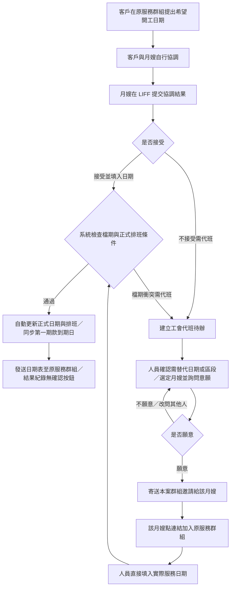

# Assignments／Scheduling Domain

> Historical Orders 的 count-based 單薪帳務不建立或偽造正式服務日，也不取得 Scheduling occupancy；
> 只有工會人員執行重啟天數精算後才重新進入本 Domain 的正常 generation／assignment／service-date
> 契約。完整邊界見 `27_歷史訂單生命週期與服務天數帳務正式規格.md`。

## 1. Domain 責任

擁有 waiting-deposit 檔期鎖、正式 assignment、assignment-owned 正式服務日、請假／順延／代班、月嫂占用、七日 buffer、排班 Preview／Apply，以及日期、工時和 assignment status 投影。

不擁有 Orders Terms／lifecycle／actual start、客戶帳務、月嫂應付、Alert workflow、LINE 或契約平台流程。

## 2. SSOT

| 事實 | 唯一權威 |
|---|---|
| assignment 歸屬與區段歷史 | `case_staff_assignments` 的版本化有效紀錄 |
| 每日正式服務 owner | effective `staff_schedule.assignment_id` |
| completed assignment 的歷史區段 | `case_staff_assignments.status=completed` 與其正式起訖日 |
| assignment 檔期占用 | 有效 assignment 的完整連續區間，包含排休與請假日 |
| actual hours | 正式服務日數 × Orders 每日服務時數 |
| assignment status | 第一／最後正式服務時刻與 Global Clock |
| leave／substitution lineage | batch header＋append-only 每日 outcome events |
| waiting-deposit lock | lock header、days 與 events |
| 七日 buffer | 獨立 buffer facts；不混入服務日或薪資 |
| 可接案結果 | 上述占用事實的 Query projection |
| 長假／暫停接案 | versioned staff unavailability period 與 append-only cancel event |
| 重建原因與 old/new lineage | 通用 assignment rebuild event |

`orders.staff_id`、`planned_hours`、`actual_hours_adjustments`、`replaced_assignment_id` 及 `original_assigned_*` 不得成為新架構依賴。

Assignment Plan Query 與付款查核共用 current assignment 選取：有效 generation 的 assignment，或歷史服務分支由最新成功 adoption 精確綁定且未取消／被替換的既有 assignment。歷史 assignment 的 `generation_id IS NULL` 不代表沒有月嫂。唯讀回傳允許已保存期間而無逐日排班，不借用正常 mutation 的日期完整性條件，不放寬 Preview／Apply invariant；名冊、歷史服務天數與應付帳務引用相同 assignment identity（2026-10-20 人工根源修正）。

## 3. Domain invariants

- assignment／schedule 改動一律 Preview，Apply 時 cancel-old／create-new，不原地截短、換人或覆寫。
- cancelled assignment 保留歷史但完全排除目前投影。
- 同案同日只有一個正式服務 owner；不支援半日或分時交接。
- 全案有效正式服務量必須等於 Orders 契約服務量。
- 全案條款變更只有在 current effective assignment 的 identity／人員／日期／區間形狀改變時才重建全部有效 assignments；費用、每日時數、下廚需求等不改變排班形狀的異動保留 current generation、assignment、schedule、buffer 與 occupancy。局部請假／代班只重建受影響 family，但仍重驗全案。
- assignment 的整段連續區間都占用月嫂，休假不能被誤判為可接其他案件。
- 一般洽談不占檔期；月嫂只表示承接意願。依規格 21 的自動保留裁決，客戶接受及 current
  confirmed service dates 齊備後，由最後條件的 Apply 在原 outer UoW 自動建立 waiting-deposit lock，
  不另要求人員按保留；衝突時該次 Apply 整筆 rollback。鎖定不要求月嫂先簽約或先形成
  precontract service commitment。
- 訂金逾期只形成異常，不自動釋放。
- 每個尚未開始服務的 assignment 預計結束日後七天為獨立 buffer；全案第一個正式服務開始時同交易解除全部 buffer。Current Query 亦須以全案第一個正式服務時刻排除已開始／已完成案件的 stale active buffer root，不得讓 persistence marker 覆蓋 `planned／active／completed` lifecycle。
- 七天 buffer 只作協調提醒；與其他案件 buffer 或實際服務重疊不阻擋 Query、聯繫、等待訂金鎖或正式排班。正式寫入仍須 fresh-lock 驗證完整 assignment interval／實際服務／有效 lock／不可服務事實；實際占用衝突必須零寫入，不提供強制重疊放行。buffer facts 與歷史 projection 保留，buffer 不再混入新的 hard occupancy projection。
- 國定假日不自動雙倍薪；只接受明確 special-pay event。
- 全部服務完成後不得取消訂單或縮減月嫂完整履約薪資。

## 4. Subsystems

### Availability Query

從 assignment interval、waiting lock、buffer 及其他案件占用推導可用日期。Staff holiday preference 只作排序，不是硬性淘汰；Query 不寫入。

依第 `24` 份正式規格，Availability Query 亦讀取 current `long_leave`／
`temporarily_unavailable` 期間。與服務需求日期重疊時屬 actual conflict；七日 buffer 必須獨立回傳
`buffer` 提醒，無需額外放行命令，不得與不可服務期間或正式占用混成同一 hard block。不可服務期間
由 Scheduling 的 versioned Query 同時供 Matching 與 Calendar 使用。

### Matching Segment Plan

單一月嫂優先；其推薦／說明日期與正式保留的邊界依下述「推薦、客戶決定與結果核對」。無法由單人承接時才產生 2–4 個連續分段；多月嫂草稿可顯示 gap／overlap，正式聯繫、鎖定與 Apply 前必須完整合法，不套用單月嫂的詢問期間規則來略過明確分段檢查。

### Waiting Deposit Lock

只提供 Acquire、Release-to-unbound、Cancel、Convert。訂金有效性由 Client Finance typed port 提供。服務區間與 buffer 同時查衝突，每次轉移保存事件。
lock day 只對應該分段的正式服務日；固定週休不是 lock day。七日 buffer 是獨立衍生占用，
不得被 current projection 當成正式服務日，亦不得要求固定週休有 lock day。
Preview 的 buffer conflict 是非阻擋提醒；只有 actual service／assignment／active lock conflict 阻擋 Acquire。buffer 不使用跨 assignment 的 staff/date 唯一限制；實際服務保留唯一限制。

### Assignment Plan

提供 Query、Preview、Apply；支援 bootstrap、分段增減、換人、日期調整及 Orders Terms 全案重建。Apply 取消舊紀錄並新增新集合，通用 rebuild event 保存一對多／多對一 lineage。

正式指派 Query 只投影 current Orders／Scheduling 與已存在的帳務版本，不要求 Finance／Payroll 初始化或完整服務時數。尚未建立的版本及時數回傳 NULL，不以 0 假造根事實；Preview／Apply 仍須讀齊原有正式條件，Query 不建立初始資料。

#### Actual Start 逐段重新精算（2026-09-23）

已有 effective assignments 的 Actual Start 更正不得整批平移舊日期，也不得以全案新服務日按陣列位置
切片後把各段區間縮成第一／最後服務日。Scheduling 必須以 current effective assignments 的順序、staff
與每段既有 official-service-day count 為不可變輸入，依下列規則建立完整 replacement candidate：

1. 第一段 `assigned_start_date` 固定為使用者確認的新 `actual_start_date`；該日可以是休息日，不要求等於
   第一個 official service date。
2. 以 current 服務方式、固定週休、版本化 Holiday facts，以及對新日期仍有效的請假／人工覆寫逐日精算，
   直到該段取得與 source segment 相同的 official-service-day count；最後一個 official service date 為該段
   `assigned_end_date`。
3. 後續每段的 `assigned_start_date` 固定為前一段 `assigned_end_date + 1 day`，再依相同規則取得該段原有
   service-day count。落在段首至第一服務日之間的休息日屬該段完整占用，不得形成未歸屬 gap。
4. replacement 必須保留 segment 順序、staff identity、逐段服務量及一對一 source assignment lineage；
   不得換人、重新媒合、跨段挪用服務量或沿用只綁舊日期的假日上班同意。
5. 全部 segments 的連續區間、每日唯一 ownership、總服務量、actual hours、人員占用、七日 buffer 與
   generation version 必須重新驗證；`actual_end_date` 取最後一段 `assigned_end_date`。任何衝突皆在
   Preview 顯示；actual conflict 使 Apply 零寫入，七天 buffer overlap 僅提醒。

Holiday／人工調整 facts 與其版本必須納入 Preview fingerprint；Apply 在同一 outer Unit of Work fresh-lock
相同 owner facts 後重算，不得由 UI 提供日曆結果，也不得以另一條 DB connection 讀取未綁定版本的假日集合。

對已有 effective assignments 的開工日更正，逐段候選須在正式寫入前供內部操作者查看與
重新確認。此 Actual Start 畫面只接受新開始日，不接受自選服務日、請假或假日上班輸入；
這些調整須先走既有受控 owner 流程，不由 UI 提交權威日曆結果或直接切換
`staff_schedule.is_work_day`。Scheduling 依目前有效的週休、Holiday、請假及人工調整 facts
重新精算／驗證，回傳可核對的完整候選。開始日或相關 owner facts 變更使既有 Preview
失效；最終確認仍由 Actual Start 單一 Apply fresh-lock 重算並同交易寫入。
取消、拒絕或 stale conflict 全部零寫入。

已核准請假／代班若在 source effective generation 仍有有效占用與對應 outcome，本次 Actual Start
重排必須一併保留並重新驗證：原月嫂的請假日期不得被排成正式服務日；既有代班／順延 outcome
的已核准人員與結果日期不得因重排被偷偷移動、重複計入或遺失；有效請假占用須隨 successor
generation 繼續有效，immutable outcome 與原有 Payroll 事實保持不變。Preview fingerprint 必須綁定
這些 current facts，Apply 在同一 Unit of Work fresh-lock；若新逐段候選無法唯一對應並保留既有
outcome，或與請假、人員占用衝突，回 typed conflict 且 Orders／Scheduling／請假占用全部零寫入，
由操作者走既有請假／代班流程調整後重新 Preview。本次畫面不另建請假／代班批准入口。

Actual Start replacement 建立 successor assignment identity 時，Scheduling candidate 必須保存每段唯一
`source_assignment_id`，供 Payroll persistence adapter 原值搬移 immutable rate snapshot。這項搬移不重算
Payroll、不改 Payroll root version／obligation／amount；source snapshot 缺失或 lineage 不唯一時 fail closed，
不得以 current case policy 取代 source snapshot。

2026-08-27 人工裁決：服務前現任月嫂因車禍或其他正式不可服務事實必須
整案換人時，不是將 Orders／Scheduling version 改小，也不是原地改舊 assignment。
必須新增 version 更大的 caregiver-replacement event，supersede 舊 active matching／assignment
lineage，建立新 matching round，並讓 Orders 11 步投影回到最早失效的 caregiver-bound
step。整案重新媒合默認為 Step 2；只有 current replacement round 的 owner root 證明可沿用
合法候選池時，server 才可投影 Step 3／4。舊候選回覆、特定月嫂簽回、recipient
confirmation、waiting lock、commitment 與排班的 immutable 歷史保留，但不得滿足
新 round 的 gate。

分流根事實固定由 Scheduling 的 assignment-owned official service facts 決定：

- 尚未提供任何服務：可建立新 matching round 並讓 Orders current SOP 回 Step 2／3／4。
- 已提供任何服務：禁止整案回媒合，固定走既有 Leave／Substitution；只重建受影響
  assignment family，保留已服務日與原月嫂薪資事實，代班日由新 assignment 及既有
  Payroll impact 計算。不新建另一套代班或薪資公式。

第一個正式 assignment 的 bootstrap 必須轉換同案仍有效的 waiting-deposit lock；
若沒有 waiting lock，回 `assignment_plan_bootstrap.waiting_lock_required`，不得直接建立
正式 assignment。轉換前仍必須驗證契約流程完成、服務時間完整，以及 Client Finance 提供的訂金已正式核銷或有效的一般市民訂金未付人工放行；放行不得把訂金投影成已核銷或零元；
legacy 缺漏只能進異常與人工修正，不得由 Assignment Plan 猜測或補造。

依第 `21` 份正式規格，首次 bootstrap 必須驗證 commitment 的方案、人員與每人服務量；
日期採本節服務開始回覆或工會代班日期登錄所形成的 current owner 結果，不要求客戶／月嫂再按日期表確認。
原簽約文件與 commitment 歷史不可改寫；換人不得移植原月嫂簽回或以承接意願假造新人的契約資格。
assignment、schedule、Payroll impact、commitment conversion、outbox 與 receipt 仍由正式 writer 同交易提交。

#### 服務開始、排班與代班（2026-10-23）

本節是正常案件服務開始與本次代班處理的 current contract，Authority 為使用者確認的群組協調／月嫂觸發流程。
實作狀態：現有程式尚需依下列修改範圍接通；規格完成不代表 API、UI、DB 或 LINE 發送驗收通過。



- **SSTART-01／入口與責任：** 客戶只在原服務群組提出日期，雙方自行協調；Bot 不監控、解析或推定群組聊天中的日期與同意。客戶訂單異動 LIFF 移除現有「服務日期／天數」日期修改選項、開始日／結束日輸入及對應預覽提交；後端同步停用該新申請種類，不只隱藏畫面。其他訂單異動選項保留；既有日期申請與客服歷史不刪除、不自動轉成新流程。正常案件無人員核准步驟或人工關注待辦。
- **SSTART-02／月嫂提交：** 透過既有 verified staff LIFF 入口提供「接受，填寫開始日期」與「無法配合，請工會安排代班」。接受時填入雙方約定開始日；不得要求月嫂自行猜算結束日或服務天數。服務量、每日時段、休假與假日規則由原 owner facts 計算。每次提交限本人目前有效案件／負責區段；有效配對已成立但尚無正式 assignment 的本人亦可提交，不能以先有正式班表作資格。檔期無衝突不等於願意；私事等原因可選不接受，不強迫填原因。
- **SSTART-03／正式更新：** 接受送出即由 server fresh-read／lock 驗證身分、方案／區段、版本、occupancy、契約與訂金等既有正式條件，通過後自動委派 Orders、Scheduling、Client Finance、Payroll 正式 writer，保存實際開始日、正式服務日、班表、結束日及受影響投影。使用既有 durable command／outer UoW，沒有第二次工會確認；不得拆成先保存開始日、等人工確認日期表才補排班。單月嫂日期不可與舊推薦期間取空交集；多月嫂沿明確分段歸屬與各段本人結果處理，不由一人代替其他月嫂同意、不猜測分配。
- **SSTART-04／例外待辦：** 月嫂不接受或 canonical 檔期衝突需代班時，保存同案同區段可追溯的工會待辦；正式日期、班表及付款條款保持原值。已保存待辦的結果須明確回讀，不能先丟 generic error 令待辦一併回滾。身分、stale version 或資料完整性錯誤仍回 typed rejection／conflict，不誤當月嫂拒絕或一律製造代班待辦。簽約／訂金等條件未齊不得跳過原 gate，也不增加常態人工日期核准。
- **SSTART-05／人員代班：** 工會確認需替代日期／區段，選定月嫂並詢問意願；不願意就改問其他人，願意才將該人選交給群組邀請。該月嫂點連結加入本案原群組後，人員直接填入實際服務日期，由同一正式流程檢查及保存，不再要求代班月嫂開 LIFF 接受／填日期、不另等客戶或月嫂按日期表確認。候選意願只證明願意，不等於正式指派；既有候選聯繫可重用，選定代班人選與需替代區段由 Scheduling 記錄，不能先建假 assignment 取得邀請資格。
- **SSTART-06／局部與跨域：** 工會用語可統稱代班，server 仍依正式服務證據分流。尚未服務的整案換人沿 service-before-replacement lineage；已有服務的代班／換人只替換受影響 assignment family，保留已服務日、原月嫂費率與薪資／付款歷史，沿既有 Payroll／Staff Payables 計算，不整案退回媒合、不重跑另一套拆帳公式。只有本案實際開始日改變才依 Client Finance 同步第一期款日期；服務中局部代班不以代班首日覆蓋全案開始日。
- **SSTART-07／群組結果：** 正式更新成功後，依 committed 日期／排班版本建立一次本案群組日期表通知。內容列案件、實際開始日、各月嫂負責區段與逐日服務日期；只有結果紀錄，無「確認日期表／拒絕日期表」按鈕，也不另索取拒絕原因。日期表送達與否不影響正式排班資格。失敗保留正式結果、呈現寄送異常，僅依既有投遞機制補送，不重跑排班或帳務。群組尚未就緒不改寄個人日期確認卡。額外正式開工通知未定稿，不在本次新增。
- **SSTART-08／權限與失敗：** 有效工會人員與相應 owner capability 可查待辦、選定人選、邀請及保存代班日期，不限 system_admin；LINE 工會入口驗 current binding／enabled Admin，React 依既有 Access session 驗 capability。Query 零寫入；相同命令重播回原結果，不能重複建待辦、排班、義務或日期表。infra failure 整筆 rollback；outcome unknown 以原操作身分回讀。完成／取消／服務資料已鎖案件不可由此覆寫。

日期表 recipient confirmation 不再是正式排班或 commitment 日期平移的 gate。自動排班 discovery 必須只接續已提交的月嫂接受或人員代班日期結果，不能再以舊 `confirmed`／`manually_confirmed` 卡片事件自動觸發。歷史 snapshot／回覆／receipt 保留不可變；舊卡片不能產生新的有效確認或正式變更，current UI 與訊息不再生產該確認流程。查詢狀態以本人回覆、代班待辦、正式排班與寄送結果呈現，不以 job accepted 或卡片送達冒充生效。

##### 前後端修改範圍與方案

下列為後續程式實作範圍，並非已完成變更。優先重用現有 owner 與 transport；新欄位／資料表須先核對現有 schema，不預先指定新表或新增 Orders／付款狀態。

| 範圍 | 現有位置／必要修改 |
|---|---|
| 客戶 LIFF 與日期申請 API | `line/static/order_update.html` 移除 `service_days` 對應「服務日期／天數」選項、起訖日／天數表單、預覽與組裝分支及安全預覽示例；`api/schemas/line_order_change.py`、`api/routes/line_order_change.py`、`subsystems/line/customer_order_change_contracts.py`／`customer_order_change_application.py` 的新申請 allowlist、validation、impact note 與 ticket 組裝同步停用該種類。手造／舊頁的新日期 preview／apply 回 typed rejection，不建新客服需求；歷史事件種類、查閱與正式訂單日期顯示保留，不刪 Orders 日期欄位或其他異動功能。 |
| 月嫂 LIFF 前端 | `line/static/staff_order_search.html`、`staff_schedule.html` 與 `gateway.html`／`identity.html` 的既有 staff navigation：增加本人案件的協調結果表單、日期輸入、衝突／待辦／成功及結果未明回讀。沿現有 staff 入口，不增加客戶日期申請入口，不為此發布 Rich Menu。 |
| LIFF API／身分與 schema | `api/routes/line_staff_self_service.py`、`api/schemas/line_staff_self_service.py`、`api/dependencies/line_identity.py`／`infrastructure/mysql/line_unit_of_work.py`：新增 typed 結果提交與回讀；`infrastructure/mysql/customer_service_repository.py` 的既有 staff order read adapter 或 Scheduling typed query 須涵蓋尚未排班的有效本人方案；新 mutation 委派 Scheduling，不由 LINE adapter 寫正式 roots。 |
| Scheduling 回覆與代班協調 | `subsystems/scheduling/`、既有 `matching_coordination`／candidate contact、`leave_substitution_workflow.py`、`service_before_replacement_workflow.py` 與對應 MySQL adapters：保存月嫂決策／日期、衝突待辦、選定人選與意願、區段及流程進度；明確區分願意承接、入群、正式指派。 |
| 正式日期／排班 coordinator | `subsystems/orders/actual_start_workflow.py`、`service_date_confirmation_workflow.py`、`subsystems/scheduling/automatic_service_arrangement.py`、`assignment_plan_workflow.py`／`assignment_plan_impacts.py` 及對應 repository／impact ports：接受／人員填日期兩條入口接同一 owner Apply，內部精算、fresh-lock、衝突回待辦、原子保存與正式回讀。 |
| 舊日期確認 gate | `infrastructure/mysql/matching_schedule_confirmation_repository.py`、`subsystems/scheduling/matching_schedule_confirmation.py`、`infrastructure/mysql/automatic_service_arrangement_repository.py`、`domains/scheduling/commitment_execution.py`、`subsystems/line/matching_postback_application.py` 與相應 API：以新提交結果取代雙方 recipient confirmation；停止生產確認卡、拒絕原因追問及舊事件自動排班。歷史 readback 保留，舊 mutation caller 依 entry-point governance 退役／封閉，不只刪 UI 或逕刪 public route。 |
| 工會手機與 React 前端 | `line/static/mobile_admin.html`、`api/routes/line_mobile_admin.py`、`ui_react/src/components/OrderWorkbenchV2Drawer.tsx`、`MatchingScheduleAndAssignmentActions.tsx`、`OrderServiceDatesPanel.tsx`、`OrderActualStartPanel.tsx`、`OrderAssignmentPlanPanel.tsx`、`ui_react/src/pages/ServiceHandoverPage.tsx`／`SchedulingPage.tsx`，以及相關 typed clients／flow adapters：正常只顯示結果；例外提供代班待辦、選人詢問意願、邀請及加入狀態、人員日期輸入與回讀。移除「設定日期／確認排班」雙方確認步驟。 |
| 案件進度與開工時間 | `subsystems/orders/stage_projection_query.py`／`core_stage_projection_query.py`、`infrastructure/mysql/orders_stage_projection_repository.py`、相關 Orders typed schemas／clients、`ui_react/src/api/scheduling/service_arrangement_status_client.ts` 及 durable worker：移除「等待雙方確認日期表」的狀態與錯誤引導，改讀本人提交／代班待辦／正式排班／寄送結果。已確定的實際開工日已到時委派 Orders canonical lifecycle 評估為服務中，不靠人員點擊、不由唯讀頁面寫狀態，也不新增正式開工通知。 |
| 群組邀請與結果日期表 | `subsystems/line/order_group_application.py`／contracts、`infrastructure/mysql/line_order_group_adapters.py`／`line_media_order_group_repository.py`、delivery worker 與 `config/message_templates.json`：支援對已選定且願意的代班月嫂單獨寄原群組邀請，不重寄全體、不要求假 assignment；membership 不以送出邀請代替加入。正式排班成功後產生無按鈕的群組結果表。管理端 `LineOrderGroupWorkbench.tsx` 依 typed readback 呈現選定代班者與加入結果，維持唯讀。 |
| 第一期款與相關日期 | `domains/client_finance/obligation_planning.py`、`infrastructure/mysql/client_finance_terms_writer.py`／`automatic_client_accounting.py`、Orders／Scheduling impact ports：第一期到期日採已確定實際開始日，尚未確定才用預計日；沿原 identity 同步未結清日期、第二期既有加 15 日公式及付款查詢，保留已核銷交易、allocation、已簽文件與既定月嫂付款日。既有 `order_pre_start_notification_source` 與通知失效處理使用最新正式日期，不重發失效日期或虛構補發。 |
| 權限、持久化與部署邊界 | `api/dependencies/admin_auth.py`、上述管理 routes、Access capability 與相關 API schema：取代本流程 system_admin-only gate，範圍限已認證工會人員／本人月嫂。Scheduling-owned 新決策與待辦若現有 schema 無法承接，採 additive migration、preserve-data upgrade 與清楚版本 lineage；不改寫歷史確認證據、不新增付款義務關卡。本次只有規格更新；程式、DB migration、provider 發送、選單 publication 與部署均未執行。 |

##### 前端畫面與按鈕逐項對照

下表是必做功能，不以「調整代班介面」概括。工會手機待辦工作面與 React 代班處理頁都須接通同一 owner-backed 操作與結果；`LineOrderGroupWorkbench` 仍是觀察頁，不把所有 mutation 放進群組清單。未開始且無 assignment 的例外亦須能從此待辦處理，不能被既有「必須先有正式班表」選案條件排除。下列業務進度為 readback，不新增一套前端自管狀態機。

| 畫面／步驟 | 必要內容與操作 | 開放條件與操作後效果 |
|---|---|---|
| 客戶「修改訂單資訊」 | 移除「服務日期／天數」選項、日期輸入與預覽／送出分支，同步移除安全預覽中的該選項。保留服務地址、下廚需求、每日時段與其他內容。 | 不再產生結構化日期申請；後端對舊頁、舊 preview 或自行送出的日期 payload 同樣拒絕，不能只靠前端隱藏。 |
| 月嫂本人案件清單 | 增加「回報服務開始安排」入口；顯示案件、目前安排及本人負責區段。本人已有效配對但尚無正式班表也須可見。 | 已驗證／已綁定本人且方案有效才可進入；不能借用任意案件編號。 |
| 月嫂協調結果表單 | 選「接受，填寫開始日期」時顯示開始日；另一選項為「無法配合，請工會安排代班」，原因選填。提供「送出協調結果」，不用填結束日與合約天數。 | 接受送出即觸發系統處理；拒絕建立代班待辦。畫面分別呈現已完成、需工會代班、未通過驗證、處理中或結果未明；結果未明只能沿原操作查核，不重複送新命令。 |
| 工會代班待辦清單／案件入口 | 顯示案號、原月嫂、拒絕或衝突來源、需替代區段、目前處理進度；提供「處理代班」、server 分頁與完整待辦數。 | 只列需工會處理的例外。正常成功不列待辦；邀請排入或入群都不提前結案，正式安排回讀成功才完成該替代區段待辦。 |
| 替代範圍與人選 | 顯示原服務與已服務日，讓人員記錄需替代日期／區段、選擇有效月嫂。若拒絕時沒提供新日期，明示尚待工會確認，不能猜測群組內容。 | 只編輯本次協調範圍，不先改正式班表或建立假指派。選定人選與本次區段須能保存／回讀。 |
| 詢問代班意願 | 選人後提供「詢問該月嫂意願」；顯示詢問對象、代班期間、寄送結果及最新本人回覆。詢問重用現有意願通知，但回覆須連到本代班待辦與人選，不混成一般候選池完成。 | 等待回覆時不開放群組邀請；不願意時提供「改問其他月嫂」，保留前人詢問歷史。願意後進下一步。 |
| 單人群組邀請 | 明確提供「寄送本案群組邀請連結」按鈕，顯示目前選定月嫂及原服務群組是否就緒。點擊直接建立該人的寄送工作，不用複製網址、另回群組輸入全體 `發送邀請`，也無第二次確認視窗。 | server 驗證人選仍選定且已願意、staff binding、目前群組／保存網址及原資格後才可寄；只寄這名月嫂。缺綁定、缺群組／網址或資格已變，顯示具體不能寄送原因。不得順便重寄給客戶與其他月嫂。 |
| 邀請結果與加入狀態 | 分開顯示已排入、已送達／寄送失敗、待加入、已加入；提供「重新查詢加入狀態」。狀態與錯誤由 server 回傳，前端不取得 raw 群組 ID、邀請網址或完整 provider 錯誤。 | 以目前群組及選定月嫂的 membership 證據判定加入；寄送成功不能冒充已加入。改選人選後舊人的加入不算新人的加入。 |
| 工會實際服務日期表單 | 選定代班月嫂已加入後，開放人員輸入本次實際服務日期，顯示系統精算的起訖、服務日／天數及受影響區段；提供「儲存並更新排班」。 | 由工會人員直接送出，同步 fresh 檔期驗證與正式保存；不要求代班月嫂再次開 LIFF、不再要求客戶確認。再次衝突保留待辦，不更新半套正式資料，讓人員調整日期或改選。 |
| 正式保存結果 | 顯示正式人員／日期／班表、第一期付款期限與 owner readback；服務中局部代班保留全案原開始日與已服務紀錄。結果未明提供同一操作查核。 | 不以接受工作、HTTP 202、排入佇列或本機 draft 宣稱保存完成；普通工會人員可依 capability 操作，不限系統管理員。 |
| 群組日期表／工作台紀錄 | 正式保存後自動寄原群組，畫面顯示結果表寄送狀態；移除「寄送日期確認表」、雙方確認計數、人工補登雙方確認與確認／拒絕按鈕。 | 日期表為結果，不能變成另一個人員送出或核准步驟。寄送失敗沿原投遞機制處理，不撤銷排班或重新儲存日期。 |
| 訊息預覽與樣本 | 更新 `subsystems/line/message_preview.py`／`message_preview_samples.py`、`ui_react/src/components/LineMessagePreviewWorkspace.tsx` 相關 catalog 與樣本：代班意願、單人邀請、無按鈕群組結果表及必要處理回訊與實際 sender 一致。 | 安全預覽不呼叫 provider；不繼續顯示已退役日期確認卡或把假送達當正式結果。既有模板、schema、preview fixtures 只更新受影響項目。 |

##### 每個前端操作所需的後端能力

前端新按鈕都須有 typed transport、owner command／Query、權限及正式回讀；不得使用 local state 模擬完成。以下是 API 能力邊界，具體路徑在實作時沿現有 owner router 決定，不預先宣稱現有 endpoint 已可用。

| 能力 | 必要後端範圍與資料 |
|---|---|
| 客戶日期入口退役 | 新 request kind 與 allowed fields 同步移除現有日期申請，Preview／Apply 都 fail closed；歷史 response/event 仍能解讀舊種類，不能刪共用 enum 後令既有客服歷史無法讀取。其他種類不可夾帶 `start_date`／`end_date`。 |
| 月嫂案件／提交／回讀 | 本人有效 plan／segment 的 bounded Query、接受／拒絕 command、日期精算、共同 Apply 或代班待辦，以及原命令結果 Query；修改 `line_staff_self_service` schema、route、bindings 與 Scheduling ports／repository。 |
| 待辦清單／詳情／計數 | Scheduling-owned 全量條件一致的分頁、數量及 case／segment 詳情；工會手機 `line_mobile_admin` 與 React typed client 共用 owner 意義，沒有 assignment 的例外也可查。 |
| 記錄替代區段／選人 | 保存原區段、擬替代日期、人選與目前 owner version；Query 回可選 active staff 與本次範圍。選人不是正式指派，讀取原安排不變。 |
| 詢問意願／改選／回覆 | 連結代班待辦、人選與詢問事件；沿現有 durable 意願發送及 verified 本人回覆入口保存最新結果，提供寄送／本人回覆回讀。改選保留歷史，舊人的願意不解鎖新人的邀請。 |
| 單人邀請 command／結果 | 從代班工作面發起，使用 Scheduling 選定＋願意授權，委派 LINE order-group application 建立單人 committed delivery。不能直接重用目前群組指令的全體 audience；React 管理 session 與工會 LIFF 都可依 capability 操作，不擴張唯讀群組清單 API 的職責。 |
| 加入狀態 Query | LINE owner 對目前 group binding／selected staff 的 membership 提供受限結果；送達與入群獨立。人員填日期的 Apply 必須 server 再驗加入，不能只靠前端 disabled。 |
| 人員填日期／正式保存 | server 驗指定人選、區段、意願、入群、owner version 與 occupancy，沿原正式 writer 更新 Orders／Scheduling／Finance／Payroll；回傳完整正式結果與付款期限、待辦完成結果及 committed 群組結果通知 reference。 |
| UI integration／typed errors | 新增或修改相關 React typed clients、schemas、flow adapters／store、OpenAPI 與工會 routes 的 capability guard；錯誤含邀請資格不符、未加入、日期／版本衝突、處理結果未明，與畫面可執行動作一一對應。 |

##### 本次 DB 變更執行範圍

SSTART 實作使用 Scheduling-owned 服務開始回覆／代班處理紀錄及代班人選詢問紀錄，保存本人決策、日期、來源方案／區段、選定人選、意願與 command replay，不能借用 LINE 日期確認事件冒充。新增 schema-only additive tables，不作 system seed、business-row backfill 或 destructive change；舊 snapshot、客服日期申請、assignment 及 ledger 不改寫。新庫 assembly 與 preserve-data release 同步登錄，驗 absent／exact／partial／drift；重播 exact no-op，未知 partial／drift 關閉。切換前可丟棄候選庫，套用後保留 additive objects 並以前向相容修正，不自行 drop。DB 驗證限 localhost development 的新 lu_test_*，保存 fresh／舊資料 preserve evidence；本輪不做 production、source replacement、provider send 或選單 publication。

##### 驗收與後續實作順序

先完成 owner 決策／區段／待辦與 typed API，再接正式日期＋排班＋Finance 的共同 Apply，接代班意願／單人邀請／入群回讀，最後接月嫂及工會 UI、群組結果表並封閉舊確認 gate。保留現有 canonical test roots，不以重寫快照冒充新語意通過。

| 驗收 | 必須觀察到的結果 |
|---|---|
| SSTART-01／02 | 群組一般聊天零業務寫入；客戶頁已移除「服務日期／天數」及日期表單，直接使用舊 preview／apply 或夾帶日期欄位也拒絕且不建新客服需求，其他異動與歷史查閱保持可用；已驗證的本人月嫂可對尚無班表的有效方案提交，跨人／跨案拒絕。 |
| SSTART-03／07 | 無衝突正常案件不經工會確認：正式日期、逐日班表、第一期款期限與 owner 版本一致；commit 後只建一份群組結果表且無確認按鈕。 |
| SSTART-03／08 | 未來開工先保存正式班表，至開工日由 canonical lifecycle 更新為服務中；待辦看板、手機狀態與班表回讀一致，不出現舊的雙方日期確認提示。 |
| SSTART-04 | 拒絕或 occupancy 衝突建立同案同段代班待辦，正式資料零變更；stale／越權／infra 錯誤不偽裝成拒絕或成功。 |
| SSTART-05 | 實際 UI 按「詢問該月嫂意願」→不願意→「改問其他月嫂」→本人願意→「寄送本案群組邀請連結」→「重新查詢加入狀態」→已加入→人員「儲存並更新排班」。檢查每一步按鈕開放、實際 command 與 readback；未願意／未加入的直接 API 也不得繞過，邀請只寄選定一人，加入前不形成正式指派。 |
| SSTART-06 | 多月嫂分段、服務前整案換人、服務中局部代班／換人均保存正確服務量、原已服務日、薪資／實付歷史及唯一付款日期；局部代班不改全案開工日。 |
| SSTART-07／08 | 同鍵重播無重複待辦／排班／應付／通知；實際並行占用與中途失敗 rollback；寄送失敗不回滾正式結果、不重算帳務；舊卡點擊不更新新安排。 |
| SSTART-08 | 工會人員可處理例外與日期，普通月嫂不可用工會功能；實際 UI 覆蓋正常、拒絕改選、入群、人員填日期、衝突與結果未明恢復。 |

現行服務開始與代班入口為 `POST /api/v1/line/staff-self-service/service-start/*`、工會 `POST /api/v1/line/mobile-admin/service-start/*` 及 `GET/POST /api/v1/scheduling/service-start/*`。月嫂訂單／班表頁與工會手機／React 工作面共用同一流程；舊日期表發送、人工確認及再次確認 mutation 回覆 410，舊卡按鈕不改安排，未寄出的舊確認卡由 delivery worker 取消。未來開始日由既有背景作業週期委派 Orders lifecycle writer 轉入服務中，不重排班或新增開工通知。

首次排班必須有 current 本人回報／工會代班結果、簽約完成、訂金資格及完整服務時段；已存在的等待訂金鎖沿用並轉換，不要求已繳清案件為了正式排班再建立一份等待鎖。多位月嫂先保存各區段結果，全部齊備才以共同 Apply 一次保存正式日期、逐日班表、Finance 及 Payroll。同一承接者連續承接的一段服務日形成同一正式指派；逐日服務、雙薪及來源 outcome 各自保留，不因承接天數多而每天增加一段指派。局部代班以正式 assignment identity 辨識區段；不同區段不得只依案件編號或人員任意取第一筆。

服務安排以唯讀 `GET /api/v1/orders/{case_no}/client-finance/deposit-skip` 顯示 Client Finance 的
目前訂金應收、已核銷額及已生效的放行狀態，不能使用 Preview 的預期結果冒充現況。「未付款人工放行」一鍵接續
既有 deposit-skip Preview／Apply，保存標準操作原因且正式回讀。它不把未付款改為已付款，也不釋放
月嫂 reservation；既有適用條件及正式 writer 不變。契約簽回完成的下一步導向同案服務安排，核銷仍由帳務入口辦理。

名冊的獨立日期更正保留 Orders 既有受控 writer；正常服務開始及本節代班日期則必須經上述共同 Apply，
同步正式日期、班表與付款期限，不導向另一個人工確認排班步驟。不得留下已改日期與舊班表等待事後補排。
換人入口導向同案推薦確認並開啟既有換人操作；已服務的既有請假代班裁決不變。

開工、順延與代班未完成需求只在正常有效案件（洽談中、訂單成立、服務中）列入工會待辦；取消、完成及歷史案件不列出，也不能沿既有 Apply 操作。查詢不改寫需求歷史。

### Schedule Projection

由 assignment segment、排休規則及正式 leave outcome 產生完整 assignment-owned 日曆。禁止單日 CRUD、獨立 Generate 或 UI 直接切換 `is_work_day`。

### Leave／Substitution

代班工作台的案件選單以 server-owned 進行中訂單集合及 current effective assignment-owned 正式服務日為準；已正式排班但尚未開始服務的案件亦須納入，直到服務完成。完成、取消及尚無正式排班服務日的案件不納入，不得只以 Orders「服務中」標籤篩選。

多日請假為一次 Preview、一個 fingerprint、一次 Apply transaction；每一天保存 immutable outcome。正式結果只允許順延或指定代班。代班建立獨立 assignment；取消或更正以反向／替代事件處理。

2026-09-20 人工裁決：順延處理可選擇指定補班日期。未指定時仍依案件固定週休、國定假日及目前有效的國定假日上班協議自動順延；指定時只將該次服務由原服務日移至明確新日，不得無聲改成其他日期，也不得連帶移動其他既有服務日。原日與新日不得重複計入，全案服務日數守恆；與同案服務日、案件休假條件或人員占用衝突時，Preview／Apply 必須沿既有 typed blocker／conflict fail closed。指定日期須納入 request snapshot、fingerprint、immutable outcome 與正式 generation readback，不建立另一套單日 CRUD 或平行 writer。

2026-08-12 人工裁決：月嫂請假審核的 API、typed client 與管理入口由 Scheduling 擁有，
不得掛在 LINE identity review route 或 `LineAdminApiClient`。LINE 只提供 verified identity、
delivery intent 與通知結果。現有依賴已退役 `services.*` 的 review service 是 `live-drift`，
在 canonical repository／outer UoW、capability、typed result 與 entrypoint replacement 完成前
不得掛入 FastAPI。

月嫂請假以本人提交雙方已協調結果為正式入口。順延指定逐日新日期，無衝突即在單一交易套用正式日期、排班及相關帳務，無受理／再次核准；代班或衝突才建立工會工作項。完整互動與 UI 契約見規格 20 §5.3。
工會只記錄雙方談妥的結果或選人安排代班，不負責溝通協調。代班須願意、寄送原案件群組邀請並確認加入後，才由工會記錄實際日期。指定代班可同時保存明確新服務日，未指定時維持原日；不得重複計算服務日或更動其他日。
既有 Scheduling result／candidate store 共用於服務開始與請假；請假 `execution_dates` 使用 `{kind:"leave-v1",decision,dates:[{original_date,new_date}],conflict_message?}`，與 service-start execution array／peer 決策隔離。只使用既有 awaiting_peers／substitute_required／applied 狀態；awaiting_peers 僅供同交易施工，不是人工等待。
舊請假 request 的歷史資料、readback、取消與 canonical linked receipt 證據保留，不再接受新的 pending 請假 intake 或客戶同意順延操作。舊受理／退回入口及舊日常待辦已退役，僅保留歷史查閱及正式處理證據；不建立詢問客戶的工作，也不以退役入口宣稱已完成排班。不需要資料 backfill。
日期、Scheduling generation、Finance／Payroll impact、immutable leave outcomes、result receipt 及群組寄送工作共用一個 outer commit；衝突或中途失敗不能留下半套結果。原服務日不得已完成，新日期不可空白、重複或冒用他人指派。所有送出與人員操作需 replay 同一 key，內容不同回 typed conflict。

Batch replay：

- `batch_key` 是一次多日操作的冪等 identity，並綁定 canonical request snapshot、
  Preview fingerprint、actor 與 reason。
- Apply 先以 `batch_key FOR UPDATE` 讀取 header；不存在才可進入施工，存在時必須再鎖定
  並讀取全部 child events。
- header、item count、連續 ordinal、case／assignment linkage、request snapshot 與
  fingerprint 全部完全相同時回傳原 receipt，不再執行 mutation。
- 相同 `batch_key` 搭配不同 request 或 fingerprint 回 `batch_key_request_identity_conflict`；
  header 缺 child、ordinal 重複／缺號或 lineage 不一致屬資料完整性 blocker，不自動補寫。
- batch header、逐日 events、assignment／schedule replacement、payroll impacts、outbox
  與 receipt 必須同一 transaction；rollback 後不得留下可被誤認為成功的 partial batch。

與 Orders AutoComplete 的競爭契約：

- leave-substitution Apply 與 AutoComplete 必須先鎖定同一 Orders lifecycle aggregate，並驗證同一
  expected Orders lifecycle version；不得各自只鎖 Scheduling 或 Orders projection。
- AutoComplete 先提交時，舊 leave Preview 必須以 typed `stale_version`／version conflict 失敗；
  Scheduling generation、assignment／schedule、Client Finance、Payroll、leave outcome、receipt 與
  outbox 全部零寫入。
- leave-substitution 先提交時，必須在同一 transaction 更新正式服務日與 Orders lifecycle version；
  舊 AutoComplete command 必須以 `order_version_conflict` 失敗且零寫入。只有重新讀取新 effective
  generation、official service days 與新 completion instant 後，才能再次判斷完成。
- LINE leave request evidence 或管理員受理狀態不參與此競爭；只有 canonical leave-substitution
  Apply 會取得鎖並改變正式根事實。
- 任一 stale／conflict 路徑不得留下 partial batch，也不得以「先完成後補請假」掩蓋競爭。

### Assignment Lifecycle Projection

`planned`、`active`、`completed` 由正式服務時刻推導；中間休假仍 active。`cancelled` 只由命令產生；`replaced` 只作 legacy 相容。

### Calendar Read

日曆的業務說明使用「排班」「服務日」「工作日」與「歷史指派」，不加「正式」前綴；技術識別名稱維持原名。資料來源與納入時點如下（2026-10-15 澄清）：

| 顯示內容 | 來源步驟 | 納入條件 |
|---|---|---|
| 等待訂金檔期及緩衝提醒 | 媒合決定配對後保留等待訂金檔期 | 有目前有效的 waiting lock／buffer，且日期與查詢期間交集；不表示已有排班工作日 |
| 排班區間、工作日、休假及服務狀態 | 確認服務日期與排班中的排班建立／安排；後續請假、順延、代班修改沿同一 owner 保存 | 有目前有效 assignment／逐日排班且日期與查詢期間交集；只保存日期或產生前段服務說明不形成這些排班資料 |
| 已完成案件的歷史指派區間 | 已保存的 completed 歷史 assignment 與起訖日 | 即使未重啟精算且缺逐日排班，仍依下節規則唯讀顯示；重啟精算使舊歷史指派失效後不再覆蓋目前排班 |
| 長假／暫停接案 | 月嫂不可服務期間設定 | 有目前有效不可服務期間且與查詢期間交集 |

「尋找月嫂與詢問意願」中的每週服務說明不是日曆排班來源。日曆可顯示歷史區間，不表示該區間可計入「每週服務中與工時」；工時表另要求目前有效逐日排班。來源修改套用後，重新查詢取得最新投影。

#### 日曆顯示優先順序與排班替換標準（2026-10-15 澄清）

日曆查詢只讀取、組合目前資料，不寫入或覆寫排班。顯示優先順序與業務操作造成的排班替換分開判定：

| 情況 | 處理標準 |
|---|---|
| 新的每週服務說明或只保存服務日期 | 不替換已存在的排班；後續仍須經排班建立／調整操作及相關 gate 驗證 |
| 同案人員、日期或指派區間有變更 | 經相應改期、換人、請假／順延／代班的 Preview／Apply，通過版本、服務量及占用檢查後，以新有效排班取代舊有效排班；舊紀錄與變更血緣保留，不原地改寫 |
| 只改費用、每日時數或其他不改人員／日期／區間的條件 | 保留原排班版本；相關帳務或工時依其 owner 更新，不因此另建排班 |
| 等待訂金檔期轉成排班 | 契約、訂金與日期確認等關卡符合，排班建立成功後由同一交易轉換檔期保留；不能在日曆查詢時自動轉換 |
| 目前資料與歷史指派區間重疊 | 目前有效排班、檔期保留、緩衝或不可服務資料優先；歷史區間只補沒有目前資料的日期。已重啟精算而失效的舊歷史指派不再補顯示 |
| 多筆目前占用互相衝突 | 排班、等待訂金服務日與不可服務期間不得靠顯示順序互相覆蓋；回 typed conflict，修改操作零寫入，由人員依相應流程調整 |
| 緩衝提醒與其他資料重疊 | 緩衝是提醒，可與排班等資料並列；不取代工作日、不改月嫂服務狀態，也不以緩衝重疊阻擋安排 |

替換後只讀新的有效排班作為目前排班，重新查詢日曆顯示結果；保留歷史不代表舊排班仍同時有效。

逐日顯示 waiting lock、buffer、assignment interval、排班工作日與休假。只組合 typed ViewModel，不在 Query 或 render 時轉移狀態。

Calendar 亦顯示 current 長假／暫停接案的日期、kind 與原因。這些日期不可標為可接案、排班服務日、
assignment leave outcome 或七日 buffer；取消後保留歷史但不再出現在 current availability projection。

Calendar／React 只能顯示 Scheduling typed projection 的 `planned／active／completed` 與逐日
`assignment_status`；不得依 Orders label、瀏覽器日期、occupancy tone 或是否含案件編號自行推導「服務中」。
`assignment_buffer`／`waiting_deposit_buffer` 永不得標為服務中；完成 assignment 的歷史服務日顯示
「服務已結束」，但仍維持唯讀歷史可見性。

Calendar 的「可進行出勤精算案件」必須先以 Scheduling 的單一批次 read
`staff/{staff_id}/assignment-schedules` 取得該月嫂未取消的正式 assignment `case_no` 集合，
再與 Orders 摘要相交。不得以 `orders.staff_id`、`orders.staff_name` 或逐案
`cases/{case_no}/assignment-schedules` fallback 作為 formal-assignment 判定；前兩者可能是投影
漂移，後者會形成 N+1 read。此 query 只授權 Calendar 選案，不授權 Preview 或 Apply 寫入。

#### Calendar presentation 與案件選擇（2026-08-25 人工裁決）

- 沒有 assignment、waiting lock、buffer、不可服務期間或其他 typed occupancy 的日期，不渲染灰色
  空白占位方塊；空白日期不是一種排班事件。月嫂姓名下方只顯示 server typed 的 current 可排班狀態
  與必要人可讀原因，不得由灰階、cell 是否存在或瀏覽器日期自行推導 availability。
- 真實 assignment／lock／buffer／不可服務期間仍依各自 typed kind 顯示，不能為了移除灰塊而隱藏
  排班占用、合法唯讀歷史或 blocker。
- 「可進行出勤精算案件」改為下拉選單。選項由上述單一批次 Scheduling read 與 Orders typed summaries
  的 server／client adapter 組合取得，包含穩定 case identity 與人可讀 label；不得要求操作者手動輸入
  `case_no`，也不得使用 `orders.staff_id`／`staff_name` fallback 或逐案 N+1 查詢補選項。
- 下拉選單須有 loading、合法空、error、retry、stale request cancellation 與 identity-preserving refresh；
  options query 失敗時不掛載 Preview／Apply，且不得保留上一位月嫂的 stale 案件。
- 選定排查案件後，每位月嫂的月曆列須以一個連續區間顯示該案件的完整排班服務檔期；若完整檔期內
  任一天與 assignment、lock、buffer 或不可服務期間衝突，仍顯示整段案件檔期並將整段標示為有衝突，
  衝突天數與原因留在狀態文字／詳細排查中。不得只渲染零碎衝突日期而隱藏同案其餘服務日期。

驗收狀態（2026-08-25）：`completed`。Calendar 已以 typed 下拉選案，並依同日最新人工裁決改為
完整服務檔期連續投影；任一日期衝突時，整段檔期顯示衝突。Focused tests／React build 已通過；
最新 Chrome 實選跨月案件 `115000008`（`2026-09-05 ～ 2026-10-13`），九月投影為 9/5～9/30、
十月投影為 10/1～10/13；同一月嫂若任一天有 typed 衝突，兩個月的可見區段皆顯示整段受影響。
月份切換與清除案件後無 stale 投影或 API error。

#### Completed assignment historical projection（2026-08-12）

完成訂單與 `completed` assignment 一律可在 Calendar 唯讀查閱，完成狀態只禁止
leave／substitution 等 mutation，不得使歷史區段消失。Query 優先顯示
assignment-owned `staff_schedule.assignment_id` 的每日 ownership；若 historical／legacy
資料缺少該 daily ownership，但 `case_staff_assignments` 保有 completed assignment 的起訖日，
Calendar 必須以該區段顯示 `historical_assignment`／「歷史指派」。此 fallback 是歷史占用
view，不能宣稱為排班工作日、不能重算 actual hours、不能產生薪資、不能變更 availability
current projection，也不能授權任何 Apply。

同一天若同時存在 assignment-owned daily schedule、waiting lock、buffer 或其他 current fact，
該 current fact 優先；historical fallback 只填補沒有較高權威逐日事實的日期。Calendar 不得使用
`orders.actual_start_date`、`orders.staff_id`、legacy 無 `assignment_id` 的 `staff_schedule` 或 UI
自行推算，將完成案歷史誤標為「可接案」或「服務工作日」。

## 5. Modules

- `SegmentCoverageValidator`
- `AssignmentIntervalValidator`
- `OccupancyIntervalProjector`
- `OfficialWorkdayProjector`
- `ActualHoursCalculator`
- `CaseServiceConservationValidator`
- `AssignmentStatusProjector`
- `BufferDateProjector`
- `AvailabilityConflictDetector`
- `AssignmentRebuildPlanner`
- `ScheduleDiffBuilder`
- `LeaveResolutionPlanner`
- `SubstitutionOwnershipValidator`
- `SpecialPayProjector`
- `CandidateFingerprint`
- `RebuildLineageBuilder`

Modules 是純函式；不讀 DB、不取現在時間、不 import UI/API。

## 6. Apply transaction

```text
authorize／idempotency lookup
→ lock case aggregate/version
→ 依 preflight impacted set 按 staff_id 升冪鎖定月嫂占用
→ lock batch replay header／children
→ 載入 fresh Orders、Finance 與凍結事實
→ 使用 Preview modules 重建 candidate
→ 驗證 version／fingerprint／coverage／ownership／hours／occupancy
→ 取消受影響舊 assignments 與舊 current schedules
→ 新增 assignments、schedules、locks 與 immutable events
→ 推導 actual hours、status、actual end 及跨域 impacts
→ 委派 Orders lifecycle、Payroll、Client Finance
→ 寫 outbox／receipt
→ 單一 commit
```

對於涉及大量計算的排班指令（例如 `ApplyAssignmentPlan` 與 `ApplyLeaveSubstitutionBatch`），API 應支援回傳 `202 Accepted` 並以 Durable Job 於背景執行。背景 Worker 仍必須嚴格執行此處定義的「單一原子 transaction」，不得因為非同步執行而將 lock 與 commit 拆分為多次。

全 Scheduling commands 共用下列鎖定順序：

1. case／Scheduling aggregate；
2. 全部受影響 `staff` mutex rows，去重後按 `staff_id` 升冪；
3. replay batch header／children；
4. effective generation 與 assignments，按 assignment id 升冪；
5. schedules／waiting locks／buffer facts，按日期與 row id 穩定排序；
6. Payroll／Client Finance obligations，按 owning aggregate identity 穩定排序。

鎖 staff mutex 後必須 fresh 重建 impacted staff set。若 fresh facts 出現 preflight 未包含的
新 staff，不得中途再取得較小或任意順序的 mutex；本次 transaction rollback，回
`scheduling_lock_set_stale`，由呼叫端重新 Query／Preview。任何 repository／Subsystem
不得另訂第二套鎖順序或自行 commit。

鎖後必須重新驗證：Orders Terms／actual start／aggregate version、唯一 effective
generation、原 assignment 仍有效、所有目標 schedule 的日期與 owner、全案 coverage、
staff occupancy、waiting lock、七日 buffer、Payroll／Finance freeze、完成時刻及 Preview
fingerprint。任一不同均零 mutation 回 conflict；不得信任 Preview snapshot 或 UI payload。

## 7. 必要資料模型

- **已確認採用 `generation + effective` 模型**：每次正式 Apply 取消舊有效 generation、完整保留其 assignment／schedule 歷史，並建立新的 effective generation；目前排班、工時、檔期與薪資只讀 effective generation。
- 同一個 `case_no` 同一時間只能有一個 effective scheduling generation；切換 effective generation 必須與新 assignments、schedules、重建事件及 aggregate version 在同一交易完成。
- `UNIQUE(staff_id, work_date)` 與 `UNIQUE(case_no, assignment_sequence)` 必須納入 generation／effective 語意，使歷史 generation 與目前 generation 可共存，同時仍禁止 effective generation 內重複 ownership。
- 建立通用 rebuild command/event，保存 old/new sets、actor、reason、version、fingerprint 及 idempotency key。
- lock day 必須區分 `service` 與 `buffer`；buffer 有獨立 lifecycle。
- `staff_schedule.assignment_id` 必須進入 base schema，正式歷史不得 `ON DELETE CASCADE`。
- Scheduling aggregate 需要獨立 version 與 idempotency receipt。
- 完工後正式日期更正仍須經 canonical generation replacement：舊 effective schedule 退役、
  successor assignment／`staff_schedule`／occupancy 同交易生效，舊 generation 與 rebuild lineage 保留；
  Orders correction command 不得原地修改舊 `work_date`。新有效 assignment 的完成狀態
  必須與已完成 Orders lifecycle 一致，週報只讀 successor effective 工作日。
- batch header 必須唯一 `batch_key`；child event 必須唯一
  `(batch_key, batch_item_index)` 與穩定 event identity，且 ordinals 從 0 連續。

## 8. 驗收

Module 驗證 coverage、full-interval occupancy、七日 buffer、時區、hours 與 fingerprint。
Subsystem 使用隔離 MySQL 驗證 Preview 零寫入、cancel/create、exact batch replay、
batch-key payload mismatch、partial replay corruption、鎖後 impacted-staff set 擴張、
相反 staff 順序的並行命令、stale、占用衝突及 rollback。Domain 覆蓋單／多月嫂、
waiting deposit、全案條款重建、局部請假、順延、代班、buffer 釋放與完整履約取消拒絕。
Calendar Query 必須驗證 completed assignment 在缺少 assignment-owned daily schedule 時仍回傳
唯讀 `historical_assignment`，且不覆蓋同日的 current ownership／lock／buffer，也不顯示為可接案。

### Current anomaly owner decision matrix（2026-08-31）

下表只組合本 Domain 已有的 Assignment Plan 與 Leave／Substitution Q／P／A；不新增
generic remediation 或 Anomalies writer。共同 owner readback 必須綁定 current Scheduling aggregate
version／effective generation，回報 `authoritative_complete`；owner Apply 在既有 outer UoW 內與
receipt／outbox 一併寫入 bounded `anomaly.recheck` intent。readback 不完整、stale 或 unavailable
一律 fail closed。

| Code／subject | Active predicate（current roots） | 唯一合法 owner operation | Completion predicate | Closed unresolved reasons |
|---|---|---|---|---|
| `SCHEDULE-002` / `assignment_id` | current replacement／substitution lineage 不完整：既有 assignment 已失效，但 exact successor、受影響每日 outcome、official ownership 或必要 Payroll／Finance impact 仍有缺口 | 未有任何正式服務日時使用 `Preview／ApplyAssignmentPlan`建立新 effective generation；已有正式服務日時使用 `Preview／ApplyLeaveSubstitutionBatch`只重建受影響 family | exact old/new lineage 存在，每日 outcome、official ownership、全案 coverage／hours 與必要 Payroll／Finance impacts 全部完整 | `replacement_successor_missing`, `daily_outcome_incomplete`, `service_ownership_incomplete`, `payroll_impact_incomplete`, `finance_impact_incomplete`, `owner_readback_incomplete` |
| `SCHEDULE-003` / sorted `assignment_id_a + assignment_id_b` | 兩個 current effective assignments 使同一 staff 的完整占用區間重疊 | 人員在 `Preview／ApplyAssignmentPlan` 明確選定受修正案件與 candidate；Apply 仍以 cancel-old／create-new 重建該案 current generation，並 fresh 驗證另一 assignment 的占用 | 該 canonical pair 在 current effective generations 不再重疊，兩案 coverage／ownership／hours 仍合法 | `correction_target_not_selected`, `staff_occupancy_conflict`, `coverage_incomplete`, `owner_readback_incomplete` |
| `SCHEDULE-006` / `case_no + generation` | current effective generation 的 official service dates、daily ownership、coverage、hours 或 staff occupancy 任一違反本規格，或有效服務量不等於 Orders 契約服務量 | `Preview／ApplyAssignmentPlan` 以 current Orders terms 與 Scheduling roots 重建完整 generation | 同一 current snapshot 下 official dates、ownership、coverage、hours、occupancy 與唯一 effective generation 全部合法 | `official_service_dates_invalid`, `service_ownership_conflict`, `coverage_incomplete`, `hours_mismatch`, `staff_occupancy_conflict`, `generation_conflict`, `owner_readback_incomplete` |

```yaml
convergence:
  status: READY
  requirement_ids: [SCH-ANM-002, SCH-ANM-003, SCH-ANM-006, SCH-ANM-READBACK]
  acceptance_ids: [SCH-ANM-ACTIVE, SCH-ANM-OWNER-QPA, SCH-ANM-TERMINAL, SCH-ANM-FAIL-CLOSED]
  blockers: []
```

## 9. Typed Commands／Ports／Errors

Commands：

- `QueryStaffAvailability`
- `PreviewAssignmentPlan`
- `ApplyAssignmentPlan`
- `PreviewLeaveSubstitutionBatch`
- `ApplyLeaveSubstitutionBatch`
- `AcquireWaitingDepositLock`
- `ReleaseWaitingDepositLock`
- `ConvertWaitingDepositLock`
- `CancelWaitingDepositLock`
- `QueryCaseCalendar`

輸入 ports：

- `OrdersTermsFactsPort`
- `OrdersActualStartFactsPort`
- `ClientDepositSettlementFactsPort`
- `PayrollImpactCandidatePort`
- `ClientFinanceImpactCandidatePort`
- `BusinessClockPort`

Stable errors：

- `invalid_scheduling_intent`
- `case_not_found`
- `staff_not_found`
- `assignment_not_found`
- `coverage_incomplete`
- `service_ownership_conflict`
- `staff_occupancy_conflict`
- `waiting_lock_conflict`
- `buffer_conflict`
- `scheduling_generation_conflict`
- `scheduling_lock_set_stale`
- `stale_preview`
- `batch_key_request_identity_conflict`
- `invalid_batch_replay_snapshot`
- `scheduling_data_integrity_violation`
- `idempotency_conflict`
- `transaction_failed`

## 10. Live writer 退出

### 休假／代班 Calendar Preview 補充裁決（2026-08-12）

- Preview 必須回傳零寫入的 before／after day-cell candidate 與獨立 `apply_readiness`。
- Client Finance、Payroll 或 Orders blocker 不得遮蔽已成立的 Scheduling candidate；UI 必須停用 Apply。
- 代班只替換同一服務日 owner；順延才移動服務日期。兩者都必須維持合約服務日數守恆。
- Apply 必須 fresh rebuild 並重新檢查 blocker、versions、fingerprint 與 occupancy，禁止信任 UI snapshot。
- `SchedulingHolidayQuery` 是 Preview／Apply 共用的版本化、fail-closed read port；國定假日預設為休假、扣除服務日並順延。Holiday facts 必須納入 Preview fingerprint，Apply 必須 fresh-read 並鎖定同一 planning horizon；無法讀取時回 `holiday_calendar_unavailable`。
- Holiday 管理 Query 必須回傳 closed typed rows、`source_identity`、calendar version 與明確
  planning horizon；Preview 為零寫入，Apply 以同一 horizon fresh-lock、驗 expected version 與
  fingerprint，並把 holiday mutation 與 immutable receipt 放在單一 outer UoW。Cache 只在
  commit 後失效，失效失敗不得改寫已提交 receipt。`is_double_pay_default`僅為相容參考，
  不得由 UI 或 Scheduling 自動產生 Payroll 規則。
- Leave／substitution Calendar Preview 的 API view、UI client 與 route payload 必須以同一
  `LeaveSubstitutionPreviewView` 驗證；成功 envelope 的 nullable `error` 不得被 UI 誤判為
  失敗。UI 只 render typed candidate、holiday rows 與 apply readiness。

- `services/assignment_schedule_rest_date_service.py` 的 canonical batch replay、event 與純
  transition 可吸收；直接 UPDATE／DELETE assignment 或 schedule 的 mutation 必須移入
  Scheduling persistence adapter。
- `services/caregiver_availability_lock_*` 與 `services/caregiver_matching_*` 只可經 typed
  Waiting Lock／Assignment commands。
- `services/multi_caregiver_schedule_generation.py`、
  `services/multi_caregiver_schedule_adjustment_service.py`、
  `services/order_assignment_synchronization.py`、`services/payment_service.py` 與
  `services/db_service.py` 的 assignment／schedule writers 遷移後關閉。
- `services/actual_hours_adjustment_confirmation_service.py` 不得再寫權威 actual hours；
  legacy adjustment 僅供異常 recovery。
- final writer scan 必須證明 effective assignment、schedule、waiting lock、buffer、
  rebuild event 與 Scheduling version 都只有本 Domain persistence adapters 可寫。

## Candidate Contact Pool（2026-08-12）

Scheduling／Matching 擁有 case-owned Candidate Contact Pool。它只擁有候選月嫂聯繫事實：候選人、完整 coverage evidence、資訊-1／資訊-2 發送事件與 delivery 狀態、月嫂意願、拒絕理由、人工補登 actor／時間。它不是 `caregiver_matching_plans` 或 `caregiver_matching_plan_segments`，不得建立 availability lock、正式 assignment、staff schedule、日期表 snapshot、客戶履歷傳送或正式指派資格。

- 一次可加入多位候選人；對預計服務日期有部分或全部檔期衝突的人選仍可聯繫協調。加入與每次資訊發送皆須 fresh-read availability，保留目前 coverage evidence，不得把有衝突的人選標示成完整無衝突。
- 初步意願詢問以預計起訖期間檢查檔期，不要求 BeClass 或正式服務日期精算完成；未填需求仍為未知、顯示待確認，不得寫成 false。已填需求才參與啟用的查詢篩選；「偏好服務日」與「每日服務時數」勾選時，只列出符合已填需求的月嫂，未勾選時不以該項排除。查詢畫面每人只顯示空閒／總天數及彙總衝突提醒，不逐日列出衝突。加入／聯絡時重新檢查占用與不可服務期間，不重新套用使用者查詢偏好；詢問 coverage 不形成正式服務日、工時、薪資、assignment 或方案資格。單月嫂推薦沿下述「推薦、客戶決定與結果核對」的詢問／說明日期分工；多月嫂分段與實際保留／正式安排仍須其完整日期及 fresh-fact gates。
- 發送資訊-1／資訊-2 是詢問接案意願的唯一聯繫動作；不得另建沒有資料效果的「聯繫與確認意願」命令。
- 每位候選人的意願及資訊寄送紀錄獨立、append-only 且以 candidate entry／event key 冪等；不得由同案其他候選人覆蓋。
- 2026-10-14 人工裁決：候選與詢問使用同一個案件共用資訊入口，未有候選也能查閱；服務條件與費用、照護與飲食需求、每週服務說明三份內容可各自選擇候選月嫂並分開寄送。收件人確認與 Apply 仍逐人核對 canonical bound LINE identity、current facts、preview fingerprint 及 event key，同一份內容與每人的投遞回條分别保留；共用畫面不建立虛構 candidate／assignment。
  每週內容只使用 Orders 已保存且天數相符的 current service dates 與每日時數；當次試算仍零寫入，不可寄送。獨立週說明為補充資訊事件 `info_3_sent`，沒有意願回覆按鈕，不重新啟動資訊-1／2 的詢問期限、全池完成 gate 或人工跟進；不連動薪資、正式指派與排班。
  清單依原 event key／task ID 綁定的 LINE-owned task 投影目前投遞狀態與送達時間；原發送事件不改寫，排入佇列不代表已送達。人工確認沒有 provider task 時仍採其原確認事件。
  工會工作台以候選清單、抽屜逐筆新增候選與卡片內手動意願表單續辦；「前往客戶確認準備」只帶入已願意的人選，不自動建立方案或客戶決策。「尋找月嫂與詢問意願」提供「候選月嫂／多月嫂分段」入口；分段沿用原查詢與正式分段 writer，查詢不建立方案，只有明確採用完整組合才建立正式推薦方案，收據及分段回讀成功後進入客戶確認準備。正式日期、完整 coverage、接受及鎖定規則維持既有契約。名冊換人入口保持既有流程。
- 候選池 readback 必須以 nullable `latest_willingness_event_id` 回傳該候選人最新有效意願事件的既有 event ID。客戶端只有在此 ID 與自己收到的意願回條相同、且意願值相同時，才能確認該次回覆已儲存；較新的同值或異值事件只代表最新狀態，不得確認原操作。
- 初步查詢發現既有 active 人選的詢問期間與 current 預計期間不同時，提供明示「更新詢問期間」入口，沿用候選加入 writer fresh-read coverage 與單一 outer transaction。更新同一 entry 的期間及 fingerprint，追加含前後日期的 pending 意願事件；舊意願及舊資訊紀錄保留歷史，但不滿足新期間，須重新人工確認或重新詢問。相同期間的重複加入不重設意願；不建立正式服務日期、指派或 LINE 投遞。
- 客戶同意日期調整、且 Orders Terms 已修改未指派案件的 planned 起訖日後，一般候選資訊預覽與寄送前內容均讀 current Orders 期間。一般寄送或重新聯繫原候選人必須在同一 Scheduling transaction 以相同 current Orders 起訖日重驗 coverage；有衝突仍可繼續協調，期間有異動時更新 candidate contact period／coverage fingerprint、追加前後日期事件並排入新資訊卡，任一步失敗皆 rollback。Preview 零寫入，既有寄送 receipt 重播保留原內容／任務，不建立正式服務日或 assignment；正式 plan／assignment 的期間仍由各自 owner 擁有。
- 未正式排班即可預覽每週服務時間。未有 confirmed service dates 時依候選期間、週休及特殊休假推算並核對 Orders 約定服務天數；不足或超出必須明示，不能靜默視為履約完整。已有 current confirmed dates 時使用精確服務日，包括人工協調的週末上班；同時顯示延長後的 actual conflict 與 buffer 提醒。協調後須重新確認服務日期；正式排班仍以 current owner dates 驗證服務量及實際占用。
- 2026-10-13 人工裁決：前段每週說明顯示 Case Import 原始服務方式，人工週休僅用於當次 server 試算。
  當次日期經 Orders Preview 驗證後零寫入投影；一按「保存預計日期」沿 Orders Service Dates writer 保存，
  無另一步核對／確認，不保存星期設定或 Actual Start，不建立 Scheduling assignment／occupancy。
  重開及客戶確認資訊均使用 current 保存日期；寄送仍保存既有不可變內容快照，不自動轉換原文。
- 2026-10-13 後續人工裁決（只解除建立推薦被預計日期阻擋）：由單一已願意的初步候選建立推薦方案時，
  fresh availability 沿用候選詢問的預計期間；前段每週說明所保存的日期不參與此步的期間／完整組合 gate。
  仍核對 active 候選、原詢問期間及初步意願，真正的檔期衝突與不可服務期間維持阻擋。
  不改寫候選詢問期間、不更換方案期間為預覽日期，也不連動 actual start、正式服務日期或 Scheduling writer。
  正式排班與既有多月嫂正式分段的日期／完整 coverage 檢查維持既有契約；預計、實際開始日可不同。
- 管理員僅能從 `willing` 候選人選定一位，重新檢查可用性後建立一個 segment 的正式 matching plan。
- 正式 matching-plan create command 必須帶 1–191 字元的 `event_key`，並以案件、依序的完整 segments、actor 與 `as_of` 組成 immutable command fingerprint。Apply 先鎖定案件 root、再以 `event_key` 鎖定並重查 receipt；同一完整原命令只回傳已保存的 plan／version／status／segments receipt，不重新檢查已被原命令改變的 availability，也不得依 current plan 或建立時間推測舊結果。相同 key 搭配任一不同 command fact 必須衝突且零寫入。新的 plan、segments 與 receipt 必須在同一 outer UoW 提交；既有歷史 plan 不得回填或臆造 receipt。receipt Query 只證明原命令 identity，unknown-result recovery 仍須另讀 current matching-plan owner state 後才可結束觀測。
- 多位月嫂共同服務仍是顯式 multi-caregiver fallback plan，不能由候選聯繫池直接轉換。
- 選定、撤回或取消不得刪除候選聯繫歷史。正式 plan 後依本節服務開始回覆／工會代班日期結果驗證 assignment gate；日期表只在正式保存後作為群組結果紀錄。

### 人工媒合確認（2026-08-24）

2026-10-14 推薦確認人工裁決：同案 active 候選已記錄願意承接，且其詢問期間涵蓋正式方案區段時，
該紀錄直接作為此區段的接案同意，不要求工會再次按正式同意。這是唯讀意願投影，不追加虛構人工
同意、LINE 送達或正式指派；無此候選依據者維持 pending，須返回詢問。區段已有正式意願回覆時，
該回覆優先；月嫂通知不承接可沿既有正式 manual response 記錄 unwilling，仍須 actor、原因、版本、
原命令冪等識別及回讀。原詢問與通知紀錄保留。
人工通知更改意願允許 append 新的 willing／unwilling；同一 outer UoW 同步通知該區段期間對應的
active 初步候選，避免下次推薦又採用舊同意。不建立不存在的候選。工會人工更正仍不作用於已有
effective assignment 的案件；實際人員異動改走換人或代班。

2026-10-14 LINE 意願更正人工裁決：正式方案的月嫂本人於既有互動有效期限內，可在客戶決策為
pending／contact_requested 時反覆修改 willing／unwilling；已接受的方案仍允許月嫂通知 unwilling，
形成換人需求，但不得由 LINE 自行改回 willing 而解除該需求。客戶已 declined 時不開放意願變更。
每次新回覆沿既有 append-only event、原 webhook idempotency key 與 communication version writer；
仍核對互動及區段 recipient、有效方案與原到期時間。caregiver_willingness 互動可重複使用，包含尚未
過期且此前已標 consumed 的月嫂互動。客戶的專人協助不消耗接受資格，7 天只作內部提醒，不阻擋回覆；仍核對本人與有效案件／推薦，取消、更換或已最終決定的方案不能重用。
最新正式通知為不承接者，不論是否已有 effective assignment，推薦確認的唯讀待辦投影皆回到待處理，
要求換人及重新取得客戶確認。既有客戶接受或檔期保留不得冒充現行接案同意；不回寫 Orders lifecycle、
歷史決定或指派資料，不自動撤銷檔期、契約或排班。已有指派者由既有換人流程處理；已有 actual-service
proof 者仍轉介請假代班，LINE 不直接執行 replacement／substitution writer。

2026-10-14 R-04 接續裁決：服務前整案換人 Apply 與原 generation transition 同一 outer UoW
退役同案仍有效的 caregiver matching plan，追加帶有 replacement event identity 的不可變歷史，
原方案的月嫂候選 entry 退為 withdrawn，保留原意願、客戶接受與投遞紀錄，不移植至新方案。
新 round 不以原 package 的候選同意或客戶接受跳過重新推薦；新選定人選仍須 fresh availability、
current candidate willingness 與日期完整性檢查。沒有新方案時回到選人／推薦準備；R-04 收據僅表示
換人已啟動，不表示新推薦已建立。前端須正式確認原方案已非 active，才能接續選人；交接回讀失敗
只重讀，不重送 R-04。新方案必須有不同 plan identity，獨立寄送與重新取得客戶決定。
Orders lifecycle 保持原狀；只有已提交 R-04 收據綁定 current effective generation、且該 generation
尚無正式 assignment 時，訂單成立案件可沿既有候選詢問及客戶確認 writer 續辦。過往 R-04、已被
替代的 generation、已恢復正式指派、取消或服務中的案件不得借此開放媒合。Query／Preview 零寫入，
不新增另一個 commit owner、schema、付款／契約或 provider writer。

2026-10-15 R-04 跟進一致性：候選 24 小時逾期掃描、工會人工跟進清單／操作與未送通知取消，
使用同一 current R-04 receipt／effective generation／零 assignment 資格；SQL 掃描先過濾再套用
批次上限，訂單成立不得單獨作為取消通知的理由。資格失效時，只取消原有 pending／retryable_failed
人工跟進通知；取消檢查於 canonical LINE delivery 前執行。既有 completed delivery、lease 中的
processing、其他通知 source、本人驗證及 post-answer Orders Terms receipt gate 均沿原契約。

推薦確認頁提供單一換人入口。尚無 effective assignment 的案件以 Matching-owned 推薦取消、
檔期釋放與新方案建立續辦：有有效檔期鎖時先完成既有 Release Preview／Apply，再取消原 proposed
方案，最後明確建立新推薦；每一步分別保留原命令與回條，結果未明不得跳步或換鍵。取消須 fresh
鎖定並確認沒有 effective assignment、沒有有效檔期鎖，且 caller 提供的 communication version 未變。
新推薦須重新取得客戶決定，原決定不移植。多月嫂更換保留未更換段落的人員與日期；新建立仍經
原完整 coverage 與 availability gate。已有 effective assignment 時沿原 service-before-replacement
Query／Preview／Apply；已有 actual-service proof 則走請假代班，不以推薦取消旁路正式指派。

2026-10-14 財務裁決：尚未建立訂金義務而缺 settlement projection 時，僅在 Client Finance
完整查核並提供 typed 未收款確認後，才允許原檔期 Release。查核借用原 UoW，確認事實與
Finance 版本納入既有 Preview fingerprint，Apply fresh-read；Scheduling 不自行認定缺資料等於零。
未收款確認保存在原 release 事件，換人原因與原命令回條仍沿用既有規則。

換人表單僅必填換人原因，evidence references 可為空，仍保留已有 references 的歷史與原 payload
fingerprint 語意；不得為省略輸入捏造聯繫紀錄。客戶資訊集中查閱，寄送與人工客戶決策在主頁分別
明確確認；建立發送工作不代表送達，履歷仍為 optional attachment。

LINE identity、recipient binding 或 delivery 缺漏時，已登入的內部操作者可透過正式 matching-plan
manual response 記錄特定 segment 的月嫂意願與客戶決策。客戶決策的「客戶回覆依據」為選填，空白亦可保存接受或拒絕；有填寫時保存內容並沿用 500 字上限。每筆仍須 actor、目前 plan
version、idempotency identity 與正式回讀；不得為填滿依據捏造聯繫紀錄，也不得偽造 LINE delivery 或省略正式 plan recipient。LINE callback
仍必須驗證 recipient／delivery state。客戶接受不代表簽約或正式排班；日期齊備時仍依規格 21
在原 outer UoW 自動保留，不能把「只形成 matching decision」解讀為略過保留或改成第二次人員確認。

#### 推薦、客戶決定與結果核對（2026-10-29 根源修正）

本節依當次人工要求修正推薦誤報與離頁鎖死；其日期來源由 Orders 規格 01 §3.4.1 擁有，
自動保留與 rollback 沿規格 21，離頁與草稿沿規格 12 §3.5。這是正式修正契約，不表示程式已完成。

**日期與意願。** 初步詢問使用當輪預計期間；單一已願意候選建立推薦時沿該詢問期間驗證。
已保存的事前服務日期是說明與後續保留的來源，不得反向要求原詢問區間覆蓋其每個日曆日，
也不得只因說明日期延伸就宣告月嫂被其他案件占用或強迫重建單月嫂推薦。
單月嫂客戶確認、寄送前檢查及自動保留須使用同一 current date version 的有效日期投影；
有已保存日期時，以其逐日集合及首末日解析本次有效期間，不將舊推薦區間與新日期外框拼成
另一個必須全覆蓋的區間。沒有已保存日期時，推薦與人工客戶決定不因缺少正式排班日期而停用，
但不得虛構日期或檔期鎖。畫面與通知明示目前說明日期及其與原詢問的差異；既有詢問、
意願與通知快照保留，初步意願不冒充對後續實際服務日期的同意，正式安排仍遵守 SSTART。
客戶確認 Preview 的 typed projection 以 `service_period_start`／`service_period_end` 回傳已保存服務日首末日，未就緒時皆為 NULL；不得由每週外框猜算實際首末日。
多月嫂須沿當次明確分段重驗完整 coverage；新增、延長或換人不得由單月嫂投影推定。

**單一日期解析與錯誤分類。** 各入口共用 owner 日期解析及既有版本檢查，不在 UI、寄送、
人工決定與鎖定各自重算。Query／Preview 零寫入；Apply fresh-read／lock current facts。
既有版本足夠時不新增 fingerprint、snapshot token、日期副本或第二個 writer。

| 條件 | 正式意義與行為 |
|---|---|
| 有效 assignment／實際班表、有效等待鎖或不可服務期間與本次需求重疊 | 實際檔期衝突；阻擋保留／正式安排，回可辨識的 typed blocker，沿既有權限呈現衝突日期及來源 |
| 日期不齊、服務量不符、分段 gap／overlap／超出合法範圍 | 日期或方案問題；回對應 typed validation／domain blocker，指出應調整的資料，不稱為月嫂已有排班衝突 |
| 無法追溯 owner 的舊班表或來源不完整 | 資料待查核；不得宣稱已證實占用，也不得當成空閒放行正式保留 |
| 七日 buffer 重疊 | 獨立協調提醒；沿既有規則不作 hard blocker |
| owner version 已變 | typed conflict；重新讀取，不以 generic 500 或自動換鍵重送掩蓋 |

**客戶決定與自動保留。** 人工及 LINE 回覆仍核對各自 actor／recipient、有效方案、當前意願、
版本及原命令識別。接受且日期齊備時，在原 outer UoW 追加決定並取得唯一檔期鎖；
任何實際衝突、日期完整性或 writer 失敗均整筆 rollback，回應須保留真正失敗分類。
若先接受而日期未齊，僅保存合法決定，日期保存時再依同一自動保留契約處理。
成功回條綁定原案件、方案、操作者與命令；回讀核對結果才顯示完成。不得以目前 customer
decision 相同，推定某一原命令已提交；不得以沒有事件推定當次未知請求已終結。

**結果核對。** 首次提交與原鍵重試採相同失敗語意；重試旗標本身不得把所有拒絕改成結果未知。
明確未提交者保留真正原因與輸入，解除操作保護；已提交但回讀失敗者保留收據，只能重新讀取。
逾時、斷線或無法驗證回條時保留原命令，沿既有 writer 的冪等回放／結果核對確認，禁止換鍵。
401／403 只表示當次身分或權限不符，不證明先前未知命令未提交；只有這類錯誤才提示恢復權限。
409／422 也須區分錯誤來源與原命令是否確定未提交；單憑 HTTP status、查無收據或查詢失敗
不能清空未知狀態。核對不得建立第二份業務狀態 root；站內續辦與離頁依規格 12 §3.5。
恢復時只有在原 writer 鎖定 current plan、查無原鍵成功收據，且單調遞增的 communication version
已不符原 expected version，使尚在途中的舊命令也無法再提交時，才回明確未提交的 typed conflict。
可消失的占用衝突或資料暫時不完整不構成此前提；不得只因同鍵重試失敗就開放新鍵。

**持久化一致性。** 人工原因的選填契約須貫穿 API、Domain、writer 與 MySQL。省略／空白保存
空字串；保留 500 字與既有 actor、target、fingerprint、冪等及 append-only 保護。
`239_matching_manual_reason_optional.sql` 供 fresh bootstrap；byte-equivalent `1061` 供 preserve-data，
只移除已知的 `chk_matching_response_manual_reason` 非空限制，分類為 schema-only，無 seed、
backfill 或資料刪改。已有 NULL、空白或非空原因的歷史事件均不重寫；未知 constraint 定義、
缺少 parent 或 reason column drift 須 fail closed。既有資料庫的實際升級另沿規格 10 §9 執行，
本次實作／測試只允許隔離合成資料，不因程式完成而自動套用真實資料庫。

**驗收。** 下列日期／天數僅為合成案例，不是新的業務常數；實際案件由 current owner facts 決定。

| ID | 情境 | 必須觀察到的結果 |
|---|---|---|
| MATCH-ROOT-01 | 單月嫂原詢問／推薦為 11/9～11/28，20 個已保存服務日至 12/4，相關占用皆為零 | 客戶確認呈現已保存日期與差異；說明日期不製造 coverage gap 或檔期衝突；符合其餘條件可記錄接受並依同一日期來源保留 |
| MATCH-ROOT-02 | 前例的已保存服務日期確有其他有效占用／不可服務事實 | 回正確 typed 衝突與日期；接受事件、版本推進與新鎖整筆零寫入 |
| MATCH-ROOT-03 | 多月嫂分段缺口／重疊，或服務日數不符 | 回日期／方案錯誤，保留修正入口；不冒充月嫂已有排班衝突，不旁路正式保留 gate |
| MATCH-ROOT-04 | 分別先接受後存日期、先存日期後接受；另含同命令重播 | 最後條件的 Apply 原子完成保留，只有一筆決定及一個有效鎖；日期未齊不偽造保留 |
| MATCH-ROOT-05 | 首次或恢復操作遭明確未提交拒絕；另含恢復時權限不足／逾時 | 前者顯示原因並解鎖；後者保留原命令與真實錯誤，不把未知結果誤當已失敗或已成功 |
| MATCH-ROOT-06 | 已取得收據但回讀失敗，或尚無收據且結果未知 | 前者只回讀；後者只用原命令核對；站內離頁、返回與延遲回應依規格 12 驗收，不重複決定或保留 |
| MATCH-ROOT-07 | canonical fresh MySQL 及帶有舊原因限制／非空歷史事件的隔離來源 dump → candidate → upgrade | 空白依據可由正式 writer 保存；升級前後歷史列逐值不變，其餘保護保留；已知舊定義為 pending、移除後 exact、未知定義 drift，重播不重複套 DDL |

本次 evidence 包含日期來源不一致、前端將恢復錯誤一律轉成未知，以及隔離 canonical MySQL
對空白人工原因實際回傳 `chk_matching_response_manual_reason` 違反而使補登失敗。原案當次 API
紀錄尚未取得，不將合成重現冒充原案紀錄；實作驗收須分別證明持久化、日期檢查與離頁問題已修復。

2026-09-14 人工裁決：正式方案寄送客戶確認資訊時，月嫂履歷 PDF 是 optional attachment，缺少履歷、
受控檔案儲存尚未配置或目前履歷不是有效 PDF 都不得阻擋其餘確認資訊與客戶決策入口。系統須在內部
操作介面明確提醒未附履歷，送出的 LINE 卡片省略該履歷下載按鈕；公會人員可沿用既有方式另行以 LINE
手工傳送履歷，但不得把這個系統外動作偽造成受控檔案 delivery。訂單資訊－1、訂單資訊－2、每周服務中
說明、方案有效性、全體月嫂意願、客戶 LINE 綁定與檔期 fresh validation 仍是寄送 blocker。

客戶點「專人協助／進一步了解」後回覆「已收到您的聯絡需求，請留下您的疑問。」；聯絡需求及後續留言沿既有 Customer Service create-or-append writer 保存，人員從待辦查看並沿原客服 Preview／Apply 回覆，不建立 escalation 或群組通知。客戶仍可由原卡片接受配對。點「接受此配對」後回覆「已收到您接受配對的回覆，後續由工會安排簽約。」，原聯絡待辦改為辦理簽約；契約準備、發起簽署及雙方簽約完成仍由 Contract Signing owner 承接，訂金正式核銷後由人員建立本案案件群組；簽約與訂金付款可先後發生。接受配對不等於簽約完成或正式排班。

推薦確認待辦由 active plan、最新 customer decision、實際 delivery sent time 與雙方簽回事實唯讀投影，不新增待辦 root。成功送達滿 7 天仍未接受只作內部提醒，不關閉按鈕、不自動拒絕、不發逾期訊息；接受後不再列未確認提醒。雙方完成簽回後解除辦理簽約待辦，取消／更換方案不列原方案待辦。仍核對本人、current binding 與有效案件／推薦，既有因協助而標 consumed 的卡片仍可在 current contact_requested 下接受；已取消、更換或最終決定的方案不能重用。履歷 PDF 下載仍沿原短效檔案憑證規則，與客戶回覆期限分開。推薦流程不查詢通知群組、不產生媒合成功群組訊息；既有 pending／retryable_failed 的 matching_plan_decision 投遞由 delivery 前置 worker 取消，已送達歷史不改寫。

2026-09-22 人工裁決：退休獨立的「國定假日上班雙方協調」入口與 agreement
Preview／Apply contract。出勤精算的初始建議仍將國定假日視為休假；工會人員在 Orders-owned
正式服務日期月曆逐日選取並完成 Preview／Apply，即代表已核對該組日期是否包含國定假日，無須另一份
matching-plan agreement。正式服務日期版本、actor、原因、日期集合、fingerprint 與冪等 receipt
是此人工確認的唯一 current 稽核事實；後續 Scheduling 投影須保留已確認的正式服務日，不得再讀取
歷史 `matching_holiday_work_agreements` 改寫日期。既有 agreement 資料只保留歷史證據，不再形成
current gate、精算 override、LINE delivery 或回覆事實。

## 人工機車通勤查詢顯示（2026-10-22 最新人工裁決）

案件中直接在指定月嫂卡片顯示人工查詢當次的機車通勤時間、距離及查詢時間；不顯示最近 50 筆歷史清單。月用量仍只在新增候選月嫂抽屜顯示，查詢仍逐位由人員手動觸發。

依同日後續人工要求，同一瀏覽器分頁的畫面狀態以案件編號與 staff identity 分開保留上次查詢結果。關閉抽屜、重新開啟案件、切換案件或候選區域不得清除結果或自動呼叫 Google；重開畫面直接呈現原查詢時間的結果。查詢中關閉卡片仍保留同一操作，完成後供重開讀取；同一組人選的多個卡片共用 pending 狀態，結果未明的確認沿用原 event key，不因重開而換鍵。重新整理／關閉瀏覽器分頁或登入狀態改變時清除，舊登入的晚回應不得填入新登入狀態。不寫入資料庫、localStorage 或 sessionStorage 保存距離與時間；地址或路況改變由人員明示重新查詢，畫面提示保留值為上次結果。

路線方向固定為月嫂名冊地址到本案客戶地址，使用 `TWO_WHEELER` 與 `TRAFFIC_AWARE_OPTIMAL`，以查詢當下為出發時間，採與 Google Maps 相同的即時路況模式；不再依未指定 routing preference 的平均路況計算。這不代表不同查詢時間、起訖定位或路線選擇下的分鐘數保證相同。保留每次人工操作最多一次 Google 請求、不自動重試，機車查詢仍按 Compute Routes Enterprise 估算用量。

既有 `GET /api/v1/orders/{case_no}/commute-history` 保留 system-admin-only、最近 50 筆的 metadata-only 唯讀契約，操作抽屜不掛載該清單。此端點不建立新資料表、不保存或回傳地址、距離、預估時間或 Google 原始回應，讀取不得呼叫 Google 或增加用量；結果未明與舊紀錄缺少結果狀態時顯示待確認，不假造成功或失敗。原計費估算與單次操作冪等性不變；成功取得路線與找不到路線均可能計費，後者在紀錄顯示失敗。歷史 `commute:billable` 僅代表計費分類，不能反推已取得路線。

## Historical pairing evidence（2026-08-13）

Historical Order Adoption 可保存一或兩位來源月嫂的不可變配對 evidence。月嫂姓名空白、找不到或
不唯一都不阻擋 Orders status adoption；只形成 bounded review。單一月嫂且共同起訖日可唯一視為
該月嫂自己的歷史區間時，可由 purpose-specific Scheduling writer 建立 `completed`
`case_staff_assignments`。兩位月嫂只有共同起訖日、沒有每人各自區間時，不建立正式 assignment、
不猜測分段，也不寫 `orders.staff_id` 或 `staff_schedule`。

歷史 assignment 即使有起訖日，仍不等於 assignment-owned official service days。缺少逐日 ownership
與 rate snapshot 時 Payroll 固定回 blocker；不得按連續曆日猜算工時、薪資或應付義務。

## 2026-08-21 M3 Matching Coordination amendment

Scheduling 正式收納 `Matching Coordination` 為本 Domain 內的 subsystem／bounded coordination capability；它擁有 criteria snapshot、candidate/package、decision lineage 與 fresh rematch orchestration，但不擁有 Orders terms、正式 assignment、official service dates、leave outcome 或 Payroll obligation。

- `accepted` 只代表 customer decision；後續必須 fresh-read downstream effects，最多產生 typed Assignment conversion/rematch request 或 reference。Matching Coordination 不寫 Orders、Assignment 或 Payroll。
- Phase D 只能透過 typed ports 讀取 Scheduling Leave／Assignment canonical receipt、提交 conversion/rematch request 並保存 reference；不得接管 `leave_substitution`、`assignment_plan` 或其 root writer。
- Query 唯讀、Preview 零寫入、Apply 仍由 owning workflow 取得 fresh facts、lock、single outer UoW 與 receipt；跨域協調不改變本 Domain 的 assignment／leave／service-day SSOT。
- 首次建立 criteria snapshot 的 Preview 沒有既存 snapshot 可供瀏覽器取得 source tuple，必須由後端 fresh-read owner facts 並在回應中回傳 canonical tuple；該 Preview 不接受 client source-version assertion。後續 Apply 必須攜帶 Preview 回傳的完整 canonical tuple 與 fingerprint，並重新 fresh-read 驗證。
- M3 Phase E schema 只屬候選 inventory／spec planning，未授權 DDL、seed、backfill、destructive 或資料庫操作；若需變更，另立 approved schema Work Package 並重跑全部 DB gates。

## 服務中換人

工會只記錄雙方已協調的結果或安排接任人選，不負責協調。服務中換人延續既有代班功能；不新增案件階段、不重置媒合、不增加付款作業關卡。

1. 原案件「服務中換人」帶入指定原月嫂及正式服務區段，唯讀顯示全部剩餘服務日。已開始服務、尚有未完成正式排班且未鎖定的案件才可操作；多月嫂案件必須指定原區段，不能猜測。
2. 具既有 matching capability 的工會人員可選擇接任月嫂，點「詢問該月嫂意願」才建立共用代班待辦與寄送工作。詢問內容列出原區段全部剩餘服務日；不願意就改問其他人。單純開頁或重新查詢均零寫入。
3. 願意後，工會點「寄送本案群組邀請連結」，沿既有訂金、案件群組網址、本人 current binding 與單人 recipient 驗證建立寄送工作。需取得接任月嫂真正加入原案件群組且未退出的有效 membership evidence，才開放填寫交接日；不以邀請已寄送代替加入。
4. 工會填入雙方已協調的交接日。畫面列出交接日（含）起指定原 assignment 的全部剩餘 official service dates，一次「儲存交接日並更新排班與帳務」，不再要求雙方或工會按確認。交接日依 Asia/Taipei business clock 不得早於今日；不能任意漏選日期、改寫已服務日、其他 assignment、原雙薪標記、服務日總數、時數或休假政策。
5. 共用 service-start result／candidate store 以 `handover-v1` typed envelope 隔離正常服務開始 peers 與 `leave-v1`。不新增表或業務狀態。保存 fresh-lock 原區段、人選、意願與加入證據，委派既有正式 `LeaveSubstitutionBatchIntent.handover_date` Preview／Apply；單一 outer UoW 更新 Scheduling、Orders、Client Finance、Payroll 與 committed delivery。版本、原區段變更、無剩餘日或不相容帳務回 typed blocker，全部 rollback，不猜測來源或金額。
6. 接任日期形成一個 assignment，仍遵守最多四個有效 assignments、逐日 ownership 與服務量守恆。原月嫂保留已服務段、已付款／匯出／核銷及 immutable generation／outcome／lineage；帳務沿既有 Payroll handover correction 及獨立追償處理，不能拿一般短期代班重建取代。原 actual start 與第一期到期日不重置，僅依既有 owner 更新剩餘排班與相關帳務。
7. 檔期／不可排班衝突保留工會待辦、原排班與全部帳務，可調整交接日或改選月嫂重新詢問。交接後不新增原月嫂請假占用，也不關聯舊請假待辦。換人儲存結果未明時沿原命令識別確認，不能換新識別重做。
8. 成功後在同一交易建立原案件群組的日期表寄送工作，列出各月嫂正式服務日，無確認／拒絕按鈕。發送前沿既有 group/version/official schedule 複核；不另外私訊客戶或原月嫂，不另建群組。實際送達失敗不回滾正式排班或重算帳務。React 原案件入口及工會手機共用待辦使用相同意願、邀請、加入與交接日流程；權限不再限定系統管理員。
