# 正式規格索引與裁決總表

## 1. 文件狀態

- 狀態：`approved-architecture-baseline`
- 2026-11-05 帳務工作台收斂與帳務通知設定新頁面最新裁決：使用者核准將「其他帳務作業」折疊區塊及其6個舊分頁全部退役清理，帳務中心（#finance）正式收斂為四大頂層工作台：進行中案件（WF-01）、銀行對帳（WF-03/04）、政府補助清單（WF-02）、每月帳務。舊pending與舊客戶應收款清冊由WF-01進行中案件及精簡抽屜完全承接；舊人員付款維度由「營運報表 → 月嫂表現分析」承接；舊入帳通知清冊由全域通知事項工作台（#notifications）及案件抽屜承接；舊逾期提醒與待處理警示之催繳歸WF-01抽屜、帳務異常歸全域通知事項；舊payments（應付款）整併入「每月帳務」，成為正式到期應付／出款口徑與十欄會計Excel匯出。左側主選單新增一級頁面「帳務通知設定」（#payment-reminder-settings），整合繳款提醒排程（通知條件）與帳務LINE範本（10則通知內容維護），既有20 LINE-PAY-06深連結同步升級。入帳通知待辦攜帶case_no深連結直開案件抽屜，即使案件已結清移出進行中，仍可完整查閱七欄期款與銀行核銷事實並於抽屜內確認發送。
- 2026-11-05客戶名冊及問卷保存最新裁決：名冊欄位／來源／編輯能力由[`33` §5.1](33_案件與月嫂整合名冊正式規格.md#client-registry-field-completion-20261105)擁有，補助身分只能唯讀，退款帳戶沿原BeClass有效修正及Client Finance快照；生日、`clients.admin_notes`及日期摘要依各owner唯讀／原入口。問卷儲存唯一規格為[`17` §5.1.1.1](17_External_Integration_LINE_Access正式規格.md#registration-storage-refund-projection-20261105)：核准前問卷不得進MySQL，獨立Redis持久化及無MySQL能力的收件服務；核准完成／拒絕立即清除待審內容，未處理自成功提交起14天到期，不因讀取／重送／重啟續期。核准中恢復、原回執防重、AOF自動重寫及每小時整理已入契約；14天為人工產品裁決，256mb／重寫門檻／每小時排程為可調實作起始值。16／23／26／29及原非市民工作包已同步適用範圍；新名冊及Redis仍僅規格、未施工／驗收，不承接舊MySQL待審PASS或授權真實清除。
- 2026-11-05 全額補助及會計Excel最新裁決：補助市民／原住民且正式H≤本案有效補助上限L（包含等於），自動S＝T、B＝0及方案一，補助轉交月嫂；在歷史自動辨識及免自備金額判斷中，不等待客戶實付、人工免自備或零額期款，不自動套方案二／三；此結果不替代進行中人工方案設定，人工選擇也不改免自備金額或既成義務。唯一跨域條款為22 §17.4.1 FULL-01～05；會計清冊為16 §2.5.4 APX-SOURCE-01～READONLY-07及APX-A01～09，月嫂公會編號＋姓名、永豐／台新分列、既有漏列逐筆驗證。03／04／05／09／14／16／21及32相關舊敘述同步。文件階段基線及完整方案沿既有「帳務工作台實作工作包」2026-11-05節；後續程式修正、限定驗收及真實補登0／7受阻的歷史執行結果見該包accounts-payable-excel-execution-20261105節與APX回條，不將當時「只改文件」當成最新施工狀態，也不外推目前整個工作區已重驗或新舊金額轉換已完成。觀測7筆不等於已確認應退7筆。
- 2026-11-04 逐案政府直付安排續作：使用者明確選擇「納入，採上述逐案確認方式」。依 `22` §17.7.1 保存確認／更新／撤回之人員、時間、依據與不可變版本，原操作重送不新增、stale 回409；後續工會補助金流衝突保留安排並投影待確認。fresh244／preserve1066／v60 與 qualified localhost schema-only Apply 完成；本輪69帳務（含 MySQL guards）、7 schema／assembly、34前端及6＋4組真 Browser 有各自證據，安排操作前後10表一致。舊費率與新模型及政府正式模板未因此完成，原流水／核銷／已形成日期不改。
- 2026-11-05人工方案與應付交接最新裁決：使用者已明確採用「人工方案決定歸屬，原帳務流程負責成立、更正與核銷款項」。唯一交接契約為[16 §2.5.5](16_Staff_Payables與Client_Refund正式規格.md#manual-subsidy-plan-payables-handoff-20261105) HANDOFF-01～06及HANDOFF-A01～07；客戶款齊＋保存才移出進行中，移出不等於金融結清。原正式服務結束後承接最後正式保存的人工方案；歷史分類只比對，未知／不同不單獨阻擋，缺方案不代選第三方案。與既成款項衝突僅受影響款項待確認，其他合法到期款照原規則；修改方案不自動改舊應付、流水、核銷、日期、帳戶快照或已匯出檔，必要更正走原owner。政府補助清單與會計Excel仍沿各自既有流程，清冊只讀正式餘額。最新明確實作授權已補齊，交接已接線並完成限定後端／前端、隔離native MySQL與實際Chromium驗收，詳16 §2.5.5與既有工作包；沒有新schema、原帳務資料回填或真實通知／付款。前輪「僅文件／交接NOT_RUN」的階段狀態已取代，僅供歷史追溯，原證據仍保留。
- 2026-11-05最新案件抽屜／通知／人工方案裁決：第8步起六欄清單與四階段保留，第4階段改為設定補助退款方案；人員可在訂金未繳或任一期提前選三方案，不改前三期應繳，款齊且方案正式保存後才移出，提前保存者收齊後不需再確認。全站抽屜與客戶名冊同寬，WF-02只留精簡摘要與客戶繳款／補助退款方案兩區塊，無目前事項列、獨立收付／歷史或案件內核銷。期款七欄含通知時間／通知，最近成功時間照實，已齊／免繳灰色鎖定；同案看內容與近期紀錄再通知，不新增冷卻規則或獨立通知頁。歷史自動辨識沿22 §17.4，免自備金額與既成金融事實不改，案件結束後補助及應付仍走原流程。現行契約22 §18.1～18.4、FIN-UI-A01～A36；正式兩區塊抽屜、同期期款通知與獨立人工方案保存已接線，既有限定驗收與本機schema-only升級結果見22 §18.10；不外推為本輪重新驗收、真實通知或已切換5173。**已取代，僅供歷史追溯**：同日較早「只更新文件／正式程式及DB未實作」描述原文件交付階段。舊頁退役另議；人工方案與應付流程的交接已核准依16 §2.5.5，本輪只更新規格，仍不因已保存安排宣稱下游程式已全部接通。**已取代，僅供歷史追溯**：先前交接細節待確認的狀態。

- 2026-11-04 正式帳務 UI 施工：使用者已授權依最新規格修改正式程式並用實際瀏覽器確認，保留原流水、核銷及已形成日期。已局部落地四主入口／同一案件抽屜／實際起訖／核銷與待辦分區／月報雙口徑／銀行已核銷清單及內部補助清單；62 後端、30 前端、build、scoped closure、9 組實際 Browser 通過，驗收庫 8 表前後一致。已取代，僅供歷史追溯（前輪未完成項目）：直付安排保存已由 §17.7.1 完成；舊費率與新模型銜接、政府正式模板仍未完成；案件完整搜尋集合的方案篩選／摘要與顯示分頁已接通；現行狀態及證據邊界以 `22` §18.10 為準，未部署或修改正式業務資料。
- **已取代，僅供歷史追溯（案件顯示及通知入口）**：2026-11-04 六畫面 UI 與新版案件抽屜核可：使用者確認右側抽屜互動預覽，要求將實際開始／結束日同欄與確認的操作補進正式規格，不改正式程式。流程、欄位、狀態及 FIN-UI-A01～A20 見 [`22` §18](22_銀行流水匯入與帳務異常處理正式規格.md#finance-six-surfaces-ui-20261104)，同步 `04` CF-SCHEME-UI-01、`16` §2.5.2。四主入口及案件三分頁不變；任何來源開案保留原清單／查詢位置，同抽屜核對後回原案分頁、捲動及焦點。實際起訖供核對各期應收款日期，缺值標待確認，不代填或改既有期程。新預覽 23 項瀏覽器檢查只證明獨立示例；舊整頁版 14 項證據仍保留，原「抽屜尚未修改預覽」進度已取代，僅供歷史追溯。本輪使用者已明確核准已核銷／待處理分區及案件／銀行／每月帳務分工，月報分為已核銷收付款（交易月份）及到期款進度（到期月份），處理時開同一案件抽屜，見 `22` §18.2／18.8／18.10 與 FIN-UI-A17～A20。**已取代，僅供歷史追溯**：當輪「先補規格再改獨立預覽、不改正式程式」的施工上限已由最新指示取代；當輪預覽證據仍保留，現況見前項與 `22` §18.10。
- 2026-11-03 案件帳務三方案：使用者核准第三版草案並明確僅授權修正規格書、不改程式。最新跨域契約及驗收見 [`22` §17](22_銀行流水匯入與帳務異常處理正式規格.md#case-accounting-schemes-20261103)，同步 `03`、`04` §0.3、`05`、`09`、`14`、`16`。案件總額＝月嫂應收＝服務費＋樓層費／其他費用；客戶扣補助後負擔與應繳工會分開，除22 §17.4.1明定例外外，不由身分直接決定收退款。歷史訂單的非免繳各期款未齊不自動分類、齊款且證據唯一才辨識，否則待確認；進行中人工方案依最新§18可提前設定。真實收付仍逐筆沿原owner核銷。永豐 C／P永／R永、台新 G／P台／R台；台新補助轉交月嫂不是額外薪資。未來預設政府直接付客戶，所有方案補助清單統一以方案三格式為主；不要求客戶實收政府補助證明，不改寫歷史金流。具體清單欄位及新模型實作銜接仍待收斂，本次沒有程式、schema、DB、發布或歷史重算授權。
- 收斂日期：2026-08-03
- 人工核准日期：2026-08-03
- 2026-11-02 舊全域帳戶完整退役：依最新人工指示移除「舊帳戶維護」、舊設定 Query／Preview／Apply、全部讀寫程式與三張專屬表；取代 `04` §8 舊的維護保留要求。單案虛擬帳號、月嫂／退款帳戶與登入帳號管理保留。資料表移除依 `10` §9.3.1 及同一帳務工作包 inventory／gates；帳務瀏覽器健檢目前為 20 組 120 項計畫，包含各業務階段異動及跨頁更新，不等同已執行。
- 2026-11-02 帳務工作台實作：兩頁預覽核可後，月份／案件／歷史標記及同案收款已落地；本次指定續作的差額認列、Client Finance／Payroll／Government Subsidy 人工金額與自動模式、政府整期差額亦已完成正式 writer、畫面與 focused／真 MySQL／Browser 驗證。開發庫先備份再 additive 新增案件標記及 owner 差額表，既有業務帳保留；未部署、通知或 Git 提交。最新權威、範圍及驗證見 [`22` §16.9.1](22_銀行流水匯入與帳務異常處理正式規格.md#accounting-differences-implementation-20261102) 及 [工作包](../帳務工作台實作工作包.md)；未核可的通知協調新表單及其他整體改版不擅自擴大。
- 2026-11-01 差額處理總覽與簡化流程：使用者核可後只授權寫入正式規格，未授權程式／API／schema／DB、通知或部署。七種處理與驗收見 [`22` §16](22_銀行流水匯入與帳務異常處理正式規格.md#finance-differences-20261101)；owner 同步 `03` §0、`04` §0.2、`05`、`09`、`14` §0、`16` §0。人工更正只改系統應收／應付結果，銀行事實不可變；追收、補付、退款、追償及認列各保留帳務狀態。歷史原因已確認無法查明時只作案件人工核銷標記，該類案件排除實際金額統計、不直接計工會損益。退匯功能及獨立「退匯、更正與處理異常」章節移除，歷史 return／reversal 證據保留，本次不刪程式／API。此裁決局部優先於較早差額僅顯示、exact-only 及退匯操作設計；認列、政府涵蓋、誤配攔截與重算銜接仍依 §16.7 待收斂，不宣稱已實作或可全面開工。
- 2026-10-29 帳務參數與個案計價歷史：當時核准的政策版本、案件綁定、人工事件及已形成日期保留；**身分決定給付／訂金／先墊流程的部分已取代，僅供歷史追溯**。現行案件金額及方案依 `04` §0.3／`22` §17，四主入口與案件抽屜依 §18；舊實作授權及驗收不構成本次程式、資料或發布授權。
- 2026-10-29 銀行匯入案件辨識補充：客戶收款完整虛擬帳號路徑維持；永豐客戶退款／月嫂付款只讀「備註」完整連續六碼，對應虛擬帳號後六碼定位案件，且正式應付款項候選限於該案；不讀／回退「存摺備註」。人工範例 `HC115001服務人員`、`A115001服務人員`、`HC115001退款` 均取得 `115001`；較長數字不截碼，多組不同六碼或案件不唯一交人工確認。`22` §15.6.1、§15.12 已收斂此補充，狀態 `SPEC_READY`；後續 U10 僅授權並完成此匯入配對局部實作與銷帳來源確認，其他功能仍未施工。
- 2026-10-29 銀行成功明細、案件帳務及共用帳務警示：已確認需求與 UI，完整規格／影響範圍／驗收見 [`22` §15](22_銀行流水匯入與帳務異常處理正式規格.md#finance-20261029)，銀行來源與付款規則分別同步至 `09`、`16`。成功明細只收正式對帳成功列及明確人工新增；整庫匯出仍保留，不被篩選截斷；**已取代，僅供歷史追溯**：當輪不新增明細查詢頁限制，現行銀行清單及對象分流依 `22` §17／18。**已取代，僅供歷史追溯（舊 UI／分類範圍）**：當時永豐應收／應付、台新政府補助／補助退款及案件整頁的實作／驗收，只證明舊版本；差額不參與核銷，帳務警示可持久解除，同筆同差額不重報、新異常再提示。人工與匯入不猜測合併，由人員確認；最新修正為只保留一筆，重複列在當次結果標記排除，不另存第二筆或重複旗標明細。需求收斂 `SPEC_READY`；U12 已擴充授權並完成六項程式、必要 additive schema／API／正式 UI 與隔離 DB 後端驗收，實作及證據見 `22` §15.13 與帳務六項工作包。未授權 production 部署／既有業務庫套用／entry switch，不復活退役異常審核頁或變更 LINE-006。
- 2026-08-11 executable finance amendment：`approved`
- 2026-08-11 Contract Signing／月嫂與客戶簽約完成／正常驗收資料鏈：`approved`
- 2026-08-13 Staff Matching Preferences、Case Import 下廚條款與 Scheduling 不可服務期間：`approved`
- 2026-08-13 ADR-001 `IMPORT-ENTRY-02`：HCM 日常 Web upload；Client BeClass／Staff 現行
  LIFF typed API；BeClass scripts 保留為 restricted historical import：`approved`
- 2026-08-14 WP77 合併裁決：Staff restricted historical source在 identity、姓名一致且來源報名時間
  嚴格較新時，可覆寫姓名、銀行帳戶與關聯集合；來源空值與受保護 root fields 不覆寫；
  HCM以案件編號防重；新案件若IP位址與姓名同時命中既有Client，視為疑似同一客戶重複申請，
  不載入並通知公會人工確認；只有IP相同但姓名不同不阻擋。HCM與Client BeClass可獨立匯入，
  缺少對方時建立 partial formal case 並標記 warning，待兩方唯一配對後再綁定並補入料理條款：`approved`
- 2026-08-13 WP80 歷史訂單裁決：只以 `case_no + 客戶姓名` 精確匹配既有 Order；0／1／2
  採納為歷史 asserted status，日期永遠可空且 Excel serial 依 workbook date system 轉換；
  2026-08-28 最新人工裁決將 canonical workbook 收旂為前六欄
  `客戶姓名／案件編號／開始日期／結束日期／狀態／月嫂姓名`；第七欄起包含
  `月嫂姓名2` 不屬本匯入契約，固定不解析為 caregiver、不參與配對或 Apply；原檔
  bytes 仍依 Global 完整性契約參與 content digest：`approved`
- 2026-09-01 歷史訂單一次性空白 DB 建檔校正：Historical Orders 改採
  `WHOLE_WORKBOOK_ATOMIC`；Preview 先驗證全檔狀態、實際服務日期前提及來源內月嫂區間，Apply 的
  claim、所有 Orders／Scheduling 寫入與 terminal receipt 必須同一 outer UoW。任一列失敗即全檔
  rollback，不得留下部分訂單或排班；不同案件來源內的同月嫂檔期重疊固定 fail closed，既有測試排班
  不得作為刪除或覆寫其他案件的理由：`approved`
- 2026-09-01 歷史訂單生命週期與服務天數帳務裁決：歷史訂單是 Orders 正式 lifecycle branch，
  分為未服務、服務中、服務完成與帳務完成；歷史服務帳務以每位月嫂人工確認的
  `actual_service_days` 按單薪計算，不要求或偽造逐日排班，天數可少於或大於原合約，樓層費隨比例
  增減。只有客戶與全部月嫂款項均實際結清才進帳務完成；未服務及服務中可重啟天數精算回正常
  lifecycle。完整契約由 `27_歷史訂單生命週期與服務天數帳務正式規格.md` 擁有：`approved`
- 2026-08-13 資料匯入中心過渡裁決：管理端以單一「資料匯入中心」排列 HCM、Client BeClass、
  Staff BeClass、歷史訂單與銀行流水等獨立上傳卡；LIFF 穩定前，Client／Staff BeClass 可暫由
  authenticated Web upload 進入各自 typed intake，明示為 temporary entry，LIFF end-to-end 驗收後
  必須移除。HCM 與帳務固定由 Web upload，不得回退 File Watcher／browser SQL：`approved`
- 2026-08-25 資料中心入口規劃：管理端「資料匯入」規劃改名為「資料中心」，內含 `NAS 檔案`、
  `資料匯入`、`數據瀏覽` 三個分頁；NAS 介面只先固定為資料夾與其中檔案名稱的簡單投影，不另列
  層級、用途、案件／人員、版本、大小、更新時間或異常狀態，也不暴露實體路徑或提供原地編輯。
  舊數據瀏覽 URL 應保留為相容深連結並開啟資料中心的數據瀏覽分頁，既有匯入與去敏瀏覽功能不得
  因整併而減少。版型與互動待使用者另行設計，本次不實作：`approved-plan`
- 2026-08-27 工會內部管理 UI 顯示裁決：已認證、enabled 且具對應業務權限的工會內部人員，
  在 React 管理端日常業務頁面可查看 owner Query 已授權的完整業務值，不再以姓名、電話、地址、
  帳號顯示值或其他一般個資遮蔽作為內部防護。防止外部攻擊者批量取得資料改由 authentication、
  authorization、bounded Query、pagination、rate limit、audit 與 export/download gate 負責。此裁決不
  擴張 LINE 對客／群組訊息、Client／Staff LIFF、自助或公開頁面，不允許 credential、secret、完整
  storage locator、raw provider payload、raw error／log／receipt／evidence 洩漏，也不代表任一角色可跨越
  owner permission scope。既有 Data Browser、Reports、Anomalies、LINE 管理頁及其他內部 UI masking
  契約由 `PROV-20260827-internal-admin-ui-unmasked-display-spec-gap.md` 統一盤點後分批 supersede；在該
  bounded package 施工前，現有畫面保持不變：`approved-requirement / implementation-pending`
- 2026-09-11 Issue #276 名冊裁決：管理端日常資料修正收斂為以 `case_no` 為中心的客戶名冊與以
  `staff_id` 為中心的月嫂名冊；composition不擁有root，Client／Case Import／Orders／Staff各自提供
  typed Query／Preview／Apply。六來源Data Browser退出canonical React入口並只保留唯讀相容查詢；
  銀行資料依owner明確授權：月嫂完整帳號查閱沿33 §6既有人工例外；客戶退款帳戶依33 §5.1由原BeClass有效修正承接，授權輸入與一般遮蔽查閱分開。event、receipt、一般log／error不輸出完整帳號，不增加敏感匯出。完整契約由`33_案件與月嫂整合名冊正式規格.md`擁有：`approved-current`。本列原「只能Staff Bank mutation、所有Query皆不得讀」的無例外說法已由各owner最新明確契約取代。
- 2026-08-14 訂單狀態與月嫂歷史配對過渡裁決：舊 `historical_orders` 僅保留 source lineage；
  匯入中心以 Orders typed Preview／Apply 補既有 Order 的 status、月嫂配對 evidence 與可空的實際
  服務日期。多月嫂缺個別區間不得猜 assignment／日期／薪資；日常 UI 不得呼叫 legacy CLI：`approved`
- 2026-08-14 WP92 匯入採用與 warning lane recovery：Historical Orders 精確配對且可解析的歷史值
  直接寫入，不比較 current value 或 source time，也不產生 `current_conflict`；無法採用的欄位建立
  typed warning。現階段只授權 import scripts、lane Preview／Apply 與正式寫入；warning center UI、
  typed Query、人工轉態及 WarningReferral 留待後續 Work Package：`approved`。2026-08-15
  WP94 已承接 typed Query 與人工轉態；WarningReferral 仍須 owner-specific Work Package：`approved`
- 2026-08-15 HCM 異常中心補充裁決：未達 HCM 最低 import 條件的來源列只保留
  source review／receipt／outbox 稽核，不投影異常中心，因此不存在 `HCM-CASE-001`。缺漏與
  格式錯誤保持通用 logical code，由 `field_path` 組成人可讀文字，例如「缺少身分證」。
  未登錄 issue 屬 projection contract 故障：整筆回滾、去敏記錄、最多 3 次且間隔 1 秒後 dead-letter，
  不得預設映射成任一業務警示：`approved`
- 2026-08-15 WP95 HCM owner 裁決：異常中心只提供警示、追蹤與 owning 業面跳轉；HCM 缺漏、格式
  錯誤或同案修正版由完整修正來源重新走 owner typed Preview／Apply，不在警示中心或 Streamlit
  編輯欄位。owner commit 後另由 root predicate 自動解除；typed backend 供未來 React 使用：`approved`
- 2026-08-15 Scheduling LINE 請假裁決：已綁定月嫂的 LIFF 請假只建立 Scheduling request evidence；
  管理受理不是正式核准，不得猜案件、服務日或代班人。只有既有 Leave/Substitution Apply 的 canonical
  receipt 已提交且 staff 關聯唯一時可結案並排入 durable LINE delivery task；通知失敗不回滾：`approved`
- 2026-08-15 WP91 Staff 退役：保留 Staff、BeClass、Orders、Payroll 與歷史配對；退役後排除所有新
  Matching。已確認的未來服務保留，未確認媒合失效；復職使用獨立 typed command 且不恢復過期
  媒合資料；第一階段不新增外部通知：`approved`
- 2026-08-11 退款單、應付明細與帳單後核對邊界：`approved`；此最新人工裁決優先於
  既有任何把會計匯款排程或執行納入系統的文字。
- 2026-08-11 Finance Amendment cutover：不要求獨立的正式 production migration procedure
  或 runbook；release record 只須保存目標、revision、digest、operator、時窗與備份／回復責任。
- 2026-08-16 Access Control 本機驗證 closeout：TOTP、帳號中心、security-alert outbox 與本機
  schema upgrade 已完成；production cutover、external security alert sink 與 target-specific 驗收移交
  `25` 與其 proposed Work Package，未取得 target 時一律不得部署：`user-deferred-2026-08-16`。
- 2026-08-21 LINE four-module specification freeze：M1 Alternative A、M2 deterministic Phase 1、M3
  Scheduling Matching Coordination Phase A–D、M4 runtime target／Customer Service escalation ownership：
  `approved-for-specification-freeze`。後續人工已核准 M1-A、M2-A、M3-A～D、M4-A exact production
  implementation slice；provider、deployment、production DB、未另行核准 schema 與 external side effect
  仍未授權。裁決 identity 與 current status 以本節 11 及正式規格／待辦清單為準。
- 2026-08-22 React Phase 3D-H Anomalies public detail／recovery hardening：closed typed evidence、timeline、
  source bindings 與 recovery snapshot 已完成；未知／缺漏／額外／malformed projection fail closed，Query
  零寫入，focused regression `43 passed`。只解鎖 Phase 3D-R 唯讀 React 接線；Claim／Resolve、warning
  transition、owner repair、DB/schema 與 provider side effect 仍不在此完成範圍：`completed`。
- 2026-08-22 React Phase 3D-R Anomaly detail／recovery query：既有 Drawer 已接 typed detail、timeline、
  evidence 與 recovery metadata 的唯讀顯示；detail GET 200，recovery GET 404 時局部 fail closed 為
  unavailable，Claim／Resolve／warning transition 維持 disabled。build與focused驗證已完成；full suite／lint
  與 positive recovery browser 未宣稱，0 DB/schema/mutation：`completed-read-only`。
- 2026-08-29 current-state anomaly slimming 已取代下列 2026-08-26～27 的 42-code／33-active、
  occurrence／tracking／reclassification 產品目標；2026-08-31 最新 reachability 裁決再將 runtime current issue
  收斂為唯一 `LINE-006`，`BECLASS-001`改為 Case Import／Client owner follow-up。
  詳見本表 §16 與 `06_Anomalies_Domain.md`。下列舊工作只作 replacement 候選證據，
  不代表新 contract 已收旂或授權 cutover。下列文字中較早的 `approved`、
  `in-progress`、`SPEC_READY` 或 `PACKAGE_READY` 都不再授權 anomaly-owned source、schema、
  API、UI、writer、entry 或 DB mutation；只能作 owner replacement 現況證據。
- 2026-08-30 Task 97 remaining-exit 裁決：Media 核准 reference-aware finalize／Scheduling
  reference／lease 的 additive no-backfill successor；Anomaly 核准唯一
  `current_anomaly_issues` projection 與 generic `background_jobs` typed recheck；HCM resubmission
  核准 versioned Client root、dedicated `ClientHcmCorrectionCommand`、Client-owned `service_type`、
  Orders-owned `end_date` derivation、canonical review identity 與 Case Import single outer UoW。三項只授權
  本機 additive schema／code／test，不授權 production／`union_db`、NAS／provider、deployment、
  backfill、entry switch、legacy destructive drop 或重算 immutable artifact hash：`approved-local-additive-successor`。
- 2026-08-30 LINE／current-state Anomalies parallel integration：PR #62與#61已依固定順序整合；2026-08-31
  reachability裁決進一步固定 `LINE-006` 為唯一 runtime current issue，`LINE-004`只屬LINE Identity正常
  replacement／role-selection，不再產生current projection。M1 schema、M3 candidate delivery、DB／provider／
  production／deployment仍未授權：`repository-local-integration-complete / partial-products`。
- 2026-08-30 M1 role-scoped identity 人工裁決：customer／staff 共用同一 role-scoped
  binding／event／readback／application contract；LINE Identity 只擁有一個 nullable 目前角色狀態；
  綁定失敗只保留一筆 bounded streak，同 scope 第二次失敗幂等呼叫既有
  Customer Service escalation。只授權 Task 96 本機 additive schema／migration／code／test；
  不改既有解除 saga 語意、Rich Menu provider boundary、`LINE-006` 或其他模組，不授權
  public API／entry、production／`union_db`、provider／deployment：`approved-local-additive-m1-role-scope`。
- 2026-08-31 LINE-006 人工裁決：公開subject維持`case_no + notification_reason`；LINE Notification擁有
  source／decision／manual-replay lineage與applicability，LINE Delivery擁有task／attempt／retry／terminal
  result，LINE Integration提供無新persistence的typed zero-write group readback，Anomalies只消費其
  `predicate_active`／completeness。沿用`manual-replay:{source_event_id}:{idempotency_key}`與既有
  `anomaly.recheck`，fresh recipient／binding／configuration validation與exact terminal successor全部成立才
  可移除current issue；不授權schema、public API、generic remediation、production／provider實送或entry switch：
  `approved-local-existing-boundaries-line-006`。
- 2026-08-26 全異常人工 remediation 是較早歷史裁決，已由2026-08-31 reachability裁決supersede。
  舊42-code／33-code migration、通用人工解除表單與owner work-item計畫均不再是current產品目標；其
  execution文件已從current工作樹封存。Current Anomalies exact set與解除條件只由`06_Anomalies_Domain.md`
  擁有。`HISTORICAL-ORDER-001`來源更正契約已吸收至`01_Orders_Domain.md`，既有source與canonical tests
  繼續保護該owner workflow，不再依賴舊Work Package建立Authority。
- 2026-08-23 Case Import workbook policy decision：HCM duplicate identity採`review_only`，HCM Current採
  `WHOLE_WORKBOOK + archive_required`；Client BeClass、Staff Historical、Historical Orders採
  `ROW_ATOMIC_RESUMABLE + archive_required`。archive-first failure固定0 Domain／DB write；row-atomic
  family必須具durable running/progress/resume/terminal receipts。static inventory結果為
  `DB_SCOPE_REQUIRED`；本裁決只完成specification freeze，不授權production code、schema／DB、React Apply、
  entry switch或production host：`approved-policy-decision`。
- 目的：把歷史合併來源、狀態機候選與逐表盤點，
  收斂為唯一可人工確認的 `Global → Domain → Subsystem → Module` 規格入口。
- 生效結果：本文件與 `16`～`20` 的既有條款已經人工整體確認，成為後續 Work Package 的
  業務與架構依據；2026-08-11 寫入 `06`、`14`、`16`、`20` 的追償結清、staff payout
  difference、government overpayment disposition 與 typed recovery dispatcher 條款，已於
  2026-08-11 人工整體確認，授權 production code／schema 實作。
- 第 `21` 份規格收斂 2026-08-10 已確認的月嫂先簽、訂金先行核銷、客戶簽回、Contract
  Completion、commitment exact conversion 與 validation dataset 邊界；其可執行範圍由
  已完成的 Contract Signing Work Package 56 約束；歷史原文需要時從 Git 歷史取回。
- 2026-08-03 的原始核准只授權建立 Inventory v2；不授權 production code、pytest、schema、
  正式資料庫、資料、外部平台、移除、部署、Git stage／commit／push 或 release mutation。

## 2. 權威順序

狀態：`implemented / repository-local-verified`。使用者已於 2026-10-29 核准七階段實作與逐階段驗收；執行範圍及實際證據見 [非市民案件實作工作包](../非市民案件實作工作包.md)。此狀態不代表已部署、使用正式資料或完成外部 provider 驗收。

1. 人工最新明確裁決。
2. 已經人工整體確認的本目錄正式規格。
3. `document/文件整併工作區/06_欄位權威性與計算邏輯盤點*`；其餘歷史無損稿從 Git 歷史追溯。
4. live schema、API、Service、SQL writer、production caller、UI 與測試，僅作現況證據。
5. legacy `system_map*.md`／`system_map*.yaml` 與 `history/adad/`，僅作歷史證據。

live 現況與正式規格不一致時，記為 `live-drift`，不得反過來把繞過路徑升格為規格。

### 2.1 補助整期入款、客戶應退與月嫂應付

**2026-11-03 後續裁決優先**：下述身分／政策資格與歷史整期核銷仍保留；案件金額、工會收付款方案、補助轉交對象及清單方向改依 [`22` §17](22_銀行流水匯入與帳務異常處理正式規格.md#case-accounting-schemes-20261103)。除22 §17.4.1明定補助市民／原住民H≤有效L自動免自備外，先前由身分或固定時數門檻決定先墊／退款的路徑，不再是新模型方案判斷依據；舊原住民帳務路徑分界問題亦不作為本模型的自動分類前置。資格、補助上限及報表身分欄位仍由原 owner 保存，不因本次方案解耦自行改值；尚未定義的費率與新模型接線、清單欄位不宣稱已可實作。

2026-11-03 使用者最新更正：原有正式補助身分類別為一般市民（原規則最高 40 小時）、補助市民（社福資格、原規則最高 120 小時），不是只在週報使用的別名；本次僅規格新增原住民身分，由帳務參數設定補助上限、目前預設 80 小時。案件實際上限與政策綁定以 `04` §0 及 `14` 為準，身分與資格欄對應依本表 §15.1.1，不將 40／80／120 寫死為所有案件的計價常數。政府申請、送件及核准在系統外辦理；系統按月／季／年共用同一有效服務結束月份與金額來源，核銷整筆入款。季度核銷涵蓋月份，不拆造月入款；重疊期間及已核銷後移期的案件禁止重複核銷。

現行客戶款、補助與月嫂款依 `22` §17分開；歷史自動辨識先檢查§17.4.1免自備例外，其餘款齊且證據唯一才分類。進行中人工補助安排依§18可提前保存、不受歷史自動分類門檻限制，也不回寫金額或原金融事實；是否已實付不能由人工安排、身分或S推定。已有正式退款及真實交易仍沿原 owner 核銷；工會未經手的政府直付不列工會待退款，也不要求客戶收款證明。

**已取代，僅供歷史追溯**：原依身分／案件資料自動同步客戶應退、固定先墊退款與代墊回收的統一路由，不再作新方案判斷。既有 due date、真實代墊、ledger／allocation、核銷及沖正 lineage 保留，政府後入不補造第二筆付款。

Payroll／Staff Payables 保存同一服務歸屬的正式薪資權利，P永／P台 及分次真實付款合計清償案件總額，不額外加付補助。**已取代，僅供歷史追溯**：舊全補助身分推單一付款日與禁止兩次 payout 的限制不再決定新模型；已形成的義務及到期日保留，不能為了分類批次改期。

## 3. 狀態標記

| 標記 | 定義 |
|---|---|
| `confirmed-inherited` | 已由較新的人工決策或已確認架構明確決定，本次只去重與搬移 |
| `consolidated-decision` | 依較新的已確認原則消除舊文件矛盾，已隨本套文件整體核准 |
| `historical` | 僅保存來源與遷移脈絡，不得形成新依賴 |
| `live-drift` | production 現況違反正式方向，必須另立 Work Package 退出 |
| `human-decision-required` | 現有證據不足以唯一決定，不能由 Agent 猜測 |
| `out-of-scope` | 不屬本次架構收斂，不得順帶實作 |

## 4. Global 架構

### 4.1 Global 責任

Global 擁有：

- Domain ownership 排他性與跨 Domain 不變量；
- command envelope、actor、correlation、fingerprint、idempotency 與 typed error；
- 管理端FastAPI `detail.error`八欄、pre-routing `X-Correlation-ID`與response-only correlation rebase，
  見`00_Global_共同契約.md` §4.1；
- outer Unit of Work、outbox、receipt、retry、timeout 與 conflict policy；
- 身分驗證、同權限內部存取、稽核及外部整合安全邊界；
- preserve-data migration、部署、備份、復原、可觀測性及 release gate；
- Streamlit 薄顯示層與所有正式 API 的共同限制。

Global 不擁有任何 Domain 金額、日期、狀態或資格公式。

### 4.2 Global 不變量

1. Query 唯讀；Preview 零寫入；Apply 以 fresh root facts 重建並驗證。
2. 同一業務命令只有一個 outer Unit of Work owner，Repository／Adapter 不得 hidden commit。
3. 正式狀態、金額與服務日判斷只在後端 owning Domain；所有已登入且 enabled 的內部使用者具有
   相同業務功能權限。
4. 外部 webhook、LINE、File Watcher 與 UI 不得直接寫 Orders、
   Scheduling、Client Finance、Payroll 或 Staff Payables 根事實。
5. 外部副作用一律由已提交的 outbox／durable task 觸發；外部失敗不得回滾已提交
   的 Domain transaction，也不得偽造 Domain 成功。
6. 管理操作要求 service authentication（如適用）與 internal-user authentication；actor identity
   用於操作歸屬及 audit，不以 role／capability 造成內部使用者間的業務功能差異。
7. 正式資料庫不得直接暴露公網；測試、candidate、fixture 與正式資料嚴格隔離。
8. legacy writer 必須移除、只讀或固定回 `410 Gone`；不得以相容 adapter 偷跑舊規則。
9. Streamlit 只呼叫 typed API、保存 UI 暫態並顯示 typed result，不計算業務衍生值。
10. 任何 architecture、data contract、public interface、external side effect 或
    production cutover 變更，都必須重新取得人工確認。

### 4.3 Global SSOT

- 業務語意 SSOT：人工已確認的正式架構與 Domain 規格。
- 身分 SSOT：各 Domain 的 canonical identity 與 immutable mapping event。
- 時間 SSOT：`BusinessClock` 與明確 IANA timezone。
- 金額 SSOT：integer `MoneyNTD` 與 immutable obligation／ledger event。
- mutation SSOT：typed Application Command、outer Unit of Work receipt 與 outbox。
- release SSOT：versioned release manifest、artifact digest、migration journal 與 switch receipt。

Read model、cache、Alert、UI session、XLSX、log、legacy table 與外部平台顯示都不是
業務根事實；只能由正式根事實推導或作證據。

## 5. Domain 版圖

| Domain | 正式責任 | 正式規格 |
|---|---|---|
| Orders | 條款、契約完成事實、生命週期、取消、reopen、服務資料鎖 | `01_Orders_Domain.md`、`27_歷史訂單生命週期與服務天數帳務正式規格.md` |
| Assignments／Scheduling | generation、assignment、正式服務日、檔期、請假代班與versioned Holiday horizon | `02_Assignments_Scheduling_Domain.md` |
| Payroll | assignment-owned 薪資義務與調整 | `03_Payroll_Domain.md`、`27_歷史訂單生命週期與服務天數帳務正式規格.md` |
| Client Finance | 客戶應收、收款、退款、沖正、調整及核銷 | `04_Client_Finance_Domain.md`、`16_Staff_Payables與Client_Refund正式規格.md`、`27_歷史訂單生命週期與服務天數帳務正式規格.md` |
| Staff Payables | 月嫂應付義務、正式出款、退匯／沖正與付款投影 | `05_Staff_Payables_Export_Domain.md`、`16_Staff_Payables與Client_Refund正式規格.md`、`27_歷史訂單生命週期與服務天數帳務正式規格.md` |
| Anomalies | 根事實異常的 canonical projection 與人工處理進度 | `06_Anomalies_Domain.md` |
| Finance Import | 銀行來源事實、分類、人工修正與 owning Domain dispatch | `09_Finance_Import_Domain.md` |
| Government Subsidy | 申請、送件、核准、政府撥款、allocation 與 reversal | `14_Government_Subsidy_Domain.md` |
| LINE Integration | LINE platform identity、webhook inbox、delivery、review、publication 與 media | `17_External_Integration_LINE_Access正式規格.md` |
| Internal Access | 內部使用者登入、session、actor identity、安全稽核與後續 production cutover／external alert | `17_External_Integration_LINE_Access正式規格.md`、`25_Access_Control_Production_Cutover與External_Security_Alert正式規格.md` |
| Case Import | BeClass／HCM 來源事實、驗證、review 與正式 case bootstrap | `17_External_Integration_LINE_Access正式規格.md` |
| Scheduling Staff Matching Profile | 自訂配對偏好定義、月嫂偏好值與版本；不新增獨立 Domain | `24_Staff_Matching_Preferences與不可服務期間正式規格.md` |
| Knowledge Retrieval | FAQ／crawler provenance、審核發布、index 與非權威 RAG 回答 | `17_External_Integration_LINE_Access正式規格.md` |
| Customer Service | LINE 客服需求、對話事件、處理狀態與人工回覆 | `20_LINE客服與月嫂自助服務正式規格.md` |
| LINE Identity Management | 身分查詢、修正、解除 saga、owner projection 清除與預設 Rich Menu 回復 | `23_LINE身分管理與解除正式規格.md` |

`26_LINE四大模組Eraser流程圖轉錄與驗收基線.md` 保存 M1～M4 與四模組總覽的
原始流程需求、current 衝突裁決及逐節點驗收欄位。它是跨 Domain 的需求輸入／驗收路由，
不取代本表的 Domain owner、唯一 writer 或正式 mutation 契約；其中未承接缺口依
2026-08-25 人工裁決固定為 `deferred-after-96`。

`27_歷史訂單生命週期與服務天數帳務正式規格.md` 是 Historical Orders 跨 Orders、Scheduling、
Payroll、Client Finance 與 Staff Payables 的最新 application contract；它只在歷史 lifecycle branch
允許 count-based 單薪帳務，不改正常訂單的逐日服務日與雙薪契約。

Contract Signing Integration 與簽約前 Scheduling Commitment 是跨 Orders、Scheduling、Client
Finance、LINE Integration 的 application/integration subsystem，不新增第十三個業務 Domain。
其唯一正式補充規格為 `21_Contract_Signing_Commitment與正常驗收資料鏈正式規格.md`。

Deployment、Migration、Performance、Runtime Supervision／Observability、Release 與
Accounts Payable Export 是 Global／Application Subsystem，不是業務 Domain。

銀行流水正常匯入、帳務異常固定處置、歷史重處理與管理端入口治理，另以
`22_銀行流水匯入與帳務異常處理正式規格.md` 為最新正式裁決。

Staff 自訂配對偏好、Orders 匯入下廚條款及 Scheduling 長假／暫停接案，另以
`24_Staff_Matching_Preferences與不可服務期間正式規格.md` 為最新正式裁決。

已完成或被取代的功能開發計畫不繼續作為 active 規格：休假代班精算、Calendar Preview、
單月嫂預設及預計服務日期表由 `02_Assignments_Scheduling_Domain.md` 承接；契約與 UI 情境矩陣由
`21_Contract_Signing_Commitment與正常驗收資料鏈正式規格.md` 承接；配對偏好與不可服務期間由
第 `24` 份正式規格承接。歷史文件已自目前工作樹移除，需要時依
[`04_已完成與上線封存/README.md`](../04_已完成與上線封存/README.md) 從 Git 歷史精準取回。

### 5.1 完整目標架構圖

狀態：`approved-architecture-baseline`。實線表示 runtime call／data flow；虛線表示
架構約束或 adapter implementation。Global 不是 runtime 巨型 Service。

```mermaid
flowchart TB
  subgraph EXT["External Actors / Providers"]
    ADMIN["Approved Admin Client"]
    LINEP["LINE"]
    FILES["Bank / BeClass / HCM / Knowledge Sources"]
  end

  subgraph EDGE["Public / Private Edge"]
    PUB["HTTPS Public Edge"]
    PRIV["LAN / VPN Admin Edge"]
  end

  subgraph APP["Application Zone"]
    UI["Streamlit Thin Presentation Adapter"]
    API["FastAPI Typed HTTP / Integration Adapter"]
    WATCH["File Watcher: Durable-job Producer Only"]
    WORKER["Worker: Inbox / Outbox / Job Consumer"]
    COORD["Application Workflow Coordinators
    Single Outer UoW Owner"]
  end

  subgraph GLOBAL["Global Contracts / Subsystems"]
    CONTRACTS["Actor / Version / Fingerprint / Idempotency
    Typed Result-Error / Clock / Correlation / UoW"]
    INTEGRATION["Integration Security Boundary
    Security Receipt / Durable Inbox / Transactional Outbox"]
    EXPORT["Accounts Payable Export
    Cross-domain Read-only Reporting"]
    PERF["Performance & UX"]
    MIGRATION["Preserve-data Migration / Cutover"]
    DEPLOY["Deployment Security Boundary"]
    RELEASE["Release Orchestration / Approval Receipts"]
    OBSERVE["Runtime Supervision / Observability"]
  end

  subgraph DOMAINS["12 Business Domains"]
    ORD["Orders"]
    SCH["Assignments / Scheduling"]
    PAY["Payroll"]
    CF["Client Finance"]
    SP["Staff Payables"]
    GOV["Government Subsidy"]
    FI["Finance Import"]
    ANO["Anomalies"]
    LI["LINE Integration"]
    AC["Internal Access"]
    CASE["Case Import"]
    KNOW["Knowledge Retrieval"]
  end

  subgraph HEX["Typed Ports / Infrastructure Adapters"]
    PORTS["Repository / Query / Gateway / Archive / Clock
    Inbox / Outbox / Queue / Cache / UoW Ports"]
    DBAD["MySQL Persistence Adapters"]
    EXTAD["Provider / Notification / Archive Adapters"]
    QUEUEAD["Inbox / Outbox / Durable-job Adapters"]
    CACHEAD["Optional Cache Adapter"]
  end

  subgraph DATA["Private Data / Archive Zone"]
    DB[("MySQL")]
    ARCHIVE[("Evidence / XLSX Archive")]
    BACKUP[("Backup / Recovery Candidate")]
    QUEUE[("Durable Inbox / Outbox / Job Queue")]
    CACHE[("Optional Cache")]
  end

  ADMIN --> PRIV --> UI --> API
  LINEP --> PUB --> API
  FILES --> WATCH --> QUEUE
  API -->|"Admin / Business Command"| AC
  AC -->|"Authenticated Enabled Principal"| COORD
  API -->|"Verified Canonical Webhook Inbox"| QUEUE
  QUEUE --> WORKER --> COORD

  COORD --> ORD
  COORD --> SCH
  COORD --> PAY
  COORD --> CF
  COORD --> SP
  COORD --> GOV
  COORD --> FI
  COORD --> ANO
  COORD --> LI
  COORD --> AC
  COORD --> CASE
  COORD --> KNOW

  ORD --> PORTS
  SCH --> PORTS
  PAY --> PORTS
  CF --> PORTS
  SP --> PORTS
  GOV --> PORTS
  FI --> PORTS
  ANO --> PORTS
  LI --> PORTS
  AC --> PORTS
  CASE --> PORTS
  KNOW --> PORTS

  DBAD -. "implements" .-> PORTS
  EXTAD -. "implements" .-> PORTS
  QUEUEAD -. "implements" .-> PORTS
  CACHEAD -. "implements" .-> PORTS
  DBAD --> DB
  EXTAD --> ARCHIVE
  QUEUEAD --> QUEUE
  CACHEAD --> CACHE

  CONTRACTS -. "constrains" .-> APP
  CONTRACTS -. "constrains" .-> DOMAINS
  INTEGRATION -. "constrains ingress / egress" .-> API
  PERF -. "constrains UI / API / Query / Jobs" .-> APP
  OBSERVE -. "observes" .-> APP
  OBSERVE -. "observes" .-> DATA
  EXPORT --> SP
  EXPORT --> CF
  MIGRATION --> BACKUP
  MIGRATION --> DB
  DEPLOY -. "governs topology" .-> APP
  DEPLOY -. "governs topology" .-> DATA
  RELEASE --> MIGRATION
  RELEASE --> DEPLOY

  ORD -->|"Terms / Lifecycle Coordination"| SCH
  ORD -->|"Finance Impact Candidate"| CF
  ORD -->|"Payroll Impact Candidate"| PAY
  SCH -->|"Official Service Facts"| PAY
  PAY -->|"Immutable Staff Obligations"| SP
  FI -->|"Typed Dispatch / Borrowed UoW"| CF
  FI -->|"Typed Dispatch / Borrowed UoW"| SP
  FI -->|"Typed Dispatch / Borrowed UoW"| GOV
  CASE -->|"Owning-domain Bootstrap Intent"| COORD
  KNOW -->|"Non-authoritative Answer / Delivery Intent"| LI
```



### 5.2 關鍵 runtime 邊界

- 管理／業務 API 必須先驗證 internal-user session 與 enabled 狀態，再呼叫 typed Application
  Command／Query；不得依人員 role／capability 形成業務功能差異。root 與其他 enabled 帳號同樣可使用
  全部業務功能；唯一額外權限是 Access Control 帳號中心：依 `17` 的 2026-08-16 裁決，僅唯一 enabled
  root 帳號可執行帳號生命週期管理。
- LINE webhook 通過 request security 驗證後，只建立 canonical durable
  inbox；必須由 Worker 消費後才能呼叫 Coordinator，不得同步穿透至業務 Domain。
- FastAPI／Worker 不直接寫 Domain table。
- Domain／Application 只依賴 typed ports；concrete adapter 反向實作 ports。
- root facts、receipt 與 outbox 必須由唯一 outer Unit of Work 原子 commit。
- Worker 只消費 committed inbox／outbox／durable job；外部副作用不得位於核心交易內。
- Finance Import 只擁有 bank facts／classification，透過 borrowed UoW 委派
  Client Finance、Staff Payables 或 Government Subsidy。
- Orders 跨域 workflow 協調 Scheduling、Client Finance 與 Payroll；Scheduling 的
  official service facts 供 Payroll 使用，Payroll immutable obligations 供 Staff Payables。
- LINE 只負責平台互動。
- Case Import 透過 owning-Domain ports bootstrap；Knowledge answer 永遠
  `authoritative=false`，不得觸發業務 mutation。
- Accounts Payable Export 只讀 Staff Payables 與 Client Finance typed views，
  不擁有 ledger，也不改變付款或退款狀態。

## 6. 優先衝突裁決

| ID | 主題 | 裁決 | 狀態 |
|---|---|---|---|
| CON-SET-001 | 人工月結 | 不建立 draft／finalized／revision／paid 月結 aggregate；`staff_monthly_settlements*` 僅歷史相容 | `confirmed-inherited` |
| CON-SET-002 | 月嫂應付款彙總 | 正式義務為 Payroll 建立的 assignment-owned immutable obligation；`staff_payments` 僅可作 compatibility projection；同月嫂同付款日只在 Query／XLSX 聚合 | `confirmed-inherited` |
| CON-SUB-001 | 補助與代墊 | 補助 S、工會經手方案及對象分開；已確認客戶應退沿正式來源更新及原到期日核銷，P台 為月嫂原應收的一部分，政府直付客戶不建工會退款。**已取代，僅供歷史追溯**：舊依身分／資料足夠自動建應退的路由。政府入款與回收仍沿既有月／季／年整期核銷，季度涵蓋月份且禁止重複。正式身分為一般市民 40 小時／補助市民 120 小時，實際依有效政策；本列早前「補助市民 40／社福 120」名稱已由 2026-11-03 裁決取代。月嫂給付依本案有效規則，不改寫既有付款。詳 04、14、16 | `reconfirmed-by-user-2026-10-24; identity-corrected-by-user-2026-11-03` |
| CON-FULL-20261105 | 全額補助免自備與會計清冊 | 22 §17.4.1明定補助市民／原住民H≤有效L時B＝0、S＝T及歷史自動辨識方案一／轉交月嫂；不代替22 §18.3／18.4進行中人員方案設定，不改既成義務，不恢復固定120／80或先有客戶應付0的舊條件。16 §2.5.4統一來源、出款銀行、餘額、月嫂顯示及漏列驗證；21／32舊整筆付款及固定門檻僅歷史追溯。執行證據及0／7資料阻擋以原APX工作包為準，不以本索引宣稱整體已實作或歷史轉換完成。 | `confirmed-by-user-2026-11-05; execution-see-APX-parent` |
| CON-REGISTRY-20261105 | 客戶名冊來源及唯讀身分 | 33 §5.1 CRX-01～07／ACCOUNT-01～04／A01～08為本輪欄位與驗收權威；正式補助身分、生日及`clients.admin_notes`唯讀，既有客戶備註／BeClass註記／服務條件沿原writer。退款帳戶共用有效來源及金融快照，不因編輯而新增退款。歷史自動辨識與進行中人工方案依22各自契約，名冊不得代存；水平捲軸沿原表格可視區。 | `confirmed-by-user-2026-11-05; source-implemented; local-qualified; real-data-not-applied` |
| CON-REG-STORAGE-20261105 | 核准前MySQL隔離及Redis儲存 | 17 REG-BOUNDARY-01～06、REG-REDIS-01～09：專用Redis 7、持久volume、AOF每次同步、noeviction、收件端無MySQL憑證／連線；核准後才沿原owner及唯一MySQL commit建正式資料，提交後依回執清除，不重建。拒絕清除且不建MySQL案件；已有正式BeClass及金融快照不受待審清除影響。舊MySQL待審保存與Redis僅候選方案不再生效。 | `confirmed-by-user-2026-11-05; source-implemented; local-isolation-qualified; deployment-not-run` |
| CON-REG-RETENTION-20261105 | 14天到期及持久檔自動整理 | 17 REG-EXPIRY-01～04：成功提交起14×24小時，待審到期清內容／索引並留最小已到期結果，禁止再核准；核准完成／拒絕立即清除，不等14天。核准處理中原子解除待審TTL後按回執恢復，不直接刪交易中來源。原生AOF重寫加定期合併整理，成功後由Redis清理舊檔；線上刪除不等於已物理抹除。14天不套身分改綁／資料異動review；舊不設TTL方案已取代。 | `confirmed-by-user-2026-11-05; retention-14-days; local-engine-qualified; deployment-not-run` |
| CON-REF-001 | 一般客戶退款 | 納入 Client Finance 正式能力；允許多筆有效出款逐步清償，progress 與 review 分成正交投影；不允許負收款或改寫原交易。後續決策 25、32、42、45、46 已完成 partial/full allocation、return/reversal、Finance Import borrowed UoW dispatch、canonical anomaly 與 Accounts Payable read-only export；第 16 份的現行驗收收據為 `proven-current-evidence`。 | `consolidated-decision` |
| CON-REF-002 | 退款與沖正 | refund 清償退款義務；reversal 使既有正式收款失效並重開原應收，兩者不可共用命令 | `confirmed-inherited` |
| CON-LINE-001 | LINE ownership | LINE 擁有平台 identity、webhook inbox、delivery task、attempt、review 與 publication；不擁有業務 Domain 狀態 | `consolidated-decision` |
| CON-AUTH-001 | 內部存取 | 所有 authenticated、enabled `AdminPrincipal`（含 root）具有相同、完整的業務功能權限；principal 保留作 actor／audit，internal key 只作 service authentication。2026-08-16 追加唯一額外權限：恰有一個 enabled root 可管理 Access Control 帳號中心，不形成其他業務功能差異。 | `reconfirmed-by-user-2026-08-16` |
| CON-AUTH-002 | Access Control cutover | 本機驗證完成不等於 production release；production target、external security alert sink、keyring／時鐘／雙人 MFA、維護窗與 rollback owner 必須由後續精確 Work Package 另行確認。 | `user-deferred-2026-08-16` |
| CON-JOB-001 | Durable Job canonical equality | 2026-08-21 exact核准Option A：equality為type＋version＋canonical object payload＋immutable actor；correlation僅觀測、key限lowercase ASCII、repository不得hidden commit。2026-08-24 fresh rerun：core／worker／schema 36 passed、route caller focused 47 passed；以唯一 ephemeral `lu_test_*` DB 實證 canonical equality／collation 與 claim→crash→recovery 5 passed，並於 fixture teardown 清理。Bridge、caller adoption與 closed public outcome 已在 current source 實作；個別業務功能仍須各自完成真 API／Chrome acceptance，不能以 JobAccepted 冒充業務完成。 | `implementation-complete-engine-verified` |
| CON-DEP-001 | 部署 | deployment profile、target host、edge provider、RTO/RPO 與 target-host acceptance 已依決策 53 退役，不再是產品設定或 release gate；僅保留 MySQL 私有、公開 HTTP 受控與 secret 不進 Git 的安全邊界。 | `retired-by-user-2026-08-09` |
| CON-GOV-001 | ADAD 語彙 | 全部降為 historical；改用人工架構確認、Work Package、明確 write scope 與 evidence matrix | `confirmed-inherited` |

2026-08-20 traceability note：`PROV-20260817-line-knowledge-authorization-normalization-work-package.md`
已取得 exact approval 並完成 `G0-G6`；其 Access/FastAPI、LINE compatibility projection、route inventory 與
current regression evidence 完成此包範圍的 live implementation traceability，不變更 `CON-AUTH-001` 的正式
invariant，也不把 Knowledge direct authorization 納入本包。provider、browser、deployment 與 React UI
cutover 仍由相鄰工作包承接。

## 7. Subsystem 共同完成條件

每個 Subsystem 必須同時記錄：

1. owner、root facts、derived values 與 non-goals；
2. Commands／Queries、typed input／output／errors；
3. state machine、guards、transaction、lock 與 commit owner；
4. idempotency identity、replay、stale、retry、timeout 與 conflict；
5. outbox、external side effects、alerts 與人工操作入口；
6. Repository／Clock／Gateway／Archive 等 ports；
7. legacy writer／caller 退出條件；
8. Module、Subsystem、Domain、Global 四層驗收。

## 8. 來源文件處置

- `document/文件整併工作區/01`～`05`：`historical-source`，已由正式規格承接並自工作樹移除；需要時從 Git 歷史取回，不直接實作。
- `05_潛在狀態機規則盤點.md`：`source-analysis`；已收斂項由本總表與 `16`～`24` 覆蓋。
- `06_欄位權威性與計算邏輯盤點.md` 及子文件：`field-lineage-source`；
  schema 現況與未決欄位仍可補充，但不能覆蓋正式 owner。
- `07_正式規格收斂出口.md`：`bridge-to-formal-spec`；只指向本套文件，不另立語意。
- `08_非Markdown附件索引.md`：`attachment-evidence-index`；九份業務內容附件已依目前
  hash 逐一裁決為 `historical`、`historical/source-lineage`、`conflict`、`mixed`、
  `historical/legal-template-evidence` 或 `historical-operational-report`，不覆蓋正式規格。
- 舊文件中的「已實作」只能轉成 `implementation-evidence`，必須另以 live chain 驗證。
- 舊文件中的 ADAD／Checkpoint／Source Lock／system map gate 語彙全部為 `historical`。
- 契約整合與正常測試資料鏈決策草案（歷史原文已移除）：`superseded`；人工裁決已
  收斂到第 `21` 份正式規格與 Work Package `56`，原檔只保留來源歷史。

### 8.1 本輪 live evidence snapshot

稽核日期：2026-08-03。觀察時 HEAD 為
`4081a9b40c91a030c64f1d488411287ec6c01bdc`，但 worktree 有既存未提交修改；
因此 HEAD 不足以綁定內容，下列 SHA-256 才是本輪讀取證據，不代表規格已實作：

| Path | SHA-256 |
|---|---|
| `line/line_bot.py` | `25125230bfa0de48e2d76e5eeef853bde54cc8b897187eca0a95205d6576fd8b` |
| `api/dependencies/admin_auth.py` | `b5bd899effc1d7788472cc3d0e1886c1d27045429283d92a922d97eab52ee852` |
| `services/admin_auth_service.py` | `20b40e1aa1ca4684464669aaa84efbab4c5b9edddd46aa031c15edeb6a698968` |
| `services/line_task_service.py` | `53ed139641b422bc159221316f3d25b304f9cc2ed6fd4b6ed859b92d41bcf7a0` |
| `services/line_review_service.py` | `e9f6a380c2aad40f5af59229d1a67e07aafe66aa704184aa264f6ee9e6bf3b0e` |
| `db/schema.sql` | `c2e859a213d46c1c56b49c138f7b2a982060c1682cf89f27cdd3263e48bf5a8e` |
| `online.bat` | `006701b2a6a916224b7bcbdc381f9d3d8d24bf3da0a1b96ed4f0f30b06c8ef62` |
| `start.bat` | `282fa47717f086c1a731a71eee92a3ce9c99da3449228072d84b6044fad43e07` |
| `AGENTS.md` | `3d3f0ee697e0315d33fc2b9c093405eb72e03fe92c8f2b01557303d598ff7c13` |

### 8.2 附件內容裁決（2026-08-09）

附件語意預審與人工裁決收據為
`03_追蹤清單與證據/evidence/2026-08-09_human_content_review_precheck.md`。其結果已回寫
`08_非Markdown附件索引.md`：舊 LINE 提案與帳務／來源資料為 `historical`，跨 Domain
流程圖、異常中心草案及 generic data-browser 提案為 `conflict`；契約與週報含實質法律或
營運內容，僅作限制存取、保存責任敏感的歷史證據，不授權 provider、API 或 write SSOT。
任何後續功能只可依本目錄正式規格與明確 Work Package 立案。法律效力與保存年限由
業務／法務負責，不構成產品入口授權。

## 8.3 Finance Amendment acceptance linkage（2026-08-11）

`06`、`14`、`16`、`20` 所授權的 Finance Amendment production code／schema 實作，
其 completed implementation scope、集中驗收與 production release 前置資料分別固定連結為：

- Work Package 55（歷史原文已移除）：
  completed scope、owner、invariants、typed dispatcher 與 entrypoint governance 結論；
- 2026-08-11 finance amendment regression：`82 passed, 2 skipped` focused cross-contract plus
  governance evidence；current completion 已由相鄰封存 Work Package 與 validation closeout 承接，
  不再指向缺失的舊 evidence 檔案；
- Finance Amendment validation closeout（歷史原文已移除）：
  isolated-test schema、UI Preview／Apply 與 focused regression 的完成記錄。

2026-08-11 Finance Amendment 的核准實作與 test-environment acceptance 已完成並封存。此範圍不
執行 deployment、production schema application 或任何會計匯款，也不要求另立 production migration
procedure 或 runbook。

## 9. 尚需人工決定

無。LINE review、Rich Menu、管理員 session、Security Audit 與內部使用者同權限政策均已決定；
歷史決策 53 已將 Deployment Profile／Target Host Acceptance 退出產品設定與 release gate。

## 10. 人工核准紀錄

2026-10-15 最新人工裁決：移除政府溢付款退回設計及其帳款清冊來源。第 `14`、`16`、`22` 份的相關建單、出款核銷、收款帳戶維護、追償及驗收規則已同步移除；第 `06`、`12` 份不再保留相應異常／介面要求。既有補助入款、claim allocation、reversal 與合法 offset 規則保留，尚無合法 offset target 時仍 pending review。後續同日使用者明確追加程式與 API 同步授權；預估功能完成規格收斂後，再明確授權依第 `16` 份 §2.5.1 實作 API 與畫面。repo-local 退役已移除建單、核銷／追償、退款帳戶維護、前端退回選項與清冊來源；既有資料表、release schema、歷史證據及補助入款／offset 保留。已確定清冊與預估資金需求的規格見第 `16` 份 §2.5.1。現行四主入口與案件右側抽屜依第 `22` 份 §18；**已取代，僅供歷史追溯（2026-10-15）**：舊「財務查詢與對帳工作台 → 應付帳款」及預估／已確定雙頁籤位置不再約束新版。原預估查詢仍為唯讀分批 GET，不建立帳務或付款，補助流向依三方案判斷，未知資料保留待確認；既有清冊、Excel 封存及付款核銷維持原 owner。驗證狀態依本次實際測試結果回報，不推定 production 或 provider 已部署。

本次退役 bounded execution contract：
- Authority：2026-10-15 使用者要求同步移除程式／API／清冊來源並修正畫面用詞；預估功能僅收斂規格。
- `GOVRETURN-RETIRE-01`：Government Subsidy return／refund-account 的 Domain、Subsystem、repository、HTTP request/response 與前端分支移除；由 offset 與 receipt regression、OpenAPI 無退回入口及 request schema 拒絕 return 驗證。
- `GOVRETURN-RETIRE-02`：Accounts Payable Query／Export 只組合月嫂應付與客戶退款來源；由唯讀來源、付款類型、同 bytes 下載／封存測試驗證。
- `COPY-CLARITY-01`：相關排班畫面移除正式前綴，簽約完成明示所有月嫂與客戶，清冊的已確定代表帳務已建立；用 rendered component tests 與 TypeScript／Vite build 驗證，技術識別名稱不改。
- Write set：上述 owner 的 source／typed clients、直接測試與仍有效 shared fixture、對應 Arch Map leaf，以及第 `15`／`16` 份規格；不修改資料庫或其他正在進行的排班自動化邊界。
- Effect ceiling／safe stop：僅本機 code、focused test、build 及唯讀契約檢查；不含 production、provider、部署、stage／commit／push 或任何資料刪除。退役前資料與 released schema 留存；不以無 caller 為由移除其他入口。


2026-10-15 人工用詞裁決：流程階段使用「所有月嫂簽約完成」與「客戶簽約完成」；應收不分正式／非正式，尚未建立應收時稱預估金額。共同用詞定義由第 `21` 份正式規格 §1.1 擁有，第 `01`、`02`、`04` 份同步沿用；帳務建立時點、簽回證據與交易邊界維持原規則。

2026-08-10 人工明確確認所有月嫂簽約完成後保存人員與精確服務日資料（commitment）、
訂金可先核銷、客戶簽約完成時保存 Contract Completion，以及訂金已核銷且客戶簽約完成後
才能 exact conversion。2026-08-11 人工要求
將該裁決收斂至正式規格並建立可執行 Work Package；核准效果為：

- `21_Contract_Signing_Commitment與正常驗收資料鏈正式規格.md` 成為此範圍 SSOT；
- 已完成的 Work Package 56（歷史原文已移除）定義 production code／schema／pytest
  的 write set 與 acceptance；
- production DB、validation DB 重建、LINE 正式傳送、部署與 cutover 未隨文件收斂獲得授權。

2026-08-03 人工明確核准：

> 核准 15～18（包含完整目標架構圖）為正式架構基線；目前只授權 Inventory v2，
> 不授權移除 production code。

核准效果：

- `15`～`18` 與第 6 節裁決成為正式架構 SSOT；
- 第 9 節未決營運參數仍 fail closed，阻擋相應 release；
- 本輪可建立 read-only／analysis-only Inventory v2 artifact；
- 一次性核准狀態同步已完成並 freeze；歷史 approval receipt 已依 artifact lifecycle
  自工作樹封存，需要稽核時依
  [`04_已完成與上線封存/README.md`](../04_已完成與上線封存/README.md) 指定的 Git commit
  精準取回 `architecture_approval_2026-08-03.json`；
- Inventory v2 當時的 exact write set 只限（現已由 Inventory v3 successor 取代並自工作樹封存）：
  `document/架構重整/03_追蹤清單與證據/evidence/writer_inventory_v2/README.md`、
  `inventory_v2_candidate.manifest.json`、`inventory_v2_candidate.rows.jsonl`、
  `inventory_v2_candidate.sources.json`、
  `inventory_v2_candidate.reconciliation_receipt.json`；
- 不得修改 production code、pytest、schema、資料或外部平台；
- 任一移除、遷移、`410`、caller replacement 或測試實作必須另立 Work Package
  並取得人工確認。

## 11. 2026-08-21 LINE four-module decision identity／status index

本節是 2026-08-21 人工批准的 specification／Work Package freeze index。`approved`／`approved-for-specification-freeze` 只代表文件語意與後續 exact scope 已凍結，不代表 production、schema／DB、provider、deployment 或外部副作用已獲授權。

| Decision／Work Package identity | Scope owner／frozen effect | Current status | Implementation／DB／provider boundary |
|---|---|---|---|
| `PROV-20260820-line-liff-binding-ownership-reconciliation` | M1 Alternative A；`line_identity_bindings` 唯一 writer；Case Import 擁有 provisional registration；legacy direct writers guarded／410；onboarding 為 binding projection outcome | `M1-A backend completed / sandbox E2E user-waived` | 已知 legacy surface與canonical binding focused evidence完成；真實 LIFF／provider／cutover未驗收 |
| `PROV-20260821-line-ai-router-architecture-decision` | M2 reject production full AI；Phase 1 deterministic harness＋durable manual fallback；Phase 2 proposed；human／wrong precedence；exact protected alias only | `M2-A backend completed / module partial` | direct `reply_provider`已由durable task取代；business failure整筆rollback後另交易記錄失敗；AI/provider/deployment未授權 |
| `PROV-20260821-matching-coordination-successor-contract` | M3 Scheduling Matching Coordination subsystem；Phase A–D；accepted→fresh-effects→Assignment conversion/rematch；Phase D typed ports only | `approved backend scope completed / real E2E user-owned` | focused `165 passed`；service-date Apply fresh-lock與leave canonical receipt Preview／Apply完成；stale在lineage／receipt前rollback；M3不寫Leave／Orders／Assignment／Payroll，真實DB/API／跨域UI E2E未宣稱PASS |
| `PROV-20260820-line-runtime-alert-target-admin-contract` | M4 target owner；history-preserving disable、active singleton、opaque CAS、same-key replay、new-key no-active=`not_found`；registration/reset/enable/disable 共用 0-schema advisory boundary | `M4-A backend completed / module partial` | singleton／typed API／masked audit與manual recovery完成；provider／React E2E未驗收 |
| `PROV-20260821-line-human-escalation-closed-loop-contract` | M4 Customer Service escalation owner；Anomaly only source；HIGH only escalation；兩張 additive candidate tables；M2／runtime target sole-writer ports；Scheduling不在交易 | `local schema applied / backend completed` | create→claim→handling→resolve與hold release已完成；0 seed／backfill／destructive；production DB／provider未授權 |

### Cross-module invariants

1. Eraser current module IDs (2026-08-21 MCP fresh-read) are M1 `9vI_ssJZUHa59Yw7LXc0d`、M2 `xS5rOAuuQCUL139Tp4RA`、M3 `IXLp95YCVlOmYlkS1gBkl`、M4 `bYdfiEJlAm-XhTLuLoJ-`；previous M1 `1XwrLwQvzREt3gYfwac2` and M3 `A9x4TWcBBN1l6Ppn0-ot` are stale workspace mappings；diagram identity is input evidence, not authorization。
2. `accepted` is a decision followed by fresh-effects／typed Assignment conversion/rematch; it never directly writes Orders、Assignment or Payroll。
3. explicit human／wrong precedes all automatic routing；only exact protected identity aliases without those markers enter identity。
4. runtime target lock failure is 0 write；unknown post-commit release does not return success and must query the original idempotency key receipt。
5. Each writer has one owner: `line_identity_bindings` LINE Identity、provisional registration Case Import、M2 `service_help` M2 owner、runtime target `runtime_alert_application` Runtime Monitoring／LINE owner、M4 escalation Customer Service；typed ports cannot become competing writers。
6. 2026-08-25 user-provided Eraser M1～M4 DSL and overview are transcribed in
   `26_LINE四大模組Eraser流程圖轉錄與驗收基線.md`。後續 LINE 驗收逐節點對照該文件；
   conflicts follow current formal owners，unimplemented gaps remain `deferred-after-96` and do not
   expand the current 96 task register。

### DB gate summary

M3 Phase E 與 M4 escalation 的 candidate inventory／spec planning 可標 `PASS`；Static release、Descriptor、Read-only plan、Engine verification、Developer acceptance 均 `NOT_RUN`。沒有 DDL 或資料庫操作，總結固定 `DB_CHANGE_NOT_READY`。

## 12. Phase 3D-W-H Import Warning terminal receipt裁決（2026-08-22）

`PROV-20260817-react-admin-phase3d-warning-transition-receipt-hardening`已完成backend收旂：Preview為零寫入獨立view，
Apply回terminal receipt，同key／同payload回同一receipt並標示replayed，同key／異payload回conflict；已認證
receipt GET可在outcome unknown時重查，回應不含PII或raw evidence。receipt identity沿用immutable tracking event
identity，event、current projection、receipt、outbox由單一outer UoW提交。Required focused command `39 passed`，
其中含2支真`lu_test_*` MySQL E2E；0 schema／seed／backfill／destructive change。本裁決只解鎖Phase 3D-W-R，
不授權Claim／Resolve、owner root repair／re-import、HCM Apply、provider、deployment或cutover。

## 13. Phase 3D-W-R Import Warning React裁決（2026-08-22）

`PROV-20260817-react-admin-phase3d-w-r-warning-transition-react`已完成strict React client／adapter與
Query → Preview → Apply → terminal receipt → authenticated receipt re-query。full React 119 files／757 tests、
focused direct-affected 8 files／66 tests、build、lint與檔案品質檢查PASS；真FastAPI＋Vite browser在development
`lu_test_*`觀察到`open v1 → awaiting_external_confirmation v2`一致receipt。Drawer close在Apply／unknown／re-query
期間原生鎖定，Claim／Resolve／owner root repair維持disabled。本裁決0 schema／seed／backfill／destructive change，
不授權provider、deployment、entry cutover或來源資料修復。

## 14. Phase 3D-DB-H Data Browser masked query裁決（2026-08-22）

`PROV-20260817-react-admin-phase3d-db-query-public-contract-hardening`已完成六來源allowlist、PK ascending cursor、
server-masked完整list-row detail、strict views與Global typed error OpenAPI matrix。focused 12 PASS；真development
`lu_test_*`查詢六來源、cursor、masking且SQL audit只允許SELECT／0 commit；GET-only API workflow exact 1 operation、
25 events、0 failures／unique。0 schema／seed／backfill／destructive change。本裁決只解鎖Phase 3D-DB-R，
不把legacy raw table metadata／source correction冒充ready，也不授權entry cutover。

### 14.1 Phase 3D-DB-R React Data Browser 狀態（2026-08-23）

`PROV-20260817-react-admin-phase3d-db-r-react-work-package`已完成六來源typed Query、搜尋、cursor、遮罩Drawer、
去敏複製、stale request guard與唯讀mutation controls。Chrome以真FastAPI＋development `lu_test_*`逐一載入六來源；
受控fault injection驗證403、10秒timeout與schema mismatch均fail closed、0 stale rows且可重試復原。focused
`6 files / 16 tests`與TypeScript no-emit PASS。此slice狀態為`completed-read-only`；0 schema／seed／backfill／
destructive change，不新增detail GET、不開啟source correction／PATCH，也不授權entry cutover。

## 15. 營運作業 React 前端優先狀態（2026-08-23）

人工優先順序已調整為先完成營運作業前端，再進行後續 Phase。Current status：

- 2026-08-24 fresh recheck：React full suite `146 files / 934 tests` 與 `npm run build` 均 PASS；這只恢復
  current source 的 compile／test gate，不能取代 Chrome 實機業務驗收。Finance `#finance` 已以受控
  `lu_test_*` 完成正常 ready-dispatch 的 Upload → Preview → confirmed durable Apply → worker terminal
  receipt，並讀回核銷成功、pending 為零。正常匯入頁已依正式規格收斂為「上傳檔案 → 預覽 →
  匯入完成」，不再顯示歷史批次、Manifest、review rows 或 Reprocess；異常只導向帳務異常中心。
- Client BeClass 於 development `lu_test_dataset_contract_signing_v4` 已重新以 Chrome 走完 unique workbook
  Preview → confirmation → Apply；既有來源列回 receipt、無 alert，並讀回 `requires_cooking=true`、
  `lifecycle_version=2`。唯一來源的料理條款補正可穿越無 segment 的歷史 `actual_start_date`，但不得改寫
  其他服務條款或跨越 service-data lock。
- 服務日期精算已完成固定排休覆寫：`週休1日` 預設週日、`週休2日` 預設週六日；Chrome 實際點擊固定
  排休後，以 `custom_work_dates` 重跑 server 精算並顯示人工服務日，再次點擊可恢復固定排休。國定假日
  與事前請假維持優先休假。Python focused `4 passed`、React focused `12 passed`、TypeScript build PASS；
  此功能只形成事前服務日期候選，正式指派後的請假／代班仍由 Scheduling workflow 擁有。
- 營運作業六頁的 typed page runtime 與既有靜態案例 Chrome 驗收已完成；Orders、OrderTracker、Scheduling、
  Staff、Data Import、Reports 均能載入且未顯示「後端未提供／未開放／API 錯誤」。此狀態只代表
  當時的 `page-runtime-accepted`；後續同一節 `115000152` 已完成新匯入訂單 11 步 lifecycle E2E，
  不得再依這筆較早頁面快照重開 lifecycle。原始 UI 設計的視覺對齊另列後續工作。
- Data Browser 六來源 Query、遮罩、錯誤復原維持 `completed-read-only`。
- HCM Current、Client BeClass、Staff Historical、Historical Orders 四類已完成 Chrome Preview → Apply →
  receipt → 同檔案 replay；positive scoped scenario 各 1 列，首次 Apply 建立所需 order／client／BeClass／staff／
  historical adoption，重播均明示「整份工作簿已重播／未新增寫入」並把數字標為原始 receipt 統計。
  `pending／outcome_unknown` 期間鎖定換檔、Preview、站內導航與 `beforeunload`，保留相同 idempotency identity
  安全重試；blocked／unmatched／review receipt 固定顯示需檢查，不得宣稱成功匯入。Historical Orders 的
  `review_required` 是 overlay，不納入 `adopted + unmatched + current_conflict` terminal 守恆總數。
- 2026-08-23 新訂單 lifecycle 驗收已從 Chrome 資料匯入中心實際選取 HCM workbook，完成 Preview（1 筆可寫、
  0 warning／review）與 Apply（新增 1 筆、receipt `#47`），建立唯一測試案件 `116990823`；OrderTracker 以 UI
  載入下一頁後讀回同一案件、完整電話／地址與 Step 1 checked completed。此資料保留供後續 Step 2～11
  累積 lifecycle 驗收，不得把單次匯入成功宣稱為整體 11 步完成。
- 2026-08-24 fresh lifecycle 案件已用 Chrome 走過匯入、媒合人工回覆、雙邊簽回、訂金核銷、日期確認、
  正式指派、實際開始與 canonical Orders 服務完成，並投影至第 7 階段。OrderTracker 的 Orders
  `service_completion` 已改讀唯一 canonical `order_auto_completion_apply_receipts`，不再錯讀 service-data
  lock fingerprint；Chrome 回讀為 completed。Staff #531 的完整 open obligations 已使用正常三步 Finance
  Import 做唯一帳戶、足額 `ready_dispatch`，terminal 顯示核銷 1／pending 0；Staff Payables v1 回讀三筆
  obligation 均 `completed`、正式 payout event NT$26,400。Orders settlement 改讀
  `staff_payable_projections` 後，案件 `115000151` 的 Step 11 與三個獨立結清投影均 completed。正常頁已移除
  「標記已付／新增調整（未開放）」假操作。Step 3 的候選聯繫與 Step 5 的客戶履歷傳達仍缺獨立人工或
  provider 根事實；這只表示 `115000151` 未完整，不再代表總目標未完成。後續 `115000152` 以各 owner
  人工根事實補齊並完成 E2E，仍不得用後續決策事實倒推補造舊案。
- 2026-08-24 另以唯一 fresh 案件 `115000152` 從 Chrome 完成 HCM 匯入、typed 媒合查詢、候選池、
  Step 3 人工候選聯繫證據、意願、正式方案、Step 5 人工客戶履歷說明、客戶決定、雙方人工簽回、訂金
  核銷、日期確認、正式指派、實際開始、服務完成與月嫂付款。OrderTracker fresh readback 的 Step 1～11
  全部 completed，`service_completion`、`client_settlement`、`staff_payout` 三個獨立結清投影亦全部
  completed；兩個人工證據是各自 owner root，不由後續狀態倒推。此案例完成全新匯入訂單的 11 步正向
  lifecycle E2E；不代表真實 LINE provider delivery 已驗收。
- 排班甘特 corrective patch 已改由 server `planned／active／completed` 與全案第一個正式服務日控制顯示；
  active／completed 不投影 stale assignment buffer，buffer 不再標為服務中。仍啟用的 legacy monthly-schedule
  Query 亦已移除「服務中／訂單完成」的合成 7 天 buffer，只允許尚未開始的 `訂單成立` 指派投影該 buffer；
  lifecycle／monthly-schedule focused Python `32 passed`。
- React current-calendar 已對目前已載入的每位服務人員各查一次 bounded server projection，選取列不再重複
  發送 GET；waiting filter 已納入 `assignment_buffer`，日期軸、今日與 query `as_of` 固定使用
  `Asia/Taipei`。Client 另 fail closed 驗證 `days` 完整涵蓋 request range 且連續升冪；成功查詢但無占用
  顯示「本月無排班占用」，不再誤稱尚未查詢。Chrome 實測首批 20 列全部有 typed 結果、0 role alert、
  0「後端未提供／未開放／尚未查詢資格」；缺 service-time tuple 的 legacy 列明確顯示待補正。React
  scheduling focused `19 passed`、build／lint PASS。月曆 retry 只重查失敗的服務人員列，已成功列不重新
  發送 GET；月份切換仍為每個可見人員各查一次，切換已預載人員為 0 額外 GET。
- OrderTracker 11 步 SOP corrective 已完成：React 依 typed status 顯示 completed 勾選、唯一 current step 橘色
  強調、blocked／unavailable 分流與 ordered-list 語意；projection failure 不再偽裝 11 筆「尚無紀錄」。Backend
  已用 current plan-scoped matching notification／latest response 與雙方 signing `sent／signed_received` owner facts，
  並以 official service dates、service-time tuple、BusinessClock 取代 stale assignment status count。Chrome 驗證
  `113000012` step 1 為 `in_progress／aria-current=step`、`115000002` step 9 為 checked completed，頁面 0 role alert、
  0「後端未提供／未開放／API 錯誤」；focused Orders Python `10 passed`、React `6 passed`、build／lint PASS。
  本機舊測試資料中的主要案件其實已有 effective generation、assignment 與 assignment-owned official
  service days；真正缺口是完整 service-time tuple、finance／payroll、contract／deposit、matching confirmation
  與 commitment roots。這些案件維持 typed `official_service_period_missing` 或相應 owner blocker，不得重複
  補 Scheduling lineage，也不得以 `orders.actual_*` compatibility fallback 偽造成服務完成。
- 2026-08-23 single-order lifecycle 盤點發現 Case Import 可直接建立完整 Orders terms root facts，但舊 Step 1
  projection 只承認 `order_terms_change_events`，可能使後續 LINE／媒合已有進度、Step 1 卻未完成。Corrective
  已讓完整 import lineage 直接滿足 Step 1，缺欄位匯入仍維持 `in_progress`，無 import／terms lineage 則維持
  unavailable；focused Python `13 passed`，Chrome 已驗證既有完整匯入案件 Step 1 顯示 checked completed。
  此早期 corrective 的待辦已由 `115000152` 正向案例關閉；不得以前端補勾、直接修改狀態欄或重建
  新案例重跑已完成 lifecycle。
- OrderTracker 不再把 `current_stage_code=null` 的歷史缺陷資料顯示成正常「尚待分類」泳道；它們被隔離為
  「歷史資料待補正」，逐卡顯示缺失 owner fact，並明示這不是業務階段且系統不猜分類。Chrome 實測
  0 role alert、0 舊分類標籤、0「後端未提供／未開放」，React Tracker focused `7 passed`。
- Orders 契約 Drawer 的 terms／completion／detail／signing 四個 required GET 已改為 fail closed：任一
  transport／schema／identity failure 只顯示 typed query alert，不再渲染條款、簽署、mutation controls 或偽
  business absence；四來源成功後才允許合法空資料呈現。React Orders focused `19 passed`，Chrome success
  path 0 role alert、0「後端未提供／未開放」。
- Staff 三分頁已完成 frozen staff identity、request／response identity binding、retry 與合法空資料分流；Chrome
  已讀回匯入服務人員 `#8950`，Drawer、偏好與 Availability 均維持同一 identity，日期查詢以真 API 顯示
  合法空結果。Staff focused `20 files / 88 tests`、lint PASS。
- 2026-08-25 Staff `#531` 已用 Chrome 在可見 Drawer 面板建立與案件 `115000015` 服務期間重疊的長假
  `2026-12-10`～`2026-12-11`，走完 Preview → Apply → typed receipt／fresh readback；收合時 mutation controls
  不再掛載，Availability GET 與 mutation Preview 使用不同 request generation／AbortController，日期刷新不再
  中止 Preview。Matching fresh query 由原本唯一完整候選 `#531` 變成 0 位，Calendar 12 月顯示同一長假；
  其後由同一 Drawer 以明確取消原因完成 Preview → Apply → receipt/readback，Matching 恢復 `#531`，Calendar
  恢復「本月無排班占用」。此 Staff → Matching → Calendar → cancel → restore browser chain 為
  `completed-runtime`，不擴張 accepted plan、正式排班或 provider 授權。
- Reports 已完成季度／年度 typed query、`general + subsidized` 雙 partition、admin-only XLSX export、stale export
  state reset 與 request sequence guard；Chrome 季度查得 11 筆並成功下載 XLSX，切換年度不保留舊成功狀態。
- Orders card projection 的 unavailable／blocked、Matching active plan failure 與 OrderTracker settlement fallback
  runtime corrective 已完成；歷史缺根事實一律走 typed correction，不再吞錯或偽裝空資料。
- 內部管理端以已認證且 enabled 的 session 查詢 Orders／OrderTracker card projection 時，Client owner 已登錄的
  電話與服務地址以 canonical 完整值顯示；缺值或 version 缺漏仍回 typed unavailable／blocked，不得 fallback
  造值。此裁決不擴張 LINE／LIFF、Delivery、Security Audit、error／log／receipt／evidence、Data Browser 或
  Reports 的去敏契約。
- 最終 React full suite `132 files / 863 tests passed`；Operations corrective fresh focused `27 passed`，資料匯入與
  reports／historical order Python focused `54 passed`；production build、lint、strict UTF-8、structured headers 與
  `git diff --check` PASS。測試內刻意 abort 的 localhost connection stderr 與既有 React `act(...)` warning 不構成
  runtime API failure；其測試均通過。

上述 Reports `completed-runtime` 只適用季度／年度補助核銷；未涵蓋營運週報。2026-08-23 人工指出週報遺失，
並指定 `document/資料庫、資料處理/表格需求模板/週報.xlsx` 的 current-year 三個業務分頁為需求來源，取代已放棄的
Stitch「營運分析與周／月度報表」畫面。此裁決授權下列 exact GET／XLSX public contract 與 React successor，
不授權 schema、DB mutation、production host、provider、deployment 或 entry switch：

### 15.1 營運報表三分頁正式契約

2026-11-03 欄位對齊裁決：週報案件受理畫面與 XLSX 以原模板 A:W 雙層表頭為基線，保留平台序號、年度月份（月份／民國日期）、週報週數、申請人、推廣次數、詢問人次、平台案件申請數；市民案件審核下分一般市民符合／不符合，社福案件審核下分補助市民符合／不符合；同日後續人工補充依 §15.1.1 新增「原住民案件審核」群組及「原住民符合／原住民不符合」兩欄，放在社福案件審核之後、申請案件狀況之前，服務欄依序後移。申請案件狀況固定為訂單成立、洽談中、取消、審核不符合；其後為服務天數、每日服務時數、預計服務開始日期、預計服務結束日期、服務狀況、區域、備註。平台序號沿用來源 `seq_num`，缺值沿用既有報表列序號；週報週數顯示實際星期一至星期日起訖，推廣／詢問每週只呈現一次，備註保留空白。JSON 傳出 owner 提供的明細指標與服務狀況供 React 使用，不由前端重算。年度累計／月小計依相同欄位對齊，期間規則維持。六種生命週期計數仍保留於既有統計資料，不展開取代模板四欄。原住民及補助資格新語意僅規格、尚未實作，不能以先前原模板接線通過宣稱本補充已完成。

模板四欄的成立／洽談／取消分類沿原契約：`order_established` 包含訂單成立、服務中、訂單完成及對應歷史狀態；`negotiating` 只計洽談中；`cancelled` 計真正取消的有效案件，排除補助審核不符合的原 HCM 報名。`review_rejected` 的補助語意依 §15.1.1，不能僅依任意拒絕原因、身分字串或缺少訂單推定。四欄不改 Orders 根狀態，待補件／未知狀態不強塞其他分類，也不要求四欄合計等於案件總數。生命週期逐項計數與補助審核是不同維度，原 HCM 補助審核失敗不決定另一 A 字頭自費案件的服務狀態。

1. 現行營運分頁為「週報案件受理總表」、「每週服務中與工時」；2026-11-04 使用者核准將「補助案件統計表」及季度／年度補助查詢與既有 XLSX 搬至帳務「政府補助清單」唯一入口，原營運位置只導向該入口（`22` §18.7）。完整營運 workbook 仍保留原三張工作表，既有欄位／排序及 owner 公式不變；活頁簿內 `113`、`114` 為歷史年度頁，不是 current React tab 或新匯出 worksheet。
2. 報表期間由管理端以 `Asia/Taipei` Gregorian `start_date`／`end_date` 自選，兩端皆納入；`start_date`
   不得晚於 `end_date`。一週固定為星期一至星期日，預設期間為台北時間本週星期一至星期日，但不限制使用者
   選擇的期間長度；期間跨週時必須按每個實際週界分組，不得使用月份內第幾週、人工 week code 或年度週次
   作為資料分組或工時計算鍵。「每週服務中與工時」畫面的「週數」欄保留月份週次作顯示標籤：取週起始日的月份，
   以週起始日的日數除以 7 向上取整，例如 `2026-09-07` 顯示 `9-1`；此標籤不得取代實際週起訖日。
   此 selected period 只直接限制「週報案件受理總表」與「每週服務中與工時」；「補助案件統計表」依第 5 點
   固定投影 `end_date` 所屬完整年度。
3. 案件受理 owner 是 Orders／Client read facts：原「週報案件受理總表」依 §15.1.1／§15.3 排除另行核准的非市民自費案件，但保留原 HCM 申請的補助審核不符合結果；既有正式案件以 `clients.created_at` 落在週界內納入，原 HCM 作廢結果沿原可追溯申請／審核紀錄及其既有期間來源，不由 A 案件的建案日回填或推定，顯示案件識別、
   去敏申請人、身分類別、審核結果、訂單狀態、服務天數／每日時數、預計服務起訖與區域；status aggregate
   直接由 server rows 計算。缺 order、日期、時數或無法判定的歷史列仍保留並附 typed data-quality code，
   不得移除、猜分類或以 0 補值。歷史來源狀態 `1` 採納後的「歷史訂單－未服務」屬已付訂金的訂單成立，
   `order_established` 必須為 `1` 且服務狀態顯示「等待服務」。區域只投影為「東區」、「北區」、「香山」；
   無法由 `clients.city`／`clients.address` 判定時顯示完整地址供服務人員判斷。XLSX 明細的互斥 0／1 指標中，
   `0` 只在呈現層顯示空白；週推廣／詢問等實際數值的 `0` 仍須保留。
4. 推廣次數與詢問人次是以星期一 `week_start_date` 為唯一鍵的獨立 weekly root fact，管理端可直接選定查詢期間
   涵蓋的週次並儲存；`null` 表示尚未登錄，`0` 表示該週實際為零，兩者不得混用。查詢期間跨週時，每週各自顯示
   其儲存值，不得相加成查詢期間合計、綁定案件或建立結算批次。「一般／補助不符合」無 canonical 分類時仍以
   `rejection_partition_unknown` 表示，不得由前端猜測。
5. 「補助案件統計表」是營運報表專用的年度統計表，不是「報表範圍－年度補助」的另一種呈現；兩者用途、
   格式與欄位契約不同。本表維持目前營運報表 worksheet 的格式與欄位，`report_year` 固定取 `end_date` 所屬
   西元年，資料範圍固定為該年 1 月 1 日至 12 月 31 日。`start_date`／`end_date` 只選一週或跨月時仍輸出完整
   `report_year`；跨年時只取 `end_date` 所屬年度，不得混合兩年度資料。

   業務流程的納入起點統一寫為「訂單成立（已付訂金）」。成立後進入服務中或完成狀態仍納入；正常訂單與具有同等已付訂金語意的
   歷史訂單一律納入，已取消與仍在洽談中的訂單不納入。不得要求先建立、送出或核准
   `subsidy_claim_batches`，不得以 draft／submitted、current revision、claim item、current Scheduling generation
   或 `submitted_at` 是否存在作為納入門檻。季度與年度分類只依每列「年度季度」的標準計算結果：先取有效
   服務結束日（實際服務結束日，尚未有實際值時取預定服務結束日），以其西元年作核銷年度，並將 1–3 月、
   4–6 月、7–9 月、10–12 月依序投影為「第一季」、「第二季」、「第三季」、「第四季」，顯示時加上西元核銷年度，
   例如「2026年第一季」；React 與 XLSX 欄名均為「年度季度」。只有核銷年度等於
   `report_year` 的列納入。正式 `submitted_at` 若存在只作送件事實，不得取代此標準計算或排除沒有 claim
   batch 的訂單。補助統計 owner 維持 Government Subsidy
   reconciliation formula，Reporting 不得重算或重定義補助單價、時數上限與金額。每列「年度與身分」仍取
   9 碼 canonical `case_no` 前三碼民國申請年度；編號格式不合法時保留原值並回
   `subsidy_case_no_invalid`，不得套用 `report_year` 或自動補碼。
   worksheet 頂端的前一年度／本年度市民與社福筆數、金額，必須依每列上述民國申請年度與身分類別分組；
   不得將前一年度硬寫為零，也不得把跨接案年度的金額全數歸入本年度。
6. 「每週服務中與工時」的來源是「確認服務日期與排班」步驟建立的目前有效逐日排班，
   不是「尋找月嫂與詢問意願」中的每週服務說明。只確認、保存服務日期尚不代表排班已建立；
   須完成排班建立／安排 Apply，才能提供本表所需的 assignment 與 `staff_schedule` 工作日。
   服務工時 owner 是 Scheduling effective generation；只有 selected period 內
   `effective_marker=1 AND is_work_day=1` 的日期計入，並以每個工作日實際所屬的星期一至星期日分組。`weekly_work_days` 是該週排班工作日數，
   `weekly_hours = weekly_work_days × Orders.service_hours_per_day`；目前有效排班依期間內工作日呈現，active／completed 都可列入，
   不加入 7 天防撞 buffer，取消／replaced assignment 不得列入。歷史未服務／服務中案件必須先走既有受控
   Precision Restart，再確認、保存服務日期，最後透過獨立安排 Apply 建立 current canonical Scheduling generation；
   未重啟且沒有逐日排班的歷史案件不納入。週報不得以歷史起訖、日曆的歷史指派區間或前段每週服務說明推算工時。
   本表與日曆的業務說明使用「排班」「服務日」「工作日」，不使用「正式」前綴區分資料；
   精確來源仍須寫明目前有效排班、預計服務日期或歷史指派區間，不能因刪除前綴而混用資料。

   各分頁的資料來源與納入時點（2026-10-15 澄清）：

   | 產物 | 來源步驟／資料 | 納入顯示條件 | 修改後更新 |
   |---|---|---|---|
   | 週報案件受理總表 | 案件匯入／建立後保存的 Client、Orders 資料；推廣／詢問數另外人工按週登錄 | 案件建立時間在所選期間內；依目前資格及訂單狀態分類，不要求排班或重啟精算 | 重新查詢依目前資料重算；本頁週指標儲存成功後重新載入 |
   | 補助案件統計表 | Orders 已付訂金狀態、Client 身分、服務結束日與 Government Subsidy 金額投影 | 起點為訂單成立（已付訂金）；涵蓋後續服務中／完成及同等歷史狀態，另依第 5 點的身分與年度規則篩選 | 重新查詢更新；不要求重啟精算或先建立補助申請批次 |
   | 每週服務中與工時 | 確認服務日期與排班中的排班建立／安排結果；Scheduling 逐日排班與 Orders 每日時數 | 所選期間有目前有效排班工作日，且指派未取消／被替換；僅有前段說明或歷史區間不納入 | 排班／請假／順延／代班或每日時數修改套用後，重新查詢重算 |

   查詢不建立新的帳務或排班。已下載 Excel 是當次輸出，來源修改後須重新匯出，不自動改寫舊檔。

7. Dedicated Reporting Query 為 `GET /api/v1/operations-reports/weekly?start_date=YYYY-MM-DD&end_date=YYYY-MM-DD`，回 strict、
   server-redacted `operations-report.v3` view；完整匯出為同 path 的 `/export`，filename 必須含
   `start_date`／`end_date`，content type 為 XLSX，且 worksheet 名稱／順序固定對應上述三分頁。`week_start` 不再接受。
   `promotion_count`、`inquiry_count`、`annual_ytd`、人工 week code及年度週報參數均已退役；「補助案件統計表」
   的固定年度 candidate 是三分頁匯出內容，不是可選的年度週報參數，也不得改成獨立 Government Subsidy
   年度核銷報表的格式。
8. Query 唯讀、export 不保存 workbook；兩者使用相同 server candidate 與 source revision。週指標 mutation 只有
   `PUT /api/v1/operations-reports/weekly/metrics/{week_start_date}`，且只接受星期一；list endpoint按日期範圍列出所有交集週。
   React 必須提供起日／迄日選擇、逐週指標編輯、三 tab、reload、完整 XLSX下載、loading／empty／error／retry、request abort 與 stale export
   reset；不得移除既有季度／年度補助報表。
9. Focused acceptance 至少涵蓋自選期間 validation、歷史缺欄位、非空／空期間、aggregate 守恆、PII 遮罩、
   Scheduling official-day 工時、三 worksheet contract、季度／年度 regression；「補助案件統計表」另須證明
   一週查詢仍輸出 `end_date` 所屬完整年度、跨年只取 `end_date` 年、訂單成立以上的正常／歷史訂單在沒有
   claim batch 時仍納入，以及其欄位／格式不會變成「年度補助」報表。最後以真 FastAPI＋development
   `lu_test_*` 在 Chrome 驗證三 tab、非空資料、空週與 XLSX 下載。

2026-09-09依最新人工裁決完成 repository-local 改版：批次結算、案件綁定、人工 week code與年度週報路徑退出
current runtime；新增Monday-keyed nullable weekly metrics契約及fresh `218`／preserve-data additive `1034`。
舊 `1031` release bytes與已部署資料只作歷史重現／保留資料，不得由current runtime讀寫，也不得未經destructive-data
授權刪表。實際資料庫升級、production、deployment與entry switch仍須各自執行門，不能由repository-local通過外推。

### 15.1.1 補助資格、HCM 作廢與原住民統計（2026-11-03 後續人工裁決；僅規格）

Authority：使用者明確確認「非市民是補助資格不符合，不代表不能自費服務；只能走非市民報名路線與案件編號，HCM 報名作廢」「社福資格不符但符合一般市民資格，就歸一般市民符合」「原住民補助時數由帳務參數設定，目前預設 80 小時；新增符合／不符合兩欄，案件不要重複計數」。本節補充優先於同日較早只恢復原模板／現有指標的敘述；當前程式及先前通過的測試只證明先前版本，不證明本節已實作。此補充原為僅規格；一般／補助市民實作授權與歷史保護依 `04` IDENTITY-FIX，原住民／HCM 作廢仍按本節未收斂邊界處理。

同日最新名稱更正：一般市民、補助市民是 HCM 來源即接受的身分類別，本次加入原住民，不是只更改週報稱呼。「一般市民＝正式補助市民」「補助市民＝正式社福」的先前對照撤回；正式名稱及修正前匯入／補助程式的混同落差詳 `04` QUAL-FIN-02、`14` §1。舊裁決表中按先前命名保存的歷史列不能覆蓋此最新定義，也不證明資料已 migration。

| 群組／欄位 | 業務語意與分類 |
|---|---|
| 市民案件審核／一般市民符合 | 符合正式身分「一般市民」的補助資格，原規則最高 40 小時，實際適用上限依本案帳務政策。 |
| 市民案件審核／一般市民不符合 | 已確認不符合市民補助資格的原 HCM 報名，屬補助審核不符合；保留原申請審核結果，原 HCM 報名作廢。 |
| 社福案件審核／補助市民符合 | 符合正式身分「補助市民」的社福補助資格，原規則最高 120 小時，實際適用上限依本案帳務政策；「社福」是本群組的資格描述。 |
| 社福案件審核／補助市民不符合 | 社福資格不符的審核結果；若一般市民資格符合，最終案件歸一般市民符合，不因社福不符把整案列審核不符合，也不新增第二筆案件。 |
| 原住民案件審核／原住民符合 | 已確認符合原住民補助資格；新增正式身分，其補助上限由帳務參數設定管理，目前預設 80 小時。 |
| 原住民案件審核／原住民不符合 | 已確認不符合原住民補助資格的審核結果；缺值／待審不能猜成不符合，不能只由此推定所有其他補助資格皆不符。 |

- **QUAL-STAT-01**：案件總數依所屬申請／案件的唯一識別計數，同案只計一次。資格審核結果、最終實際適用補助身分與申請案件狀況分開；六個資格欄及四個案件狀況欄不能相加當案件總數。社福不符而一般市民符合的案件只以一般市民作實際補助分類；不能再當作另一社福案件或整案審核失敗。同時符合原住民及其他資格時亦不得在多個「符合」欄當成多個受理案件；採本案正式確認的實際適用身分，不依欄位順序或 40／80／120 的大小擅定優先序。未能確認實際適用身分者保留待確認。
- **QUAL-STAT-02**：「審核不符合」在本補充指補助申請審核不符合；一般市民不符合的原 HCM 申請應同步反映於此欄，是同一筆原申請的不同統計維度，不另增加總案件數。單一社福資格不符但可適用一般市民者，不計為整案補助審核不符合；原住民不符合也不能未檢視其他資格就推定整案審核失敗。任意備註、一般缺件或訂單不存在不等於資格審核不符合。
- **QUAL-STAT-03**：已確認非市民的原 HCM 補助報名作廢，保留原申請、審核結果與既有可追溯期間來源供不符合統計；不得因原報名作廢就把曾發生的補助申請／審核結果刪出週報，也不得繼續當成有效補助服務案件。「取消」不能用來替代此補助審核不符合結果。
- **QUAL-STAT-04**：自費服務必須依 `17` §5.1.1 另行非市民報名、工會核准及取得 A 字頭案號；未核准不配正式號碼。A 字頭正式自費案件依 §15.3 獨立計數，不重複回灌原 HCM 平台案件申請數或補助資格欄。原 HCM 審核結果與 A 案件服務結果分別呈現，不能相加冒充去重案件總數，也不能把 HCM 的審核不符合套成 A 案的訂單狀態。
- **QUAL-STAT-05**：週報畫面、同 candidate XLSX、待辦看板共用上述資格與分類語意，新增原住民符合／不符合兩欄，既有四欄申請案件狀況保留。案件／週指標的期間、星期一分組、週報年度迄日累計及看板完整年度累計不因新增身分而改變；原 HCM 日期與 A 核准日期不互相冒充。帳務上限與補助金額由 `04`／`14` 擁有，Reporting 不寫死 80 或重新計價。

後續實作驗收（本輪 NOT_RUN）：① 非市民 HCM 報名作廢，原申請只計一次並出現在一般市民不符合／審核不符合；② 自費須另走 LIFF 核准及 A 字頭配號，原 HCM 案號不得沿用，自費案件可正常服務且不回灌原受理總數；③ 社福不符但市民符合者歸一般市民、不算整案審核不符合；④ 原住民上限可設定且目前預設 80，政策與個案綁定沿原規則；⑤ 原住民符合／不符合兩欄在畫面、JSON、XLSX、看板一致，缺值不猜零／不符合；⑥ 重疊資格、退回一般分類與新增欄位均不重複案件，三處同期間總數及分類相符。重疊資格的身分／補助政策選用優先序，以及 `17` NC-ENTRY-03 的實際作廢／既有案件狀態銜接，仍是後續實作前須收斂的具體缺口；原 `04` QUAL-FIN-04 的固定80／120時數帳務路徑已取代，僅供歷史追溯；2026-11-05動態H≤有效L免自備例外已由22 §17.4.1明定，不恢復舊固定門檻，不再列為三方案阻塞，不在本輪補造預設或設計新入口。

本輪仍未收斂的資格／資料銜接狀態如下，不構成程式派工或資料異動授權。**已取代，僅供歷史追溯**：原住民小於／大於 80 小時的先墊路徑分界不再列入阻塞；下列其餘資格選用、HCM 與既有資料問題仍保留。

```yaml
spec_status: AUTHORITY_REQUIRED
convergence:
  status: NOT_READY
  blockers:

    - "重疊資格選用：owner 為使用者；已確認案件不得重複計數，尚未指定同時符合原住民及社福時如何選實際適用身分；回到本節 QUAL-STAT-01 收斂，不能擅以時數大小決定。"
    - "HCM 作廢落地契約：owner 為 Case Import／Orders 規格；作廢及禁止沿用原案號的業務結果已確認，實際入口及既有正式案件狀態銜接尚未定義；回到 17 NC-ENTRY-03 與 01 §3.1.4 收斂，不以本輪文字執行資料異動。"
    - "既有身分資料對齊：owner 為 Case Import／Client Finance；正式身分類別已確認，匯入正規化曾合併一般市民與補助市民，新案程式已依 04 IDENTITY-FIX 修正；尚未核對既有來源與政策綁定的實際影響；回到 14 §1 對照來源後才能定修正方案，不能依目前單一字串批次改補助時數。"
```

### 15.2 待辦看板案件統計與週報狀態合併（2026-10-13 人工裁決）

Authority：使用者確認緊湊單排 UI 後明確授權串接後端；統計沿用「週報案件受理總表」，不是補助案件統計表。

1. `CASESTAT-01`：依 2026-11-03 欄位及後續資格補充，待辦看板原案件統計依 §15.1.1／§15.3 分流 HCM 補助申請審核與另行核准的非市民自費案件，頂端顯示平台案件申請數、年度累計；市民案件審核下分一般市民符合／不符合，社福案件審核下分補助市民符合／不符合，原住民案件審核新增原住民符合／不符合；申請案件狀況顯示 §15.1 的模板四欄：訂單成立、洽談中、取消、審核不符合。資格與申請案件狀況分別計數，不將十欄相加當總數；同案不因多重資格、退回一般市民分類或新增欄位而重複計數。不新增個案明細、週指標合計或週篩選。非市民獨立統計仍依 §15.3 顯示六種生命週期。
2. `CASESTAT-02`：只提供年度、季度、月份篩選，依既有案件受理 owner 的 `clients.created_at` 分類。年度為 1 月 1 日至 12 月 31 日；季度與月份按曆月。選定月份必須屬於選定季度。年度累計不隨季度／月份縮小；可選年度來自正式案件匯入年度，並包含台北時間本年度。
3. `CASESTAT-03`：一般與歷史訂單合併統計。歷史未服務 → 訂單成立、歷史服務中 → 服務中、歷史服務完成／帳務完成 → 訂單完成。只改 Reporting classification，不改 Orders root facts；週報 JSON／React／XLSX 使用同一分類，不能再產生獨立歷史狀態統計欄。週報年度案件累計也從 1 月 1 日至迄日起算；週資料與月小計的星期一分組、weekly metrics key 維持原契約。
4. `CASESTAT-04`：新增 authenticated、read-only `GET /api/v1/operations-reports/case-statistics?year=YYYY[&quarter=1..4][&month=1..12]`。Reporting 只讀當年度案件與可選年度，不載入 Scheduling、Government Subsidy 或週指標。回 strict typed period、年度總數、固定欄位計數與來源未分類計數；2026-11-03 補傳既有 `order_established_count`、`negotiating_count`、`cancelled_count`、`review_rejected_count` 供模板呈現，原六種生命週期 `order_status_counts` 保留，不由 UI 加總替代四欄。不回傳案件明細或 PII。空集合回零；缺值／其他狀態仍納入案件總數，不猜成待補件或取消。
5. `CASESTAT-05`：統計保持單排，窄螢幕可橫向捲動；下方固定查詢 `in_progress`，統計期間不改待辦 query。loading／failure 顯示缺值而非零，failure 可重試，切換條件須取消舊請求並忽略晚到回應。看板重新整理及案件處理後應重新讀取統計。
6. `CASESTAT-06`：看板與週報在相同期間共用 §15.1.1 的六個資格結果欄與四欄申請案件狀況；實際適用補助分類與案件總數去重，不能因社福不符退回市民或原住民與其他身分重疊而多算。確認沒有不符合案件時回 `0`；尚有身分未分類的不符合案件、且該身分類別沒有已確認計數時，相應不符合欄回 `null` 並顯示缺值，不猜成零。未分類案件仍納入總数並保留資料品質提示。可選期間的年度累計另從 1 月 1 日計算，不把期間總數冒充年度總數。
7. Acceptance：年初／閏月／季度／跨年邊界、四種歷史狀態合併、六個資格結果欄與去重、缺值與零差異、authenticated GET／strict decode／invalid filter、年度與期間 count 守恆、週報 JSON／XLSX regression，以及單排 Browser 與 stale request 驗證；同期間的看板／週報總數、六個資格結果欄及模板四欄需直接比對，畫面／XLSX 雙層表頭及明細值須對齊，補充情境依 §15.1.1。週報年度累計維持 1 月 1 日至迄日，看板維持所選完整年度。2026-11-03 後續補充本輪僅調整規格，不執行上述程式／DB／Browser 驗收，不將先前驗證視為新語意通過。

<a id="noncitizen-statistics-20261029"></a>

### 15.3 非市民案件獨立統計（2026-10-29 人工確認）

狀態：`implemented / repository-local-verified` 僅指 2026-10-29 七階段版本，執行範圍及實際證據見 [非市民案件實作工作包](../非市民案件實作工作包.md)，不代表已部署、使用正式資料或完成外部 provider 驗收。2026-11-03 §15.1.1 補助資格與 HCM 作廢補充為 `spec-only / implementation-not-run`，優先於舊版籠統「排除非市民」敘述。

- **NC-STAT-01**：原案件受理統計排除另行核准的非市民自費服務案件，涵蓋待辦看板、週報案件受理總表、期間案件數、年度累計、資格及各訂單狀態件數，以及其 JSON／React／XLSX 對應輸出。但原 HCM 補助報名因非市民作廢的原申請／審核結果，依 §15.1.1 保留在一般市民不符合／審核不符合統計，不能連同歷史申請結果一併濾掉。同一期間及分類須使用相同 server candidate。
- **NC-STAT-02**：自費案件分類使用正式案件身分及既有身分規則，不只檢查 A 前綴；既有非市民正式服務案件也不得混入補助服務案件統計。原 HCM 補助申請失敗與自費服務案件須按 §15.1.1 區分，不以同一非市民字串混為一談。資料品質提示、缺值／零區別及歷史狀態合併沿 §15.2，不把未知資格猜成非市民或有效補助案件。
- **NC-STAT-03**：獨立非市民統計提供年度／季度／月份篩選、期間案件數、年度累計，以及待補件、洽談中、訂單成立、服務中、訂單完成、訂單取消六種狀態件數。不套用市民／社福／原住民的符合及不符合六欄，也不在此新增補助或帳務金額統計；HCM 原申請審核失敗不使已核准 A 案失去服務資格。
- **NC-STAT-04**：非市民以工會核准建案日（臺灣時間）歸入年度、季度及月份，不使用 LIFF 送出日、預計服務日或編號字串推定日期。未核准申請不是正式案件，不計入；年底送出、隔年核准者歸核准年度。
- **NC-STAT-05**：年度、季度及月份沿既有曆年／曆月邊界及月份屬於季度的驗證；年度累計使用所選完整年度，不隨季度或月份篩選縮小。空集合顯示 0，載入或失敗顯示缺值並可重試，不以 0 冒充失敗。
- **NC-STAT-06**：沿用現有 authenticated、read-only Reporting typed Query，補足案件類別選擇及獨立非市民統計結果；既有查詢未選類別時按 §15.1.1 保留補助申請審核結果、排除另行核准的非市民自費案件。API schema、strict client、看板及報表須共同遵守同一分類，不能僅增加前端過濾或以當頁筆數當正式件數。本輪只規格，不固定額外 endpoint 或另建統計資料表。
- **NC-STAT-07**：待辦看板保留原統計並另呈現「非市民案件統計」區塊；Reports 提供同口徑的獨立統計呈現。統計期間不限制下方既有訂單待辦清單，不能因統計排除而把非市民正式案件從工作流程移除。原週報三分頁／XLSX 的案件受理內容依 NC-STAT-01 分流，不擅自增添第四個固定 worksheet。
- **NC-STAT-08**：本節規定案件受理統計分流；政府補助維持原 owner 的適用資格，帳務統計另依 `04` §0.1 的補助案件／非市民案件／全部案件篩選。既有非市民若缺少可追溯核准日期，後續須先確認正式來源，不能把舊 HCM 建檔日冒充 LIFF 核准日；本次不回填既有資料。

後續驗收至少包含：原 HCM 補助申請不符合結果保留一次，另行核准的非市民自費案件排除於原補助受理總數；獨立統計只計已核准正式非市民案件，不以 HCM 作廢推定 A 案取消；跨年申請／核准、月季及閏日邊界；年度累計不隨月季縮小；六種生命週期與歷史映射一致；含原住民的六個資格結果欄及多重資格去重依 §15.1.1；看板與報表同口徑；loading／empty／failure 及舊請求回應；統計篩選不影響案件待辦。此輪只更新文件，以上驗收尚未執行。

### 15.4 月嫂表現分析（2026-11-04 人工核准）

Authority：2026-11-04 最新人工裁決將接案數及整案金額改為只在案件實際服務開始月份認列一次，歸開案時主責月嫂；後續接手／代班只認列各自排班工時。期間趨勢一律按月，Excel 同步修改並補足排名依據、前期比較期間、整案總額與本期認列金額。先前「本期有服務即計件、跨月及多人各列整案金額」由本段取代。原核准版面、移除額外說明列及包含公會自訂編號／姓名的下拉選單保留。

- **STAFF-PERF-01**：營運作業的營運報表新增「月嫂表現分析」工作區，保留既有營運／補助報表。月／季／年按臺灣曆年曆季曆月選擇；當期僅計至臺灣今日，前期比較使用相同經過日數且不超出前一期。使用者可選全部或單一月嫂；包含有歷史服務的退役月嫂，身分依 canonical Staff id、姓名與 nullable 公會編號，不以姓名識別。
- **STAFF-PERF-02**：接案數以 Orders 正式 `actual_start_date` 所在月份認列一件，僅歸開案時主責月嫂；不以預計日期或查詢期間第一個工作日替代，僅保存日期且沒有已發生的有效正式工作日不認列。主責依 Scheduling 第一正式 segment，沿同人 generation lineage 與確切每日代班 outcome 回溯；服務前整案換人改歸新主責，服務中接手或代班不得取得第二次開案認列。缺開始日保留待確認，受影響接案數／認列金額為 null，不偽裝為零；lineage 不完整／歧義 fail closed。工時獨立沿 §15.1 有效逐日工作排班及 Orders 每日時數，不按開案月過濾工時；跨月／跨年接手者仍列入服務月嫂數及工時排行。同人同案同日不得重複。同一資料基準下，季／年的三項指標等於逐月合計。
- **STAFF-PERF-03**：案件總額 T 沿 `04` §0 Reporting 唯讀投影 的服務費＋樓層費／其他有效費用，維持既有 Client Finance 唯讀計價 projection，不以補助扣抵後應繳、現金入款、月嫂薪資或補助再次加總代替。T 只在開案月份歸主責認列一次；後續月份、接手或代班者的本期認列金額為零，整案總額仍保留原值供查核。實際開始日更正後，認列月份隨之移動；個案計價更正回到開案月份更新，不複製為第二筆開案。開始前取消不計件；開始後中止保留一件，T 及已確認工作日沿既有取消 owner 結果，不自訂取消費用或改 writer。缺金額只影響應認列該案的月份，不將非認列月份的零改為 null；未知時數保留 null。此輪不改帳務方案、政策快照、schema 或歷史資料。
- **STAFF-PERF-04**：呈現四項摘要、三指標切換排行（前五位）、一律逐月趨勢、可排序比較表及個人明細抽屜；月查詢趨勢只有一個月列。期間摘要為所選月／季／年的合計，期間標示年月／季度／全年；截止日及案件服務日期仍可精確到日。服務月嫂數依本期實際存在的排班工作日，不依新接案數。排名依所選指標的已知正值，同值同名次；後續服務者接案數為零仍可列工時排名。前期零／缺值不顯示百分比。下拉沿公會編號自然排序與姓名，切換查詢清除舊結果、明細及舊匯出，late response 不覆蓋新篩選。不加回說明列。
- **STAFF-PERF-05**：既有 authenticated admin 唯讀 GET `/api/v1/operations-reports/staff-performance` 與 `/staff-performance/export` 改為 `staff-performance.v2`，strict client／匯出 header 同步拒絕舊認列語意。參數沿 `year`、`period=month|quarter|year`、對應 `month|quarter`、選填 `staff_id`，匯出排序沿三指標。XLSX 四分頁保留：期間摘要（所選期間一列）、月嫂比較（逐人）、服務案件（逐人逐案）、期間趨勢（一律逐月）。各頁標示期間、月嫂範圍、排名依據、前期比較期間與截止日；明細分列實際開案日、主責、整案總額、本期認列件數／金額及本人期間工時。字串固定文字，無 DB 寫入、schema／migration、provider 或部署效果。

施工封包（單一 current package，owner：Reporting；基準：`3dbd9f8` 加施工前既有 dirty 工作樹，既有成果不可覆寫）：依序完成 owner 金額 projection、read-only Query／API／XLSX、React 介面及名冊捷徑，再驗證 STAFF-PERF-01..05。驗收使用固定合成排班／個案計價 facts；涵蓋跨月／季／年去重、多人同案、半小時、缺值、當期截止、非法參數、認證、XLSX、下拉編號與 stale response、手機橫捲。既有週報 focused regression、型別建置、實際畫面及 architecture closure 為交付門；不執行 production／DB mutation 或部署，必要驗收通過即停止。

## 16. Current-state anomaly slimming status（2026-08-31）

2026-08-31 最新人工 reachability 裁決將 runtime Anomalies exact target 固定為唯一 `LINE-006`。
`BECLASS-001`是 Case Import／Client owner follow-up，不進
`#anomalies`。`PAYOUT-002`、`GOVSUB-001`～`GOVSUB-005`、`IMPORT-003`、`IMPORT-006`、
`SCHEDULE-002/003/006`與`LINE-004`同樣退出 runtime anomaly。退役碼的正常 owner validation、
focused tests、transaction guard與migration readback仍保留，但不得建立 anomaly recovery product。
predicate false直接刪除 current row，不保存 anomaly-owned occurrence、workflow、tracking、reclassification
或 reopen history。既有 43-code registry、舊 necessity migration、history-retention tests 與任何
source green 都只是 live-drift evidence，不是新契約已實作的證據。

Canonical owner 為 [`06_Anomalies_Domain.md`](06_Anomalies_Domain.md)。舊Current-state Anomalies execution
plan及amendments已完成生命週期並由Git歷史保存，不再作current施工入口。PR #63已完成repository-local current identity/API/UI、typed 410、fresh recheck foundation、
shared Task 97／entry／Arch Map收斂；本節狀態為
`ANOMALIES_REPOSITORY_LOCAL_COMPLETE`。目前只保留`LINE-006` owner typed consumer；
`LINE-006`已依2026-08-31裁決完成zero-write group readback、exact manual-replay successor、fresh validation、
Delivery terminal predicate與fail-closed bounded recheck。`BECLASS-001`只保留Case Import／Client
owner follow-up語意；其餘退役碼不得有runtime producer、public current definition
或React current mapping，但其正常owner validation／migration readback仍可保留。這不得被外推為
provider、production或deployment acceptance已完成。
Destructive deletion、DB migration／engine、production、provider、deployment與entry switch仍未授權；
DB結論維持`DB_CHANGE_NOT_READY`。

### 16.1 Historical order operational package status（2026-08-27）

`PROV-20260827-historical-order-operational-work-packages.md` 與 controlling spec 的較早
`PACKAGE_READY`／`approved`／`SPEC_READY` 狀態僅作歷史證據。2026-08-29 後，六包只要涉及
anomaly-owned baseline storage、occurrence、tracking、successor history、writer、schema 或 UI，
全部固定 `blocked-by-current-state-anomaly-spec-gap`；不得以較早 package Authority 直接施工。
Orders owner root、review、remediation receipt 等不屬 anomaly history 的業務 evidence 仍依
current Orders spec 保留，但本節不授權新 mutation：

2026-08-28新增的歷史付款裁決已由
`PROV-20260828-historical-payment-and-owner-settlement-spec.md`收斂為`SPEC_READY`：Finance Import對帳單是
首要證據；只有pre-system且已採納的historical case可走Client Finance／Staff Payables各自的人工
`paid | settled` Q/P/A。Payment fact、owner settlement與Step 11分離；Client已付款不得推定Staff已付款；
客戶補助退款固定屬Client Finance。原對應工作包的程式、additive local schema、
allowlisted `lu_test_*` 與 Browser Authority 不得用於 current-state anomaly cutover；
對應 owner contract 必須先重新映射至 LINE-006 single-code／owner follow-up replacement gate。

- `WP-HOB-A` workflow＋pure Domain `25 passed`；repository、schema／migration、API、React、projector
  仍未完成。
- `WP-HOB-B` 服務前 replacement successor round 已完成；R-01～R-04、R-07與actual-service referral的
  owner workflow、1012 persistence、typed API／React與no-auth true Browser均PASS。R-07 final Apply response
  canonical readback直接顯示Step 2、0 candidate、`blocked_no_candidate`與`complete=true`，不恢復舊月嫂、
  不假推定異常已解除。
- `WP-HOB-C` 核心「沒有代班新契約／簽回也不阻擋 substitution」gate `28 passed`；optional
  note 已採S1／S2且不影響流程；schema／release／API／runtime仍未施工，維持 `DB_CHANGE_NOT_READY`。
- `WP-HOB-E` subsystem completion oracle combined `60 passed`；尚未接 owner ports、API、projector、UI。
- `WP-HOB-F` versioned scenario 契約已ready；A～E尚未具備完整 runtime candidate，因此跨頁 Browser
  closure 尚未開始。
- cancellation public explicit `direction` source candidate：Python `36`、React `56`；真 MySQL、
  FastAPI API、enabled-human Browser 均 `NOT_RUN`。
- `CLIENTREFUND-001`、`PAYOUT-001` 已 static source closed，但真 MySQL／API／Browser 仍 `NOT_RUN`；
  不得把 static closure 或單層測試宣稱為 runtime completion。

本輪 DDH 依 Authority、能力、write-set 隔離與驗證結果動態調整計畫／運作模式；所有實際建立的子代理
均為 `gpt-5.6-luna`／`high`。此為 execution evidence，不改寫 package scope、owner、acceptance 或完成門檻。

## 17. LINE React successor 與 caller adoption 狀態（2026-08-25）

依人工最新明確裁決，LINE 前端連線優先於後續 phase；React caller 可採用 `17`、`20`、`23` 已完成且
具 strict public response model 的既有契約，但不擴張 provider、production DB、schema／migration、部署、
external side effect 或新 public contract。所有外送仍只由已提交 durable task 執行，瀏覽器不得直接呼叫
LINE provider。

1. Canonical React entry 固定保留四個獨立入口：`line-management`／「客服與選單」、
   `line-ai-events`／「AI 事件工作室」、`line-liff-studio`／「LIFF 卡片工作室」、
   `line-security`／「群組與安全」。`line-ai` 與 `line-studio` 只分別 alias 至其對應 canonical entry，
   不得把三頁再次 redirect／收斂回 `line-management`。接 API 時必須保留原設計的功能、操作入口與業務說明；
   應移除的是假 runtime facts、demo token、假成功及未授權 provider side effect，不是刪除未接線的功能。
2. Customer Service 已接 summary／list／detail 與 resolve Preview／Apply；Apply 必須沿用 Preview 的
   fingerprint、expected version、correlation 與 idempotency，完成後重新查詢。
3. LINE Identity 已接 masked list／detail 與 revocation Preview／Apply；若 default Rich Menu publication
   缺少，應顯示 canonical blocker，不得假造可提交狀態。Apply 只代表 durable 解除申請已受理。
4. Rich Menu 僅接 safe configuration／publication query；Delivery 已接 masked summary／list／detail／
   attempts；Order Groups 已接 list／detail／events。未獲 mutation 授權的 provider button 不得以 disabled
   shell 暴露。
5. M4 已接六種 safe configuration、runtime alert target list／candidates／add／reset／enable-disable，以及
   human escalation create／detail／claim／handling／resolve。所有 mutation 使用 server version、caller
   correlation／idempotency 並顯示 receipt；UI 不推導 action eligibility。
6. M3 Scheduling Matching Coordination 的 1 Query、7 Preview、8 Apply／decision strict React clients 已完成，
   並已接入 Scheduling canonical page 的「媒合協調工作台」。工作台可先查 root facts、自動帶入 source
   tuple／snapshot／package，再依 closed operation 選單執行 typed Preview 或經人工確認後 Apply；不得以
   通用 raw endpoint 或瀏覽器重算取代。LINE React contract caller 狀態為 `runtime-accepted-with-data-blockers`：
   現有 legacy 案件若服務日期未確認或尚無 snapshot，顯示 typed 補正指引，不假造成功資料。
7. M2 deterministic/manual fallback 目前沒有適合管理規則 catalog 的 strict public admin endpoint。
   React 可保留原規則編輯、標籤管理與明確標成零寫入的 browser-local deterministic 預覽；未命中時固定顯示
   人工 fallback，不得套用目前編輯規則。正式 Query／Preview／Apply／receipt catalog contract 尚未裁決前，
   「儲存並發布」不可假成功。滿意度調查的「有幫助／未解決」按鈕、指標槽位與未解決轉人工語意必須保留；
   feedback Query／record／receipt contract 完成前只可本機預覽，不得硬編百分比、增加計數或假造客服工單。
   Knowledge raw response 亦不得接入 React。
8. Customer Service reply／handling、Identity replacement／retry／manual completion、identity review、Rich Menu
   publish Preview／Apply 與 notification rule mutation 現均已接入既有 strict 契約；Chrome 逐頁可操作且不顯示
   「後端尚未提供／未開放」。LINE 全流程仍為 `in-progress`：Staff LIFF self-service 的 verified-token browser
   E2E 與 LINE provider sandbox delivery 仍受 token／provider 授權限制；不得因此宣稱「所有 LINE 流程完成」。
   Staff LIFF 請假待辦現已具備 typed Preview／明確確認／Apply／staff-scoped readback；Apply 只建立
   Scheduling-owned `pending` 待辦，不會直接改變正式班表。寶寶日誌與餐食照片仍須補齊 staging cleanup
   與 Preview／Apply 契約後才可解除 UI 鎖定，兩者均不得用既有 direct POST 冒充完整流程。
9. LIFF 卡片工作室固定保留原設計的 8 個 LIFF 與 4 個 Flex 資產。已有 canonical route 的入口必須開啟真實
   LIFF URL，且不得產生 client identity、demo token 或假 provider payload；缺 route／API 的
   Flex typed design preview 應保留完整設計槽位並標示 required contract gap，不能導向
   不存在的頁面，也不能因尚未接線而移除。群組安全頁維持 typed target Query／Preview／Apply／receipt／
   fresh readback，同時保留群組狀態、單一互斥與 Super Admin 重設說明；receipt 已提交與 readback 失敗必須分開顯示。
   legacy `/static/bind.html` 現僅導向 `/line-identity`，不再暴露 direct writer。`profile_update` 的正式
   Query／Preview／Apply／receipt 與 owner DB readback 已由 `20` §6.1裁決，2026-08-31 repository-local
   Client successor與1021 schema candidate已完成；test DB engine及verified-token Chrome E2E仍列入代辦。
   query-string `userId`永遠不建立任何身分或成功事實。

目前驗證：LINE focused React `15 files / 68 tests passed`、successor focused `5 files / 14 tests passed`、
M3 client／workbench `2 files / 7 tests passed`、
TypeScript `noEmit` PASS；真 FastAPI＋development `lu_test_*` Chrome 已逐頁驗證六 tab，0 role alert、
0「後端未提供／尚未納入／未開放／unavailable／mock」，identity revocation Preview 與 Delivery detail
均實際通過。Chrome extension 自身 message-channel warning 不屬 application error；React duplicate-key
已修正並 fresh reload 驗證 0 application console error。Scheduling M3 Chrome 顯示完整 15 種 closed
Preview／Apply 操作；legacy 案件 `115000003` 的 service dates 未確認時顯示補正指引，0 horizontal overflow、
0 application console error，未執行未具完整 root facts 的 Apply。

Task 96已達repository-local acceptance；terminal結果與明示external exclusions屬當時closeout provenance；
完整terminal register由Git history `901b337aa26795ae270baf8662c3286c5014d774`精準保存，
不再由current working-tree文件承擔Authority。
2026-08-29 使用者曾暫停 Task 96，先執行
`任務 97：架構一致性修復與全域驗收計畫`，
以校正 entry、writer、transaction 與 typed contract 基線。Task 97 不重寫本表的業務 owner／SSOT；本節的
較早 snapshot、session handoff 與已完成 Work Package 不得重新形成待辦。
Task 97、`97A 前置處理後基線修訂`與
`97B repository-local successor`
均有tracked identity。2026-08-30最新人工Authority已將Task 97 terminal scope固定為repository-local
architecture completion，current result為`TASK97_REPOSITORY_LOCAL_COMPLETE`。因此
`blocked_by_task97_priority`不再是其他task的current blocker。任何Task 96 excluded／deferred項目若要恢復，
必須建立新的current successor與acceptance，不因Task 96／97 closeout或局部repository evidence擴張Authority。

Task 97 deferred的真MySQL engine、production Access T3、external provider／caller、deployment、entry switch、
cutover與rollback均未執行，且不代表production acceptance通過。這些項目只可由未來獨立DB／deployment／
external acceptance task承接，不得用Task 97 final receipt推導production mutation authority。

## 18. 2026-08-31 後順位正式裁決索引

- Full Contract Preview：`21`最新章節固定Finance／Payroll／Staff Payables、Scheduling Commitment、INFO12
  owner projections、`required|conditional|optional` requiredness，以及authenticated exact-target preview/download
  public entry。Authority blocker已解除，但不得跳過Task 96 current Stage 3／4 priority。
- LINE Feedback：`20` §6.3固定LINE-owned bounded feedback、exact actor＋canonical response subject、
  `resolved|unresolved`、immutable receipt、aggregate privacy與Customer Service durable linkage；尚未施工。
- LINE自然語言：`20` §6.4固定deterministic command/security alias優先；無命中才進LLM semantic router，
  且只能選closed typed tool catalog。工具產生owner正式結果後才進durable delivery；本裁決不授權AI provider、
  direct business answer／write、catalog擴張或delivery bypass。
