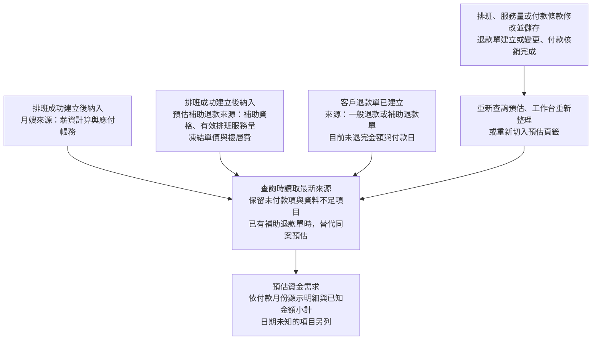
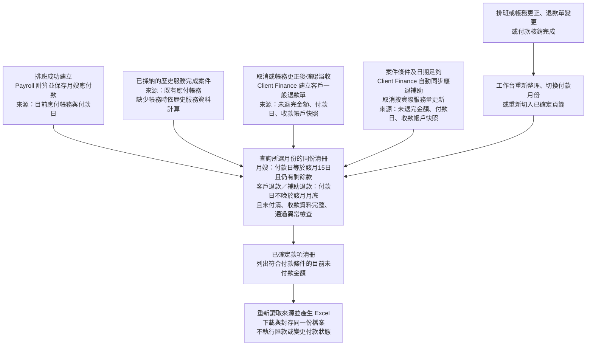

# Staff Payables 與 Client Refund 正式規格

> 2026-10-29 最新裁決：依規格04 §0新增獨立左側「帳務參數設定」及客戶名冊Drawer個案調整。新計價案件移除全補助分類，月嫂薪資可按來源分期：客戶負擔部分為服務結束月次月15日，直接補助部分為次次月15日。不得以實際入帳月份移動日期；分期總額與實付守恆，既有流水及已形成歷史資料不回寫。\n


## 1. 文件狀態與裁決

- 狀態：`approved-architecture-baseline`
- 人工核准日期：2026-08-03
- Staff Payables 月結裁決：`confirmed-inherited`
- Client Refund 納入正式 Client Finance：`consolidated-decision`
- Client Refund implementation status：`proven`
- 2026-08-10 金流證據與超收裁決：`approved`
- 2026-08-11 差額付款與追償可執行契約：`approved`
- 2026-09-11 客戶代墊、月嫂整筆應付與服務後補助退還：`reconfirmed-by-user`
- 2026-10-29 案件帳務 UI、差額只顯示與共用警示：U12 已授權並完成本機程式及後端驗收；完整行為及證據見 [`22` §15](22_銀行流水匯入與帳務異常處理正式規格.md#finance-20261029)，仍沒有手續費核銷或自動結清授權。既有 `REFUND_OVERAGE` writer 的收據 enum 由 236／1058 append-only 補齊，不重定義退款／追償規則。
- 本文件覆蓋舊稿中「人工月結 aggregate」與「一般客戶退款 deferred／missing」的矛盾。
- 2026-08-03 原始核准只啟用 Inventory v2 evidence；後續 Commands、schema、pytest 與
  legacy exit 的實作，必須各自依人工核准的 decision／Work Package 授權。

### 1.1 共通金流證據邊界（2026-08-10 裁決）

- 系統只被動匯入銀行對帳單；canonical bank fact 是實際收款、付款、退匯或扣回的唯一
  現金根事實。
- 應付帳款清冊是每月 5 日交會計師的付款指示與封存快照，不是付款指令執行結果；產生、
  下載、封存或交付清冊都不得將 obligation、ledger 或提醒改為已付款／已退款／已完成。
- 所有實際付款結果都必須由後續匯入的 canonical bank fact 經 Preview／Apply 核銷後才
  改變。未看到流水不代表付款失敗，只表示仍待付款或待核對。
- 所有退款先建立退款單，再產生交會計的應付明細並等待對帳單。退款單的 due date／明細
  產生日期只服務排程，不是後續銀行列核銷條件；緊急先匯時，canonical outflow 仍以
  收款對象的 canonical 收款帳戶與金額（多筆候選時人工唯一選定）對回既有退款單。
- 金額或對象不唯一時，必須保留原始銀行事實與 typed anomaly；不得猜測 allocation、
  不得直接建立已付款紀錄，也不得重複列出可能已付款的義務。
- 「退匯」只指銀行已退回既有出款的後續銀行事實；客戶超收後交會計師處理的項目名稱為
  「客戶退款應付／退款清冊列」，不得混稱為退匯。

2026-08-28 successor例外：上述bank fact唯一現金根事實與exact allocation仍是一般／新案件及可正常
還原歷史交易的規則；它不排除`PROV-20260828-historical-payment-and-owner-settlement-spec.md`核准的
pre-system historical owner-specific人工付款證據。該例外必須保存獨立source kind、payer/payee/direction、
exact obligations與audit lineage，不得偽造Finance Import row或bank allocation，也不得跨owner推定結清。

## 2. Domain：Staff Payables

### 2.1 責任與 SSOT

Staff Payables 擁有：

- Payroll 已建立之 assignment-owned 月嫂應付義務的付款生命週期與投影；
- 正式銀行出款、退匯／沖正的 immutable ledger event；
- payout event 與 payable obligation 的 allocation／link；
- `payable | partially_paid | completed | recovery_required | anomaly` 衍生投影；
- 應付款清單、同月嫂彙總與 XLSX 歸檔。

Staff Payables 不擁有：

- 訂單狀態、服務日、薪資公式或義務初始金額；
- 客戶退款義務；
- 人工 month-end close、draft、finalized、revision 或 paid 月結狀態機。

### 2.2 根事實與衍生值

根事實：

1. Payroll 產生的 immutable staff payable obligation；
2. assignment identity、正式服務日與 rate snapshot；
3. canonical bank payout fact；
4. payout／return／reversal ledger event；
5. obligation allocation／link；
6. bank account identity snapshot；
7. aggregate version 與 idempotency receipt。

衍生值：

- 應付餘額；
- `payable | partially_paid | completed | recovery_required | anomaly`；
- 指定付款日應付款清單；
- 同一月嫂、同一付款日的 XLSX 聚合列；
- payout anomaly 與重新應付狀態。

`staff_monthly_settlements`、`staff_monthly_settlement_details`、
`staff_actual_transfers`、`staff_payment_transactions` 與
`staff_transfer_allocations` 只作歷史查詢／遷移來源，不得形成新流程依賴。
live `staff_payments` 若存在，只能是 canonical Payroll obligation 的 compatibility
projection，不得成為第二個義務 SSOT 或被 Staff Payables 反向改寫。

### 2.3 Subsystem：Payable Obligation Projection

責任：把 Payroll 已提交的 obligation event 投影成 Staff Payables root facts。

Modules：

- `StaffPayableObligationConsumer`
- `StaffPayableIdentity`
- `StaffPayableProjectionReducer`
- `StaffPayableVersionGate`

不變量：

- obligation identity 唯一且可重播；
- 金額為正整數 NTD；
- 來源必須綁定 assignment 與 rate snapshot；
- 來源事件重送不得建立第二筆義務；
- adjustment 建立新不可變 event／allocation，不修改舊義務歷史。
- 同一 assignment 的 `total_payable` 只形成一筆整筆應付；不得按補助／自費資金來源拆分 obligation、due date 或 payout。
- 非全補助案件的月嫂付款資格不依賴政府入款，也不等待客戶補助退還；全補助案件的唯一整筆 due date 為結案後第二曆月 15 日，不因資金來源拆帳。實際不足額付款依 §2.4.1 先核銷實付，餘額繼續待付。

### 2.4 Subsystem：Payout Reconciliation

Commands：

- `PreviewStaffPayout`
- `ApplyStaffPayout`
- `PreviewStaffPayoutReturn`
- `ApplyStaffPayoutReturn`
- `PreviewStaffPayoutReversal`
- `ApplyStaffPayoutReversal`
- `PreviewStaffPayoutDifference`
- `ApplyStaffPayoutDifference`
- `PreviewStaffOverpaymentRecovery`
- `ApplyStaffOverpaymentRecovery`

共同 Apply 交易：

1. 以 canonical staff mutex order 取得 lock；
2. 鎖定 aggregate version、bank facts、bank account snapshot 與 obligations；
3. 重建 candidate，驗證 Preview fingerprint 與 expected version；
4. 依事件別 guard 驗證；
5. append payout／return／reversal event；
6. append obligation links；
7. 更新 projection、version、outbox 與 receipt；
8. 由 outer Unit of Work 單次 commit。

HTTP Preview 的 `candidate` 必須是 closed typed public view（不可向管理端透傳
`dict[str, Any]`）；各 Apply route 回 `202 JobAccepted` 時只表示 durable command 已排入，
不表示付款、ledger event、allocation 或 resulting status 已完成。完成結果只能由後續 job
outcome／canonical bank fact 讀回判定。

事件別 guard：

- 一般 payout：選定銀行出款與選定 obligation 的當下剩餘款精確相等；
- payout difference：只允許已確認唯一月嫂、唯一銀行帳戶 snapshot 與同一付款範圍內的
  obligations；銀行總額可以小於或大於 obligation remaining，但每一元銀行出款都必須由
  payout allocation 或 overpayment recovery root 完整表達；
- return：必須指向一筆仍有效的 payout 與 canonical 銀行退匯入款，重開相同義務；
- reversal：必須指向一筆仍有效的錯誤 payout，不要求銀行入款，但要求人工 reason、
  operation capability 與不可重複沖正；
- return／reversal 都不得超過目標 payout 的尚未重開金額。

帳戶不一致、收款人不唯一或 allocation 不唯一時，整筆仍不得建立正式 payout，轉 typed
blocker／anomaly。只有金額差異且 ownership 唯一時，才可使用專用 difference action；
一般 payout action 仍維持 exact-only。

#### 2.4.1 公會對月嫂付款不足

公會實際出款小於選定 obligation remaining 時，先核銷實際付款，剩餘款繼續列待付。
後續補款沿同一 obligation 核銷剩餘款，不修改原應付全額或重複計算薪資。

2026-10-29 差額顯示補充：案件頁以應付減有效實付顯示手續費參考，不認列費用、不扣減 obligation，也不因差額在 100 元以內或人員解除警示而結清。少付超過 100 元及任何超付依 `22` §15.7–15.8 進共用帳務警示；恰好少付 100 元不觸發此新增門檻。這是顯示／警示契約，以下不足額核銷、remaining、補款、超額追償及原正式 owner 規則不變。

`ApplyStaffPayoutDifference(mode=underpayment)` 必須在單一 Staff Payables UoW 內：

1. append 每筆 canonical bank outflow 對應的 immutable payout event；
2. 依 obligation identity 順序 deterministic allocation，allocation 總額必須等於銀行總額；
3. 計算 `remaining = obligation_amount - net_valid_payout`，不得由 UI 傳入；
4. remaining 大於零時投影為 `partially_paid`，保留待付餘額；
5. 下一次應付清冊只輸出 remaining，不得重列原 obligation amount；
6. 後續新的 canonical outflow 可繼續清償 remaining；歸零才轉 `completed`。

銀行對帳的人工核對清單可從「處理月嫂付款」選取一位月嫂的待付款項，再進入「處理付款不足或超額」。使用已選取的銀行流水，不要求重新輸入流水編號；成功核銷後原流水不再列入人工核對，剩餘款仍列待付。新的足額補款流水按當下剩餘款自動核銷。

畫面可選「足額核銷剩餘款」、「付款不足，先核銷實付」及「付款超額，另列追收」。
不足額處理成功且重新讀取餘額後，才開放「繼續核銷剩餘款」；結果未明時保留原命令，不開新操作。
分次付款後的退匯／沖正只重開指定來源付款的金額，保留其他有效付款，再計算剩餘款。

不得因部分出款更新 Payroll obligation 原始金額，也不得建立第二筆薪資義務。清冊生成與
重新下載不改變 remaining。

#### 2.4.2 公會對月嫂付款超額與追償

公會實際出款大於選定 obligation remaining 時，`ApplyStaffPayoutDifference(mode=overpayment)`
必須：

1. 保存完整 canonical outflow 與全額 payout ledger event；
2. obligation 額度內建立 payout allocation，使原 obligation 歸零並轉 `completed`；
3. 差額建立獨立 `staff_overpayment_recovery` root，不能提高 Payroll obligation；
4. 保存 bank fact、payout event、obligation 與 recovery identity 的 immutable lineage；
5. 投影 `recovery_required` anomaly，且 recovery 不得進入應付清冊；
6. 不得自動從其他案件或未來薪資扣抵。

`staff_overpayment_recovery` 最少保存：`recovery_identity`、`staff_id`、來源 bank fact、來源
payout event、來源 obligation identities、原始追償額、remaining、status、version、actor、
reason、evidence 與 current event identity。狀態機為：

```text
open／partially_recovered ──canonical incoming return allocation；remaining>0──> partially_recovered
open／partially_recovered ──canonical incoming return allocation；remaining=0──> recovered
open／partially_recovered ──authorized adjustment──> adjusted
```

回收款只接受唯一月嫂與唯一 open recovery 的 canonical incoming bank fact。預設要求一次
足額收回；若實際入款不足，仍保存實收並降低 remaining，作為疏失補救。授權 adjustment
必須具 `staff_payables.recovery.adjust` capability、不可變 reason/evidence、expected version
與 idempotency receipt；不得由 UI 直接修改 remaining。

正常匯入的永豐退回入款，若交易參考帳號唯一對應月嫂主帳戶，保留帳號綁定及待人工處理分類，由人員明確配對至既有追償，再核銷實收。不得因舊的退回分類名稱未出現而拒絕正式銀行根事實；不自動收回、不把一般入款轉成月嫂付款，帳號不唯一或已使用的流水仍阻擋。

#### 2.4.3 Staff payout difference typed contract

Preview intent 只接受：bank fact identities、obligation identities、`mode`、evidence references。
Apply 另接受 expected aggregate version、Preview fingerprint、stable idempotency key、actor、
reason 與 correlation id。Preview 回傳：bank total、obligation remaining total、allocations、
remaining payable、recovery amount、resulting states 與 blockers。

金額關係必須與 mode 一致；`underpayment` 要求 `bank_total < remaining_total`，`overpayment`
要求 `bank_total > remaining_total`。相等時必須改走一般 payout action。stale、已使用 bank
row、跨月嫂、帳戶不唯一或 mode 不符時零正式寫入。

### 2.5 Global／Application Subsystem：Accounts Payable Query／Export

本 Subsystem 置於本文件是為了記錄帳務來源契約；正式 owner 是跨 Domain
read-only reporting application，不是 Staff Payables Domain。它只能透過 Staff Payables
與 Client Finance typed view ports 組合輸出，不擁有 ledger 或付款狀態。

清冊及業務流程說明使用「月嫂應付款」「客戶退款單」，不使用「義務」作為款項名稱；內部 `obligation`、資料表、API、事件名稱與付款規則維持原名（2026-10-15 用詞裁決）。

月嫂應付款與客戶補助退款的建立時點不同：

- 月嫂應付款：排班成功建立時，由 Payroll 計算並保存；僅確認日期或排班作業尚未成功，不視為已建立。後續合法排班／條件修改依同一 owner 重算。
- 客戶補助退款：案件計價資料及日期足夠時由 Client Finance 自動同步應退 projection，隨有效服務量、條件或取消更新，不等待服務完工或服務費收齊，也沒有人工建立關卡；資料不足仍列待確認。
- 應付清冊：查詢時才把上述已建立、符合付款日與未清償條件的款項彙整成明細；預估補助金額不能當成待付款明細。

清冊查詢前的來源步驟與納入條件：

| 款項 | 從哪個步驟已有資料 | 清冊讀取來源／納入條件 |
|---|---|---|
| 月嫂應付款（一般案件） | 確認服務日期與排班中的排班建立／安排，由 Payroll 同交易計算及保存；換人、代班或相關條件變更沿既有 owner 重算 | Staff Payables 目前應付投影；必須尚待付款、付款日已確定且等於所選目標付款日，並通過帳戶與異常檢查。不因只有前段服務說明而建立，也不以完工狀態單獨判斷是否列入 |
| 月嫂應付款（歷史完成案件） | 歷史完成訂單採納時依原服務天數建立基準帳務；實際天數設定保存新版後重算 | 不要求重啟精算。缺少 materialized service-pay 帳務的既有採納完成案件，依下列唯讀歷史投影取得金額；已有帳務時不重複投影 |
| 客戶一般退款 | 取消或帳務更正後，Client Finance 確認已收金額超過應收並建立退款單 | 目前未退完金額、到期日及建單時收款帳戶快照；依目標付款日與正常 review 條件篩選 |
| 客戶補助退款 | 案件資料足夠時 Client Finance 自動同步，取消按已確認實際服務量調整 | 正式 `subsidy_return` projection 及未退完金額；到期列入同份清冊，缺值不當作零 |

來源已存在不代表立即列入所有月份清冊；仍須符合下列 Export 的付款日、未清償、帳戶及異常排除規則。重新查詢讀取最新款項；重新匯出產生新 Excel，舊下載與封存檔不自動改寫。產生清冊不執行匯款，也不將款項改為已付款。

Query：

- `QueryAccountsPayable(target_payment_date)`
- `QueryAccountsPayableArchive(year)`

退款付款與事後核銷邊界：所有客戶退款都先由 Client Finance 建立 `payable_to_client`
退款單，再由 Accounts Payable Query 產出給會計的付款明細；系統不執行匯款。後續 canonical
outgoing bank row 只能以退款單建立時固化的收款帳戶快照與可清償金額核銷，不能以 `due_date`、
付款明細產生日期或銀行交易日期作為配對條件。故 7/15 期的退款單即使會計在 7/1 緊急匯款，
仍可在銀行流水匯入後正確補登；無帳戶快照或銀行列未解析出收款帳戶時必須 fail closed。

客戶退款少匯（2026-08-11 人工核准）：canonical outgoing bank amount 小於同一退款單集合
remaining 時，Client Finance 在同一 UoW 保存不可變的不足來源事實（bank-row set、退款單 set、
帳戶快照、已匯額、remaining、版本、actor/reason/evidence、receipt 與 outbox），並將原退款單
投影為剩餘 payable；不得建立第二張退款單或由 UI 改 remaining。outbox 投影
`client_refund_underpayment`；後續只能以**新的**同帳戶 canonical outgoing row 對原退款單
remaining 做 Preview → Apply，全部歸零才解除。日期不參與此流程。

Export：

1. 在一致 read snapshot 讀取 `payable`／`partially_paid` 的月嫂款項，只取正數 remaining，不重列原始應付總額；以及 review=`normal` 的
   `pending`／`partially_refunded` 客戶退款義務；
   歷史訂單也只讀 Payroll 已建立的正式 obligation、其同一 assignment binding 與 Staff Payables 的目前餘額。
   已採納舊案若缺少義務，單案查核明確列為「尚未建立月嫂應付帳務」，由既有服務天數帳務 Preview／Apply 補建；
   Query 不從歷史來源重算薪資、不產生預定 obligation identity，也不將未建立義務的金額列入付款清冊（2026-10-20 人工要求移除平行帳務）。月嫂列只接受
   `due_date = target_payment_date`；較早月份未付款項不得混入所選月份清單；
2. 月嫂列依 `staff_id + target_payment_date + bank_identity` 聚合；
3. anomaly／completed／refunded／review-required 不進應付款清單；
4. client refund row 只輸出 remaining amount，並明確標示
   `customer_refund` 或 `subsidy_return`，不得重複輸出已清償金額；
   `subsidy_return` 的 target payment date 是結案月份加兩個曆月的 15 日，且列必須
   顯示為 `client_subsidy_return`，不得與月嫂 payout 合併或抵銷；
5. 只生成一次 workbook bytes；
6. 使用者下載 bytes 與 archive bytes 必須完全相同；
7. archive 名稱不可覆蓋，保存 SHA-256 receipt；
8. Query／下載／歸檔不改變 payable 狀態。

清冊列應能追溯 obligation identity、款項類型、案件、收款帳戶 snapshot、remaining amount
與重開／追償原因。被 anomaly 或付款證據待確認 blocker 排除的義務，必須另有可查詢的
排除原因與人工處理入口，不能靜默消失。

XLSX 是輸出快照，不是月結 entity。

### 2.5.1 預估資金需求與已確定清冊（2026-10-15 人工裁決）

狀態：`SPEC_READY`；2026-10-15 使用者後續明確授權依本節實作預估 API 與雙頁籤畫面，並驗證既有清冊與付款流程。規格保持已收斂；預估唯讀 API 已實作；畫面依最新人工裁決整合為付款工作區，依下列直接驗證確認既有清冊及付款核銷流程。

目的：工會先查看已排班案件未來可能支出的金額與日期，安排資金；交會計的付款清冊只列已建立且符合付款條件的款項。「已確定」表示已有帳務項目，不表示金額永久凍結或已付款；合法服務／帳務更正後仍讀取最新金額。兩者共用既有帳務來源，各自明確標示用途，不新增帳務狀態或寫入 owner root。

顯示位置（2026-10-15 最新人工裁決）：整合為「帳務工作台 → 付款」的一份清單，以款項類型、月份及正式待付／預估／待確認篩選。月嫂薪資、一般客戶退款、補助退款共用入口；逐人明細沿來源的 typed staff_id 定位，不以姓名猜配；正式帳務取代同一來源預估，不按案件號合併不同真實義務。正式待付與預估金額分開顯示；未知金額不當作零或宣稱完整總額。未知日期的項目在月份篩選後仍明示保留，避免漏列。

§2.5 已確定清冊的來源、付款條件、Excel 下載／封存與核銷規則維持不變。下載明示使用「會計清冊月份」，不受畫面款項類型／狀態／搜尋篩選改寫。歷史已付款與沖正從案件／人員明細查閱，不重複列為待付款。下列兩個流程圖描述既有來源規則，不再代表兩個獨立頁籤。

#### 預估資金需求流程圖



資料來源與納入條件：

- 新案件從「確認服務日期與排班」的排班成功建立開始納入；只有「尋找月嫂與詢問意願」的服務說明、媒合意願或保存服務日期不算已排班。排班以目前有效指派及有效工作日為準，不把已被取代的排班重複計入。
- 月嫂款項讀取既有 Payroll／Staff Payables 查核資料的未付款金額及付款日；已有應付帳務時標示「已確定」。歷史服務資料計算的項目標示「預估」；已排班但缺少薪資計算依據的月嫂仍保留明細，金額為待確認，不由此查詢建立帳務。已付清或結清者排除。
- 客戶預估補助退款讀取補助資格與上限、有效排班工作日及每日工時、凍結單價與樓層費，沿用 Client Finance 計算規則。已完成歷史案件有歷史實際服務量時沿用該來源；重新進入一般流程後改讀目前排班，不套用舊歷史服務量。
- 完工及客戶款是否收齊不是應退補助的建立關卡；資料足夠即自動同步正式金額。資料不足仍列待確認；社福未先墊的補助部分不產生客戶退款，不以零代替未知金額。
- 客戶一般退款及補助退款讀取已建立、仍未退完的退款單。補助退款單建立後，改用退款單的未退完金額與付款日，同案不再重複估算；退款已付清後，也不重新產生同案補助退款預估。來源已有未付款項時，即使沒有目前排班仍可追蹤；取消案件不再產生未建單的補助退款預估，已建立未清償款項保留。
- 未建補助退款單的預估付款日為「目前排班預計結束月份＋兩個曆月的 15 日」；已建退款單與月嫂款項使用各自來源付款日。金額、日期或收款資料不足不套用已確定清冊的排除條件，而是在明細說明原因；未知日期另列，不強塞進所選月份。

#### 已確定款項清冊流程圖



資料來源與納入條件：

- 月嫂應付款在排班成功建立時已有資料；只確認日期不會建立應付款。清冊不以訂單是否完工單獨判斷納入，而是讀取應付帳務、付款日、目前付款狀態及收款資料。
- 已採納的歷史服務完成案件不必重啟精算。已有應付帳務時讀取該帳務；缺少帳務時，沿用 §2.5 的歷史投影：最新歷史實際天數，缺少時使用原服務天數，再沿既有薪資、調整額及付款日規則計算。資料不足或已結清者不列入，查詢不補建帳務。
- 排班確認只能計算預估客戶補助退款，不會同時建立補助退款單；必須經 Client Finance 完成上述建單條件後，已建立的未退完金額才是清冊來源。客戶一般退款也必須先建立退款單。
- 月嫂款項沿用所選月份 15 日的付款日篩選；客戶一般退款及補助退款納入所選月份月底以前仍未退完的款項，包含 16 日至月底及以前月份餘額。退款依各自 due date 歸屬，不新增付款日期政策或獨立退款清冊。缺日期或收款資料在付款清單保留待確認，不冒充可付款清冊。
- 月嫂未付款或部分付款且 remaining 為正時可列入，並須有唯一主收款帳戶、收款人及銀行資料；清冊與 Excel 只列目前 remaining，同案查核 API 分開呈現原始應付總額及未付款餘額。客戶退款必須仍開啟且餘額為正，建單時收款帳戶快照完整，並通過退款來源異常檢查。客戶部分退款列目前未退完金額；已付清、結清、缺少收款資料或未通過其他異常檢查者不列入。
- 「已確定」表示有款項依據，不表示金額永久凍結或已付款。重新匯出會再次查詢來源，因此修改發生在畫面查詢與下載之間時，新 Excel 可能與先前畫面不同；同一次下載及封存使用相同檔案，舊下載及封存檔不自動改寫。

月嫂部分付款（2026-10-15 修正）：依 §2.4.1，`partially_paid` 不因部分付款本身被清冊視為異常。來源查詢及彙整同時接受 `payable`／`partially_paid`，使用 Staff Payables 目前正數餘額；付款日、歷史結清證據、收款帳戶及其他異常檢查仍適用。個案查核依所選付款月份回傳 `selected_month` 或 `other_month`，缺少日期或收款資料時仍說明排除原因。原始應付金額、部分付款狀態、付款紀錄及異常處理紀錄不因查詢、下載或封存被修改。

#### 兩個頁籤的更新時機

來源須完成儲存／套用或付款核銷後，下次查詢才讀得到最新資料。來源變更不會即時推送到已開啟的畫面，也沒有定時自動刷新。

| 操作／變更 | 預估資金需求 | 已確定款項清冊 |
|---|---|---|
| 排班、服務量、付款條款或帳務修改完成 | 下次查詢依最新來源重新計算／讀取金額及日期 | 下次查詢讀取更新後帳務，重新判斷是否符合付款條件 |
| 客戶補助退款單建立 | 下次查詢以退款單替代同案預估 | 下次查詢才可能納入，仍須符合付款日、餘額及收款資料條件 |
| 付款／退款核銷完成 | 下次查詢減少未付款金額或移除付清項目 | 下次查詢更新剩餘款或移除付清項目；月嫂部分付款只列 remaining，仍須符合付款日及其他付款條件 |
| 重新進入對應頁籤，或工作台「重新整理」 | 重新向 API 查詢 | 重新向 API 查詢 |
| 「重新查詢預估」 | 重新向 API 查詢 | 不適用 |
| 切換付款月份 | 只篩選已載入資料，不重新向 API 查詢；未知日期項目仍保留 | 重新查詢同月份清冊；月嫂按 15 日，客戶退款按月底 |
| 重新下載 Excel | 此頁籤不提供付款清冊匯出 | 重新查詢來源、產生新檔並封存；既有檔案不變 |

流程圖核對來源：`subsystems/staff_payables/cash_requirements_query.py`、`infrastructure/mysql/cash_requirements_repository.py`、`subsystems/staff_payables/accounts_payable_export.py`、`infrastructure/mysql/accounts_payable_export_sources.py`、`api/routes/finance_reports.py`、`ui_react/src/components/CashRequirementsPanel.tsx` 及 `ui_react/src/pages/FinancePage.tsx`。2026-10-15 依使用者後續指示修正月嫂部分付款的查詢篩選與彙整，API 回傳格式、金額公式、帳務建立時點與付款寫入流程沿用既有契約。

| Requirement／Acceptance | 規格與來源 | 驗收 |
|---|---|---|
| `CASHPLAN-01` 範圍 | 使用者明確選擇從已建立排班開始，納入尚未成立的預估客戶補助退款；媒合中、只有服務說明或只保存服務日期的案件不納入。已排班案件後續完成仍可追蹤未付款項；取消案件不再估算未履約支出，已建立的未清償款項仍保留 | 相同媒合案件在排班建立前不出現，建立後出現；完成／取消不造成已建立未付款項消失 |
| `CASHPLAN-02` 月嫂來源 | 既有 Payroll／Staff Payables 目前未付款金額及 owner 付款日；不得由前端以預計天數另算一套薪資，不重複列入已付清金額 | 多位月嫂與代班依各自來源合計守恆；已付清排除，更正後重新查詢更新 |
| `CASHPLAN-03` 補助退款來源 | 讀 Client Finance 的補助上限、有效服務量及凍結單價，資料足夠即自動同步應退 projection；不足時保留待確認。社福未先墊部分不退；已有 projection 使用實際未退完金額，替代同案預估 | 不等待完工或客戶款收齊；同案不重複計算預估與正式金額 |
| `CASHPLAN-04` 日期與缺值 | 月嫂付款日使用既有 owner 日期。未建客戶補助退款單時，可用目前排班預計結束月份＋兩個曆月的15日顯示「預估付款日」；建單後改讀退款單日期。金額或日期缺足夠來源時標示待確認，不以零或當月代替，也不把預估日期寫入付款條款或退款單 | 預計結束日變更後預估月份更新；日期未知的項目另列待確認；不改寫真正的結案日、到期日或帳務 |
| `CASHPLAN-05` 呈現與更新 | 付款清單顯示受款人／案件、款項類型、付款狀態、未付款金額及預估／已確定付款日，以月份篩選。付款狀態篩選為「全部／確認待付／待確認服務結束」；確認待付沿用 confirmed，待確認服務結束只納入 estimated 且 owner 原因含「服務尚未完成」的項目。其他預估項目仍保留於全部並顯示「待確認」，不得改列確認待付。狀態欄只顯示簡短標籤，不顯示「待確認事項」與原因清單；待確認原因保留於 typed 查詢（2026-10-15 使用者後續指示）。來源金額保留 typed 查詢，不在列表重複顯示。頂部依正式／預估分開顯示已知金額小計，不顯示「金額待確認」或「付款日期待確認」的筆數統計卡片（2026-10-15 使用者後續指示）。缺金額時不得宣稱完整資金總額；資料確實不足的項目仍在明細標示待確認。查詢唯讀；來源套用後重新查詢更新；已下載檔案不自動更新 | 預估結果不能當作付款指示或造成已付款；與清冊同一已確定項目的金額一致；頂部不再顯示兩張待確認筆數卡片，未知日期／金額仍可從明細查閱 |
| `CASHPLAN-06` 位置與入口 | 「帳務工作台 → 付款」統一清單；正式待付／預估／待確認為篩選，補助資訊進入共用案件補助明細；不再提供預估與正式清冊兩個主頁籤 | 正式與預估分開合計；同一真實款項只出現一次；會計清冊仍依 §2.5 下載與封存；歷史可從案件／人員明細查閱 |

實作契約與驗證範圍：

- 新增管理員唯讀 `GET /api/v1/finance-reports/accounts-payable/cash-requirements`；`page_size` 預設 100、範圍 1～200，以 `after_case_no` 按案件排序分批讀取。每批使用一致性唯讀快照，結束時 rollback；不執行 commit、建單或付款。
- Typed 回應為 `rows` 與 `next_cursor`。每列包含 `row_id`、案件、受款人、款項類型、預估／已確定、來源、來源金額、未付款金額、付款日期、日期是否預估及待確認原因；未知金額／日期保留 null，不輸出銀行帳戶或身分證字號。
- 畫面完整載入所有批次後才顯示月份小計；批次失敗不顯示部分合計，離開預估頁籤取消查詢。月份篩選保留日期未知的獨立區塊；重新查詢讀取最新 owner 金額與日期。已確定頁籤維持既有付款月份查詢及 Excel 下載／封存。
- 使用有效指派的目前排班工作日與 Orders 工時取得預估服務量；已完成歷史案件已有歷史實際服務量 projection 時沿用該 owner 資料。正常流程重啟後不得用舊歷史服務量覆蓋目前排班。月嫂金額由既有 Staff Payables 查核來源提供；客戶預估退款使用既有 Client Finance `project_subsidy_return`，不另寫計算公式。

| Acceptance | 直接驗證 |
|---|---|
| `CASHPLAN-01`～`04` | `tests/domains/staff-payables/subsystems/staff-payables/integration/test_cash_requirements_query.py`：排班邊界、取消保留未付款、補助上限／全補助排除、正式退款替代、未知值、重新查詢及來源金額守恆 |
| `CASHPLAN-05`～`06` | 同 root 的 `test_cash_requirements_api.py`：管理員 GET、typed null、無銀行欄位、批次上限及拒絕 POST；既有 Finance presentation root 的 `cash_requirements.test.tsx`：完整載入、部分失敗拒絕、月份小計、未知日期保留、重新查詢與鍵盤頁籤切換 |
| 月嫂部分付款 | 同 integration root 的 `test_accounts_payable_export_sources.py`、`test_accounts_payable_export_workflow.py`、`test_accounts_payable_query_api.py` 及 `test_accounts_payable_export_disposable_mysql.py`：正數剩餘款、所選付款日、帳戶及其他異常排除、API／個案查核／XLSX 金額一致、重新查詢更新及付清後排除；原應付金額與帳務狀態不因查詢改寫 |
| 既有流程 | 原 accounts-payable source／workflow／archive／case audit、staff payout reconciliation／public contract、client refund overage 與 FinancePage 查詢／下載 regression；本機 DB GET 前後帳務 facts 比較與實際瀏覽器畫面核對 |

Owner：既有跨 Domain Accounts Payable reporting application 負責唯讀組合；Payroll／Staff Payables 與 Client Finance 分別擁有原金額及日期規則。此裁決只增加明示的資金預估投影，不修改應收、應付、退款建立時點或核銷規則，不新增資料表／migration、fingerprint、付款副作用或另一套 writer。

來源追溯：2026-10-15 本次使用者的資金調控目的、「從已建立排班開始，包含尚未成立的預估客戶補助退款」選擇，以及「財務查詢與對帳工作台 → 應付帳款」內設置「預估資金需求」與「已確定款項清冊」兩個頁籤的明確指示（`PRODUCT_REQUIREMENT`）；本規格 §2.5、`04_Client_Finance_Domain.md` 的補助退還與預估金額規則、`03_Payroll_Domain.md` 的付款日及薪資規則。金額計算沿既有 owner，預估付款日為本節明示的預估用途，不替代正式退款日期。

```yaml
spec_route:
  status: SPEC_READY
  requirements: [CASHPLAN-01, CASHPLAN-02, CASHPLAN-03, CASHPLAN-04, CASHPLAN-05, CASHPLAN-06]
convergence:
  status: READY
  blockers: []
package_route:
  status: NO_PACKAGE_REQUIRED
  reason: 同一 reporting owner 的完整執行由本節契約、直接 source/test roots 與驗證矩陣承接；本次無獨立交接、資料 migration、付款或外部副作用，不另建重複 package。
```

### 2.5.2 帳務三工作區與案件補助明細（2026-10-15 預覽核准後授權）

人工 Authority：使用者核准互動預覽並要求正式整合；只改呈現與讀取銜接，保留原有帳務規則及歷史紀錄，最後驗證後端能力。

- 收款：客戶收款及政府補助共用工作區，沿用 canonical Client Finance 摘要與 Government Subsidy projection；政府服務歸屬季度、預計申請年月／實際送件日、核准／已分配入款與工會墊款回收狀態可查；服務季度年份沿 service_end_date，不以可能跨年的申請年份替代。摘要不得以契約金額推導未收餘額。尚無帳務案件顯示待確認，不當作已付清。
- 付款：依 §2.5.1 統一待付與預估清單；人員逐筆付款事件、歷史人工確認及案件帳務完成仍由既有 owner workflow 處理。
- 銀行對帳：保留工作簿上傳 → Preview → human Confirm → durable Apply → terminal receipt／人工核對流程；不改配對、核銷、冪等或更正規則。
- 案件補助明細：三區共用同一案件入口，集中身分、正式請款時數／凍結單價、政府申請／核准／實收分配、客戶應退與已退、正式工會墊款／回收。資料不足顯示待確認或查詢錯誤，不能以空清單／零偽裝成功。補助退款核銷後形成的代墊沿 ADVREC-01～05，自同案明細操作回收；結果不明保留原 command 並先查回結果。
- 移除獨立的客戶補助退款、代墊銷帳、逐人應付款、應付帳款主入口及重複 KPI／金額欄位；歷史 ledger、沖正、回收與下載紀錄不刪除。帳務設定為獨立設定按鈕，主導航只有三項。
- 舊 `client-receipts`／`staff-payables`／`accounts-payable`／`cross-order`／`subsidy-advance` 深連結解析至對應工作區或同案明細；不重建已退役 UI，不移除既有 API／CLI。
- canonical Client Finance 歷史查詢須接受已存在的 `subsidy_return` 與 `subsidy_advance` entry types，使同案歷史可讀；不增 ledger 類型、不補寫資料。無 schema migration、production 寫入或 external provider effect。

驗收：三個入口可操作；正式與預估不混算；款項保留來源唯一性；補助退款→代墊→政府入款→回收在隔離資料庫可重送且不重複付款；歷史含補助與沖正可讀；銀行原預覽／確認／結果不明與重送保護仍通過；必要實際 GET、桌面及手機呈現通過。

### 2.5.3 收付款完成狀態（2026-10-20 人工修正）

依本次人工指示，實際收付款後，帳務清單必須呈現「已收款／已付款」，不得持續顯示待確認。此節取代 §2.5.1、§2.5.2 中付款主清單只列未付項目的呈現限制；會計清冊仍只匯出符合既有條件的未付餘額，不改 writer、交易邊界或銀行外部效果。

- 付款清單保留已付款及歷史已結清項目。既有唯讀 cash requirements 每列增加 `payment_status`：`pending`、`partially_paid`、`paid`、`settled`；與 `certainty` 分開。銀行付款投影 completed 或 exact current 歷史 paid 證據顯示「已付款」；歷史 settled 顯示「已結清」，不能冒稱已匯款。部分付款顯示剩餘款，已付／結清列未付餘額為零，不增加待付小計；款項種類、既有預估及服務結束篩選保留，增加部分付款／已付款／已結清篩選。付款日期沿原來源，不以到期日冒稱實際匯款日。
- 服務中換人造成超付款時，付款清單顯示已付款、未付額零及追償提示；原帳務負餘額與獨立追償仍保留。不得將負餘額當成待付款，或因該列使整份付款清單無法查詢。
- 客戶帳務摘要增加 `receipt_status`：`pending`、`unpaid`、`partially_received`、`received`、`settled`。清單分別顯示待確認、待收款、部分收款、已收款、已結清；已收款篩選包含部分收款。canonical receipt／reversal 淨額與 exact current 歷史 paid 證據提供收款依據；歷史 settled 不等於實際收款。`receipt_entry_count` 保持只計 canonical receipt，不能拿其他 ledger 類型當收款證據。
- 政府補助收款列沿既有 owner `substatus_code` 呈現收款狀態：`paid` 顯示已收款、`partially_paid` 顯示部分收款；服務結束確認仍是獨立欄位，不取代入款狀態。
- 歷史 owner overlay 只有 obligation identity、金額快照與 obligation version 都符合目前義務時才有效；有效 paid／settled 不再列為未收／未付。沖正或後續版本造成新餘額時，重新查詢須顯示目前狀態，不沿用失效的歷史確認。
- 直接驗證包含：已採納歷史收付款、正常付款、部分收付款、沖正後重新未付、歷史金額／版本失效、無帳務資料與零餘額；Query 不建立付款或結清事實。

### 2.6 Typed errors

| Code | 類型 | 處理 |
|---|---|---|
| `staff_payable_not_found` | not-found | 重新 Query |
| `staff_payable_candidate_stale` | stale | 重新 Preview |
| `idempotency_conflict` | conflict | 拒絕重用不同 payload |
| `staff_obligation_not_exactly_settled` | blocker | 人工核對銀行事實與義務 |
| `staff_bank_account_ambiguous` | blocker | 人工確認唯一有效帳戶 |
| `staff_payout_amount_mismatch` | blocker | 一般 payout 不可套用；改由異常中心選正確 difference action |
| `staff_payout_difference_mode_invalid` | validation | 金額關係與 underpayment／overpayment mode 不符 |
| `staff_overpayment_recovery_target_ambiguous` | blocker | 人工確認唯一月嫂 recovery |
| `staff_overpayment_recovery_adjustment_forbidden` | forbidden | 缺 capability，不可調整 recovery |
| `staff_payout_reversal_invalid` | blocker | 不得 reversal-of-reversal 或超額 |
| `transaction_failed` | transaction | 只有 storage unavailable／deadlock／timeout 標 retryable |
| `accounts_payable_export_has_anomaly` | blocker | 異常中心處理 |
| `accounts_payable_archive_failed` | external | 不宣稱匯出完成 |

### 2.7 人工入口與異常

- 管理員只能從應付款 Query 選定 bank facts 與 obligations 後 Preview／Apply。
- `PAYOUT-001`～`003` 由 root facts 投影；認領／解除不取代修正根事實。
- 退匯／沖正成功後，既有義務重新成為 `payable`。
- 正常且可唯一辨識帳戶、月嫂及完整義務集合的銀行支出，由 Finance Import 的
  Upload → Preview → confirmed Apply 在 borrowed UoW 委派 Staff Payables；React 正常頁到 terminal
  receipt／readback 即結束，不再要求第二次「標記已付」。不唯一、金額不符、退匯、沖正與差額
  才導向本節的 typed 人工入口，不得以 disabled 假按鈕代替。

### 2.8 Legacy exit

1. 所有 `staff_monthly_settlements*` production writer 停止；
2. legacy staff payment transaction route 固定 `410 Gone`；
3. adjustment 不得寫入「下一個未 finalized 月結」；
4. `finance_import_dispatch` 不得再寫 `staff_actual_transfers` 或月結 candidate；
5. writer inventory 與 runtime tests 證明無正式 caller；
6. 保留資料只經 versioned preserve-data migration，不直接 DROP 歷史表。

## 3. Domain：Client Finance／Customer Refund

### 3.1 責任與 SSOT

Client Finance 擁有：

- 客戶 refund obligation；
- canonical bank outflow 與 immutable refund ledger entry；
- refund entry 對 refund obligation 的 exact allocation；
- account version、outbox、receipt 與目前投影；
- receipt reversal 後重新形成的 receivable。

退款不解除已成立的不可逆案件服務資料鎖，也不改變 Orders 已發生的服務事實。

### 3.2 Refund 與 Reversal 排他

| Operation | 根事實 | 結果 |
|---|---|---|
| Customer Refund | 已成立 refund obligation＋正式銀行出款 | 清償退款義務 |
| Subsidy Return | 依案件資料自動同步的應退補助＋正式銀行出款 | 退還客戶先墊補助；社福未先墊者不退款。所有月份依有效服務結束月加兩曆月 15 日到期，不等待政府入款 |
| Receipt Reversal | 既有有效 receipt ledger event 失效 | append reversal 並重開原 receivable |

禁止：

- 用負數收款表示退款；
- 更新或刪除原 receipt；
- 把 refund 當 receipt reversal；
- reversal-of-reversal；
- 無 refund obligation 時依人工輸入金額直接付款；
- 因退款解鎖服務資料或倒退 Orders lifecycle。

每一筆 canonical bank outflow 必須全額分配，不得留下不明餘額；同一 refund obligation
可以由多筆不可變銀行出款逐步清償，因此 obligation 可以有 `partially_refunded` 投影。
任何 allocation 都不得使累積有效退款超過 obligation amount。

若 canonical bank outflow 確實大於該退款 obligation 的 remaining amount，系統不得丟棄
已發生的出款。它必須：

1. 將 obligation 額度內的金額作為 refund allocation；
2. 將超額金額建立獨立的 `client_over_refund_recovery` 追償應收與 anomaly；
3. 保留原 bank fact、原 refund ledger 與超額追償之間的完整可追溯鏈；
4. 不再建立新的退款應付，亦不得自動以後續客戶款項抵銷；只有後續 canonical 入款或經
   授權的不可變 adjustment 才能結清追償。

一般退款 ledger entry type 固定為 `refund`，其退匯／沖正固定為
`refund_reversal`；客戶補助退還則固定為 `subsidy_return`，其退匯／沖正固定為
`subsidy_return_reversal`。兩條線不得共用 transaction type、remaining balance 或
progress reducer。`reversal` 只可用於原 client receipt 的沖正。

### 3.3 Subsystem：Refund Obligation Planning

Commands：

- `CreateCustomerRefundObligation`
- 案件計價資料保存時，自動同步應退補助；沒有人工建立關卡
- `AdjustRefundObligation`
- `ApplyClientReceiptWithOverage`
- `ApplyClientRefundWithOverage`

一般退款 root fact 來自已提交的 cancellation／financial adjustment；應退補助由案件條件與日期的 owner writer 自動同步，詳規格 04、14。政府入款與代墊回收以整期處理，不逐案銷帳。
每個 obligation 保存 source event identity、case number、integer amount、reason、
version 與 immutable creation event。

客戶超收是額外的合法 root-fact 來源。`ApplyClientReceiptWithOverage` 僅能在選定的
canonical incoming bank fact、唯一 case、唯一應收義務與人工確認都成立時執行，且須在
同一 outer Unit of Work 內：

1. append 全額實收的 receipt ledger；
2. 將應收額度內的金額 allocation 至原 receivable；
3. 將差額建立 `customer_refund` payable obligation，來源明確指向該 receipt ledger；
4. 寫入超收處置 receipt、version、idempotency receipt 與 outbox。

不得將超收直接視為退款已完成，也不得只把 `client_receipt_overpaid` 留在 alert 而遺失
已收現金的正式表達。案件或義務不唯一、重複匯入、疑似錯誤分類時，仍只能保留 bank fact
與 review，不得建立退款 obligation。

### 3.4 Subsystem：Refund／Reversal Preview and Apply

Queries／Commands：

- `QueryClientRefundReversal`
- `PreviewClientRefund`
- `ApplyClientRefund`
- `PreviewClientSubsidyReturn`
- `ApplyClientSubsidyReturn`
- `PreviewClientReceiptReversal`
- `ApplyClientReceiptReversal`
- `PreviewClientRefundReturn`
- `ApplyClientRefundReturn`
- `PreviewClientRefundReversal`
- `ApplyClientRefundReversal`

Preview：

- 選定 canonical bank fact 與 obligation／reversal target；
- 驗證同一 case、operation purpose、金額、唯一性與目前 account version；
- 建立 deterministic allocation 與 fingerprint；
- 零寫入。

Apply：

1. 檢查 idempotency receipt；
2. 鎖定 Client Finance account、bank facts、obligations 或 reversal targets；
3. 重建 candidate；
4. 驗證 expected account version 與 Preview fingerprint；
5. append ledger entries 與 allocations；
6. 精確套用本次 refund allocation 並重算 remaining；remaining 為零才標示
   `refunded`，receipt reversal 則重開 receivable；
7. 更新 projection、version、outbox 與 receipt；
8. outer Unit of Work 單次 commit。

每一筆選定 bank outflow 的金額必須被完整表達；不足 obligation 全額時形成
`partially_refunded`。超過 remaining refundable amount 時，`ApplyClientRefundWithOverage`
必須依 3.2 建立超額追償應收，而不是拒絕並遺失銀行現金事實。

### 3.5 State machine

Refund obligation 使用兩個正交衍生投影，避免把人工覆核進度混入付款進度：

```text
refund_progress:
not_required
pending ──valid partial allocation──> partially_refunded
pending／partially_refunded ──remaining amount exactly zero──> refunded
refunded ──valid refund return／reversal event──> pending | partially_refunded

refund_review:
normal ↔ review_required
```

`client_over_refund_recovery` 另有獨立的 `open → recovered | adjusted` 投影；它不屬於
refund progress，且不得自動與客戶新應收或其他案件抵銷。

#### 3.5.1 `client_over_refund_recovery` 可執行契約

每筆 recovery root 最少保存：

- `recovery_identity`、case number、client identity；
- 來源 canonical refund outflow bank fact、來源 refund ledger entry、來源 refund obligation；
- `original_amount_ntd`、derived `remaining_amount_ntd`；
- `status=open|partially_recovered|recovered|adjusted`、aggregate version、current event identity；
- 建立時的 actor、reason、evidence、idempotency key 與 correlation id。

不可變 recovery events：

- `established`：退款實際多匯 Apply 同交易建立；
- `cash_recovered`：連結後續 canonical incoming bank fact 與 recovery allocation；
- `authorized_adjustment`：沒有銀行入款，只能由具 capability 的人工裁決追加；
- `reversed`：只修正錯誤分類／錯誤 recovery event，必須指向原 event，不代表現金退回。

Commands：

- `QueryClientOverRefundRecovery`
- `PreviewClientOverRefundRecoveryReceipt`
- `ApplyClientOverRefundRecoveryReceipt`
- `PreviewClientOverRefundRecoveryAdjustment`
- `ApplyClientOverRefundRecoveryAdjustment`

銀行入款結清規則：

1. bank fact 必須是尚未被正式 ledger 使用的 canonical incoming row；
2. 必須由案件、客戶／退款參考或人工證據唯一指向一筆 open recovery；
3. 入款金額不得大於 recovery remaining；超額時停止並建立新的金額異常，不能自動轉作
   客戶一般收款；
4. 預設要求一次足額收回；實際入款不足時仍 append `cash_recovered` 作為疏失補救，狀態為
   `partially_recovered`，remaining 保持可追；
5. 同一 bank fact 只能對一筆 recovery 建立一份正式 allocation；
6. remaining 歸零才轉 `recovered`，並由根事實 projector 自動解除 recovery anomaly。

Adjustment 規則：

- 只允許 `client_finance.recovery.adjust` capability；
- 必須提供 adjustment amount、reason、evidence reference 與 expected version；
- adjustment amount 不得超過 remaining，也不得為負數或零；
- adjustment 只追加不可變 event，不建立虛構銀行 receipt；
- 部分 adjustment 後仍為 `open`，remaining 歸零才為 `adjusted`；
- 不得以 adjustment 偷渡跨案抵扣、改寫原 refund、client receipt 或 Orders lifecycle。

Preview 零寫入；Apply 鎖定 recovery、bank fact（cash only）、account version 與 active anomaly，
fresh rebuild candidate 後同交易 append ledger／event／allocation、CAS projection/version、outbox、
receipt 與 anomaly desired-state event。完全相同 idempotency key＋payload回 existing receipt；
不同 payload conflict。

### 3.6 銀行根事實與逾期提醒

系統不直接接收銀行付款結果。人員匯入的 canonical bank fact 是退款是否實際發生的
唯一根事實；沒有可核銷 bank fact 只表示尚未取得結果，不能建立 `payment_failed`、
`submitted` 或 `bank_pending` 狀態。

當 remaining amount 大於零且 business date 已過 due date，系統以 canonical
obligation／ledger projection 建立 overdue reminder，請人員核對對帳單是否已匯入或需
人工配對。有效 bank fact 經正式 Preview／Apply 精確 allocation 後，提醒自動解除；
它不修改任何 obligation、ledger、allocation 或 Orders lifecycle。

正式 refund ledger event append 後不可改寫。銀行退匯若需要重新應退，必須新增
dedicated reversal／reopen event，不得刪除原 refund。

Refund return／reversal 的 target 必須是仍有效的 refund ledger entry。return 另須綁定
canonical 銀行退匯入款；reversal 需要人工 reason 與 operation capability。兩者都使用
expected account version、Preview fingerprint 與各自 stable idempotency key，在 Client
Finance outer Unit of Work 內 append dedicated reopen event、重算 progress、寫 receipt
與 outbox 後單次 commit。不同 payload 重用 key、stale target、重複 return／reversal
一律 conflict；只有 storage unavailable／deadlock／timeout 可安全重試。

### 3.7 Typed errors

| Code | 類型 | 處理 |
|---|---|---|
| `client_finance_case_not_found` | not-found | 停止 |
| `client_obligation_not_found` | not-found／stale | 重新 Query |
| `client_finance_candidate_stale` | stale | 重新 Preview |
| `client_finance_version_conflict` | conflict | 重新 Query |
| `idempotency_conflict` | conflict | 拒絕不同 payload |
| `invalid_client_refund_intent` | validation | 修正選擇 |
| `client_refund_bank_allocation_incomplete` | blocker | 每筆銀行出款未被完整分配 |
| `client_refund_exceeds_remaining_amount` | blocker | 一般 refund action 拒絕；改走專用 overage action 建立追償應收 |
| `client_refund_return_invalid` | blocker | 退款退匯／沖正目標無效 |
| `client_over_refund_recovery_not_found` | not-found | 重新 Query 異常與 recovery |
| `client_over_refund_recovery_amount_exceeded` | blocker | 入款／adjustment 不得超過 remaining |
| `client_over_refund_recovery_target_ambiguous` | blocker | 人工確認唯一 recovery |
| `client_over_refund_recovery_adjustment_forbidden` | forbidden | 缺 capability，不可調整 |
| `client_receipt_reversal_invalid` | blocker | 不得超額或重複沖正 |
| `client_finance_storage_unavailable` | retryable | 安全重試／查 receipt |

### 3.8 人工入口與異常

- UI 顯示 backend Query 的 bank facts、refund obligations、account version 與 blockers。
- Apply 必須沿用同一次 Preview 的 fingerprint 與 stable idempotency key。
- 金額不符、多義對象、缺 bank identity 或歷史資料不可唯一還原時，維持 open 並進
  Anomalies；不得猜測 allocation。
- overdue reminder 的人工入口只導向 bank fact 匯入、查詢、配對或補正；不得直接把
  提醒標示為已付款。

### 3.9 Legacy exit

- 舊「本階段不支援一般退款」標為 superseded。
- 任何直接更新 `client_payments` summary、負收款、覆寫原 transaction 或跨案抵銷路徑退出。
- Data Browser 不得修改 refund／receipt ledger。

### 3.10 Implementation closure

Client Refund 已具備下列已驗證能力：

1. Finance Import／bank classifier 會產生獨立的 `client_refund` canonical classification；
2. production dispatch 以 borrowed Client Finance Unit of Work 完成退款核銷；
3. `partially_refunded`／`refunded`／`review_required` reducer 維持獨立進度與覆核投影；
4. canonical obligation／ledger projection 導出退款逾期提醒，未匯入銀行對帳單不會誤建為付款失敗；
5. bounded 全域退款待辦提供人工核對入口，根事實核銷後自動解除提醒；
6. Accounts Payable Export 明確區分 `customer_refund` 與 `subsidy_return`；
7. Module、Subsystem、隔離 MySQL Domain 與 Global E2E 均已有可重跑證據；
8. writer inventory 證明負收款、原交易覆寫與 legacy refund caller 已退出。

以上 implementation closure 只適用於既有 exact／partial refund、return／reversal 與清冊能力。
2026-08-11 新增的 client recovery collection／adjustment 與 staff payout difference／recovery
在人工確認及相應 E2E 完成前，不得列為 `proven`。

## 4. 交易與跨 Domain 邊界

- cancellation／adjustment 產生 refund obligation 時，由相應 Global coordinator 的
  outer Unit of Work 同交易委派 Client Finance。
- 實際銀行退款核銷由 Client Finance 擁有，不回寫 Orders lifecycle。
- Accounts Payable Export 可以唯讀合併 staff payable 與 client refund rows，
  但不能在同一 Query 中互相抵銷。
- Finance Import 只提供 canonical bank facts，透過 borrowed Unit of Work 委派
  Client Finance 或 Staff Payables，不直接寫正式 ledger。

### 4.1 Historical payment source priority（2026-08-28 人工裁決）

歷史案件與一般案件都先使用Finance Import匯入的對帳單；只有pre-system且已正式採納的historical
case，在舊銀行／帳務來源不能可靠還原時，才使用owner-specific歷史人工付款／結清Q/P/A。付款是
具payer、payee、direction與exact obligations的event；Client Finance settlement、Staff Payables
completion與Orders Step 11是三個不同projection，不得以單一「已付款」或「已結清」跨owner推定。

客戶補助退款是工會付給客戶的Client Finance `subsidy_return`；Government Subsidy只擁有政府撥款、
claim allocation及政府入款溢撥的合法 offset 處置。工會先墊付客戶補助退款後，政府後續撥款只建立既有墊付款的
settlement link，不新增第二筆客戶退款，也不重開已結清client obligation。

完整source、replay、later-event與UI契約由
`../02_決策與退役執行記錄/PROV-20260828-historical-payment-and-owner-settlement-spec.md`擁有。

## 5. 分層驗收

### Module

- integer NTD、一般 action exact allocation、difference action 金額守恆、deterministic ordering、
  reversal guards；
- payout／refund／remaining／recovery projection reducer；
- workbook aggregation、bytes digest 與 filename。

### Subsystem

- Preview 零寫入；
- Apply replay、idempotency mismatch、stale、rollback、retry；
- refund／reversal 排他；
- payout return／reversal 重開義務；
- staff payout difference、client/staff recovery collection 的 stale、歧義、partial remedy 與 replay；
- archive failure 不宣稱完成。

### Domain

- 隔離 MySQL 驗證 FK、unique、append-only trigger、row lock 與單次 commit；
- 同月嫂多訂單聚合不建立月結；
- 每筆 bank outflow 必須完整表達為 obligation allocation 加上具血緣的 recovery root；
- staff underpayment remaining 與 staff/client recovery collection 均於餘額歸零後才完成。

### Global

- customer over-receipt 3,000／receivable 2,500 → receipt 3,000＋refund obligation 500
  → 5 日退款清冊 → 後續 500 bank outflow → refunded；
- refund obligation 500 → 750 bank outflow → refund allocation 500＋recovery receivable 250
  → anomaly 與後續 canonical incoming recovery；
- cancellation／adjustment→refund obligation→bank refund；
- Payroll→staff payable→payout／return；
- Finance Import dispatch 不繞過 owning Domain；
- client refund 與 staff payout 同批存在但互不抵銷；
- failure injection 證明跨 Domain transaction 全部 rollback。

## 6. 來源追溯

- `04_Client_Finance_Domain.md`
- `05_Staff_Payables_Export_Domain.md`
- `07_跨Domain交易與pytest驗收架構.md`
- `../03_追蹤清單與證據/evidence/2026-08-09_implementation_matrix_revalidation_receipt.md`
- 訂單帳務與資料處理、潛在狀態機歷史合併稿（已由本規格承接並自工作樹移除）
- `document/文件整併工作區/06_欄位權威性與計算邏輯盤點.md`
- `domains/client_finance/client_refund_reversal.py`
- `subsystems/client_finance/client_refund_reversal_workflow.py`
- `domains/staff_payables/reconciliation.py`
- `subsystems/staff_payables/payout_reconciliation.py`
- `subsystems/staff_payables/accounts_payable_export.py`

live files只證明目前已有相符結構，不會因存在而自動取得規格權威。

## 7. 服務中換人的已付義務銜接（2026-10-21）

依使用者核可的服務中換人介面實作，Staff Payables 只消費 Payroll 提供的來源明確 correction，不重算薪資。

- 原付薪 obligation 及實際付款歷史保留。`staff-handover:` 差額不可被付款選單、匯出或自助應付查詢當成另一張獨立 payable；原 obligation 的有效金額包含其換人差額。
- Payroll correction 後同步刷新 Staff Payables projection，實付仍由正式 payout／return／reversal links 推導，不憑儲存換人標記付款或結清。實付大於有效金額時停止該根的付款資格，獨立追償保存該 correction 與原 obligation。
- 只對本次新形成的超付建立追償；重播不得重建，連續換人不得重複計入先前超付。未收回不影響合法排班交接，但不得抵扣其他案件或新月嫂薪資。
- Client Finance 保持原 exact-settlement 契約；換人未改變服務日期、時數、費率或雙薪時，由 owner candidate 證明客戶帳款差額，而非 UI 固定寫零。異常歷史帳款仍阻擋。
