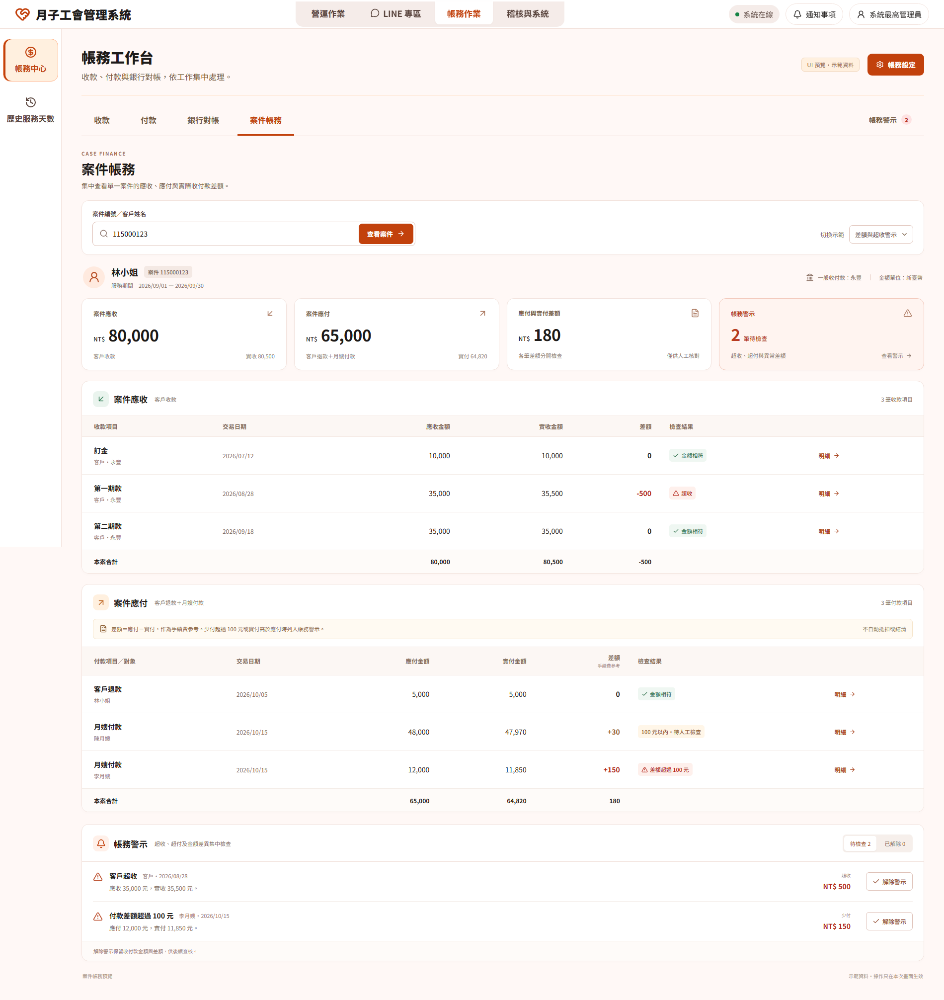

# 銀行流水匯入與帳務異常處理正式規格

> 2026-10-29 最新需求與已確認 UI：見 [§15 銀行成功明細、案件帳務與共用帳務警示](#finance-20261029)。原交付為文件整理；後續 U10 僅授權實作備註六碼案件配對與確認銷帳編號來源，其他功能維持未實作。與較早敘述有差異時，僅在該節明示範圍內採用最新人工決定。

已確認保存來源且沒有可正式入帳款項的批次，可留在人工核對後離開，不再將已保存檔案誤當成未儲存草稿；正式入帳結果仍未確認時保留原操作與離開保護。

人工更正的備註維持選填；空白時只在分類事件保存「系統記錄銀行流水人工更正」的操作稽核說明，原命令、證據與冪等比對保留人員原輸入。

## 1. 文件狀態與裁決

- 狀態：`approved-architecture-baseline`
- 人工核准日期：2026-08-10
- 正常銀行匯入與異常修正分流：`approved`
- 帳務異常中心固定處置入口：`approved`
- 歷史重處理限管理員：`approved`
- 2026-08-11 四項 executable contract 補充：`approved`
- 本文件補充 `06_Anomalies_Domain.md`、`09_Finance_Import_Domain.md` 與
  `16_Staff_Payables與Client_Refund正式規格.md` 的管理端入口與跨 Domain 編排。
- 本文件取代「訂單頁另設通用帳務處理工作台」及「銀行匯入頁同時提供任意人工帳務修正」
  的 UI 方向；Domain ownership、銀行根事實與正式 ledger 規則不因此改變。

## 2. 業務前提

系統不串接實際金流，只具備兩項金流能力：

1. 被動匯入銀行對帳單，保存 canonical bank fact；
2. 依已成立的應付義務產生清冊交給會計師。

因此：

- 清冊不是付款執行結果；
- 只有後續銀行流水能證明實際收款、付款、退匯或扣回；
- 系統不得從清冊、送件或等待銀行資料推論 `submitted`、`payment_failed`、`bank_pending`
  等付款結果；沒有可核銷 bank fact 只表示尚未取得銀行結果；
- 正常銀行資料應走批次匯入，不需要進異常中心；
- 不能自動唯一處理的資料依 15／25 分類進入 current issue 或 Finance owner review；
  只有 current issue 在 `#anomalies` 提供固定 owner action。
- Anomalies 不提供人工 claim／resolve；任何 UI 操作都不能取代正式帳務修正，
  也不能把款項標成已結清。

remaining amount 大於零且 business date 已過 due date 時，系統建立或維持 canonical overdue
reminder，提示人員核對銀行對帳單、匯入、配對或補正。提醒是 read-only projection，不改寫
obligation、ledger、allocation 或 Orders lifecycle。有效 bank fact 經 owning Domain 精確核銷後，
重新投影必須使 owner reminder 不再出現，或在 fresh recheck 後刪除 current issue；
金額、對象或 bank identity 不唯一時維持 owner review 或合法 current issue，不得猜測。

`subsidy_advance_due` 同樣只是 read-only reminder，不是付款指令。工會在銀行系統實際付款並匯入
對帳單後，Finance Import 才能把 canonical outgoing bank fact 委派 Client Finance；後續政府
allocation 只建立 immutable recovery，不得新增第二筆 payout。

## 3. Global → Domain → Subsystem → Module

### 3.1 Global／Application 責任

Global 擁有：

- 管理端入口治理與頁面導向；
- typed command envelope、actor、capability、correlation、idempotency 與 receipt；
- Finance Import 委派 owning Domain 的 outer Unit of Work；
- 異常修復 action registry 與固定 Preview／Apply 導向；
- 應付清冊唯讀輸出及封存；
- 歷史重處理的管理員權限與稽核。

Global 不擁有任何應收、應付、退款、追償、薪資或補助金額計算。

### 3.2 Domain ownership

| Domain | 正式責任 |
|---|---|
| Finance Import | 銀行檔案、批次、canonical row、occurrence、去重、分類、人工更正及 typed dispatch |
| Anomalies | 根事實異常投影、目前 predicate、事件歷程、WP88 外部追蹤狀態與可用修復 action |
| Client Finance | 客戶收款、超收、退款應付、退款核銷、退款多匯追償及相關 ledger／allocation |
| Staff Payables | 公會對月嫂的應付、實際銀行出款、退匯與付款核銷 |
| Government Subsidy | 政府撥款、claim allocation、短撥、溢撥及 reversal |
| Payroll | 月嫂薪資義務與正式 adjustment；不擁有付款結果 |

### 3.3 Subsystem 分流

| Subsystem | 性質 | 管理端入口 |
|---|---|---|
| Bank Ingestion | 正常日常作業 | 銀行流水匯入 |
| Batch Preview／Apply | 正常日常作業 | 銀行流水匯入 |
| Finance Anomaly Recovery | 單筆異常固定處置 | 系統異常警示中心／帳務異常 |
| Historical Pending Reprocess | 管理維護作業 | 管理員資料維護 |
| Accounts Payable Query／Export | 正常日常作業 | 應付帳款查詢／輸出 |

## 4. SSOT、根事實與衍生值

### 4.1 根事實

- 原始匯入檔案 digest、同批重複的 sheet／row occurrence 與 canonical finance import row；跨檔
  fingerprint 完全相同的銀行交易只保留本次 receipt／計數，不新增 occurrence；
- 銀行日期、金額、方向、帳號、摘要及不可變 raw payload；
- owning Domain obligation、ledger、allocation、return／reversal／adjustment event；
- 人工修正的 actor、reason、evidence、target identity 與 operation capability；
- Preview fingerprint、expected version、idempotency receipt 與 outbox event。

### 4.2 衍生值

- 自動分類或 `manual_review`；
- Alert definition、predicate、severity、workflow status 與可用修復 action；
- receivable／payable remaining、refund progress、recovery progress；
- 清冊列、排除原因與逾期提醒。

Alert、UI session、XLSX、操作備註與人工解除狀態都不是金流根事實。

## 5. 管理端入口規格

### 5.1 銀行流水匯入

帳務工作台的「銀行對帳」提供正常銀行流水匯入。人員選擇工作簿並點擊一次「匯入銀行交易明細」，系統自動串接下列步驟；不再要求人員逐步預覽、勾選或再次確認，原因選填：

1. 上傳銀行 Excel；
2. 建立不可變匯入批次；
3. 正常批次 Preview；
4. 正常批次 Apply；
5. 顯示批次成功、失敗與待人工處理筆數；
6. 導向 Finance owner review queue 查看待人工處理項目；只有 15-code current
   issue 另顯示於 `#anomalies`。

本頁不得提供任意輸入 bank row identity、classification 或 obligation identity 的通用修正
表單。批次 Apply 遇到不能唯一處理的 row，應保留 row、建立 typed owner review，且不得猜測
或強制入帳。

銀行原始列同樣不可由警示中心直接編輯、覆寫或重新載入。公會確認銀行對帳單、付款或退款等外部
事實後，只能使用本規格已定義的固定 typed recovery action 建立新的 ledger、allocation、recovery
或 return 事實；這不是對原始銀行列的修正。沒有唯一外部事實或合法 action 時，
Finance owner review 維持待人工確認；不為它建立 anomaly tracking 狀態。

### 5.2 系統異常警示中心／帳務異常

對 15-code current issue，`#anomalies` Drawer 是 owner action 入口；對 25-item Finance
owner work item，入口只在對應 Finance owner page。任一入口選定單筆資料後必須顯示：

- 人類可讀的異常名稱與原因；
- 原始銀行列摘要、金額、日期與來源批次；
- 受影響案件、義務與目前餘額；
- 系統允許的唯一或有限修復動作；
- 修復會新增、保持或禁止變更的資料；
- Preview 結果、blockers、expected version 與 Apply 按鈕；
- 修復後的正式 receipt 及 fresh owner readback；current issue 另顯示 recheck 後 row 是否已刪除。

不得向人員顯示 `PreviewCorrectAndPostFinanceImportRow` 等內部 command name 作為操作說明；
按鈕必須使用業務語言，例如「確認分類並入帳」、「處理客戶退款」或「重開退款義務」。取消或帳務變更時自動更新應退款，不增加人工建立付款義務的步驟。

銀行人工核對清單保留尚未正式核銷的客戶退款流水；「處理客戶退款」帶入原流水，依案件選取待退款，並提供「足額核銷待退款／退款不足，先核銷實退」。金額取銀行事實，沿用既有 Client Finance partial flag／Preview／Apply；補退仍核銷同一退款的剩餘款。結果完成後重新讀取目前餘額並刷新銀行清單，未明結果保留原操作，不重複送出。一般退款選取可含未到期款項，不更改預設逾期查詢或補助退款出款資格。

按下修復動作後必須在同頁直接展開對應 typed 表單，並預填 owner Query 已知的 bank row、case、
obligation、classification 與 source version。人員只補足該 action 明確要求的 reason、evidence
或唯一選擇，不得重新輸入系統已知 identity。

### 5.3 管理員資料維護

歷史待確認資料重處理是整批 preserve／repair 作業，不是單筆異常處理。入口必須：

- 僅對具有 maintenance capability 的管理員顯示；
- 明確標示目標批次與 dry-run 結果；
- 保存批次 fingerprint、操作者、reason、evidence 與 receipt；
- 不能繞過現行 Domain Preview／Apply；
- 不能放在一般銀行匯入頁或訂單頁。

### 5.4 退役入口

- 訂單頁頂層「帳務處理」工作台退役；
- 「客戶收款核銷／月嫂薪資調整／月嫂付款核銷」不得再作為三個自由瀏覽入口；
- 原「銀行流水匯入與帳務修正」改名為「銀行流水匯入」；
- 單筆人工帳務修正依 15／25 分類移至 `#anomalies` Drawer 或 Finance owner page；
- 所有舊入口只有在對應 current-issue action 或 owner replacement 已完成、
  測試通過且可追溯後才能移除，避免功能斷線。

## 6. 固定異常處置矩陣

| 異常類型 | 固定處置 | 正式結果 |
|---|---|---|
| 未分類銀行列 | 選定唯一分類、證據與 owning Domain target 後 Preview／Apply | canonical classification＋Domain dispatch |
| 客戶短收 | 記錄實收，保留剩餘應收及短收狀態 | receipt allocation＋remaining receivable |
| 客戶超收 | 確認唯一案件與義務後拆分實收 | 應收結清＋`customer_refund` payable |
| 客戶退款少匯 | 核銷實際出款，保留未退餘額 | `partially_refunded`＋下期清冊 remaining |
| 客戶退款多匯 | 核銷應退額，超額一律建立追償應收 | `refunded`＋`client_over_refund_recovery` |
| 客戶退款退匯 | 綁定 canonical 退回入款與原 refund ledger | append return／reopen refund obligation |
| 公會對月嫂付款不足 | 保留實際出款與剩餘應付 | payout evidence＋remaining staff payable |
| 公會對月嫂付款超額 | 保留實際出款，超額轉追償／核准調整 | staff recovery／adjustment／owner work item |
| 月嫂帳戶或付款歸屬不唯一 | 人工確認唯一收款人與 obligation | 正確 allocation；確認前維持 blocker |
| 政府補助短撥 | 核銷實收，保留政府未收款 | partial government receipt＋remaining claim |
| 政府補助溢撥 | 人工選定依法抵扣或退還 | offset fact 或 government-return payable |
| 跨檔完全重複匯入 | 於本次 receipt 明示已存在，不建立 occurrence | canonical bank fact 不變，正式 ledger 零新增 |
| 格式錯誤／證據不足 | 可解析列照常處理；不可解析列建立 Finance 警示 | source reference／review 保留，正式 ledger 零新增 |

Finance source-row qualification：工作簿格式與唯一表頭已辨識後，可定位的交易候選列若缺少／無法解析
必要交易日期、唯一正向整數新臺幣交易金額，或該格式明確提供的來源銀行帳號，建立去敏 immutable
source review，不建立 canonical bank row。空白／可辨識 footer 零 review；檔案、格式、表頭或 adapter
structural contract 失敗仍是整份 command failure。source review 不保存 source path、raw row、memo、摘要、
完整帳號或未遮罩 reference；同一 source digest＋format＋sheet＋row 不重複建立 root 或 warning。

「公會對月嫂付款不足／超額」描述的是公會實際出款結果；月嫂只負責收取薪資，不存在
「月嫂少付／月嫂超付」。

## 7. 狀態機

### 7.1 銀行 row

```text
imported → classified → dispatched → posted
    └────→ manual_review → previewed → dispatched → posted
                         └→ blocked
```

### 7.2 異常處理

2026-08-29 current-state anomaly slimming 裁決後，本節不再定義 Anomalies 的
`open／awaiting_external_confirmation／response_recorded／reimport_requested／closed／auto_resolved`
追蹤狀態。bank row 的 `manual_review → previewed → dispatched → posted` 仍是 Finance Import
owner 正式處理狀態，只在 owner page 顯示。

- typed Finance recovery Apply 成功後，owner transaction 在同一 commit 寫入 durable recheck
  intent；只有 fresh／authoritative recheck 證明 predicate false 時才刪除 current row。
- 新的、非完全重複銀行事實可產生 Finance owner review；只有 15-code predicate
  成立時才產生 current issue。不另建 anomaly occurrence、replacement event、resolve 或 reopen history。
- 跨檔 fingerprint 完全相同的交易只在 Finance owner receipt 回報已存在；不新增
  anomaly row 或 owner review。

### 7.3 應付與實際付款

```text
obligation established
→ included in accountant workbook
→ awaiting canonical bank fact
→ reconciled
→ settled | partial | recovery_required | returned
```

清冊生成、下載、封存或交付都不得直接進入 `settled`。

## 8. Command、API 與 UI client 邊界

### 8.1 既有可沿用能力

- `QueryAnomalyRecoveryContext`
- `QueryAnomalyRecoveryPreviewLink`
- `PreviewCorrectAndPostFinanceImportRow`
- Finance Import correction Preview／Apply
- Client Refund Preview／Apply／Return
- Staff Payout Preview／Apply／Return
- Government Subsidy receipt Preview／Apply

### 8.2 必須補齊的 typed actions

- `ApplyClientReceiptWithOverage`
- `ApplyClientRefundWithOverage`
- 客戶短收正式入帳及剩餘應收 action
- 公會對月嫂付款不足／超額 action
- 政府補助溢撥 disposition action

每個保留的 current-issue definition 必須在 backend registry 明確對應一組有限人工
actions；只有 automation 可為零或 `blocked_capability`。UI 不得以
definition code 自行推算業務規則，也不得把 raw `dict` 直接傳入 render function。

### 8.3 四項 executable contract 的正式落點

本文件只擁有跨 Domain 編排；金額與狀態規則的正式 owner 如下：

| 能力 | 正式契約 | 關鍵結論 |
|---|---|---|
| 客戶退款超額追償後續結清 | `16` §3.5.1 | canonical incoming 或授權 adjustment；預設足額、部分僅補救；不得自動抵新應收 |
| 公會對月嫂少匯／多匯 | `16` §2.4.1～2.4.3 | 少匯保留 remaining；多匯建立 staff recovery；清冊只列 remaining |
| 政府補助溢撥 | `14` §4.5.1 | 同一 receipt 保留全額現金；差額依既有規則 offset 合法 claim；沒有合法 target 時維持 pending review，不猜測或自動抵銷 |
| 異常中心 typed dispatcher | `06` Typed Recovery Action Registry | backend 回 action descriptor；UI 只選 typed renderer，不解析 code/message 推算規則 |

共同 payload envelope：

- Preview intent：固定 source bindings＋人員允許的有限選擇／evidence；
- Preview result：contract version、source/aggregate versions、bank total、allocations、remaining、
  recovery／payable amount、resulting states、blockers 與 fingerprint；
- Apply：相同 intent、expected versions、Preview fingerprint、stable idempotency key、actor、reason、
  capability 與 correlation id；
- Receipt：existing/created marker、root/ledger/allocation identities、resulting versions/states、outbox
  identities 與 current-issue recheck result（適用時）；不得只回成功文字。

共同金額守恆：

```text
selected canonical bank amount
= formal allocation to existing obligation／claim
+ newly established recovery／return-payable amount
+ explicitly retained pending-review amount
```

任何一元都不得消失或重複計入。`pending-review amount` 只允許尚未取得合法 disposition 的
政府溢撥或 ownership 不唯一銀行列；它不是正式 allocation，也不能進清冊或 completed 投影。

### 8.4 Aggregate／event 最小持久化契約

所有新增 recovery／overpayment aggregate 必須分離 immutable event 與 current projection：

- root identity、owner identity、source bank／ledger／obligation identities；
- original amount、derived remaining、status、aggregate version、current event identity；
- immutable events 保存 before/after amount、source identity、actor、reason、evidence、capability、
  idempotency key、correlation id 與 business time；
- cash event 必須 FK canonical finance import row；非現金 adjustment 的 bank FK 必須為 null；
- current projection 可 CAS 更新；event、allocation、receipt 不可 update/delete；
- unique constraint 必須防止同一 bank row、同一 source event 或同一 idempotency key重複生效。

AP Export 的付款來源為月嫂應付款與客戶退款單；`staff_overpayment_recovery` 與
`client_over_refund_recovery` 是 receivable，永遠不得進應付清冊。Staff partial payout 與 client
partial refund 只輸出 remaining，不能輸出 original amount。

## 9. 交易、重播與衝突

- Query 唯讀；Preview 零寫入；Apply fresh-read 並重建 candidate；
- Apply 鎖定 owner source／review version、bank row、affected aggregate 與 obligation；
- selected bank amount 必須完整表達，不得遺失已發生現金；
- ledger、allocation、refund／recovery obligation、outbox、receipt 與 durable recheck intent 必須
  在同一 outer Unit of Work commit；
- 同一 idempotency key＋相同 payload 回 existing receipt；不同 payload 回 conflict；
- stale anomaly、bank row 已使用、obligation version 改變時，拒絕 Apply 並重新 Query／Preview；
- 只有 unavailable、deadlock 或 timeout 可用同一命令安全重試；
- UI timeout 後先查 receipt／job，不得產生第二個業務命令。

## 10. Typed errors

| Code | 類型 | UI 處理 |
|---|---|---|
| `anomaly_not_found` | not-found | 回清單重新查詢 |
| `recovery_action_not_available` | blocker | 顯示尚未支援，不顯示空按鈕 |
| `anomaly_projection_stale` | stale | 重新載入異常與 action |
| `finance_import_row_not_found` | not-found | 停止並顯示來源失效 |
| `finance_import_row_already_posted` | conflict | 重新查詢正式結果 |
| `recovery_target_ambiguous` | blocker | 要求人員選定唯一 target |
| `client_receipt_overage_disposition_required` | blocker | 開啟超收固定處置 |
| `client_refund_overage_recovery_required` | blocker | 建立追償應收 Preview |
| `client_over_refund_recovery_amount_exceeded` | blocker | 入款不得超過追償 remaining |
| `staff_payout_difference_mode_invalid` | validation | 金額相等或方向與 mode 不符，改走正確 action |
| `staff_overpayment_recovery_target_ambiguous` | blocker | 確認唯一月嫂追償 |
| `government_subsidy_overpayment_target_not_eligible` | blocker | 只能選已核准且同付款方 target |
| `government_subsidy_return_recipient_invalid` | blocker | 補齊有效政府收款資訊 snapshot |
| `recovery_action_contract_version_mismatch` | conflict | 重新 Query action/context，不渲染舊表單 |
| `idempotency_conflict` | conflict | 禁止以不同 payload 重用 key |
| `transaction_failed` | internal／unavailable | 依 retryable 決定是否同命令重試 |

UI 不得依中文 message 判斷 action 或 retry policy。

## 11. UI 驗收

1. 正常銀行匯入頁只顯示上傳與正常批次 Preview／Apply。
2. 批次出現異常時顯示異常數量及「前往異常中心」，不顯示任意人工修正表單。
3. 異常中心選定 bank row 後，固定 action 直接在同頁展開且自動帶入 identity。
4. 異常 action 使用業務中文名稱，不顯示 Python command 或 API endpoint。
5. 沒有完整 backend action 的異常顯示「尚未支援此修復」，不得顯示假按鈕。
6. Apply 前必須先 Preview，blocker 存在時 Apply disabled。
7. Apply 成功顯示 receipt；異常只在 predicate 消失後自動解除。
8. 重新整理、重送與 timeout 不會建立重複 ledger、obligation、recovery 或 job。
9. 訂單頁不再顯示通用帳務處理工作台。
10. 歷史重處理只對具 maintenance capability 的管理員可見。

## 12. 測試與完成條件

### Module

- anomaly definition → allowed action mapping；
- action label、required inputs、typed payload validation；
- over-receipt／over-refund 金額守恆；
- partial、return、recovery reducer。

### Subsystem

- recovery query／preview／apply／stale／replay／idempotency conflict；
- bank row、ledger、obligation、outbox、receipt 與 durable recheck intent 原子 commit；
- `#anomalies` 不存在 manual resolve；
- correction 成功後以 durable intent 重查，predicate false 時刪除 current row。

### Domain

- 客戶超收 3,000、應收 2,500 → receipt 3,000＋refund payable 500；
- 客戶退款應付 500、銀行出款 750 → refund 500＋追償應收 250；
- 公會對月嫂少匯／多匯、退款退匯、政府短撥／溢撥；
- client recovery 250＋incoming 250 → recovered；incoming 100 → partially_recovered 150；
- staff payable 20,000＋outflow 18,500 → remaining 1,500 且下期清冊只列 1,500；
- staff payable 20,000＋outflow 21,000 → completed＋staff recovery 1,000；
- government approved outstanding 10,000＋incoming 12,000 → allocation 10,000＋overpayment 2,000，
  再依人工 Preview 選定合法 offset target；沒有合法 target 時維持 pending review；
- 不唯一、重複與證據不足時正式 ledger／obligation 零錯誤新增。

### Global／UI E2E

- 上傳正常批次 → Apply → 無異常；
- 上傳含待處理批次 → 15-code current issue 在 `#anomalies` Drawer 處理，25-item
  work item 在 Finance owner page 處理 → typed Preview／Apply → owner readback／current recheck；
- 清冊交付不改付款狀態，後續銀行流水才結清；
- 舊帳務處理入口移除後，所有已支援業務均有唯一入口；
- API／worker／UI 任一失敗時不出現半套帳務或假成功。

自動修正契約完成定義：每個保留的 finance current-issue code 均有「明確無自動修復」
或「唯一 typed automated recovery action」的 registry 紀錄。這項定義只限自動化能力；
`no_automated_recovery=true` 不能作為整體 remediation 完成證據。每個 current active code 仍必須
有 owner-specific 人工 Query／Preview／Apply／receipt／fresh recheck，直到 owner terminal predicate
成立且 authoritative recheck 刪除 current row。所有要退役的舊入口也必須有 E2E replacement evidence；未滿足前不得
移除仍承載正式功能的舊入口。

## 13. 現況漂移與實作順序

### 13.1 已存在的骨架

- 異常中心可查詢 recovery context 與 available actions；
- `correct_and_post` 已指向 Finance Import correction Preview endpoint；
- Finance Import UI 已有人工修正 Preview／Apply 表單；
- Client Refund、Staff Payout 與部分 Government Subsidy 已有 typed reconciliation 能力。

### 13.2 live-drift

- 異常中心「前往修復」目前只顯示內部 command name 與 endpoint，沒有導向或嵌入表單；
- Finance Import 頁仍混合正常匯入、歷史重處理與單筆人工修正；
- 所有一般 finance manual review 幾乎共用同一 generic action，尚未依異常類型限制輸入；
- 客戶超收尚不能建立退款應付；退款多匯尚不能建立追償應收；
- 訂單頁仍存在通用帳務處理入口。

### 13.3 實作順序

1. 將既有 Finance Import correction 表單依 15／25 分類嵌入 `#anomalies` Drawer 或
   Finance owner page，並安全預填 bank row；
2. 將正常匯入頁縮減為 upload＋batch Preview／Apply；
3. 將歷史重處理移至 maintenance capability 入口；
4. 建立 anomaly code → typed recovery action registry 與業務中文 label；
5. 實作客戶超收退款應付與退款多匯追償應收；
6. 補齊其他金額、退匯、帳戶與補助異常 action；
7. 完成 E2E replacement evidence 後退役訂單頁帳務工作台與舊人工修正入口。

### 13.4 React successor 與驗收狀態（2026-08-24）

- React `#finance` 的正常銀行匯入為單次操作：選檔 → 點擊匯入 → 系統 Ingest／Batch Preview／合法 candidates 的 durable Apply → 查回正式結果。保留 same-key replay、版本及 fingerprint 檢查；內部 Preview 不是人工操作關卡。
  待處理筆數與本批次人工核對清單自動回讀；只有 15-code current issue 導向異常中心。歷史 batches／reprocess runs 不回到正常匯入頁。
  Historical Reprocess 仍屬管理維護作業，不得回到正常匯入頁。2026-08-24 已在真 FastAPI＋受控
  `lu_test_*` 用 Chrome 完成正常 ready-dispatch 的 Upload → Preview → Apply → worker terminal receipt，
  並確認核銷成功且 pending 為零。
- `tests/fixtures/finance_import/taishin_deidentified_minimal.xlsx` 及相鄰 manifest 已取得
  `user-approved-in-spec-auto-activation-2026-08-22` 去識別 fixture authority，可用於 Ingest、exact replay、
  manual-review 與 disposable MySQL regression；舊工作包的 `blocked-test-data-authority` 描述為過期狀態。
- 通用 Finance job success outcome 仍只含 closed `result_reference`；正常 batch Apply 另由 Finance-only
  typed terminal receipt Query 讀取 immutable `finance_import_apply_receipts`，公開
  reconciled／existing／pending／resulting-version，而 ingest 與 accepted command 各自提供
  server-authoritative replay marker。不得公開 raw job payload，也不得把 `202 Accepted` 冒充正式 Apply receipt。
- `manual_review` terminal receipt 仍不得冒充正向入帳；只有 ready-dispatch receipt 的
  `reconciled_count`／`existing_count`／`pending_count` 與 owning Domain readback 才可證明正常核銷結果。
- 本次狀態校正未變更 schema、provider、deployment 或 entry switch。

### 13.5 帳務異常 Finance correction React（2026-08-24）

- Anomalies Drawer 已只對 recovery context 明確註冊的 `finance_import.correction.v1` action 展開 Finance
  correction 表單。來源銀行列只取 typed source binding；選擇合法款項後點擊一次「儲存更正並核銷」，系統內部 Preview／Apply，原因選填；表單變更會作廢舊選取與 Preview，通用 Claim／Resolve
  仍維持 disabled，未知 schema／owner／binding 一律不顯示修正表單。
- correction Apply 固定回 durable job accepted；`GET /api/v1/finance-import/jobs/{job_id}/correction-outcome`
  只在 job `succeeded` 時從 immutable `finance_import_correction_receipts` 讀回 strict terminal receipt，
  不公開 raw job payload。成功但 receipt 不存在或無法驗證時回 typed unavailable，不能誤報完成。
- 2026-08-25 已在真 FastAPI 與受控 `lu_test_dataset_contract_signing_v4` 由 Chrome 實點完成
  Preview → 明確確認 → Apply；Apply 先顯示受理中，既有 durable job 經正式 worker application
  轉為 `succeeded` 後，再由 UI「重新查詢更正結果」讀回 immutable terminal receipt 並顯示
  「帳務更正完成」。同一輪 Finance Import anomaly outbox delivery 成功，來源
  `finance-import-row:101` 的當時 live readback 為 `predicate_active = false`、
  `workflow_status = resolved`。這只是 current-state slimming 前的歷史 runtime evidence，不再是目標
  public／persistence contract，也不授權保留 workflow status。該 slice 的 owner Finance correction
  receipt 仍有效，舊 anomaly lifecycle 部分已 superseded。
- 此 runtime 狀態僅指 Finance correction 業務情境，不是 Durable Job infrastructure blocker。Durable Job
  core／worker／caller adoption 與 ephemeral `lu_test_*` engine evidence 已於 2026-08-24 fresh rerun 完成；
  `JobAccepted` 仍只表示工作受理，必須依本節 terminal receipt 規則判定 correction 是否完成。

## 14. 來源追溯

- `00_Global_共同契約.md`
- `04_Client_Finance_Domain.md`
- `05_Staff_Payables_Export_Domain.md`
- `06_Anomalies_Domain.md`
- `09_Finance_Import_Domain.md`
- `14_Government_Subsidy_Domain.md`
- `16_Staff_Payables與Client_Refund正式規格.md`
- `ui/pages/06_finance_alerts.py`
- `ui/pages/finance_import/panel.py`
- `domains/anomalies/root_fact_projection.py`
- `subsystems/anomalies/root_fact_projection_workflow.py`

<a id="finance-20261029"></a>

## 15. 2026-10-29 銀行成功明細、案件帳務與共用帳務警示

### 15.1 狀態、權威與交付邊界

- 狀態：`implemented / backend-accepted`。U12 已授權完成六項功能；驗收範圍為本機程式、隔離 MySQL 與正式頁面，沒有 production 部署或既有業務庫切換。
- 原文件交付：完整記錄已確認需求、現況差異、影響範圍與驗收情境，並保留核可 UI 參考。
- 最新允許變更：U12 擴充至本節全部六項功能、必要 additive schema／公開契約與後端驗收；U10／U11 的備註六碼規則、銷帳來源、正式 owner 核銷及案件隔離仍保留。
- 本次不執行：範圍外功能、既有業務庫或正式 DB 寫入、歷史資料回填或重分類、production 部署、切換入口、Git stage／commit／push。fresh 與 preserve-data migration 只在合成隔離庫驗證。
- 實作邊界、typed owner queries、archive 投影與持久化決策見本節末尾及工作包；沒有增加銀行原列的第二份 SSOT。
- 專案證據基準：`main`／`e409962e7df41b99121608cc20ce63e5685224b2` 加本次工作樹的相關現況；工作區含既有及並行變更，不宣稱乾淨 checkout、全域一致或行為等價。本次採 `NO_RESEARCH`，需求依人工對話，現況依 §15.10 指出的 current specs、架構 leaf 與窄範圍 source；沒有外部套件採用或額外服務。

人工 Authority 來源：

| 來源 | 本次人工決定 |
|---|---|
| U1：最初六項修改方向 | 保存成功匯入的整列明細、匯出；新增單案應收／應付頁；永豐應收／應付，台新政府補助／補助退款；顯示付款差額 |
| U2：成功匯入範圍回覆 | 自動保存只納入已正式入帳的明細 |
| U3：三種保存結果與人工必填欄位 | 對帳成功且有案件直接保存；查無案件不保存；人員可人工新增無案件明細，只要求交易日、支出或存入、銷帳編號或備註 |
| U4：縮小功能範圍與差額修正 | 只匯出明細庫，不新增對帳明細查詢銜接；差額不參與核銷；付款差額超過 100 元或實付高於應付建立警示；超收、超付等共用帳務警示，提供解除按鈕 |
| U5：UI 核可與本次文件要求 | 「UI 可以」；整理完整規格、影響範圍與驗收項目，暫不修改正式程式 |
| U6：警示持久性補充 | 同一筆、同一差額解除後，重新整理與其他人登入仍維持已解除；新的異常再提示 |
| U7：人工資料與匯入資料重複 | 不猜測合併；能確認重複時，由人員處理 |
| U8：重複排除的最新修正 | 只保留一筆；重複列標記排除，不存進資料庫。不採用「兩筆都存、其中一筆標記重複」的方案 |
| U9：應付出款的案件辨識補充 | 客戶收款可沿用虛擬帳號；客戶退款與月嫂付款沒有案件編號，須只讀「備註」六碼，對應案件虛擬帳號後六碼，不讀「存摺備註」。已提供去識別範例：`HC115001服務人員`、`A115001服務人員`、`HC115001退款`，三者案件線索均為 `115001` |
| U10：局部實作授權 | 「先依這個規則修改對帳單匯入邏輯，驗證客戶退款與月嫂付款都能透過備註六碼正確對應案件，其他功能先不要動」；並確認虛擬帳號都讀「銷帳編號」 |
| U11：本機 DB 驗證授權 | 「用本機測試資料庫驗證客戶退款與月嫂付款的匯入、備註六碼配對及核銷，確認不會配到其他案件，其他功能先不要動。用新的測試用案件」 |
| U12：完整實作與驗收授權 | 「有規格缺少或無法完成的項目嗎？不然就完成6項，並做完後端驗收再通知我」；依已收斂需求完成六項及必要的 schema、API、正式 UI 與後端驗收，不擴及 production 部署／既有資料重分類 |

此前討論過的「所有成功讀取列都納入成功明細」、「新增明細查詢／篩選頁」、「差額認列手續費後自動結清」及「兩筆都保存、以重複旗標排除其中一筆」均不採用。這些舊提案不得成為需求、驗收 oracle 或實作 Authority。

### 15.2 名詞、目標與需求索引

「銀行成功明細庫」是可完整匯出的邏輯資料集合，不指定必須新增一張同名資料表。它包含：

1. **對帳成功明細**：已有唯一案件，且 owning Domain 正式核銷／入帳已完成的銀行交易。
2. **人工新增明細**：由人員明確新增、滿足最小必填條件的銀行明細，案件編號允許空白。

人工新增成功表示該明細已保存，不表示案件帳務已正式入帳或結清。兩種來源必須可辨識；不能用一個沒有來源區別的「成功」旗標混淆。

| 需求 ID | 已確認結果 | 正式金額／資料 owner | Authority |
|---|---|---|---|
| BANK-01 | 依三種保存結果決定是否納入成功明細庫 | Finance Import；正式入帳結果由各 Finance owner 提供 | U2、U3 |
| BANK-02 | 原始整列保存、人工最小必填、缺值可空白 | Finance Import | U1、U3 |
| BANK-03 | 匯出整個成功明細庫，不新增對帳明細查詢／篩選頁 | Finance Import；檔案輸出由 adapter 承接 | U4 |
| BANK-04 | 自動匯入沿用正式去重；疑似重複不猜測，確認重複後排除且不存第二筆 | Finance Import | U7、U8、既有銀行身分契約 |
| CASE-01 | 新增單案帳務頁，應收為客戶收款，應付分客戶退款與月嫂付款 | Client Finance／Staff Payables；應用層組合顯示 | U1、U5 |
| CLASS-01 | 永豐只有應收／應付兩個銀行匯入類型；台新維持政府補助／補助退款 | Finance Import；核銷仍委派正式 owner | U1、U4 |
| CLASS-02 | 客戶退款／月嫂付款依備註六碼對應虛擬帳號尾六碼找案件；正式款項候選限縮到該案件 | 案件虛擬帳號對照由 Client Finance 擁有；Finance Import 消費 typed 結果，核銷仍由各 owner 決定 | U9、既有唯一身分與不可跨案核銷契約 |
| DIFF-01 | 顯示應收／應付與實收／實付差額，不參與核銷 | 來源金額由正式 Finance owner 擁有；UI 只顯示 typed 結果 | U4、U5 |
| WARN-01 | 超收、超付及本次差額問題共用帳務警示與解除操作 | 各 Finance owner 提供金額與來源；帳務應用層組合 | U4 |
| WARN-02 | 同一筆同一差額的解除結果持久保存，新異常再提示 | 帳務警示解除資料的持久化 owner／port 於實作設計確認，不能寫入正式金流帳本代替 | U6 |

### 15.3 成功明細的保存規則

#### 15.3.1 三種結果

| 情境 | 案件編號 | 成功明細庫結果 | 正式帳務效果 |
|---|---|---|---|
| 成功對帳，已讀回正式入帳結果 | 必須有有效對應案件 | 直接保存／納入原始整列 | 由原 owner 核銷結果決定，不另建立第二次入帳 |
| 找不到案件，且未執行人工新增 | 無 | 不納入 | 不猜測案件、不強制入帳 |
| 找不到案件，人員明確人工新增 | 可空白 | 最小必填檢查成功後保存 | 單純保存銀行明細，不建立案件、義務、付款或核銷 |

已辨識案件但仍 pending／blocked、僅成功上傳、Ingest 成功、Preview 成功或只取得 `202 JobAccepted`，均不足以納入「對帳成功明細」。後續正式入帳完成，才能依同一來源身分納入一次。

本節的「不保存」限定為不納入成功明細庫，不取消既有 ingestion attempt、canonical staging、source review、receipt 或必要稽核的保留規則，也不授權刪除既有資料。對帳未成功的資料不可透過匯出成功明細而被誤列成已入帳。

#### 15.3.2 原始欄位與人工最小必填

永豐及人工新增的欄位集合依人工指定保留下列順序：

```text
帳號、交易日、計息日、入帳日、摘要、幣別、支出、存入、餘額、票據號碼、銷帳編號、交易參考編號、備註、更正註記、存摺備註
```

| 必填組別 | 人工新增規則 | 驗證失敗結果 |
|---|---|---|
| 日期 | 交易日必填且為有效日期 | 指出交易日錯誤；不建立成功明細 |
| 金額與方向 | 支出或存入，必須有可判定單一方向的有效金額 | 缺少金額、兩邊同時有正金額或不符既有金額型別時拒絕 |
| 辨識資訊 | 銷帳編號或備註至少一項非空白；兩項都填可接受 | 指出需補銷帳編號或備註；不建立成功明細 |

人工新增的帳號、計息日、入帳日、摘要、幣別、餘額、票據號碼、交易參考編號、更正註記、存摺備註及案件編號均非必填。不得把案件編號、帳號、附件或新增必填 reason 變成人工新增的隱藏前置條件。

2026-10-30 人工確認：成功對帳明細主畫面保留匯出與新增按鈕，人工新增使用右側抽屜；先選「存入／支出」再填單一金額，提交時只映射至所選方向的原始欄位。其他原始欄位收合為選填，既有必填、整數金額、整庫匯出與未確認結果的同命令重試規則不變。

缺值保持空值，不能補成今天、0、假帳號、假案件或假分類來滿足正式 canonical bank fact 的限制。金額解析沿用現有新臺幣／方向契約，不把人工資料的最小必填規則反向套用到所有銀行原檔 adapter。

自動匯入須保存原始已支援格式的整列值及可追溯來源，不得只保留分類後的少數欄位。台新依既有原始欄位保存，不能因永豐的十五欄契約而丟棄台新原始欄位。原始文字、帳號／參考號碼的前置零、日期、支出與存入方向不得因分類或匯出而被改寫。

#### 15.3.3 保存、重送與重複

2026-10-30 人工確認：成功對帳明細畫面移除獨立的「重複處理」功能，以及人工新增中的重複明細識別欄位；保留整庫匯出與人工新增。可由正式身分確認的重複交易沿用既有自動判重／略過與 same-key replay，不要求人員再次指定排除；證據不足的疑似重複仍保留待核對，不以相似欄位猜測排除。此項移除僅限操作介面，不刪除既有判重保護、歷史排除記錄或正式帳務。

- 自動匯入沿用既有 canonical 身分與 same-key replay；同一正式交易不因重匯、重查結果或刷新畫面而新增第二筆成功明細或 ledger。
- 同一人工新增命令重送不得新增第二筆；不同人工輸入不能只憑日期、金額或相似備註自動視為同一交易。
- 人工新增後又匯入疑似同筆資料，不猜測合併、覆寫或刪除既存資料。不能以日期、金額、相似備註等不完整人工欄位冒充銀行 fingerprint；證據不足時由人員確認是否重複，不能自動誤排除真正不同的交易。
- **確認為同筆交易後，只保留一筆成功明細；後到的重複列在寫入成功明細庫前排除，不建立第二筆原始明細，也不建立一筆帶有「重複」旗標的持久化明細。** 本次操作結果可顯示「重複、已排除」及排除數，不把排除列本體另存資料庫或混入全量匯出。
- 已存在一筆時，保留既存明細，重複候選不新增；同次尚未寫入的候選由明確去重結果或人員確認選定一筆。排除與匯出不修改既有正式 ledger／allocation，也不把不完整人工記錄變成假正式入帳證據。
- 同一操作重送、重新整理或再次匯出不能重新建立已確認排除的第二筆。既有合法 receipt／重送結果可表達排除計數，但不因此新增保存排除列本體的資料表或旁路 archive。
- 本規格約束未來新增流程；不據此掃描或刪除已存在的歷史資料。既有 staging、canonical root 及稽核的保留仍由原 owner 契約負責，不將它們誤稱為第二筆成功明細，也不利用該契約另存一份被本節排除的成功明細。

### 15.4 整庫匯出規則

1. 提供成功明細庫的完整匯出入口，包含對帳成功與人工新增兩種來源，包含人工新增的無案件列。
2. 「整個資料庫」只指本功能的銀行成功明細集合，不是整個應用系統的 SQL dump、帳密或所有業務資料。
3. 不新增對帳明細查詢頁、應用程式篩選器或「查詢再匯出」的必經流程；也不以當前批次、畫面頁數或付款月份裁切整庫匯出範圍。案件帳務的案件搜尋屬 CASE-01，不受此項排除。
4. 匯出必須保有原始欄位；缺少的人工欄位留白。資料來源、案件關聯及明細識別須能追溯，但不偽造原始銀行欄位。
5. 匯出不重新解析檔案、重分類、重新核銷、更新警示或更改成功明細。讀取失敗不能交付看似成功的半份資料。
6. 匯出須經既有帳務授權；完整銀行明細只交付獲授權下載者，不進 application log、錯誤訊息、Git 或外部服務。
7. 檔案格式與不同銀行欄位排列暫採 §15.9 的實作預設，不能把預設當作新增產品需求。沒有要求另一個雲端封存／寄送流程。

### 15.5 案件帳務頁與核可 UI

核可桌面預覽：

圖像是版面參考，正式行為以本節文字需求為準。截圖內示範姓名、案件號碼、日期、金額、英文輔助字及示範切換器不是正式資料或必須照抄的產品文案。

頁面在現有帳務工作台新增「案件帳務」入口，保留收款、付款及銀行對帳的現行用途。此頁是單案財務查閱入口，不取代原正式 writer 或重新開放任意帳務修正。

| 區塊 | 必須呈現 | 資料與行為界線 |
|---|---|---|
| 選定案件 | 案件編號＋客戶辨識的下拉選單，以及完整／部分編號或姓名的文字查詢，兩者同時提供 | 下拉清單沿原 Orders 摘要分頁，可繼續載入；搜尋結果回到同一下拉選單供明確選案，同名不自動選第一案，支援非市民 A 編號；切換後各區只顯示所選案件，舊回應不得覆蓋新選擇 |
| 案件摘要 | 應收、實收、應付、實付、差額及待檢查警示數 | 讀取正式 owner 結果；資料缺少不當成 0 或已結清 |
| 案件應收 | 客戶收款，各期／各項的應收、實收、日期與差額 | Client Finance 擁有義務與核銷，不納入政府補助作客戶收款 |
| 案件應付 | 客戶退款＋月嫂付款，各列對象、項目、應付、實付與差額 | 客戶退款與月嫂付款分列；多位月嫂／代班依正式義務歸屬，不混入其他案件 |
| 收付款明細 | 對應的交易日期、來源銀行、金額、差額及案件／項目 | 不把人工無案件明細強掛進所選案件；無正式關聯時不得猜測 |
| 共用帳務警示 | 異常名稱、相關款項、差額、待檢查／已解除與解除按鈕 | 展示／解除依 §15.8，不修改正式帳務 |

同一案件有多筆付款、部分付款、補款、退匯或沖正時，應收／應付金額及有效實收／實付由原 owner 的正式義務與分配結果決定；不得以銀行對象、日期區間或人員相同就把整筆銀行款算入每個案件。

案件帳務顯示載入中、找不到案件、尚無款項與局部資料讀取失敗等狀態。切換案件途中舊回應不得覆蓋新案件；任一來源失敗時不能假裝所有金額為 0。正式版本不保留示範資料、重設示範按鈕或只在本機記憶體生效的警示解除。

### 15.6 銀行匯入分類與核銷分流

| 銀行 | 原始方向 | 銀行匯入類型 | 後續正式帳務項目 |
|---|---|---|---|
| 永豐 | 存入 | 應收 | 客戶收款 |
| 永豐 | 支出 | 應付 | 客戶退款或月嫂付款 |
| 台新 | 存入 | 政府補助 | 政府補助撥款 |
| 台新 | 支出 | 補助退款 | 客戶補助退款 |

- 永豐原始出款不必先由銀行資料硬分成客戶退款或月嫂付款；匯入層先表示「應付」。但正式核銷仍必須確認是哪個 owner 的哪筆義務，不能取消內部正式退款／月嫂付款身分。
- 分類與核銷不是同一個狀態。唯一、足夠且不衝突的證據才可走既有自動核銷；零／多候選、跨 owner 或證據不足保留原 owner 人工處理，不用金額接近或 100 元門檻猜測案件。
- 本次銀行分工採上表。既有已入帳歷史資料不因新分類自動改名、搬移銀行來源、重算 ledger 或批次重分類；歷史格式與退匯／追償等特殊情境沿用其正式 owner 契約，沒有授權刪除舊分類或特殊處理路徑。
- 純人工無案件明細的保存，不觸發分類器或建立正式 owner 義務。

#### 15.6.1 備註六碼辨識應付出款的案件

本補充先適用本次永豐應付出款的案件定位。客戶收款仍沿用完整虛擬帳號辨識；台新補助與既有歷史格式的其他規則不因本補充自動擴張。

已確認的順序：

```text
客戶收款：原有完整虛擬帳號 → 唯一案件 → 原 Client Finance 核銷
客戶退款／月嫂付款：備註中的六碼 → 案件虛擬帳號後六碼對照
                    → 唯一案件 → 該案正式應付款項與收款對象 → owning Domain 核銷
```

- 六碼的意義是「虛擬帳號後六碼」，不是直接把六碼當作正式案件編號，也不是任意拼成案件。優先尊重 Client Finance 現有匯入虛擬帳號對照；無對照時才沿該 owner 已有公式與既存案件驗證，不在 importer 自建另一套 SSOT。
- 六碼以字串處理，保留前置零。原始備註、銷帳編號及原始銀行列保持不變；辨識結果只成為可追溯的案件候選／判定證據，不冒充原檔提供了完整虛擬帳號。
- 找不到六碼、查不到案件或不能唯一對案時，不能硬指定案件或正式入帳；也不能因為交易參考編號找到一位月嫂，就把其所有案件的未付總額當成本列對象。成功明細的保存仍受 BANK-01 管理。
- 六碼只建立案件範圍。該案若同時有客戶退款及月嫂款，或有多位月嫂／多筆義務，仍須沿既有對象、帳號及正式義務證據唯一決定核銷；不足以唯一決定時交原 owner 人工處理，不只憑六碼或金額接近選第一筆。
- 月嫂應付及客戶退款候選必須受已辨識案件限制，不能只用 client_id／staff_id 在所有案件搜尋、加總或分配。若備註案件與其他已知對象證據衝突，維持待確認，不以其中一項靜默覆蓋。
- 差額 100 元門檻仍只作顯示／警示，不參與六碼辨識、候選評分或放寬核銷。

來源已確認：只讀永豐原檔「備註」，即目前 adapter 的 `memo`。不讀 `bank_references['存摺備註']`，也不在「備註」空白、無命中或兩欄內容不同時回退到「存摺備註」。兩欄原始值仍依既有保存規則保留，不能為了案件辨識改寫原欄位。

已確認範例與擷取規則：

| 備註文字（去識別範例） | 擷取六碼 | 說明 |
|---|---|---|
| `HC115001服務人員` | `115001` | 字母與中文可直接相鄰，不要求額外空格 |
| `A115001服務人員` | `115001` | 不同字母前綴使用相同六碼對照規則 |
| `HC115001退款` | `115001` | 退款文字不改變案件尾碼的擷取方式 |

擷取完整、連續的六位數字片段；數字前後可以是字母、中文、空白或標點，但不能從更長的連續數字中截取前六／後六位。六碼以字串保留，不把前置零去掉。範例的 `HC`、`A` 是可接受的前綴例子，不形成只接受這兩個前綴的白名單。

以不同六碼值計算候選：沒有可用六碼或有多組不同六碼時，維持人工確認，不挑第一組或只挑看起來能對案的一組；同一六碼重複出現仍是同一案件候選。取得單一六碼後，依正式虛擬帳號對照驗證案件唯一性，不能只憑格式正確就宣稱已對帳成功。

上述「服務人員」屬去識別範例文字，不要求真實備註必須出現這四個字，也不把備註後綴當成繞過收款對象／正式義務驗證的依據。只出現在「存摺備註」的六碼不是本次案件辨識來源。

U10 局部實作：新批次以 `finance-transaction-classifier-v4` 記錄分類版本；原 fingerprint 契約及版本不變，既存分類事件不改寫。永豐支出可沿原始「交易參考編號」驗證唯一退款收款對象或月嫂帳號，再以備註六碼限定案件；兩者用途不同，交易參考編號不作收款虛擬帳號來源。客戶收款的完整虛擬帳號仍由原始「銷帳編號」讀取，不使用更正註記、交易參考編號或存摺備註替代。原始欄位及既有去重指紋保持原值。

### 15.6.2 非市民編號與帳務篩選接線（2026-10-29 規格核准，尚未實作）

本次只同步使用者已核准的非市民規格，不擴張 U10／U12 的既有實作完成宣告。進件與編號見 `17` §5.1.1，帳號與帳務類別篩選由 `04` §0.1、§8 擁有。

- 新的 `A115001` 公式虛擬帳號為 `99781699115501`，對應尾六碼 `115501`；Finance Import 接收完整銷帳編號或備註尾六碼線索後，只經 Client Finance 既有 typed 帳號／對照解析取得正式案件。
- §15.6.1 舊範例 `A115001服務人員` 抽出 `115001` 只描述字串擷取，不代表此六碼可對應新的非市民案件 `A115001`；不能以案件編號字母或數字外形取代正式帳號對照，也不另新增猜測或 fallback。
- 案件帳務選取／搜尋、款項及警示 Query／API schema 須接受 A 開頭案件；正式應收應付、核銷及警示仍沿原 owner，不建立非市民專用 ledger。
- 帳務統計依 `04` §0.1 新增補助案件（預設）／非市民案件／全部案件選項，明細、件數與金額使用相同篩選集合；銀行原始流水及無案件人工明細不能因此猜測案件類別。

後續驗收須確認 A 開頭案件與虛擬帳號正反解析、匯入對照優先、六碼不猜案件、同案款項唯一性及帳務篩選合計一致；原銀行來源、fingerprint、歷史分類與既有正式收付不在本次變更範圍。UI／後端完整影響表見 `17` §5.1.2。

### 15.7 差額與手續費參考

```text
應收差額 = 同一收款項目的應收金額 - 正式有效實收金額
應付差額 = 同一付款項目的應付金額 - 正式有效實付金額
```

正值表示少收／少付，負值表示超收／超付。畫面須以中文說明方向，不能只用紅色或正負號讓人猜測。案件合計僅供摘要，警示依同一款項的正式比較範圍判定，不用整案正負互抵掩蓋單筆異常。

「手續費」只作差額參考，不是已認列費用，不新增手續費 ledger、費用 adjustment、寬限核銷、付款分配或自動結清。例如應付 10,000、銀行實付 9,970，顯示差額 +30，原正式核銷與剩餘應付規則保持原義；不能把該 30 元當成已付款。

| 應付與實付情境 | 顯示 | 本次新增的警示結果 |
|---|---|---|
| 差額 = 0 | 金額相符 | 不因差額建立警示 |
| 0 < 差額 < 100 | 正差額，供人工檢查／手續費參考 | 不因本門檻建立警示 |
| 差額 = 100 | 差額 100，仍供人工檢查 | 不屬於「超過 100」，不因本門檻建立警示 |
| 差額 > 100 | 少付及實際差額 | 建立共用帳務警示 |
| 差額 < 0 | 超付及實際超付額 | 無論絕對值是否低於 100，均建立共用帳務警示 |
| 實收高於應收 | 超收及實際超收額 | 納入同一個帳務警示機制 |

客戶退款及月嫂付款共用上述付款差額顯示與警示條件，不再存在「是否容許退款扣手續費核銷」的選項。客戶短收、退款、超收追償及政府補助等既有 owner 規則沒有被 100 元門檻取代；「不因本門檻建立警示」也不代表可以跳過其他既有異常檢查。

### 15.8 共用帳務警示與持久解除

1. 超收、客戶退款超付、月嫂款超付及付款差額超過 100 元共用一套帳務警示呈現與解除操作；不是每種錯誤另設一個頁面，也不是把多筆不同問題合成一筆無來源的總警示。
2. 每筆警示必須能指出來源款項、案件（若有）、異常類型、應收／應付、實收／實付及差額。待檢查數與列出的警示一致，已解除不再計入待檢查數。
3. 人員點擊「解除警示」後，保存對該筆、該異常與該差額的解除結果，並可查看已解除項目。保存失敗不可僅在前端移除警示或先宣稱解除成功。
4. 同一筆、同一差額在重新查詢、重新整理、重啟前端或其他獲授權人員登入後，維持已解除。不能只存在 React state、單一裝置儲存或個人帳號偏好。
5. 不同來源款項、新異常類型或新的異常差額，重新成為待檢查。解除不是整案永久免警示；同一案件內另一筆付款不能被連帶解除。
6. 已解除狀態須可追溯操作人、時間與精確目標；解除時只改警示資料。不能修改 bank raw row、案件應收／應付、ledger、allocation、remaining、退款、追償、付款狀態或案件 lifecycle。
7. 重複點擊／重送同一次解除不產生重複效果；解除期間來源款項已變更時，須重新核對目前目標，不能把舊操作套到新的異常差額。沿用 existing version／typed conflict 契約，不預設新增 fingerprint 或 snapshot token。
8. 共用警示在帳務工作台內提供入口與案件內相關內容；不能依賴已退役的 `#anomalies` 異常審核頁，也不因此恢復 LINE 專用鈴鐺或修改 `LINE-006`。

此處「解除」表示人員已檢查該帳務警示，不表示 underlying business predicate 已消失。較早 §2、§7.2、§11 所述 current-issue 自動 recheck／修復完成規則仍適用其原本流程；本次人工解除只作用於本節的帳務警示，不是 generic Anomalies claim／resolve 的重新啟用。

### 15.9 資料、權限與交易邊界

- 保留 Finance Import、Client Finance、Staff Payables、Government Subsidy 與 Payroll 現有正式 owner。案件頁與匯出是 consumer，不另算應收／薪資或旁路原 writer。
- 人工最小欄位資料必須有明確的人工來源身分；不能為了共用舊 schema 偽造 canonical bank fact、已核銷 receipt 或原檔 digest。成功明細可由既有事實及人工記錄共同投影；實體表與 typed port 是後續設計，不預先要求雙份 raw SSOT。
- 正式入帳與成功明細納入必須可恢復且不重複；原入帳失敗／rollback 時，不得留下虛假的對帳成功列。查詢／匯出不暗中補寫成功明細。
- 人工新增、人工重複處理與警示解除均須是有身分、可稽核且可確認結果的正式操作。使用現有帳務授權基礎，不開放匿名寫入／下載；精確 capability 名稱由現有權限設計承接，不發明新的角色產品需求。
- 任何所需持久化變更須 additive、保留既有資料；fresh bootstrap 與 preserve-data upgrade 均須驗證。新增／變更資料表、欄位、索引或公開契約須有當次實作授權；U12 已授權本節必要 additive 變更，migration 僅在本機隔離庫完成 fresh／preserve-data 驗收。

數值與方案來源分類：

| 項目 | 類別 | 來源／owner | 適用範圍與變更觸發 |
|---|---|---|---|
| 大於 100 元才建立少付差額警示；超付不受此下限 | `PRODUCT_REQUIREMENT` | U4，人工業務權威 | 付款差額警示；須最新人工修改才變更 |
| 三組人工必填及十五個原始欄位 | `PRODUCT_REQUIREMENT` | U3，人工業務權威 | 人工新增及永豐欄位；不得擴增必填 |
| 永豐／台新分類矩陣 | `PRODUCT_REQUIREMENT` | U1、U4 | 本次銀行匯入；不授權重寫歷史資料 |
| 同筆同差額跨人員維持已解除 | `PRODUCT_REQUIREMENT` | U6 | 本次共用帳務警示 |
| 僅文件，不修改正式程式／資料 | `EXECUTION_AUTHORITY` | U5 | 本次交付；不是永久禁止實作 |
| React 預覽示範數字、案件、viewport、八項檢查 | `OBSERVED_VALUE` | 已核可預覽及其 QA | 只是 UI evidence，不是正式金額、容量或驗收通過證明 |
| XLSX、不同銀行分工作表並保留各自原始欄位；附來源／案件識別欄供追溯 | `IMPLEMENTATION_DEFAULT` | 本次文件整理建議，沿用既有 Excel 工作方式 | 可在不減損全量、原始欄位及可追溯性的前提下調整；不增設應用程式查詢頁 |

### 15.10 修改後的影響範圍

下列是目前已確認的相依範圍。現況路徑用於證據與定位，尚不指定新的檔名、table 名、endpoint 名或 Agent／任務切分。

| 邊界 | 現況證據／主要路徑 | 預期影響與限制 |
|---|---|---|
| 原始列保存與匯入編排 | `subsystems/finance_import/ingestion.py`、`staging.py`；`scripts/imports/finance_statement_normalizer.py`、`finance_formats/` | 現有 raw payload／canonical 身分可沿用；補成功明細資格與人工來源，不能放寬全部銀行 parser 或重複正式入帳 |
| 分類、計畫及 owner 委派 | `domains/finance_import/transaction_classifier.py`、`ingestion.py`、`planning.py`；`infrastructure/mysql/finance_import_owning_domain_composite.py` | 銀行層應收／應付與正式業務項目分開；檢查 closed enum、typed schema、Preview、修正表單與 dispatch 連動，不能只改中文字 |
| 備註六碼案件定位 | 上述 classifier／composite；`subsystems/client_finance/virtual_account_resolution.py`、`subsystems/finance_import/identity_maps.py`；永豐 adapter 的兩個備註欄位 | 已依 U10 實作並由 U11／U12 的真實 DB 驗證；候選限制案件，保留帳號 guard。金額不足的退款留待原 owner 明示人工處理，不錯列可自動核銷而阻擋同批有效款項 |
| 成功明細持久化／匯出 | Finance Import 現有 repository／Query；`api/routes/finance_import.py`、`api/schemas/finance_import.py`、`api/dependencies/finance_import.py` | 補全量唯讀匯出、人工新增及必要稽核；現有批次／人工核對清單不能直接冒充全部成功資料來源 |
| 案件客戶帳務 | `ui_react/src/api/client_finance/client_finance_history_client.ts`、`client_receipt_query_client.ts`；Client Finance owner queries | 可沿用客戶義務、ledger、allocation；補單案組合契約，不在前端重新計算正式未收／未退款 |
| 案件月嫂應付 | `ui_react/src/api/staff_payables/staff_payables_query_schemas.ts`；`accounts_payable_query_client.ts`；Staff Payables owner queries | 現有月嫂查詢與月份查核不能代替完整單案帳務；依案件與義務精確分配，多人／部分付款不重計 |
| 差額與正式核銷 | `domains/staff_payables/reconciliation.py`、`subsystems/staff_payables/payout_reconciliation.py`；Client Finance 對應 owner | 需要新增顯示／警示資料，沒有授權增加 100 元寬限、手續費入帳或改寫不足額／超額規則 |
| 共用帳務警示 | 帳務工作台組合；各 owner 來源與新的解除持久化契約 | 必須有跨重整／跨人員的解除結果與明確來源；現有 `.arch-map/domains/anomalies/subsystems/anomalies/modules/current-issue-presentation.md` 顯示異常審核頁已退役，不能直接復活舊入口或沿用 generic resolve |
| React 畫面、client 與導航 | `ui_react/src/pages/FinancePage.tsx`、`.css`、`components/FinanceCaseHistory.tsx`、`FinanceReceiptsWorkspace.tsx`、`FinancePaymentsWorkspace.tsx`；對應 typed clients／adapters | 新增案件頁與共用警示、匯出及人工新增入口；不新增對帳明細查詢頁。現有 dirty 使用者變更須保留 |
| DB／公開契約 | 既有 Finance Import、正式帳務及必要人工／解除記錄 | U12 已授權並完成 additive schema、約束、帳務授權與 typed conflict；source row、成功集合、人工記錄及解除狀態分離。未在既有業務庫套用 |
| 台新與其他功能回歸 | Government Subsidy、Client Finance 補助退款；現有應付清冊及歷史流程 | 補助業務規則、清冊金額、退匯／追償與歷史資料維持各自正式契約；只檢查本次分流連動，不全面重構 |

規格歸屬：本節擁有整體互動與本次需求；`09_Finance_Import_Domain.md` 擁有銀行來源與分類，`16_Staff_Payables與Client_Refund正式規格.md` 擁有付款／退款核銷。沒有 source／test 變更前，不為未實作的構想更新 `.arch-map` 成為既成事實。

### 15.11 驗收情境與測試項目

下表是未來正式功能的驗收設計，不表示已寫測試或已通過。所有情境使用不含真實帳號／不必要 PII 的受控資料；DB 驗證走專案允許的隔離目標與正式 writer。

| 驗收 ID | 需求 | 輸入／操作 | 應見結果／必要反證 | 最低驗證邊界 |
|---|---|---|---|---|
| AC-B01 | BANK-01 | 有唯一案件的銀行列完成正式核銷並查回結果 | 原始整列進成功明細一次，可追溯案件及正式來源 | Subsystem＋DB |
| AC-B02 | BANK-01 | 查無案件且沒有人工新增 | 成功明細／全量匯出不含此列；沒有假案件或 ledger | Subsystem＋DB |
| AC-B03 | BANK-01 | 僅上傳／Ingest／Preview／受理成功，尚無正式結果 | 不列對帳成功；待查回終態，不能先寫成功標記 | API／Subsystem |
| AC-B04 | BANK-01 | Apply 失敗或 rollback | 無虛假的成功明細或部分正式入帳；保留既有失敗稽核 | Subsystem＋DB |
| AC-B05 | BANK-02 | 人工只填交易日、支出、備註，沒有案件及其他欄位 | 保存人工明細；其他欄位空白；正式帳務無新增 | API＋DB |
| AC-B06 | BANK-02 | 人工只填交易日、存入、銷帳編號 | 同樣可保存；入款方向正確 | API＋DB |
| AC-B07 | BANK-02 | 銷帳編號及備註同時有值 | 保存兩者原文，不互相覆蓋 | Module／API |
| AC-B08 | BANK-02 | 缺交易日、非法日期、無有效金額、雙正金額或識別資訊皆空白 | 對應欄位錯誤，零成功明細／正式帳務寫入 | Module＋API |
| AC-B09 | BANK-02 | 原始十五欄包含前置零、空值、備註及更正註記 | 保存／匯出後值與方向完整；空值不補今天或 0 | Module＋Subsystem |
| AC-B10 | BANK-04 | 同檔／跨檔重匯同一正式交易；同 key 重送人工新增 | 沿用身分與結果，沒有重複成功列或 ledger | Subsystem＋DB |
| AC-B11 | BANK-04 | 人工列與後續匯入只有相同日期、金額、相似備註 | 不以不足證據自動合併／排除真正不同的交易，交人員確認；不覆寫既存資料 | Subsystem＋DB |
| AC-B12 | BANK-04 | 已有人工明細，人員確認後續候選為同筆交易 | 候選在成功明細寫入前排除，結果顯示重複已排除；庫內及匯出只含原有一筆 | Subsystem＋DB＋匯出 |
| AC-B13 | BANK-04 | 檢查重複排除前後持久化與重送結果 | 無第二筆 raw／重複旗標明細或排除列旁路 archive；重送不補存，原 ledger／allocation 不變 | Subsystem＋DB |
| AC-B14 | BANK-04 | 兩筆相似資料經人員確認為不同交易，且分別滿足納入條件 | 各自可保存，不因最小人工欄位相同而誤排除；兩筆合法交易都可匯出 | Subsystem＋DB＋匯出 |
| AC-E01 | BANK-03 | 明細跨批次、月份、銀行，含人工無案件列；執行整庫匯出 | 所有符合成功集合的資料完整匯出，不受現有頁面／批次／月份限制 | Subsystem＋檔案 |
| AC-E02 | BANK-03 | 沒有任何成功明細 | 明確的零筆結果，不捏造資料或宣稱有入帳 | API＋UI |
| AC-E03 | BANK-03 | 台新與永豐欄位不同，人工列缺少可選欄位 | 原欄位不遺失，缺值留白，文字識別保留前置零 | Module＋檔案 |
| AC-E04 | BANK-03 | 匯出中讀取失敗、未授權下載 | 明確失敗／拒絕，不交付半份成功檔案，不外洩 raw 數值；匯出無業務寫入 | API＋Subsystem |
| AC-E05 | BANK-03 | 進入銀行對帳並匯出 | 可直接啟動全量匯出；沒有新增查詢／篩選頁作必經步驟 | UI／Browser |
| AC-C01 | CASE-01 | 選定有多期客戶收款、退款及多位月嫂的案件 | 應收／應付及對象分列，合計與各 owner 一致，沒有跨案金額 | Subsystem＋UI |
| AC-C02 | CASE-01 | 同筆銀行付款分配到不同案件；某案有多筆付款 | 只顯示所選案件的正式分配，不把整筆銀行款重計到每案 | Subsystem＋DB |
| AC-C03 | CASE-01 | 部分付款、補款、退款、退匯／沖正及歷史正式帳務 | 顯示 owner 有效結果，不把沖正算成新實付、不重新計薪 | Subsystem＋UI |
| AC-C04 | CASE-01 | 快速切案、找不到案件、無款項或部分來源讀取失敗 | 舊回應不串案；空態與失敗可辨識；未知不變 0 | UI／Browser |
| AC-C05 | CASE-01 | 核可版面與桌面／手機實際頁面比對 | 摘要、應收／應付、差額、明細、警示與解除可使用；無整頁橫向溢出；正式畫面無示範假資料 | Browser／視覺 |
| AC-I01 | CLASS-01 | 永豐存入與支出 | 銀行類型只有應收／應付；應付仍可正確委派客戶退款或月嫂款 | Module＋Subsystem |
| AC-I02 | CLASS-01 | 台新政府入款及補助退款出款 | 維持既有補助 owner、資格、分配及金額規則 | Module＋Subsystem |
| AC-I03 | CLASS-01 | 零候選、多候選、對象衝突或僅金額差在 100 元內 | 不猜測案件或放寬正式核銷，保留原 owner 待處理 | Module＋Subsystem |
| AC-I04 | CLASS-01 | 讀取舊已核銷資料、歷史格式及退匯／追償情境 | 不因新銀行標籤重寫歷史 ledger 或刪除特殊 owner 路徑 | Subsystem＋DB |
| AC-I05 | CLASS-02 | 分別輸入 `HC115001服務人員`、`A115001服務人員`、`HC115001退款`，該案有合法且唯一的正式付款項目 | 三者均擷取 `115001`，透過虛擬帳號尾碼對照取得既有案件；正式候選只屬該案，備註原文及銀行欄位不變 | Module＋Subsystem |
| AC-I06 | CLASS-02 | 虛擬帳號已有匯入對照，與依數字外形猜出的案件不同 | 沿用 Client Finance 正式對照；不以 importer 另建公式覆蓋，對照不唯一時維持待確認 | Subsystem |
| AC-I07 | CLASS-02 | 同一月嫂／客戶在其他案件也有未付款項 | 只採六碼所對應案件的合法義務，不把其他案件相同金額或合計納入 | Subsystem＋DB |
| AC-I08 | CLASS-02 | 同案同時存在客戶退款、多位月嫂或多筆無法唯一分配的款項 | 六碼命中不等於唯一付款項目；依原 owner 確認，未確認前不強制正式入帳 | Subsystem＋UI |
| AC-I09 | CLASS-02 | 備註沒有可用六碼、六碼查無案件或其他證據與案件衝突 | 不假造案件、不跨案核銷；依原待處理／人工新增規則處理，不誤列對帳成功明細 | Module＋Subsystem |
| AC-I10 | CLASS-02 | 備註只有五碼、七碼或更長連續數字、沒有數字，或包含兩組不同六碼 | 不從較長數字截取、不猜第一組，維持人工確認，不誤建立正式入帳或成功明細 | Module＋Subsystem |
| AC-I11 | CLASS-02 | 只有存摺備註有六碼，或備註與存摺備註指向不同案件 | 只讀備註，不合併兩欄、不回退存摺備註，也不改寫兩欄原始值 | Module＋Subsystem |
| AC-I12 | CLASS-02 | 備註前綴不同、同一六碼重複出現，或尾碼含前置零 | 不以 HC／A 作白名單；相同六碼只形成一個案件候選；前置零完整保留，再依原 owner 對照驗證 | Module＋Subsystem |
| AC-D01 | DIFF-01 | 應付 10,000、實付 9,970 | 差額 +30 作參考，正式金額與剩餘應付不因查看／解除而改變 | Module＋UI＋owner 回讀 |
| AC-D02 | DIFF-01 | 應付 10,000，實付分別為 10,000／9,901／9,900／9,899 | 差額 0／99／100／101；只有 101 觸發本次少付門檻 | Module＋Subsystem |
| AC-D03 | DIFF-01、WARN-01 | 應付 10,000，實付 10,001／10,030 | 超付 1／30 均警示，不能以低於 100 略過 | Module＋UI |
| AC-D04 | DIFF-01、WARN-01 | 客戶應收 10,000，實收 10,030 | 顯示超收 30，出現在同一共用警示，不因付款門檻排除 | Module＋UI |
| AC-D05 | DIFF-01 | 一筆差額 +150、另一筆 -150 | 摘要可合計為 0，但不能因此隱藏兩筆應有警示 | Subsystem＋UI |
| AC-W01 | WARN-01 | 同案有超收、客戶退款超付、月嫂超付及超過 100 差額 | 使用共用警示區，逐筆有來源／種類／金額／解除；數量一致 | UI＋Subsystem |
| AC-W02 | WARN-02 | 解除一筆後重整、重開頁面及以另一獲授權人員登入 | 同筆同差額維持已解除，待檢查數正確，已解除紀錄可見 | API＋DB＋Browser |
| AC-W03 | WARN-02 | 已解除後，同筆產生新的異常差額，或另一來源款項異常 | 新異常重新提示；舊解除紀錄不永久抑制整案 | Subsystem＋DB |
| AC-W04 | WARN-02 | 解除保存失敗、重複點擊或來源同時變動 | 不假成功；重送不重複效果；舊目標不能解除新差額，採 typed conflict／fresh read | API＋Subsystem＋DB |
| AC-W05 | WARN-01、WARN-02 | 解除前後比較銀行原列、ledger、allocation、remaining、退款／追償與案件狀態 | 只有警示解除資料變更，其餘逐項相同；不啟用退役異常頁或 LINE 操作 | Subsystem＋DB＋UI |
| AC-S01 | 全部 | 未授權新增、重複處理、解除及匯出 | 沿用帳務授權拒絕；無敏感值出現在 log／錯誤／Git | API／Static |
| AC-S02 | 涉及持久化 | fresh bootstrap 與保留既有資料的升級 | 必要結構可用、舊資料不丟失；沒有自動回填／歷史重分類 | migration contract＋隔離 DB |

既有 focused 驗證入口（重用有效 oracle，不機械新增與實作同構的測試）：

- `tests/domains/finance-import/subsystems/finance-import/modules/import006-owner-current-facts/unit/test_finance_transaction_classifier.py`
- `tests/domains/finance-import/subsystems/finance-import/integration/test_finance_import_ingestion.py`、`test_finance_import_staging.py`、`test_finance_import_query.py`
- `tests/domains/finance-import/subsystems/finance-import/integration/test_sinopac_memo_case_resolution.py`（原工作簿備註 → 初次分類 → 正式虛擬帳號對照 → 退款／月嫂案件候選與退款帳號 guard）
- `tests/test_finance_import_disposable_mysql_e2e.py::test_sinopac_memo_case_isolation_on_fresh_mysql`（明確指定且已 bootstrap 的全新空測試庫；真實 XLSX 匯入、正式 Preview／Apply、commit 回讀與重送，不重設既有資料）
- `tests/domains/client-finance/subsystems/client-finance/integration/test_client_receipt_overage.py`
- `tests/domains/client-finance/subsystems/client-finance/integration/test_client_virtual_account_resolution.py`（正式對照優先、公式僅無對照時使用）
- `tests/domains/staff-payables/subsystems/staff-payables/integration/test_staff_payout_reconciliation_workflow.py`
- `ui_react/src/tests/finance_source_review_list.test.tsx`
- `ui_react/src/tests/domains/client-finance/subsystems/client-finance/integration/finance_workspaces.test.tsx`
- 新測試如確有必要，實作時才依當次 owner、test admission／placement 決定 canonical root；本節不指定新 test 檔案。

### 15.12 收斂狀態與完成判準

已確認：本節需求來源表中的 U1–U9、保存三種結果、最小必填、全量匯出且無新增明細查詢頁、核可案件 UI、銀行分類、差額僅顯示、共用警示及持久解除，以及確認重複後只保留一筆、排除列不寫入成功明細庫。U9 已確認只讀「備註」及三種六碼格式，不讀／回退「存摺備註」；候選不唯一沿原有人工確認邊界處理。

非阻擋實作細節：XLSX／工作表與額外追溯欄排列、typed endpoint／capability 名稱、人工明細與警示解除的實體表／port 設計，以及人員判重在既有匯入／人工新增流程的具體控制項。這些須沿既有 owner 落地，不能變更本節已確認的可觀察結果、增加對帳明細查詢頁，或另存重複排除列；如方案會改 owner／SSOT／transaction／public contract，回原規格與當次 Authority 收斂。

目前規格收斂：`SPEC_READY`。U9 的來源及去識別範例已補齊，CLASS-02 的案件辨識、唯一性與原 owner 邊界已納入需求及驗收；U12 後已完成本機實作與後端驗收，不能把 SPEC_READY 本身當作驗收證據。原 `GAP-MEMO-01` 已由人工回覆收斂。

```yaml
convergence:
  status: READY
  blockers: []
```

原文件交付採 `NO_PACKAGE_REQUIRED`；U12 的實作涉及 additive schema／公開契約，沿用[帳務六項功能實作工作包](../帳務六項功能實作工作包.md) 保存必要邊界與驗收路由，沒有逐步子包或額外 Agent 工作流。

驗證狀態：

- 文件追溯、需求／驗收 ID、相對連結、變更範圍與 whitespace：以本次交付的實際檢查結果為準。
- 既有獨立 UI 預覽的八項互動檢查：先前 `passed`，只證明示範 UI；其解除狀態當時僅在記憶體，沒有證明 WARN-02。
- U10 匯入配對的 focused 行為／回歸檢查：175 項 `passed`，包含實際建立及解析測試 XLSX、退款／月嫂款的案件限定、歷史對照優先、無效／多組六碼、跨案防護、收款銷帳來源及既有匯入回歸。DB cursor 使用受控替身，沒有連真實 DB 或進行正式寫入，不能據此宣稱 MySQL commit E2E 已通過。
- U11 真實 MySQL 8.0.46 驗證：`PASS`（上述隔離 DB E2E 1 項，內含 13 組結果檢查）。專屬庫 `lu_test_memo_20261029_972e8175`，全新合成案件 `115000701`–`115000706`；10 列實際匯入，退款 1,200 核銷至 701、月嫂款 12,000／14,000 分別核銷至 702／703，收款 2,000 依「銷帳編號」核銷至 705。缺備註、多組六碼、查無案件、客戶帳戶不符、七碼數字及指定案件金額不符的 6 列均未入帳；同客戶／同月嫂的其他案件未被核銷。原銀行列不變，匯入及 Apply 同命令重送無新增帳務效果。只建立內部 outbox，未執行外部服務派送，未寫入 `union_db` 或 production。
- U11 測試歸屬／架構 closure、限定範圍 whitespace：`PASS`；既有／並行工作區另有範圍外 ownership 錯誤，不納入本次修正。
- U12 六項功能的程式、focused 後端／UI、真實 MySQL、fresh／preserve-data 及實際畫面檢查：見 §15.13。production 部署／既有業務庫套用：`NOT_RUN`。

### 15.13 U12 實作與驗收落點

驗收結果：後端 focused regression **238 passed**、migration 契約 **4 passed**、真實 MySQL E2E **5 passed**；相關前端 **27 passed／2 個既有 skipped**，本次範圍型別檢查、Vite 打包及最後整包 `npm run build` 均通過。桌面／手機及實際 XLSX 下載通過，無整頁橫向溢出；schema catalog／release／compact、fresh／preserve-data、架構 closure 與限定範圍 diff check 通過。未跑全 repository suite，也未部署或寫入既有業務庫；不能將這些結果擴充成 production 驗收。

- 成功集合採 `MySqlStatementArchiveRepository` 的正式 client ledger／staff payout links／government allocations／現行 government period entries 與 members，以及 canonical 原列投影；台新整期入帳不需要舊版 government transaction 才能匯出，整期沖正依原 receipt members 保留案件對應。Query 不補寫成功旗標，未核銷列不納入。人工明細只存人工表，缺值保留空白；同命令 replay 不增列。
- 明確判重只保存 candidate bank identity、既存保留 identity、操作人與時間，排除原列不另存 archive。保留的既存來源不可再被排除成斷鏈；銀行原始列及正式帳務不刪除、不合併。全量 XLSX 分銀行保留所有原欄位，提供檔內篩選；文字含等號仍為文字，空庫明示 0 筆，沒有新增明細查詢頁。
- 單案 typed owner queries 依有效分配顯示客戶收款／退款、月嫂款、日期與明細；Client Finance 依 remaining＋有效已分配款呈現原應收／應付，明示超收額只加到實收，不把 date-only owner event 當作新欠款。Staff Payables 沿用有效義務、正式 projection 與歷史確認，實付差額不參與原核銷。
- 客戶退款超付另讀既有追償建立來源，避免只讀 allocation 而漏掉超付額。月嫂跨項超付採原付款來源比對，不猜配到其中一筆義務；只有來源明確屬單一案件時才將未分配超付款列入該案實付。跨案仍只計該案正式分配，付款來源警示共用一個 identity、全域清單去重，從任一相關案件解除後其他相關案件維持已解除。解除記錄的案件 FK 是操作入口關聯，不是超付款分配。
- 銀行查閱新增獨立 `bank_type`：永豐應收／應付、台新政府補助／補助退款；內部 classification、正式核銷 writer、退匯／追償與歷史身分保留，沒有歷史重分類或 fingerprint 變更。
- 差額警示按各款項判定，正負不能互抵；人工解除以來源既有版本及金額 fresh-lock 驗證。相同來源／種類／差額跨人員維持已解除，新差額再次提示；只新增解除記錄，不改銀行原列／ledger／allocation／remaining／案件狀態。
- 本次新增 `finance_manual_statements`、`finance_statement_commands`、`finance_statement_exclusions`、`finance_accounting_dismissals` 及 archive singleton。fresh `235` 與 preserve `1057` SQL byte-identical。實測另外發現原 `REFUND_OVERAGE` writer 無法保存收據，新增 byte-identical 的 fresh `236`／preserve `1058` append-only enum successor，保留原三種 enum 值及 ordinal；1057 原 artifact 不改寫。兩份 release、validation schema v52 及 compact fresh 已同步。帳務事實及解除／排除記錄不提供直接 UPDATE 權限。
- 六個新 HTTP entry points 隸屬 `/api/v1/finance-import`：`GET statements/export`、`POST statements/manual`、`POST statements/duplicates`、`GET cases/{case_no}/accounting`、`POST cases/{case_no}/accounting/dismiss`、`GET accounting/warnings`。沿用既有帳務認證；衝突回傳 closed typed 409，原始帳號不進一般 DTO／錯誤／log。
- 真實 DB 驗收覆蓋全新案件 `115000701`–`115000711`、完整 XLSX→Ingest→owner Apply→commit 回讀、失敗 rollback、無案件／pending 不誤匯出、人工最小必填／重送／判重、跨案銀行款只計正式分配、少付 30／99／100／101、月嫂及客戶退款超付 1、超收 30、跨連線／跨人員解除、跨項／跨案超付警示去重及共用解除、stale 拒絕與沖正後新異常再提示。合成資料與驗收證據置於 ignored `scratch/finance_six_20261029/`。
- 台新獨立新庫 `lu_test_taishin_export_1793254472297`／新案件 `116000001`，另驗實際 XLSX 的政府補助辨識、現行整期 owner 正式核銷與成功匯出，以及補助退款原 owner 核銷與成功匯出。沒有修改台新的辨識或核銷規則；測試使用既有「新竹市政府」來源標記。
- 保留資料驗收走正式 `create_source_dump → restore_candidate → apply_schema → verify_candidate`，來源 `lu_test_memo_20261029_972e8175` 全程唯讀；新增 candidate `lu_test_statement_preserve_1793250871964` 的所有既有資料比對通過、1057 metadata exact、結果 `verified`。不宣稱已切換或修改既有業務庫。
- 1058 再以該已驗證 candidate 作唯讀來源，還原至另一個新庫 `lu_test_receipt_preserve_1793252320684`；收據 enum predecessor／successor／drift 契約及 metadata exact、既有資料保留皆通過，結果 `verified`。
