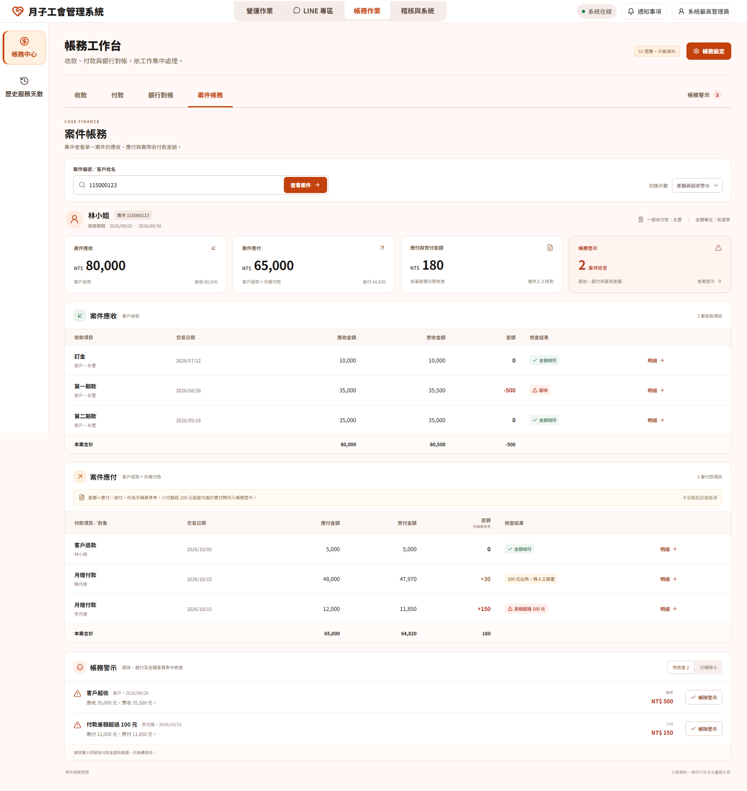
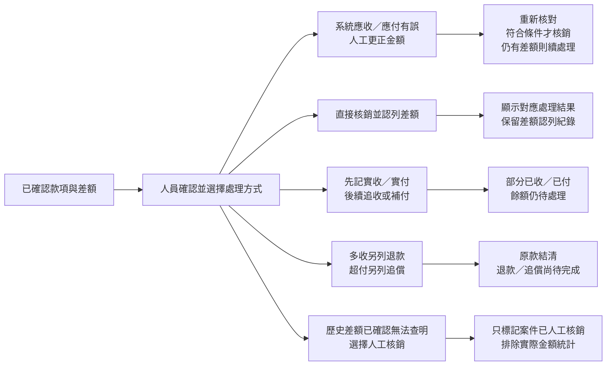

# 銀行流水匯入與帳務異常處理正式規格

> 2026-11-05 全額補助免自備與應付帳款 Excel 最新裁決：補助市民／原住民且本案正式服務總時數不超過有效補助時數上限時，自動免自備並歸方案一，補助轉交月嫂；完整條件及優先範圍見 [§17.4.1](#full-subsidy-no-advance-20261105)。文件階段之後，使用者已授權「執行程式修正、資料補登及修復後驗收」；實際通過範圍及資料阻擋見[原工作包執行結果](../帳務工作台實作工作包.md#accounts-payable-excel-execution-20261105)。Excel 契約見規格16 §2.5.4，歷史新舊金額轉換仍依 §17.7。

> 2026-11-05 帳務工作台收斂與帳務通知設定新頁面最新裁決：使用者核准將「其他帳務作業」折疊區塊及其6個舊分頁全部退役清理，帳務中心（#finance）正式收斂為四大頂層工作台。原payments（應付帳款）整併入WF-06每月帳務（含十欄會計Excel匯出）；帳務通知條件（繳款排程）與10則帳務LINE範本移轉至左側主選單一級獨立專頁「帳務通知設定」（#payment-reminder-settings）；入帳通知由全域通知事項（#notifications）承接並攜帶case_no深連結直開WF-02案件抽屜查帳與發送確認。詳見 [§18 FIN-UI-NAV-02](#finance-six-surfaces-ui-20261104)。

> 2026-11-05最新案件抽屜與通知裁決：見 [§18](#finance-six-surfaces-ui-20261104)。全站抽屜沿客戶名冊同寬；案件為精簡摘要＋客戶繳款／人工補助方案兩區塊，通知依期款顯示時間及按鈕、已繳齊鎖定，人工方案可提前設定。案件內不重複核銷、不列獨立收付款／歷史區塊；本輪只更新規格，正式程式及資料不修改。

> 2026-11-03 最新人工核准：案件總額、三種帳務方案、永豐／台新來源與真實收付核銷，以 [§17](#case-accounting-schemes-20261103) 為準。本次僅更新正式規格，未修改或驗證程式。§17 在明示範圍內優先於舊身分推導流程、台新出款僅退客戶及補助清單分流等敘述；既有銀行、ledger、allocation 與歷史快照不得因此改寫。

> 2026-11-01 最新人工核准的差額總覽與簡化流程見 [§16](#finance-differences-20261101)：人工金額更正併入差額處理，不設退匯功能或獨立操作異常章節。規格收斂當時只更新文件；2026-11-02 實作及驗證狀態以 §16.9 為準，局部差異依 §16.1 裁決。

> 2026-10-29 最新需求與已確認 UI：見 [§15 銀行成功明細、案件帳務與共用帳務警示](#finance-20261029)。原交付為文件整理；後續 U10 僅授權實作備註六碼案件配對與確認銷帳編號來源，其他功能維持未實作。與較早敘述有差異時，僅在該節明示範圍內採用最新人工決定。

已確認保存來源且沒有可正式入帳款項的批次，可留在人工核對後離開，不再將已保存檔案誤當成未儲存草稿；正式入帳結果仍未確認時保留原操作與離開保護。

人工更正的備註維持選填；空白時只在分類事件保存「系統記錄銀行流水人工更正」的操作稽核說明，原命令、證據與冪等比對保留人員原輸入。

## 1. 文件狀態與裁決

- 狀態：`approved-architecture-baseline`
- 人工核准日期：2026-08-10
- 正常銀行匯入與異常修正分流：`approved`
- 帳務異常中心固定處置入口：`approved`
- 歷史重處理限管理員：`approved`
- 2026-08-11 四項 executable contract 補充：`approved`
- 本文件補充 `06_Anomalies_Domain.md`、`09_Finance_Import_Domain.md` 與
  `16_Staff_Payables與Client_Refund正式規格.md` 的管理端入口與跨 Domain 編排。
- 本文件取代「訂單頁另設通用帳務處理工作台」及「銀行匯入頁同時提供任意人工帳務修正」
  的 UI 方向；Domain ownership、銀行根事實與正式 ledger 規則不因此改變。

## 2. 業務前提

系統不串接實際金流，只具備兩項金流能力：

1. 被動匯入銀行對帳單，保存 canonical bank fact；
2. 依已成立的應付義務產生清冊交給會計師。

因此：

- 清冊不是付款執行結果；
- 只有後續銀行流水能證明實際收款、付款、退匯或扣回；
- 系統不得從清冊、送件或等待銀行資料推論 `submitted`、`payment_failed`、`bank_pending`
  等付款結果；沒有可核銷 bank fact 只表示尚未取得銀行結果；
- 正常銀行資料應走批次匯入，不需要進異常中心；
- 不能自動唯一處理的資料依 15／25 分類進入 current issue 或 Finance owner review；
  只有 current issue 在 `#anomalies` 提供固定 owner action。
- Anomalies 不提供人工 claim／resolve；任何 UI 操作都不能取代正式帳務修正，
  也不能把款項標成已結清。

remaining amount 大於零且 business date 已過 due date 時，系統建立或維持 canonical overdue
reminder，提示人員核對銀行對帳單、匯入、配對或補正。提醒是 read-only projection，不改寫
obligation、ledger、allocation 或 Orders lifecycle。有效 bank fact 經 owning Domain 精確核銷後，
重新投影必須使 owner reminder 不再出現，或在 fresh recheck 後刪除 current issue；
金額、對象或 bank identity 不唯一時維持 owner review 或合法 current issue，不得猜測。

`subsidy_advance_due` 同樣只是 read-only reminder，不是付款指令。工會在銀行系統實際付款並匯入
對帳單後，Finance Import 才能把 canonical outgoing bank fact 委派 Client Finance；後續政府
allocation 只建立 immutable recovery，不得新增第二筆 payout。

## 3. Global → Domain → Subsystem → Module

### 3.1 Global／Application 責任

Global 擁有：

- 管理端入口治理與頁面導向；
- typed command envelope、actor、capability、correlation、idempotency 與 receipt；
- Finance Import 委派 owning Domain 的 outer Unit of Work；
- 異常修復 action registry 與固定 Preview／Apply 導向；
- 應付清冊唯讀輸出及封存；
- 歷史重處理的管理員權限與稽核。

Global 不擁有任何應收、應付、退款、追償、薪資或補助金額計算。

### 3.2 Domain ownership

| Domain | 正式責任 |
|---|---|
| Finance Import | 銀行檔案、批次、canonical row、occurrence、去重、分類、人工更正及 typed dispatch |
| Anomalies | 根事實異常投影、目前 predicate、事件歷程、WP88 外部追蹤狀態與可用修復 action |
| Client Finance | 客戶收款、超收、退款應付、退款核銷、退款多匯追償及相關 ledger／allocation |
| Staff Payables | 公會對月嫂的應付、實際銀行出款、退匯與付款核銷 |
| Government Subsidy | 政府撥款、claim allocation、短撥、溢撥及 reversal |
| Payroll | 月嫂薪資義務與正式 adjustment；不擁有付款結果 |

### 3.3 Subsystem 分流

| Subsystem | 性質 | 管理端入口 |
|---|---|---|
| Bank Ingestion | 正常日常作業 | 銀行流水匯入 |
| Batch Preview／Apply | 正常日常作業 | 銀行流水匯入 |
| Finance Anomaly Recovery | 單筆異常固定處置 | 系統異常警示中心／帳務異常 |
| Historical Pending Reprocess | 管理維護作業 | 管理員資料維護 |
| Accounts Payable Query／Export | 正常日常作業 | 應付帳款查詢／輸出 |

## 4. SSOT、根事實與衍生值

### 4.1 根事實

- 原始匯入檔案 digest、同批重複的 sheet／row occurrence 與 canonical finance import row；跨檔
  fingerprint 完全相同的銀行交易只保留本次 receipt／計數，不新增 occurrence；
- 銀行日期、金額、方向、帳號、摘要及不可變 raw payload；
- owning Domain obligation、ledger、allocation、return／reversal／adjustment event；
- 人工修正的 actor、reason、evidence、target identity 與 operation capability；
- Preview fingerprint、expected version、idempotency receipt 與 outbox event。

### 4.2 衍生值

- 自動分類或 `manual_review`；
- Alert definition、predicate、severity、workflow status 與可用修復 action；
- receivable／payable remaining、refund progress、recovery progress；
- 清冊列、排除原因與逾期提醒。

Alert、UI session、XLSX、操作備註與人工解除狀態都不是金流根事實。

## 5. 管理端入口規格

### 5.1 銀行流水匯入

帳務工作台的「銀行對帳」提供正常銀行流水匯入。人員選擇工作簿並點擊一次「匯入銀行交易明細」，系統自動串接下列步驟；不再要求人員逐步預覽、勾選或再次確認，原因選填：

1. 上傳銀行 Excel；
2. 建立不可變匯入批次；
3. 正常批次 Preview；
4. 正常批次 Apply；
5. 顯示批次成功、失敗與待人工處理筆數；
6. 導向 Finance owner review queue 查看待人工處理項目；只有 15-code current
   issue 另顯示於 `#anomalies`。

本頁不得提供任意輸入 bank row identity、classification 或 obligation identity 的通用修正
表單。批次 Apply 遇到不能唯一處理的 row，應保留 row、建立 typed owner review，且不得猜測
或強制入帳。

銀行原始列同樣不可由警示中心直接編輯、覆寫或重新載入。公會確認銀行對帳單、付款或退款等外部
事實後，只能使用本規格已定義的固定 typed recovery action 建立新的 ledger、allocation、recovery
或 return 事實；這不是對原始銀行列的修正。沒有唯一外部事實或合法 action 時，
Finance owner review 維持待人工確認；不為它建立 anomaly tracking 狀態。

### 5.2 系統異常警示中心／帳務異常

對 15-code current issue，`#anomalies` Drawer 是 owner action 入口；對 25-item Finance
owner work item，入口只在對應 Finance owner page。任一入口選定單筆資料後必須顯示：

- 人類可讀的異常名稱與原因；
- 原始銀行列摘要、金額、日期與來源批次；
- 受影響案件、義務與目前餘額；
- 系統允許的唯一或有限修復動作；
- 修復會新增、保持或禁止變更的資料；
- Preview 結果、blockers、expected version 與 Apply 按鈕；
- 修復後的正式 receipt 及 fresh owner readback；current issue 另顯示 recheck 後 row 是否已刪除。

不得向人員顯示 `PreviewCorrectAndPostFinanceImportRow` 等內部 command name 作為操作說明；
按鈕必須使用業務語言，例如「確認分類並入帳」、「處理客戶退款」或「重開退款義務」。一般取消／帳務變更及既有正式退款沿原 owner 更新；補助須依 §17 的方案與對象確認，不能因資料齊全就自動建立客戶退款，也不以方案分類門檻阻擋已確認真實交易核銷。本節不另增人工建立付款義務步驟。

銀行人工核對清單保留尚未正式核銷的客戶退款流水；「處理客戶退款」帶入原流水，依案件選取待退款，並提供「足額核銷待退款／退款不足，先核銷實退」。金額取銀行事實，沿用既有 Client Finance partial flag／Preview／Apply；補退仍核銷同一退款的剩餘款。結果完成後重新讀取目前餘額並刷新銀行清單，未明結果保留原操作，不重複送出。一般退款選取可含未到期款項，不更改預設逾期查詢或補助退款出款資格。

按下修復動作後必須在同頁直接展開對應 typed 表單，並預填 owner Query 已知的 bank row、case、
obligation、classification 與 source version。人員只補足該 action 明確要求的 reason、evidence
或唯一選擇，不得重新輸入系統已知 identity。

### 5.3 管理員資料維護

歷史待確認資料重處理是整批 preserve／repair 作業，不是單筆異常處理。入口必須：

- 僅對具有 maintenance capability 的管理員顯示；
- 明確標示目標批次與 dry-run 結果；
- 保存批次 fingerprint、操作者、reason、evidence 與 receipt；
- 不能繞過現行 Domain Preview／Apply；
- 不能放在一般銀行匯入頁或訂單頁。

### 5.4 退役入口

- 訂單頁頂層「帳務處理」工作台退役；
- 「客戶收款核銷／月嫂薪資調整／月嫂付款核銷」不得再作為三個自由瀏覽入口；
- 原「銀行流水匯入與帳務修正」改名為「銀行流水匯入」；
- 單筆人工帳務修正依 15／25 分類移至 `#anomalies` Drawer 或 Finance owner page；
- 所有舊入口只有在對應 current-issue action 或 owner replacement 已完成、
  測試通過且可追溯後才能移除，避免功能斷線。

## 6. 固定異常處置矩陣

| 異常類型 | 固定處置 | 正式結果 |
|---|---|---|
| 未分類銀行列 | 選定唯一分類、證據與 owning Domain target 後 Preview／Apply | canonical classification＋Domain dispatch |
| 客戶短收 | 記錄實收，保留剩餘應收及短收狀態 | receipt allocation＋remaining receivable |
| 客戶超收 | 確認唯一案件與義務後拆分實收 | 應收結清＋`customer_refund` payable |
| 客戶退款少匯 | 核銷實際出款，保留未退餘額 | `partially_refunded`＋下期清冊 remaining |
| 客戶退款多匯 | 核銷應退額，超額一律建立追償應收 | `refunded`＋`client_over_refund_recovery` |
| 退匯（本次設計移除） | 不提供辨識或處置功能；既有證據保留 | 最新邊界依 §16.4，不新增退匯帳務事實 |
| 公會對月嫂付款不足 | 保留實際出款與剩餘應付 | payout evidence＋remaining staff payable |
| 公會對月嫂付款超額 | 保留實際出款，超額轉追償／核准調整 | staff recovery／adjustment／owner work item |
| 月嫂帳戶或付款歸屬不唯一 | 人工確認唯一收款人與 obligation | 正確 allocation；確認前維持 blocker |
| 政府補助短撥 | 核銷實收，保留政府未收款 | partial government receipt＋remaining claim |
| 政府補助溢撥 | 人工選定依法抵扣或退還 | offset fact 或 government-return payable |
| 跨檔完全重複匯入 | 於本次 receipt 明示已存在，不建立 occurrence | canonical bank fact 不變，正式 ledger 零新增 |
| 格式錯誤／證據不足 | 可解析列照常處理；不可解析列建立 Finance 警示 | source reference／review 保留，正式 ledger 零新增 |

Finance source-row qualification：工作簿格式與唯一表頭已辨識後，可定位的交易候選列若缺少／無法解析
必要交易日期、唯一正向整數新臺幣交易金額，或該格式明確提供的來源銀行帳號，建立去敏 immutable
source review，不建立 canonical bank row。空白／可辨識 footer 零 review；檔案、格式、表頭或 adapter
structural contract 失敗仍是整份 command failure。source review 不保存 source path、raw row、memo、摘要、
完整帳號或未遮罩 reference；同一 source digest＋format＋sheet＋row 不重複建立 root 或 warning。

「公會對月嫂付款不足／超額」描述的是公會實際出款結果；月嫂只負責收取薪資，不存在
「月嫂少付／月嫂超付」。

## 7. 狀態機

### 7.1 銀行 row

```text
imported → classified → dispatched → posted
    └────→ manual_review → previewed → dispatched → posted
                         └→ blocked
```

### 7.2 異常處理

2026-08-29 current-state anomaly slimming 裁決後，本節不再定義 Anomalies 的
`open／awaiting_external_confirmation／response_recorded／reimport_requested／closed／auto_resolved`
追蹤狀態。bank row 的 `manual_review → previewed → dispatched → posted` 仍是 Finance Import
owner 正式處理狀態，只在 owner page 顯示。

- typed Finance recovery Apply 成功後，owner transaction 在同一 commit 寫入 durable recheck
  intent；只有 fresh／authoritative recheck 證明 predicate false 時才刪除 current row。
- 新的、非完全重複銀行事實可產生 Finance owner review；只有 15-code predicate
  成立時才產生 current issue。不另建 anomaly occurrence、replacement event、resolve 或 reopen history。
- 跨檔 fingerprint 完全相同的交易只在 Finance owner receipt 回報已存在；不新增
  anomaly row 或 owner review。

### 7.3 應付與實際付款

```text
obligation established
→ included in accountant workbook
→ awaiting canonical bank fact
→ reconciled
→ settled | partial | recovery_required | returned
```

清冊生成、下載、封存或交付都不得直接進入 `settled`。

## 8. Command、API 與 UI client 邊界

### 8.1 既有可沿用能力

- `QueryAnomalyRecoveryContext`
- `QueryAnomalyRecoveryPreviewLink`
- `PreviewCorrectAndPostFinanceImportRow`
- Finance Import correction Preview／Apply
- Client Refund Preview／Apply／Return
- Staff Payout Preview／Apply／Return
- Government Subsidy receipt Preview／Apply

### 8.2 必須補齊的 typed actions

- `ApplyClientReceiptWithOverage`
- `ApplyClientRefundWithOverage`
- 客戶短收正式入帳及剩餘應收 action
- 公會對月嫂付款不足／超額 action
- 政府補助溢撥 disposition action

每個保留的 current-issue definition 必須在 backend registry 明確對應一組有限人工
actions；只有 automation 可為零或 `blocked_capability`。UI 不得以
definition code 自行推算業務規則，也不得把 raw `dict` 直接傳入 render function。

### 8.3 四項 executable contract 的正式落點

本文件只擁有跨 Domain 編排；金額與狀態規則的正式 owner 如下：

| 能力 | 正式契約 | 關鍵結論 |
|---|---|---|
| 客戶退款超額追償後續結清 | `16` §3.5.1 | canonical incoming 或授權 adjustment；預設足額、部分僅補救；不得自動抵新應收 |
| 公會對月嫂少匯／多匯 | `16` §2.4.1～2.4.3 | 少匯保留 remaining；多匯建立 staff recovery；清冊只列 remaining |
| 政府補助溢撥 | `14` §4.5.1 | 同一 receipt 保留全額現金；差額依既有規則 offset 合法 claim；沒有合法 target 時維持 pending review，不猜測或自動抵銷 |
| 異常中心 typed dispatcher | `06` Typed Recovery Action Registry | backend 回 action descriptor；UI 只選 typed renderer，不解析 code/message 推算規則 |

共同 payload envelope：

- Preview intent：固定 source bindings＋人員允許的有限選擇／evidence；
- Preview result：contract version、source/aggregate versions、bank total、allocations、remaining、
  recovery／payable amount、resulting states、blockers 與 fingerprint；
- Apply：相同 intent、expected versions、Preview fingerprint、stable idempotency key、actor、reason、
  capability 與 correlation id；
- Receipt：existing/created marker、root/ledger/allocation identities、resulting versions/states、outbox
  identities 與 current-issue recheck result（適用時）；不得只回成功文字。

共同金額守恆：

```text
selected canonical bank amount
= formal allocation to existing obligation／claim
+ newly established recovery／return-payable amount
+ explicitly retained pending-review amount
```

任何一元都不得消失或重複計入。`pending-review amount` 只允許尚未取得合法 disposition 的
政府溢撥或 ownership 不唯一銀行列；它不是正式 allocation，也不能進清冊或 completed 投影。

### 8.4 Aggregate／event 最小持久化契約

所有新增 recovery／overpayment aggregate 必須分離 immutable event 與 current projection：

- root identity、owner identity、source bank／ledger／obligation identities；
- original amount、derived remaining、status、aggregate version、current event identity；
- immutable events 保存 before/after amount、source identity、actor、reason、evidence、capability、
  idempotency key、correlation id 與 business time；
- cash event 必須 FK canonical finance import row；非現金 adjustment 的 bank FK 必須為 null；
- current projection 可 CAS 更新；event、allocation、receipt 不可 update/delete；
- unique constraint 必須防止同一 bank row、同一 source event 或同一 idempotency key重複生效。

AP Export 的付款來源為月嫂應付款與客戶退款單；`staff_overpayment_recovery` 與
`client_over_refund_recovery` 是 receivable，永遠不得進應付清冊。Staff partial payout 與 client
partial refund 只輸出 remaining，不能輸出 original amount。

## 9. 交易、重播與衝突

- Query 唯讀；Preview 零寫入；Apply fresh-read 並重建 candidate；
- Apply 鎖定 owner source／review version、bank row、affected aggregate 與 obligation；
- selected bank amount 必須完整表達，不得遺失已發生現金；
- ledger、allocation、refund／recovery obligation、outbox、receipt 與 durable recheck intent 必須
  在同一 outer Unit of Work commit；
- 同一 idempotency key＋相同 payload 回 existing receipt；不同 payload 回 conflict；
- stale anomaly、bank row 已使用、obligation version 改變時，拒絕 Apply 並重新 Query／Preview；
- 只有 unavailable、deadlock 或 timeout 可用同一命令安全重試；
- UI timeout 後先查 receipt／job，不得產生第二個業務命令。

## 10. Typed errors

| Code | 類型 | UI 處理 |
|---|---|---|
| `anomaly_not_found` | not-found | 回清單重新查詢 |
| `recovery_action_not_available` | blocker | 顯示尚未支援，不顯示空按鈕 |
| `anomaly_projection_stale` | stale | 重新載入異常與 action |
| `finance_import_row_not_found` | not-found | 停止並顯示來源失效 |
| `finance_import_row_already_posted` | conflict | 重新查詢正式結果 |
| `recovery_target_ambiguous` | blocker | 要求人員選定唯一 target |
| `client_receipt_overage_disposition_required` | blocker | 開啟超收固定處置 |
| `client_refund_overage_recovery_required` | blocker | 建立追償應收 Preview |
| `client_over_refund_recovery_amount_exceeded` | blocker | 入款不得超過追償 remaining |
| `staff_payout_difference_mode_invalid` | validation | 金額相等或方向與 mode 不符，改走正確 action |
| `staff_overpayment_recovery_target_ambiguous` | blocker | 確認唯一月嫂追償 |
| `government_subsidy_overpayment_target_not_eligible` | blocker | 只能選已核准且同付款方 target |
| `government_subsidy_return_recipient_invalid` | blocker | 補齊有效政府收款資訊 snapshot |
| `recovery_action_contract_version_mismatch` | conflict | 重新 Query action/context，不渲染舊表單 |
| `idempotency_conflict` | conflict | 禁止以不同 payload 重用 key |
| `transaction_failed` | internal／unavailable | 依 retryable 決定是否同命令重試 |

UI 不得依中文 message 判斷 action 或 retry policy。

## 11. UI 驗收

1. 正常銀行匯入頁只顯示上傳與正常批次 Preview／Apply。
2. 批次出現異常時顯示異常數量及「前往異常中心」，不顯示任意人工修正表單。
3. 異常中心選定 bank row 後，固定 action 直接在同頁展開且自動帶入 identity。
4. 異常 action 使用業務中文名稱，不顯示 Python command 或 API endpoint。
5. 沒有完整 backend action 的異常顯示「尚未支援此修復」，不得顯示假按鈕。
6. Apply 前必須先 Preview，blocker 存在時 Apply disabled。
7. Apply 成功顯示 receipt；異常只在 predicate 消失後自動解除。
8. 重新整理、重送與 timeout 不會建立重複 ledger、obligation、recovery 或 job。
9. 訂單頁不再顯示通用帳務處理工作台。
10. 歷史重處理只對具 maintenance capability 的管理員可見。

## 12. 測試與完成條件

### Module

- anomaly definition → allowed action mapping；
- action label、required inputs、typed payload validation；
- over-receipt／over-refund 金額守恆；
- partial、return、recovery reducer。

### Subsystem

- recovery query／preview／apply／stale／replay／idempotency conflict；
- bank row、ledger、obligation、outbox、receipt 與 durable recheck intent 原子 commit；
- `#anomalies` 不存在 manual resolve；
- correction 成功後以 durable intent 重查，predicate false 時刪除 current row。

### Domain

- 客戶超收 3,000、應收 2,500 → receipt 3,000＋refund payable 500；
- 客戶退款應付 500、銀行出款 750 → refund 500＋追償應收 250；
- 公會對月嫂少匯／多匯、退款退匯、政府短撥／溢撥；
- client recovery 250＋incoming 250 → recovered；incoming 100 → partially_recovered 150；
- staff payable 20,000＋outflow 18,500 → remaining 1,500 且下期清冊只列 1,500；
- staff payable 20,000＋outflow 21,000 → completed＋staff recovery 1,000；
- government approved outstanding 10,000＋incoming 12,000 → allocation 10,000＋overpayment 2,000，
  再依人工 Preview 選定合法 offset target；沒有合法 target 時維持 pending review；
- 不唯一、重複與證據不足時正式 ledger／obligation 零錯誤新增。

### Global／UI E2E

- 上傳正常批次 → Apply → 無異常；
- 上傳含待處理批次 → 15-code current issue 在 `#anomalies` Drawer 處理，25-item
  work item 在 Finance owner page 處理 → typed Preview／Apply → owner readback／current recheck；
- 清冊交付不改付款狀態，後續銀行流水才結清；
- 舊帳務處理入口移除後，所有已支援業務均有唯一入口；
- API／worker／UI 任一失敗時不出現半套帳務或假成功。

自動修正契約完成定義：每個保留的 finance current-issue code 均有「明確無自動修復」
或「唯一 typed automated recovery action」的 registry 紀錄。這項定義只限自動化能力；
`no_automated_recovery=true` 不能作為整體 remediation 完成證據。每個 current active code 仍必須
有 owner-specific 人工 Query／Preview／Apply／receipt／fresh recheck，直到 owner terminal predicate
成立且 authoritative recheck 刪除 current row。所有要退役的舊入口也必須有 E2E replacement evidence；未滿足前不得
移除仍承載正式功能的舊入口。

## 13. 現況漂移與實作順序

### 13.1 已存在的骨架

- 異常中心可查詢 recovery context 與 available actions；
- `correct_and_post` 已指向 Finance Import correction Preview endpoint；
- Finance Import UI 已有人工修正 Preview／Apply 表單；
- Client Refund、Staff Payout 與部分 Government Subsidy 已有 typed reconciliation 能力。

### 13.2 live-drift

- 異常中心「前往修復」目前只顯示內部 command name 與 endpoint，沒有導向或嵌入表單；
- Finance Import 頁仍混合正常匯入、歷史重處理與單筆人工修正；
- 所有一般 finance manual review 幾乎共用同一 generic action，尚未依異常類型限制輸入；
- 客戶超收尚不能建立退款應付；退款多匯尚不能建立追償應收；
- 訂單頁仍存在通用帳務處理入口。

### 13.3 實作順序

1. 將既有 Finance Import correction 表單依 15／25 分類嵌入 `#anomalies` Drawer 或
   Finance owner page，並安全預填 bank row；
2. 將正常匯入頁縮減為 upload＋batch Preview／Apply；
3. 將歷史重處理移至 maintenance capability 入口；
4. 建立 anomaly code → typed recovery action registry 與業務中文 label；
5. 實作客戶超收退款應付與退款多匯追償應收；
6. 其他金額、帳戶及補助差額依最新 §16 核對；不再補建退匯功能，未定細則不可擅自實作；
7. 完成 E2E replacement evidence 後退役訂單頁帳務工作台與舊人工修正入口。

### 13.4 React successor 與驗收狀態（2026-08-24）

- React `#finance` 的正常銀行匯入為單次操作：選檔 → 點擊匯入 → 系統 Ingest／Batch Preview／合法 candidates 的 durable Apply → 查回正式結果。保留 same-key replay、版本及 fingerprint 檢查；內部 Preview 不是人工操作關卡。
  待處理筆數與本批次人工核對清單自動回讀；只有 15-code current issue 導向異常中心。歷史 batches／reprocess runs 不回到正常匯入頁。
  Historical Reprocess 仍屬管理維護作業，不得回到正常匯入頁。2026-08-24 已在真 FastAPI＋受控
  `lu_test_*` 用 Chrome 完成正常 ready-dispatch 的 Upload → Preview → Apply → worker terminal receipt，
  並確認核銷成功且 pending 為零。
- `tests/fixtures/finance_import/taishin_deidentified_minimal.xlsx` 及相鄰 manifest 已取得
  `user-approved-in-spec-auto-activation-2026-08-22` 去識別 fixture authority，可用於 Ingest、exact replay、
  manual-review 與 disposable MySQL regression；舊工作包的 `blocked-test-data-authority` 描述為過期狀態。
- 通用 Finance job success outcome 仍只含 closed `result_reference`；正常 batch Apply 另由 Finance-only
  typed terminal receipt Query 讀取 immutable `finance_import_apply_receipts`，公開
  reconciled／existing／pending／resulting-version，而 ingest 與 accepted command 各自提供
  server-authoritative replay marker。不得公開 raw job payload，也不得把 `202 Accepted` 冒充正式 Apply receipt。
- `manual_review` terminal receipt 仍不得冒充正向入帳；只有 ready-dispatch receipt 的
  `reconciled_count`／`existing_count`／`pending_count` 與 owning Domain readback 才可證明正常核銷結果。
- 本次狀態校正未變更 schema、provider、deployment 或 entry switch。

### 13.5 帳務異常 Finance correction React（2026-08-24）

- Anomalies Drawer 已只對 recovery context 明確註冊的 `finance_import.correction.v1` action 展開 Finance
  correction 表單。來源銀行列只取 typed source binding；選擇合法款項後點擊一次「儲存更正並核銷」，系統內部 Preview／Apply，原因選填；表單變更會作廢舊選取與 Preview，通用 Claim／Resolve
  仍維持 disabled，未知 schema／owner／binding 一律不顯示修正表單。
- correction Apply 固定回 durable job accepted；`GET /api/v1/finance-import/jobs/{job_id}/correction-outcome`
  只在 job `succeeded` 時從 immutable `finance_import_correction_receipts` 讀回 strict terminal receipt，
  不公開 raw job payload。成功但 receipt 不存在或無法驗證時回 typed unavailable，不能誤報完成。
- 2026-08-25 已在真 FastAPI 與受控 `lu_test_dataset_contract_signing_v4` 由 Chrome 實點完成
  Preview → 明確確認 → Apply；Apply 先顯示受理中，既有 durable job 經正式 worker application
  轉為 `succeeded` 後，再由 UI「重新查詢更正結果」讀回 immutable terminal receipt 並顯示
  「帳務更正完成」。同一輪 Finance Import anomaly outbox delivery 成功，來源
  `finance-import-row:101` 的當時 live readback 為 `predicate_active = false`、
  `workflow_status = resolved`。這只是 current-state slimming 前的歷史 runtime evidence，不再是目標
  public／persistence contract，也不授權保留 workflow status。該 slice 的 owner Finance correction
  receipt 仍有效，舊 anomaly lifecycle 部分已 superseded。
- 此 runtime 狀態僅指 Finance correction 業務情境，不是 Durable Job infrastructure blocker。Durable Job
  core／worker／caller adoption 與 ephemeral `lu_test_*` engine evidence 已於 2026-08-24 fresh rerun 完成；
  `JobAccepted` 仍只表示工作受理，必須依本節 terminal receipt 規則判定 correction 是否完成。

## 14. 來源追溯

- `00_Global_共同契約.md`
- `04_Client_Finance_Domain.md`
- `05_Staff_Payables_Export_Domain.md`
- `06_Anomalies_Domain.md`
- `09_Finance_Import_Domain.md`
- `14_Government_Subsidy_Domain.md`
- `16_Staff_Payables與Client_Refund正式規格.md`
- `ui/pages/06_finance_alerts.py`
- `ui/pages/finance_import/panel.py`
- `domains/anomalies/root_fact_projection.py`
- `subsystems/anomalies/root_fact_projection_workflow.py`

<a id="finance-20261029"></a>

## 15. 2026-10-29 銀行成功明細、案件帳務與共用帳務警示

### 15.1 狀態、權威與交付邊界

- 狀態：`implemented / backend-accepted`。U12 已授權完成六項功能；驗收範圍為本機程式、隔離 MySQL 與正式頁面，沒有 production 部署或既有業務庫切換。
- 原文件交付：完整記錄已確認需求、現況差異、影響範圍與驗收情境，並保留核可 UI 參考。
- 最新允許變更：U12 擴充至本節全部六項功能、必要 additive schema／公開契約與後端驗收；U10／U11 的備註六碼規則、銷帳來源、正式 owner 核銷及案件隔離仍保留。
- 本次不執行：範圍外功能、既有業務庫或正式 DB 寫入、歷史資料回填或重分類、production 部署、切換入口、Git stage／commit／push。fresh 與 preserve-data migration 只在合成隔離庫驗證。
- 實作邊界、typed owner queries、archive 投影與持久化決策見本節末尾及工作包；沒有增加銀行原列的第二份 SSOT。
- 專案證據基準：`main`／`e409962e7df41b99121608cc20ce63e5685224b2` 加本次工作樹的相關現況；工作區含既有及並行變更，不宣稱乾淨 checkout、全域一致或行為等價。本次採 `NO_RESEARCH`，需求依人工對話，現況依 §15.10 指出的 current specs、架構 leaf 與窄範圍 source；沒有外部套件採用或額外服務。

人工 Authority 來源：

| 來源 | 本次人工決定 |
|---|---|
| U1：最初六項修改方向 | 保存成功匯入的整列明細、匯出；新增單案應收／應付頁；永豐應收／應付，台新政府補助／補助退款；顯示付款差額 |
| U2：成功匯入範圍回覆 | 自動保存只納入已正式入帳的明細 |
| U3：三種保存結果與人工必填欄位 | 對帳成功且有案件直接保存；查無案件不保存；人員可人工新增無案件明細，只要求交易日、支出或存入、銷帳編號或備註 |
| U4：縮小功能範圍與差額修正 | 已取代，僅供歷史追溯（當輪 UI 範圍）：只匯出明細庫、不新增查詢；現行銀行清單見 §18。差額不參與核銷；付款差額超過 100 元或實付高於應付建立警示；超收、超付等共用帳務警示，提供解除按鈕 |
| U5：UI 核可與本次文件要求 | 「UI 可以」；整理完整規格、影響範圍與驗收項目，暫不修改正式程式 |
| U6：警示持久性補充 | 同一筆、同一差額解除後，重新整理與其他人登入仍維持已解除；新的異常再提示 |
| U7：人工資料與匯入資料重複 | 不猜測合併；能確認重複時，由人員處理 |
| U8：重複排除的最新修正 | 只保留一筆；重複列標記排除，不存進資料庫。不採用「兩筆都存、其中一筆標記重複」的方案 |
| U9：應付出款的案件辨識補充 | 客戶收款可沿用虛擬帳號；客戶退款與月嫂付款沒有案件編號，須只讀「備註」六碼，對應案件虛擬帳號後六碼，不讀「存摺備註」。已提供去識別範例：`HC115001服務人員`、`A115001服務人員`、`HC115001退款`，三者案件線索均為 `115001` |
| U10：局部實作授權 | 「先依這個規則修改對帳單匯入邏輯，驗證客戶退款與月嫂付款都能透過備註六碼正確對應案件，其他功能先不要動」；並確認虛擬帳號都讀「銷帳編號」 |
| U11：本機 DB 驗證授權 | 「用本機測試資料庫驗證客戶退款與月嫂付款的匯入、備註六碼配對及核銷，確認不會配到其他案件，其他功能先不要動。用新的測試用案件」 |
| U12：完整實作與驗收授權 | 「有規格缺少或無法完成的項目嗎？不然就完成6項，並做完後端驗收再通知我」；依已收斂需求完成六項及必要的 schema、API、正式 UI 與後端驗收，不擴及 production 部署／既有資料重分類 |

此前討論過的「所有成功讀取列都納入成功明細」、「新增明細查詢／篩選頁」、「差額認列手續費後自動結清」及「兩筆都保存、以重複旗標排除其中一筆」均不採用。這些舊提案不得成為需求、驗收 oracle 或實作 Authority。

### 15.2 名詞、目標與需求索引

「銀行成功明細庫」是可完整匯出的邏輯資料集合，不指定必須新增一張同名資料表。它包含：

1. **對帳成功明細**：已有唯一案件，且 owning Domain 正式核銷／入帳已完成的銀行交易。
2. **人工新增明細**：由人員明確新增、滿足最小必填條件的銀行明細，案件編號允許空白。

人工新增成功表示該明細已保存，不表示案件帳務已正式入帳或結清。兩種來源必須可辨識；不能用一個沒有來源區別的「成功」旗標混淆。

| 需求 ID | 已確認結果 | 正式金額／資料 owner | Authority |
|---|---|---|---|
| BANK-01 | 依三種保存結果決定是否納入成功明細庫 | Finance Import；正式入帳結果由各 Finance owner 提供 | U2、U3 |
| BANK-02 | 原始整列保存、人工最小必填、缺值可空白 | Finance Import | U1、U3 |
| BANK-03 | 保留整個成功明細庫匯出，不被畫面篩選截斷；§18 另列已核銷銀行清單。已取代，僅供歷史追溯：舊「不新增查詢／篩選頁」限制 | Finance Import；檔案輸出由 adapter 承接 | U4 |
| BANK-04 | 自動匯入沿用正式去重；疑似重複不猜測，確認重複後排除且不存第二筆 | Finance Import | U7、U8、既有銀行身分契約 |
| CASE-01 | 新增單案帳務頁，應收為客戶收款，應付分客戶退款與月嫂付款 | Client Finance／Staff Payables；應用層組合顯示 | U1、U5 |
| CLASS-01 | 永豐區分客戶入款 C、月嫂款 P永 與正常客戶退款 R永；台新區分政府入款 G、月嫂補助轉交 P台 與退客戶補助 R台，特殊政府款沿原 owner | Finance Import 保存銀行事實；依 §17 確認案件、用途及真實對象後委派正式 owner，未唯一保留待核對 | U1、U4；現行以 §17／18 為準 |
| CLASS-02 | 客戶退款／月嫂付款依備註六碼對應虛擬帳號尾六碼找案件；正式款項候選限縮到該案件 | 案件虛擬帳號對照由 Client Finance 擁有；Finance Import 消費 typed 結果，核銷仍由各 owner 決定 | U9、既有唯一身分與不可跨案核銷契約 |
| DIFF-01 | 顯示應收／應付與實收／實付差額，不參與核銷 | 來源金額由正式 Finance owner 擁有；UI 只顯示 typed 結果 | U4、U5 |
| WARN-01 | 超收、超付及本次差額問題共用帳務警示與解除操作 | 各 Finance owner 提供金額與來源；帳務應用層組合 | U4 |
| WARN-02 | 同一筆同一差額的解除結果持久保存，新異常再提示 | 帳務警示解除資料的持久化 owner／port 於實作設計確認，不能寫入正式金流帳本代替 | U6 |

### 15.3 成功明細的保存規則

#### 15.3.1 三種結果

| 情境 | 案件編號 | 成功明細庫結果 | 正式帳務效果 |
|---|---|---|---|
| 成功對帳，已讀回正式入帳結果 | 必須有有效對應案件 | 直接保存／納入原始整列 | 由原 owner 核銷結果決定，不另建立第二次入帳 |
| 找不到案件，且未執行人工新增 | 無 | 不納入 | 不猜測案件、不強制入帳 |
| 找不到案件，人員明確人工新增 | 可空白 | 最小必填檢查成功後保存 | 單純保存銀行明細，不建立案件、義務、付款或核銷 |

已辨識案件但仍 pending／blocked、僅成功上傳、Ingest 成功、Preview 成功或只取得 `202 JobAccepted`，均不足以納入「對帳成功明細」。後續正式入帳完成，才能依同一來源身分納入一次。

本節的「不保存」限定為不納入成功明細庫，不取消既有 ingestion attempt、canonical staging、source review、receipt 或必要稽核的保留規則，也不授權刪除既有資料。對帳未成功的資料不可透過匯出成功明細而被誤列成已入帳。

#### 15.3.2 原始欄位與人工最小必填

永豐及人工新增的欄位集合依人工指定保留下列順序：

```text
帳號、交易日、計息日、入帳日、摘要、幣別、支出、存入、餘額、票據號碼、銷帳編號、交易參考編號、備註、更正註記、存摺備註
```

| 必填組別 | 人工新增規則 | 驗證失敗結果 |
|---|---|---|
| 日期 | 交易日必填且為有效日期 | 指出交易日錯誤；不建立成功明細 |
| 金額與方向 | 支出或存入，必須有可判定單一方向的有效金額 | 缺少金額、兩邊同時有正金額或不符既有金額型別時拒絕 |
| 辨識資訊 | 銷帳編號或備註至少一項非空白；兩項都填可接受 | 指出需補銷帳編號或備註；不建立成功明細 |

人工新增的帳號、計息日、入帳日、摘要、幣別、餘額、票據號碼、交易參考編號、更正註記、存摺備註及案件編號均非必填。不得把案件編號、帳號、附件或新增必填 reason 變成人工新增的隱藏前置條件。

2026-10-30 人工確認：成功對帳明細主畫面保留匯出與新增按鈕，人工新增使用右側抽屜；先選「存入／支出」再填單一金額，提交時只映射至所選方向的原始欄位。其他原始欄位收合為選填，既有必填、整數金額、整庫匯出與未確認結果的同命令重試規則不變。

缺值保持空值，不能補成今天、0、假帳號、假案件或假分類來滿足正式 canonical bank fact 的限制。金額解析沿用現有新臺幣／方向契約，不把人工資料的最小必填規則反向套用到所有銀行原檔 adapter。

自動匯入須保存原始已支援格式的整列值及可追溯來源，不得只保留分類後的少數欄位。台新依既有原始欄位保存，不能因永豐的十五欄契約而丟棄台新原始欄位。原始文字、帳號／參考號碼的前置零、日期、支出與存入方向不得因分類或匯出而被改寫。

#### 15.3.3 保存、重送與重複

2026-10-30 人工確認：成功對帳明細畫面移除獨立的「重複處理」功能，以及人工新增中的重複明細識別欄位；保留整庫匯出與人工新增。可由正式身分確認的重複交易沿用既有自動判重／略過與 same-key replay，不要求人員再次指定排除；證據不足的疑似重複仍保留待核對，不以相似欄位猜測排除。此項移除僅限操作介面，不刪除既有判重保護、歷史排除記錄或正式帳務。

- 自動匯入沿用既有 canonical 身分與 same-key replay；同一正式交易不因重匯、重查結果或刷新畫面而新增第二筆成功明細或 ledger。
- 同一人工新增命令重送不得新增第二筆；不同人工輸入不能只憑日期、金額或相似備註自動視為同一交易。
- 人工新增後又匯入疑似同筆資料，不猜測合併、覆寫或刪除既存資料。不能以日期、金額、相似備註等不完整人工欄位冒充銀行 fingerprint；證據不足時由人員確認是否重複，不能自動誤排除真正不同的交易。
- **確認為同筆交易後，只保留一筆成功明細；後到的重複列在寫入成功明細庫前排除，不建立第二筆原始明細，也不建立一筆帶有「重複」旗標的持久化明細。** 本次操作結果可顯示「重複、已排除」及排除數，不把排除列本體另存資料庫或混入全量匯出。
- 已存在一筆時，保留既存明細，重複候選不新增；同次尚未寫入的候選由明確去重結果或人員確認選定一筆。排除與匯出不修改既有正式 ledger／allocation，也不把不完整人工記錄變成假正式入帳證據。
- 同一操作重送、重新整理或再次匯出不能重新建立已確認排除的第二筆。既有合法 receipt／重送結果可表達排除計數，但不因此新增保存排除列本體的資料表或旁路 archive。
- 本規格約束未來新增流程；不據此掃描或刪除已存在的歷史資料。既有 staging、canonical root 及稽核的保留仍由原 owner 契約負責，不將它們誤稱為第二筆成功明細，也不利用該契約另存一份被本節排除的成功明細。

### 15.4 整庫匯出規則

1. 提供成功明細庫的完整匯出入口，包含對帳成功與人工新增兩種來源，包含人工新增的無案件列。
2. 「整個資料庫」只指本功能的銀行成功明細集合，不是整個應用系統的 SQL dump、帳密或所有業務資料。
3. 整庫匯出不以當前批次、畫面頁數、銀行清單篩選或付款月份裁切，也不增加「查詢再匯出」必經流程。**已取代，僅供歷史追溯（當輪 UI 排除）**：舊版不新增查詢／篩選頁；現行銀行清單依 §18。案件搜尋仍沿 CASE-01。
4. 匯出必須保有原始欄位；缺少的人工欄位留白。資料來源、案件關聯及明細識別須能追溯，但不偽造原始銀行欄位。
5. 匯出不重新解析檔案、重分類、重新核銷、更新警示或更改成功明細。讀取失敗不能交付看似成功的半份資料。
6. 匯出須經既有帳務授權；完整銀行明細只交付獲授權下載者，不進 application log、錯誤訊息、Git 或外部服務。
7. 檔案格式與不同銀行欄位排列暫採 §15.9 的實作預設，不能把預設當作新增產品需求。沒有要求另一個雲端封存／寄送流程。

### 15.5 案件帳務入口與右側抽屜

現行案件介面依 [§18](#finance-six-surfaces-ui-20261104)：案件清單作入口，從案件、銀行、補助清單或月報開啟右側案件抽屜，保留來源查詢、分頁、捲動及選取脈絡，不跳成另一個案件整頁。

- 案件識別須含案件編號與客戶辨識；同名不自選第一案，支援合法既有與非市民 A 案號，不以搜尋結果猜金流。
- 精簡摘要與兩區塊沿§18.4：原金額與真實收付事實保留，畫面不再把T／B／C及全期差額重複堆成卡片；未知不得當0或已完成。
- 同頁兩區塊為客戶繳款、補助退款方案；通知與人工設定在同一抽屜返回原區塊。核銷集中銀行對帳，原歷史與核銷證據保留於原合法查閱來源。
- 各期／各項的正式義務與有效實付仍來自原 owner，不將同一跨案銀行全額算進每案，不能以對象或日期相近代替正式分配。
- 共用帳務警示仍依 §15.8 保存及解除，不改帳；載入、找不到、來源錯誤、衝突與儲存結果未確認依 §18.2 顯示，舊案件回應不得覆蓋新選擇。
- 正式介面不保留示例資料或重設示例功能；原合法歷史／差額工具及不可變核銷證據保留。

**已取代，僅供歷史追溯（2026-10-29）**：以下核可圖像及當時案件整頁／獨立選案佈局只作舊版證據，不是現行抽屜版面或已完成驗收。



圖內姓名、案件號碼、日期、金額及示範控制不是真實資料或新規格常數；不改原圖檔或以該圖證明新抽屜已實作。

### 15.6 銀行匯入分類與核銷分流

| 銀行 | 原始方向 | 銀行匯入類型 | 後續正式帳務項目 |
|---|---|---|---|
| 永豐 | 存入 | 應收 | 客戶收款 |
| 永豐 | 支出 | 應付 | 客戶退款或月嫂付款 |
| 台新 | 存入 | 政府補助 | 政府補助撥款 |
| 台新 | 支出 | 補助轉交／退款 | 依 §17 確認收款對象：轉交月嫂計入 P台，退客戶先墊補助計入 R台；本列為核准規格，分類器尚未依本次修改 |
| 台新 | 支出且有政府來源標記 | 政府補助 | §16 政府多撥差額實際退回，由人員指定原期間款或另列更正差額 |

- 永豐原始出款不必先由銀行資料硬分成客戶退款或月嫂付款；匯入層先表示「應付」。但正式核銷仍必須確認是哪個 owner 的哪筆義務，不能取消內部正式退款／月嫂付款身分。
- 2026-11-03 補充：台新出款亦不能僅憑銀行或「補助退款」名稱判成退客戶；本案、真實收款對象及用途確認後，才分別委派 Staff Payables 或 Client Finance。銀行交易分類、案件方案分類與正式收付款核銷是三件事；案件方案須依 §17 等客戶各期款繳齊後才判斷，不阻止保存或核銷此前已確認的真實交易。
- 分類與核銷不是同一個狀態。唯一、足夠且不衝突的證據才可走既有自動核銷；零／多候選、跨 owner 或證據不足保留原 owner 人工處理，不用金額接近或 100 元門檻猜測案件。
- 政府差額退回沿用台新原始「新竹市政府」來源標記分流；若已核對帳戶同時對應客戶或月嫂，保留待檢查，不覆蓋對象身分。分流不指定期間、不自動核銷；銀行原始方向、金額及日期保持不變。
- 本次銀行分工採上表。既有已入帳歷史資料不因新分類自動改名、搬移銀行來源、重算 ledger 或批次重分類；歷史格式與退匯／追償等特殊情境沿用其正式 owner 契約，沒有授權刪除舊分類或特殊處理路徑。
- 純人工無案件明細的保存，不觸發分類器或建立正式 owner 義務。

#### 15.6.1 備註六碼辨識應付出款的案件

本補充先適用本次永豐應付出款的案件定位。客戶收款仍沿用完整虛擬帳號辨識；台新補助與既有歷史格式的其他規則不因本補充自動擴張。

已確認的順序：

```text
客戶收款：原有完整虛擬帳號 → 唯一案件 → 原 Client Finance 核銷
客戶退款／月嫂付款：備註中的六碼 → 案件虛擬帳號後六碼對照
                    → 唯一案件 → 該案正式應付款項與收款對象 → owning Domain 核銷
```

- 六碼的意義是「虛擬帳號後六碼」，不是直接把六碼當作正式案件編號，也不是任意拼成案件。優先尊重 Client Finance 現有匯入虛擬帳號對照；無對照時才沿該 owner 已有公式與既存案件驗證，不在 importer 自建另一套 SSOT。
- 六碼以字串處理，保留前置零。原始備註、銷帳編號及原始銀行列保持不變；辨識結果只成為可追溯的案件候選／判定證據，不冒充原檔提供了完整虛擬帳號。
- 找不到六碼、查不到案件或不能唯一對案時，不能硬指定案件或正式入帳；也不能因為交易參考編號找到一位月嫂，就把其所有案件的未付總額當成本列對象。成功明細的保存仍受 BANK-01 管理。
- 六碼只建立案件範圍。該案若同時有客戶退款及月嫂款，或有多位月嫂／多筆義務，仍須沿既有對象、帳號及正式義務證據唯一決定核銷；不足以唯一決定時交原 owner 人工處理，不只憑六碼或金額接近選第一筆。
- 月嫂應付及客戶退款候選必須受已辨識案件限制，不能只用 client_id／staff_id 在所有案件搜尋、加總或分配。若備註案件與其他已知對象證據衝突，維持待確認，不以其中一項靜默覆蓋。
- 差額 100 元門檻仍只作顯示／警示，不參與六碼辨識、候選評分或放寬核銷。

來源已確認：只讀永豐原檔「備註」，即目前 adapter 的 `memo`。不讀 `bank_references['存摺備註']`，也不在「備註」空白、無命中或兩欄內容不同時回退到「存摺備註」。兩欄原始值仍依既有保存規則保留，不能為了案件辨識改寫原欄位。

已確認範例與擷取規則：

| 備註文字（去識別範例） | 擷取六碼 | 說明 |
|---|---|---|
| `HC115001服務人員` | `115001` | 字母與中文可直接相鄰，不要求額外空格 |
| `A115001服務人員` | `115001` | 不同字母前綴使用相同六碼對照規則 |
| `HC115001退款` | `115001` | 退款文字不改變案件尾碼的擷取方式 |

擷取完整、連續的六位數字片段；數字前後可以是字母、中文、空白或標點，但不能從更長的連續數字中截取前六／後六位。六碼以字串保留，不把前置零去掉。範例的 `HC`、`A` 是可接受的前綴例子，不形成只接受這兩個前綴的白名單。

以不同六碼值計算候選：沒有可用六碼或有多組不同六碼時，維持人工確認，不挑第一組或只挑看起來能對案的一組；同一六碼重複出現仍是同一案件候選。取得單一六碼後，依正式虛擬帳號對照驗證案件唯一性，不能只憑格式正確就宣稱已對帳成功。

上述「服務人員」屬去識別範例文字，不要求真實備註必須出現這四個字，也不把備註後綴當成繞過收款對象／正式義務驗證的依據。只出現在「存摺備註」的六碼不是本次案件辨識來源。

U10 局部實作：新批次以 `finance-transaction-classifier-v4` 記錄分類版本；原 fingerprint 契約及版本不變，既存分類事件不改寫。永豐支出可沿原始「交易參考編號」驗證唯一退款收款對象或月嫂帳號，再以備註六碼限定案件；兩者用途不同，交易參考編號不作收款虛擬帳號來源。客戶收款的完整虛擬帳號仍由原始「銷帳編號」讀取，不使用更正註記、交易參考編號或存摺備註替代。原始欄位及既有去重指紋保持原值。

#### 15.6.3 台新補助出款對象分流與客戶候選辨識（2026-11-04 規格清理；未改程式）

台新支出依 §17.3 與 §18.5／18.6 保留原銀行事實後辨識真實對象；不能把所有支出視為客戶退款，亦不能因備註查不到客戶姓名就略過月嫂補助款。

```text
台新支出
  ├─ 政府來源標記／政府特殊款 → 沿原 Government Subsidy owner 核對
  ├─ 唯一、足夠的客戶應退證據 → R台 候選 → 原 Client Finance 核銷
  ├─ 唯一、足夠的月嫂應付證據 → P台 候選 → 原 Staff Payables 核銷
  └─ 查無客戶、查無對象、同名、多案或用途未唯一 → 保留待核對，不猜、不僅因此略過
```

- 客戶姓名最長前綴比對可作 R台 的候選來源；姓名、月份或金額相符不能替代真實對象、案件與正式義務確認，亦不得將月嫂款導向客戶退款。
- 對已確認屬客戶應退的候選，原 `transaction_date`／`due_date` 年月與 `debit`／正式待退金額可供原配對契約核對；不符、不唯一或來源不足須保留待確認及原因，不改原日期或金額來配對。
- 月嫂補助沿原正式月嫂義務及真實付款證據核銷為 P台，與 P永 合計清償案件總額，不另加付薪資；不能先要求命中客戶姓名或有客戶退款義務。
- 新竹市政府等特殊來源保留原 owner 分流，若同時與客戶／月嫂候選衝突則待核對，不自行指定期間或改寫銀行身分。
- 方案未分類不阻止記錄已確認的真實交易；核銷後原案件、交易與清單顯示按 §18 更新，不以匯入分類代替方案分類。

**已取代，僅供歷史追溯（2026-11-03）**：舊「情境 C／選項 C-1：查無客戶姓名且非政府標記即不匯入」及將台新一般支出全部先導向客戶退款的處理，不再是現行匯入規格。原略過結果、銀行原檔、核銷及當時分類器實作證據保留；本次不追補、重匯、刪除或更改歷史來源，亦不宣稱分類器已依新條文修改。

### 15.6.2 非市民編號與帳務篩選接線（2026-10-29 規格核准，尚未實作）

本次只同步使用者已核准的非市民規格，不擴張 U10／U12 的既有實作完成宣告。進件與編號見 `17` §5.1.1，帳號與帳務類別篩選由 `04` §0.1、§8 擁有。

- 新的 `A115001` 公式虛擬帳號為 `99781699115501`，對應尾六碼 `115501`；Finance Import 接收完整銷帳編號或備註尾六碼線索後，只經 Client Finance 既有 typed 帳號／對照解析取得正式案件。
- §15.6.1 舊範例 `A115001服務人員` 抽出 `115001` 只描述字串擷取，不代表此六碼可對應新的非市民案件 `A115001`；不能以案件編號字母或數字外形取代正式帳號對照，也不另新增猜測或 fallback。
- 案件帳務選取／搜尋、款項及警示 Query／API schema 須接受 A 開頭案件；正式應收應付、核銷及警示仍沿原 owner，不建立非市民專用 ledger。
- 帳務統計依 `04` §0.1 新增補助案件（預設）／非市民案件／全部案件選項，明細、件數與金額使用相同篩選集合；銀行原始流水及無案件人工明細不能因此猜測案件類別。

後續驗收須確認 A 開頭案件與虛擬帳號正反解析、匯入對照優先、六碼不猜案件、同案款項唯一性及帳務篩選合計一致；原銀行來源、fingerprint、歷史分類與既有正式收付不在本次變更範圍。UI／後端完整影響表見 `17` §5.1.2。

### 15.7 差額與手續費參考

```text
應收差額 = 同一收款項目的應收金額 - 正式有效實收金額
應付差額 = 同一付款項目的應付金額 - 正式有效實付金額
```

正值表示少收／少付，負值表示超收／超付。畫面須以中文說明方向，不能只用紅色或正負號讓人猜測。案件合計僅供摘要，警示依同一款項的正式比較範圍判定，不用整案正負互抵掩蓋單筆異常。

「手續費」只作差額參考，不是已認列費用，不新增手續費 ledger、費用 adjustment、寬限核銷、付款分配或自動結清。例如應付 10,000、銀行實付 9,970，顯示差額 +30，原正式核銷與剩餘應付規則保持原義；不能把該 30 元當成已付款。

| 應付與實付情境 | 顯示 | 本次新增的警示結果 |
|---|---|---|
| 差額 = 0 | 金額相符 | 不因差額建立警示 |
| 0 < 差額 < 100 | 正差額，供人工檢查／手續費參考 | 不因本門檻建立警示 |
| 差額 = 100 | 差額 100，仍供人工檢查 | 不屬於「超過 100」，不因本門檻建立警示 |
| 差額 > 100 | 少付及實際差額 | 建立共用帳務警示 |
| 差額 < 0 | 超付及實際超付額 | 無論絕對值是否低於 100，均建立共用帳務警示 |
| 實收高於應收 | 超收及實際超收額 | 納入同一個帳務警示機制 |

客戶退款及月嫂付款共用上述付款差額顯示與警示條件，不再存在「是否容許退款扣手續費核銷」的選項。客戶短收、退款、超收追償及政府補助等既有 owner 規則沒有被 100 元門檻取代；「不因本門檻建立警示」也不代表可以跳過其他既有異常檢查。

### 15.8 共用帳務警示與持久解除

1. 超收、客戶退款超付、月嫂款超付及付款差額超過 100 元共用一套帳務警示呈現與解除操作；不是每種錯誤另設一個頁面，也不是把多筆不同問題合成一筆無來源的總警示。
2. 每筆警示必須能指出來源款項、案件（若有）、異常類型、應收／應付、實收／實付及差額。待檢查數與列出的警示一致，已解除不再計入待檢查數。
3. 人員點擊「解除警示」後，保存對該筆、該異常與該差額的解除結果，並可查看已解除項目。保存失敗不可僅在前端移除警示或先宣稱解除成功。
4. 同一筆、同一差額在重新查詢、重新整理、重啟前端或其他獲授權人員登入後，維持已解除。不能只存在 React state、單一裝置儲存或個人帳號偏好。
5. 不同來源款項、新異常類型或新的異常差額，重新成為待檢查。解除不是整案永久免警示；同一案件內另一筆付款不能被連帶解除。
6. 已解除狀態須可追溯操作人、時間與精確目標；解除時只改警示資料。不能修改 bank raw row、案件應收／應付、ledger、allocation、remaining、退款、追償、付款狀態或案件 lifecycle。
7. 重複點擊／重送同一次解除不產生重複效果；解除期間來源款項已變更時，須重新核對目前目標，不能把舊操作套到新的異常差額。沿用 existing version／typed conflict 契約，不預設新增 fingerprint 或 snapshot token。
8. 共用警示在帳務工作台內提供入口與案件內相關內容；不能依賴已退役的 `#anomalies` 異常審核頁，也不因此恢復 LINE 專用鈴鐺或修改 `LINE-006`。

此處「解除」表示人員已檢查該帳務警示，不表示 underlying business predicate 已消失。較早 §2、§7.2、§11 所述 current-issue 自動 recheck／修復完成規則仍適用其原本流程；本次人工解除只作用於本節的帳務警示，不是 generic Anomalies claim／resolve 的重新啟用。

### 15.9 資料、權限與交易邊界

- 保留 Finance Import、Client Finance、Staff Payables、Government Subsidy 與 Payroll 現有正式 owner。案件頁與匯出是 consumer，不另算應收／薪資或旁路原 writer。
- 人工最小欄位資料必須有明確的人工來源身分；不能為了共用舊 schema 偽造 canonical bank fact、已核銷 receipt 或原檔 digest。成功明細可由既有事實及人工記錄共同投影；實體表與 typed port 是後續設計，不預先要求雙份 raw SSOT。
- 正式入帳與成功明細納入必須可恢復且不重複；原入帳失敗／rollback 時，不得留下虛假的對帳成功列。查詢／匯出不暗中補寫成功明細。
- 人工新增、人工重複處理與警示解除均須是有身分、可稽核且可確認結果的正式操作。使用現有帳務授權基礎，不開放匿名寫入／下載；精確 capability 名稱由現有權限設計承接，不發明新的角色產品需求。
- 任何所需持久化變更須 additive、保留既有資料；fresh bootstrap 與 preserve-data upgrade 均須驗證。新增／變更資料表、欄位、索引或公開契約須有當次實作授權；U12 已授權本節必要 additive 變更，migration 僅在本機隔離庫完成 fresh／preserve-data 驗收。

數值與方案來源分類：

| 項目 | 類別 | 來源／owner | 適用範圍與變更觸發 |
|---|---|---|---|
| 大於 100 元才建立少付差額警示；超付不受此下限 | `PRODUCT_REQUIREMENT` | U4，人工業務權威 | 付款差額警示；須最新人工修改才變更 |
| 三組人工必填及十五個原始欄位 | `PRODUCT_REQUIREMENT` | U3，人工業務權威 | 人工新增及永豐欄位；不得擴增必填 |
| 永豐／台新分類矩陣 | `PRODUCT_REQUIREMENT` | U1、U4 | 本次銀行匯入；不授權重寫歷史資料 |
| 同筆同差額跨人員維持已解除 | `PRODUCT_REQUIREMENT` | U6 | 本次共用帳務警示 |
| 僅文件，不修改正式程式／資料 | `EXECUTION_AUTHORITY` | U5 | 本次交付；不是永久禁止實作 |
| React 預覽示範數字、案件、viewport、八項檢查 | `OBSERVED_VALUE` | 已核可預覽及其 QA | 只是 UI evidence，不是正式金額、容量或驗收通過證明 |
| XLSX、不同銀行分工作表並保留各自原始欄位；附來源／案件識別欄供追溯 | `IMPLEMENTATION_DEFAULT` | 本次文件整理建議，沿用既有 Excel 工作方式 | 可在不減損全量、原始欄位及可追溯性的前提下調整；不增設應用程式查詢頁 |

### 15.10 修改後的影響範圍

下列是目前已確認的相依範圍。現況路徑用於證據與定位，尚不指定新的檔名、table 名、endpoint 名或 Agent／任務切分。

| 邊界 | 現況證據／主要路徑 | 預期影響與限制 |
|---|---|---|
| 原始列保存與匯入編排 | `subsystems/finance_import/ingestion.py`、`staging.py`；`scripts/imports/finance_statement_normalizer.py`、`finance_formats/` | 現有 raw payload／canonical 身分可沿用；補成功明細資格與人工來源，不能放寬全部銀行 parser 或重複正式入帳 |
| 分類、計畫及 owner 委派 | `domains/finance_import/transaction_classifier.py`、`ingestion.py`、`planning.py`；`infrastructure/mysql/finance_import_owning_domain_composite.py` | 銀行層應收／應付與正式業務項目分開；檢查 closed enum、typed schema、Preview、修正表單與 dispatch 連動，不能只改中文字 |
| 備註六碼案件定位 | 上述 classifier／composite；`subsystems/client_finance/virtual_account_resolution.py`、`subsystems/finance_import/identity_maps.py`；永豐 adapter 的兩個備註欄位 | 已依 U10 實作並由 U11／U12 的真實 DB 驗證；候選限制案件，保留帳號 guard。金額不足的退款留待原 owner 明示人工處理，不錯列可自動核銷而阻擋同批有效款項 |
| 成功明細持久化／匯出 | Finance Import 現有 repository／Query；`api/routes/finance_import.py`、`api/schemas/finance_import.py`、`api/dependencies/finance_import.py` | 補全量唯讀匯出、人工新增及必要稽核；現有批次／人工核對清單不能直接冒充全部成功資料來源 |
| 案件客戶帳務 | `ui_react/src/api/client_finance/client_finance_history_client.ts`、`client_receipt_query_client.ts`；Client Finance owner queries | 可沿用客戶義務、ledger、allocation；補單案組合契約，不在前端重新計算正式未收／未退款 |
| 案件月嫂應付 | `ui_react/src/api/staff_payables/staff_payables_query_schemas.ts`；`accounts_payable_query_client.ts`；Staff Payables owner queries | 現有月嫂查詢與月份查核不能代替完整單案帳務；依案件與義務精確分配，多人／部分付款不重計 |
| 差額與正式核銷 | `domains/staff_payables/reconciliation.py`、`subsystems/staff_payables/payout_reconciliation.py`；Client Finance 對應 owner | 需要新增顯示／警示資料，沒有授權增加 100 元寬限、手續費入帳或改寫不足額／超額規則 |
| 共用帳務警示 | 帳務工作台組合；各 owner 來源與新的解除持久化契約 | 必須有跨重整／跨人員的解除結果與明確來源；現有 `.arch-map/domains/anomalies/subsystems/anomalies/modules/current-issue-presentation.md` 顯示異常審核頁已退役，不能直接復活舊入口或沿用 generic resolve |
| React 畫面、client 與導航 | `ui_react/src/pages/FinancePage.tsx`、`.css`、`components/FinanceCaseHistory.tsx`、`FinanceReceiptsWorkspace.tsx`、`FinancePaymentsWorkspace.tsx`；對應 typed clients／adapters | 已取代，僅供歷史追溯（舊 UI 範圍）：當輪案件整頁及不新增查詢頁；現行抽屜及銀行清單見 §18。共用警示、匯出、人工新增入口與 dirty 使用者變更保留 |
| DB／公開契約 | 既有 Finance Import、正式帳務及必要人工／解除記錄 | U12 已授權並完成 additive schema、約束、帳務授權與 typed conflict；source row、成功集合、人工記錄及解除狀態分離。未在既有業務庫套用 |
| 台新與其他功能回歸 | Government Subsidy、Client Finance 補助退款；現有應付清冊及歷史流程 | 補助業務規則、清冊金額、退匯／追償與歷史資料維持各自正式契約；只檢查本次分流連動，不全面重構 |

規格歸屬：本節擁有整體互動與本次需求；`09_Finance_Import_Domain.md` 擁有銀行來源與分類，`16_Staff_Payables與Client_Refund正式規格.md` 擁有付款／退款核銷。沒有 source／test 變更前，不為未實作的構想更新 `.arch-map` 成為既成事實。

### 15.11 驗收情境與測試項目

下表是未來正式功能的驗收設計，不表示已寫測試或已通過。所有情境使用不含真實帳號／不必要 PII 的受控資料；DB 驗證走專案允許的隔離目標與正式 writer。

| 驗收 ID | 需求 | 輸入／操作 | 應見結果／必要反證 | 最低驗證邊界 |
|---|---|---|---|---|
| AC-B01 | BANK-01 | 有唯一案件的銀行列完成正式核銷並查回結果 | 原始整列進成功明細一次，可追溯案件及正式來源 | Subsystem＋DB |
| AC-B02 | BANK-01 | 查無案件且沒有人工新增 | 成功明細／全量匯出不含此列；沒有假案件或 ledger | Subsystem＋DB |
| AC-B03 | BANK-01 | 僅上傳／Ingest／Preview／受理成功，尚無正式結果 | 不列對帳成功；待查回終態，不能先寫成功標記 | API／Subsystem |
| AC-B04 | BANK-01 | Apply 失敗或 rollback | 無虛假的成功明細或部分正式入帳；保留既有失敗稽核 | Subsystem＋DB |
| AC-B05 | BANK-02 | 人工只填交易日、支出、備註，沒有案件及其他欄位 | 保存人工明細；其他欄位空白；正式帳務無新增 | API＋DB |
| AC-B06 | BANK-02 | 人工只填交易日、存入、銷帳編號 | 同樣可保存；入款方向正確 | API＋DB |
| AC-B07 | BANK-02 | 銷帳編號及備註同時有值 | 保存兩者原文，不互相覆蓋 | Module／API |
| AC-B08 | BANK-02 | 缺交易日、非法日期、無有效金額、雙正金額或識別資訊皆空白 | 對應欄位錯誤，零成功明細／正式帳務寫入 | Module＋API |
| AC-B09 | BANK-02 | 原始十五欄包含前置零、空值、備註及更正註記 | 保存／匯出後值與方向完整；空值不補今天或 0 | Module＋Subsystem |
| AC-B10 | BANK-04 | 同檔／跨檔重匯同一正式交易；同 key 重送人工新增 | 沿用身分與結果，沒有重複成功列或 ledger | Subsystem＋DB |
| AC-B11 | BANK-04 | 人工列與後續匯入只有相同日期、金額、相似備註 | 不以不足證據自動合併／排除真正不同的交易，交人員確認；不覆寫既存資料 | Subsystem＋DB |
| AC-B12 | BANK-04 | 已有人工明細，人員確認後續候選為同筆交易 | 候選在成功明細寫入前排除，結果顯示重複已排除；庫內及匯出只含原有一筆 | Subsystem＋DB＋匯出 |
| AC-B13 | BANK-04 | 檢查重複排除前後持久化與重送結果 | 無第二筆 raw／重複旗標明細或排除列旁路 archive；重送不補存，原 ledger／allocation 不變 | Subsystem＋DB |
| AC-B14 | BANK-04 | 兩筆相似資料經人員確認為不同交易，且分別滿足納入條件 | 各自可保存，不因最小人工欄位相同而誤排除；兩筆合法交易都可匯出 | Subsystem＋DB＋匯出 |
| AC-E01 | BANK-03 | 明細跨批次、月份、銀行，含人工無案件列；執行整庫匯出 | 所有符合成功集合的資料完整匯出，不受現有頁面／批次／月份限制 | Subsystem＋檔案 |
| AC-E02 | BANK-03 | 沒有任何成功明細 | 明確的零筆結果，不捏造資料或宣稱有入帳 | API＋UI |
| AC-E03 | BANK-03 | 台新與永豐欄位不同，人工列缺少可選欄位 | 原欄位不遺失，缺值留白，文字識別保留前置零 | Module＋檔案 |
| AC-E04 | BANK-03 | 匯出中讀取失敗、未授權下載 | 明確失敗／拒絕，不交付半份成功檔案，不外洩 raw 數值；匯出無業務寫入 | API＋Subsystem |
| AC-E05 | BANK-03 | 進入銀行對帳並匯出 | 可直接啟動全量匯出；沒有新增查詢／篩選頁作必經步驟 | UI／Browser |
| AC-C01 | CASE-01 | 選定有多期客戶收款、退款及多位月嫂的案件 | 應收／應付及對象分列，合計與各 owner 一致，沒有跨案金額 | Subsystem＋UI |
| AC-C02 | CASE-01 | 同筆銀行付款分配到不同案件；某案有多筆付款 | 只顯示所選案件的正式分配，不把整筆銀行款重計到每案 | Subsystem＋DB |
| AC-C03 | CASE-01 | 部分付款、補款、退款、退匯／沖正及歷史正式帳務 | 顯示 owner 有效結果，不把沖正算成新實付、不重新計薪 | Subsystem＋UI |
| AC-C04 | CASE-01 | 快速切案、找不到案件、無款項或部分來源讀取失敗 | 舊回應不串案；空態與失敗可辨識；未知不變 0 | UI／Browser |
| AC-C05 | CASE-01 | 核可版面與桌面／手機實際頁面比對 | 摘要、應收／應付、差額、明細、警示與解除可使用；無整頁橫向溢出；正式畫面無示範假資料 | Browser／視覺 |
| AC-I01 | CLASS-01 | 永豐存入與支出 | 銀行類型只有應收／應付；應付仍可正確委派客戶退款或月嫂款 | Module＋Subsystem |
| AC-I02 | CLASS-01 | 台新政府入款、月嫂補助轉交及退客戶先墊補助出款 | G／P台／R台 正確委派原 owner；對象不唯一保留待核對，不能只因查不到客戶略過月嫂款；P台 不額外增加薪資 | Module＋Subsystem；本次未執行新版驗收 |
| AC-I03 | CLASS-01 | 零候選、多候選、對象衝突或僅金額差在 100 元內 | 不猜測案件或放寬正式核銷，保留原 owner 待處理 | Module＋Subsystem |
| AC-I04 | CLASS-01 | 讀取舊已核銷資料、歷史格式及退匯／追償情境 | 不因新銀行標籤重寫歷史 ledger 或刪除特殊 owner 路徑 | Subsystem＋DB |
| AC-I05 | CLASS-02 | 分別輸入 `HC115001服務人員`、`A115001服務人員`、`HC115001退款`，該案有合法且唯一的正式付款項目 | 三者均擷取 `115001`，透過虛擬帳號尾碼對照取得既有案件；正式候選只屬該案，備註原文及銀行欄位不變 | Module＋Subsystem |
| AC-I06 | CLASS-02 | 虛擬帳號已有匯入對照，與依數字外形猜出的案件不同 | 沿用 Client Finance 正式對照；不以 importer 另建公式覆蓋，對照不唯一時維持待確認 | Subsystem |
| AC-I07 | CLASS-02 | 同一月嫂／客戶在其他案件也有未付款項 | 只採六碼所對應案件的合法義務，不把其他案件相同金額或合計納入 | Subsystem＋DB |
| AC-I08 | CLASS-02 | 同案同時存在客戶退款、多位月嫂或多筆無法唯一分配的款項 | 六碼命中不等於唯一付款項目；依原 owner 確認，未確認前不強制正式入帳 | Subsystem＋UI |
| AC-I09 | CLASS-02 | 備註沒有可用六碼、六碼查無案件或其他證據與案件衝突 | 不假造案件、不跨案核銷；依原待處理／人工新增規則處理，不誤列對帳成功明細 | Module＋Subsystem |
| AC-I10 | CLASS-02 | 備註只有五碼、七碼或更長連續數字、沒有數字，或包含兩組不同六碼 | 不從較長數字截取、不猜第一組，維持人工確認，不誤建立正式入帳或成功明細 | Module＋Subsystem |
| AC-I11 | CLASS-02 | 只有存摺備註有六碼，或備註與存摺備註指向不同案件 | 只讀備註，不合併兩欄、不回退存摺備註，也不改寫兩欄原始值 | Module＋Subsystem |
| AC-I12 | CLASS-02 | 備註前綴不同、同一六碼重複出現，或尾碼含前置零 | 不以 HC／A 作白名單；相同六碼只形成一個案件候選；前置零完整保留，再依原 owner 對照驗證 | Module＋Subsystem |
| AC-D01 | DIFF-01 | 應付 10,000、實付 9,970 | 差額 +30 作參考，正式金額與剩餘應付不因查看／解除而改變 | Module＋UI＋owner 回讀 |
| AC-D02 | DIFF-01 | 應付 10,000，實付分別為 10,000／9,901／9,900／9,899 | 差額 0／99／100／101；只有 101 觸發本次少付門檻 | Module＋Subsystem |
| AC-D03 | DIFF-01、WARN-01 | 應付 10,000，實付 10,001／10,030 | 超付 1／30 均警示，不能以低於 100 略過 | Module＋UI |
| AC-D04 | DIFF-01、WARN-01 | 客戶應收 10,000，實收 10,030 | 顯示超收 30，出現在同一共用警示，不因付款門檻排除 | Module＋UI |
| AC-D05 | DIFF-01 | 一筆差額 +150、另一筆 -150 | 摘要可合計為 0，但不能因此隱藏兩筆應有警示 | Subsystem＋UI |
| AC-W01 | WARN-01 | 同案有超收、客戶退款超付、月嫂超付及超過 100 差額 | 使用共用警示區，逐筆有來源／種類／金額／解除；數量一致 | UI＋Subsystem |
| AC-W02 | WARN-02 | 解除一筆後重整、重開頁面及以另一獲授權人員登入 | 同筆同差額維持已解除，待檢查數正確，已解除紀錄可見 | API＋DB＋Browser |
| AC-W03 | WARN-02 | 已解除後，同筆產生新的異常差額，或另一來源款項異常 | 新異常重新提示；舊解除紀錄不永久抑制整案 | Subsystem＋DB |
| AC-W04 | WARN-02 | 解除保存失敗、重複點擊或來源同時變動 | 不假成功；重送不重複效果；舊目標不能解除新差額，採 typed conflict／fresh read | API＋Subsystem＋DB |
| AC-W05 | WARN-01、WARN-02 | 解除前後比較銀行原列、ledger、allocation、remaining、退款／追償與案件狀態 | 只有警示解除資料變更，其餘逐項相同；不啟用退役異常頁或 LINE 操作 | Subsystem＋DB＋UI |
| AC-S01 | 全部 | 未授權新增、重複處理、解除及匯出 | 沿用帳務授權拒絕；無敏感值出現在 log／錯誤／Git | API／Static |
| AC-S02 | 涉及持久化 | fresh bootstrap 與保留既有資料的升級 | 必要結構可用、舊資料不丟失；沒有自動回填／歷史重分類 | migration contract＋隔離 DB |

既有 focused 驗證入口（重用有效 oracle，不機械新增與實作同構的測試）：

- `tests/domains/finance-import/subsystems/finance-import/modules/import006-owner-current-facts/unit/test_finance_transaction_classifier.py`
- `tests/domains/finance-import/subsystems/finance-import/integration/test_finance_import_ingestion.py`、`test_finance_import_staging.py`、`test_finance_import_query.py`
- `tests/domains/finance-import/subsystems/finance-import/integration/test_sinopac_memo_case_resolution.py`（原工作簿備註 → 初次分類 → 正式虛擬帳號對照 → 退款／月嫂案件候選與退款帳號 guard）
- `tests/test_finance_import_disposable_mysql_e2e.py::test_sinopac_memo_case_isolation_on_fresh_mysql`（明確指定且已 bootstrap 的全新空測試庫；真實 XLSX 匯入、正式 Preview／Apply、commit 回讀與重送，不重設既有資料）
- `tests/domains/client-finance/subsystems/client-finance/integration/test_client_receipt_overage.py`
- `tests/domains/client-finance/subsystems/client-finance/integration/test_client_virtual_account_resolution.py`（正式對照優先、公式僅無對照時使用）
- `tests/domains/staff-payables/subsystems/staff-payables/integration/test_staff_payout_reconciliation_workflow.py`
- `ui_react/src/tests/finance_source_review_list.test.tsx`
- `ui_react/src/tests/domains/client-finance/subsystems/client-finance/integration/finance_workspaces.test.tsx`
- 新測試如確有必要，實作時才依當次 owner、test admission／placement 決定 canonical root；本節不指定新 test 檔案。

### 15.12 收斂狀態與完成判準

已確認：本節需求來源表中的 U1–U9、保存三種結果、最小必填、全量匯出且無新增明細查詢頁、核可案件 UI、銀行分類、差額僅顯示、共用警示及持久解除，以及確認重複後只保留一筆、排除列不寫入成功明細庫。U9 已確認只讀「備註」及三種六碼格式，不讀／回退「存摺備註」；候選不唯一沿原有人工確認邊界處理。

非阻擋實作細節：XLSX／工作表與額外追溯欄排列、typed endpoint／capability 名稱、人工明細與警示解除的實體表／port 設計，以及人員判重在既有匯入／人工新增流程的具體控制項。這些須沿既有 owner 落地，不能變更本節已確認的可觀察結果、增加對帳明細查詢頁，或另存重複排除列；如方案會改 owner／SSOT／transaction／public contract，回原規格與當次 Authority 收斂。

目前規格收斂：`SPEC_READY`。U9 的來源及去識別範例已補齊，CLASS-02 的案件辨識、唯一性與原 owner 邊界已納入需求及驗收；U12 後已完成本機實作與後端驗收，不能把 SPEC_READY 本身當作驗收證據。原 `GAP-MEMO-01` 已由人工回覆收斂。

```yaml
convergence:
  status: READY
  blockers: []
```

原文件交付採 `NO_PACKAGE_REQUIRED`；U12 的實作涉及 additive schema／公開契約，沿用[帳務六項功能實作工作包](../帳務六項功能實作工作包.md) 保存必要邊界與驗收路由，沒有逐步子包或額外 Agent 工作流。

驗證狀態：

- 文件追溯、需求／驗收 ID、相對連結、變更範圍與 whitespace：以本次交付的實際檢查結果為準。
- 既有獨立 UI 預覽的八項互動檢查：先前 `passed`，只證明示範 UI；其解除狀態當時僅在記憶體，沒有證明 WARN-02。
- U10 匯入配對的 focused 行為／回歸檢查：175 項 `passed`，包含實際建立及解析測試 XLSX、退款／月嫂款的案件限定、歷史對照優先、無效／多組六碼、跨案防護、收款銷帳來源及既有匯入回歸。DB cursor 使用受控替身，沒有連真實 DB 或進行正式寫入，不能據此宣稱 MySQL commit E2E 已通過。
- U11 真實 MySQL 8.0.46 驗證：`PASS`（上述隔離 DB E2E 1 項，內含 13 組結果檢查）。專屬庫 `lu_test_memo_20261029_972e8175`，全新合成案件 `115000701`–`115000706`；10 列實際匯入，退款 1,200 核銷至 701、月嫂款 12,000／14,000 分別核銷至 702／703，收款 2,000 依「銷帳編號」核銷至 705。缺備註、多組六碼、查無案件、客戶帳戶不符、七碼數字及指定案件金額不符的 6 列均未入帳；同客戶／同月嫂的其他案件未被核銷。原銀行列不變，匯入及 Apply 同命令重送無新增帳務效果。只建立內部 outbox，未執行外部服務派送，未寫入 `union_db` 或 production。
- U11 測試歸屬／架構 closure、限定範圍 whitespace：`PASS`；既有／並行工作區另有範圍外 ownership 錯誤，不納入本次修正。
- U12 六項功能的程式、focused 後端／UI、真實 MySQL、fresh／preserve-data 及實際畫面檢查：見 §15.13。production 部署／既有業務庫套用：`NOT_RUN`。

### 15.13 U12 實作與驗收落點

**已取代，僅供歷史追溯（舊 UI／分類範圍）**：本節保留 U12 當時的實作、測試及 DB 證據。舊案件整頁與台新補助出款分類不代表已符合現行 §17／18；仍有效的銀行不可變、核銷、差額及警示證據繼續保留，不改原測試結果、資料或已形成日期。

驗收結果：後端 focused regression **238 passed**、migration 契約 **4 passed**、真實 MySQL E2E **5 passed**；相關前端 **27 passed／2 個既有 skipped**，本次範圍型別檢查、Vite 打包及最後整包 `npm run build` 均通過。桌面／手機及實際 XLSX 下載通過，無整頁橫向溢出；schema catalog／release／compact、fresh／preserve-data、架構 closure 與限定範圍 diff check 通過。未跑全 repository suite，也未部署或寫入既有業務庫；不能將這些結果擴充成 production 驗收。

- 成功集合採 `MySqlStatementArchiveRepository` 的正式 client ledger／staff payout links／government allocations／現行 government period entries 與 members，以及 canonical 原列投影；台新整期入帳不需要舊版 government transaction 才能匯出，整期沖正依原 receipt members 保留案件對應。Query 不補寫成功旗標，未核銷列不納入。人工明細只存人工表，缺值保留空白；同命令 replay 不增列。
- 明確判重只保存 candidate bank identity、既存保留 identity、操作人與時間，排除原列不另存 archive。保留的既存來源不可再被排除成斷鏈；銀行原始列及正式帳務不刪除、不合併。全量 XLSX 分銀行保留所有原欄位，提供檔內篩選；文字含等號仍為文字，空庫明示 0 筆，沒有新增明細查詢頁。
- 單案 typed owner queries 依有效分配顯示客戶收款／退款、月嫂款、日期與明細；Client Finance 依 remaining＋有效已分配款呈現原應收／應付，明示超收額只加到實收，不把 date-only owner event 當作新欠款。Staff Payables 沿用有效義務、正式 projection 與歷史確認，實付差額不參與原核銷。
- 客戶退款超付另讀既有追償建立來源，避免只讀 allocation 而漏掉超付額。月嫂跨項超付採原付款來源比對，不猜配到其中一筆義務；只有來源明確屬單一案件時才將未分配超付款列入該案實付。跨案仍只計該案正式分配，付款來源警示共用一個 identity、全域清單去重，從任一相關案件解除後其他相關案件維持已解除。解除記錄的案件 FK 是操作入口關聯，不是超付款分配。
- 銀行查閱新增獨立 `bank_type`：永豐應收／應付、台新政府補助／補助退款；內部 classification、正式核銷 writer、退匯／追償與歷史身分保留，沒有歷史重分類或 fingerprint 變更。
- 差額警示按各款項判定，正負不能互抵；人工解除以來源既有版本及金額 fresh-lock 驗證。相同來源／種類／差額跨人員維持已解除，新差額再次提示；只新增解除記錄，不改銀行原列／ledger／allocation／remaining／案件狀態。
- 本次新增 `finance_manual_statements`、`finance_statement_commands`、`finance_statement_exclusions`、`finance_accounting_dismissals` 及 archive singleton。fresh `235` 與 preserve `1057` SQL byte-identical。實測另外發現原 `REFUND_OVERAGE` writer 無法保存收據，新增 byte-identical 的 fresh `236`／preserve `1058` append-only enum successor，保留原三種 enum 值及 ordinal；1057 原 artifact 不改寫。兩份 release、validation schema v52 及 compact fresh 已同步。帳務事實及解除／排除記錄不提供直接 UPDATE 權限。
- 六個新 HTTP entry points 隸屬 `/api/v1/finance-import`：`GET statements/export`、`POST statements/manual`、`POST statements/duplicates`、`GET cases/{case_no}/accounting`、`POST cases/{case_no}/accounting/dismiss`、`GET accounting/warnings`。沿用既有帳務認證；衝突回傳 closed typed 409，原始帳號不進一般 DTO／錯誤／log。
- 真實 DB 驗收覆蓋全新案件 `115000701`–`115000711`、完整 XLSX→Ingest→owner Apply→commit 回讀、失敗 rollback、無案件／pending 不誤匯出、人工最小必填／重送／判重、跨案銀行款只計正式分配、少付 30／99／100／101、月嫂及客戶退款超付 1、超收 30、跨連線／跨人員解除、跨項／跨案超付警示去重及共用解除、stale 拒絕與沖正後新異常再提示。合成資料與驗收證據置於 ignored `scratch/finance_six_20261029/`。
- 台新獨立新庫 `lu_test_taishin_export_1793254472297`／新案件 `116000001`，另驗實際 XLSX 的政府補助辨識、現行整期 owner 正式核銷與成功匯出，以及補助退款原 owner 核銷與成功匯出。沒有修改台新的辨識或核銷規則；測試使用既有「新竹市政府」來源標記。
- 保留資料驗收走正式 `create_source_dump → restore_candidate → apply_schema → verify_candidate`，來源 `lu_test_memo_20261029_972e8175` 全程唯讀；新增 candidate `lu_test_statement_preserve_1793250871964` 的所有既有資料比對通過、1057 metadata exact、結果 `verified`。不宣稱已切換或修改既有業務庫。
- 1058 再以該已驗證 candidate 作唯讀來源，還原至另一個新庫 `lu_test_receipt_preserve_1793252320684`；收據 enum predecessor／successor／drift 契約及 metadata exact、既有資料保留皆通過，結果 `verified`。

<a id="finance-differences-20261101"></a>

## 16. 差額處理總覽與簡化流程（2026-11-01 核准；部分實作進度見 §16.9）

### 16.1 權威、範圍與局部優先

- **人工權威**：使用者確認差額統一於流程圖 05；移除流程圖 08「退匯、更正與處理異常」，系統應收／應付人工更正亦併入 05。使用者核可簡化流程後，明確要求「寫入正式規格。先不要修改代碼」。
- **需求狀態**：本節流程、七種處理及結果為已核准的正式產品需求（`PRODUCT_REQUIREMENT`）；細則待確認項見 §16.7。核准不代表已實作、驗收通過，或所有實作細則均已收斂。
- **執行授權**（`EXECUTION_AUTHORITY`）：只更新既有正式規格與索引；不修改程式、API、schema、DB 或帳務資料，不發通知、不匯款、不部署、不切換入口、不作 Git 提交，也不建立實作工作包。
- **系統目的**（2026-11-01 最新人工確認）：功能重在幫人員整理及顯示數據。系統彙整案件／期間明細、計算合計及剩餘金額，呈現應收／應付、實收／實付與目前狀態，提供人員已確認的處理選項；處理判斷由人員作成。不為推測所有匯款意圖或例外而增加自動判斷、報錯、提醒、強制確認或蒐證功能。原已確認的自動計算、正常核銷及防重不因此移除，新的規則須有具體人員使用目的與人工確認，不能由 Agent 假設擴充。
- **適用範圍**：已辨識案件及對應款項的客戶收款、人員薪資、客戶退款與政府整期入款。政府仍由人員確認月／季／年期間，不以銀行日期或金額猜期別。
- **局部優先**：本節在明示範圍內取代較早「差額僅供顯示，不參與任何處理」與另設退匯／更正／操作異常章節的方向。正常精確核銷、銀行事實不可變、owner 分責、防重及正式交易邊界保留。100 元不是自動結清、免追收或認列損益門檻；原警示門檻也不表示差額已處理。
- **owner**：本規格擁有跨帳務流程及結果呈現；Client Finance 擁有客戶應收／退款，Payroll 擁有人員應付金額，Staff Payables 擁有人員實付／追償，Government Subsidy 擁有政府期間款。Finance Import 只提供不可變銀行來源與 typed 委派，不新增通用帳本 writer。各 owner 最新適用邊界同步於規格 `03`、`04`、`05`、`09`、`14`、`16`。

### 16.2 簡化流程圖

主圖只呈現「人員選擇處理方式 → 帳務結果」。相近操作在主圖合併，七種細項及現有能力缺口保留於下表；通知、協調與後續追蹤列在對應操作說明。選項不是固定順序，也不是每種款項均可任選所有處理；原因及證據隨操作保存，不以原因調查作總覽主線。 各項資料保留依 §16.3.1～§16.3.5 的明示範圍，§16.3.5 不另存同意證明、免付／免退明細或操作紀錄。

**DIFF-CHOICE-01（2026-11-01 已確認）**：差額處理提供可用選項，**沒有預設選項**；在人工差額處理中，人員未主動選擇前保持未選，不預選「確認不用再補付／退款」或其他差額處理，也不因差額金額、來源或上次選擇而自動套用。此規則限定人工差額處理選擇，不改變既有正常唯一且符合條件的自動核銷。



### 16.3 七種處理方式及帳務結果

| 需求 ID | 人員選擇 | 系統需支持的操作 | 處理後狀態 | 正式 owner |
|---|---|---|---|---|
| DIFF-CORRECT-01 | 人工更正系統應收／應付 | 核查確認系統計算結果或數值有誤後，手動修改系統內金額；保存更正前後及操作紀錄，再與銀行實收／實付重新核對 | 更正完成待重新核對；符合核銷條件才核銷，仍有差額則續處理，不直接視為已收／已付 | Client Finance／Payroll／Government Subsidy 各自金額；Staff Payables 消費 Payroll 結果 |
| DIFF-RECOGNIZE-01 | 依確認方式處理並認列差額 | 依已確認且適用的處分類型處理原款及獨立差額，保留實際銀行金額；已確認子選項見 §16.3.1～§16.3.5，不補造現金 | 按適用方式顯示結清或「已作損失處理」，不一律顯示已收足；各選項資料保留依 §16.3.1～§16.3.5，原銀行實際收付保持不變，其他衍生款仍分別判定 | 原款及差額處分的 owning Domain |
| DIFF-RECEIVE-01 | 核銷實收，餘額續收 | 已收部分先成立，少收／少撥餘額待收，後續補款／補撥接續原款，不重建同額原應收 | 部分已收＋剩餘待收；補足或適用處分成立後才結清，政府案件狀態依 §16.5.1，核銷歸屬及資金銜接依 §16.7 補齊 | Client Finance／Government Subsidy |
| DIFF-PAY-01 | 核銷實付，餘額補付 | 保存實際出款與剩餘應付，後續補付接續原款，不重複建立薪資或退款 | 部分已付＋剩餘待付；補清後該原款完成 | Staff Payables／Client Finance |
| DIFF-REFUND-01 | 多收另列退款 | 保存全額實收、核銷原應收，多收另列待退；政府多撥依其 owner 細則，不復活舊政府退回建單入口 | 原應收已清＋退款待付；退款完成與原款結清分開判斷 | Client Finance；政府差額由 Government Subsidy 按 §16.7 收斂 |
| DIFF-RECOVER-01 | 超付另列追償 | 保存全額實付、核銷原應付，超付另列待追回；不自動抵扣其他案件或未來薪資 | 原應付已清＋追償待收；收回或適用處分成立後才結束追償 | Staff Payables／Client Finance |
| DIFF-HISTORY-01 | 歷史案件人工核銷 | 僅在人員已確認歷史差額原因無法查明後選用，只記該案件帳務已人工核銷；保留原差額、確認說明、操作人／時間及前後狀態 | 案件帳務已人工核銷；該類案件排除實際金額統計，不推定足額收付、不直接計工會損益，不表示訂單或服務整體完成 | application 組合各 owner facts；案件標記持久化歸屬依 §16.7 確認，不寫假現金事件 |

<a id="difference-loss-plain-language-20261101"></a>

#### 16.3.1 已確認用語：確認收不回，記錄損失（2026-11-01）

人工權威：使用者確認「這樣白話可以」，後續明確要求「紀錄規格，繼續討論其他細項」。本次確認下列選項名稱、說明、處理後狀態與紀錄保留；未授權程式、帳務或資料庫變更。

| 項目 | 已確認內容 |
|---|---|
| 操作名稱 | **確認收不回，記錄損失** |
| 人員說明 | 將這筆未收回的金額作損失處理，保留原欠款、處理依據及操作紀錄。 |
| 處理後狀態 | **已作損失處理**；不得以「已收足」代替。此為人員可讀狀態，不預選資料庫 enum。 |
| 保存紀錄 | 原欠款／原款項關聯、未收回金額、本次作損失處理金額、處理依據與操作紀錄；後續若又收到款項，仍可關聯原欠款及原處理紀錄。 |
| 實際收支 | 原銀行實收／實付保持不變，損失處理不補造實際入款。損失與實際現金收支分列，不重複計款。 |

例：應收 10,000、實收 9,900，剩餘 100 確認收不回並完成損失處理後，呈現「實際收到 9,900 元」「未收回並作損失處理 100 元」及「已作損失處理」。原欠款、原差額及操作紀錄仍可查閱，不把銀行實收改成 10,000。

此為 `DIFF-RECOGNIZE-01` 下已確認的子選項，識別為 **DIFF-LOSS-01**。人員操作名稱及主要狀態不使用「欠款沖銷／已沖銷」等需要會計背景才能理解的名稱；技術／會計憑證的正式術語仍可在必要說明中保留。

本項有已知未收款項及確認收不回的依據，與 `DIFF-HISTORY-01`「歷史差額原因無法查明，只作案件標記」分開。名稱及狀態核准不等於已確認所有款項均可列損失、特定會計／稅務條件均已符合，或債務已免除；適用範圍、分類、權限、月份及原有損失紀錄銜接仍依 §16.7 收斂。減收服務費、工會負擔手續費與工會承擔超付款不再追回已另依 §16.3.2～§16.3.4 核准；「確認不用再補付／退款」的操作及不另存明細／紀錄界線已依 §16.3.5 收斂；已限定客戶退款少退及客戶多付款不用退回，且沒有預設選項，不因本項記錄擴大到其他款項。

<a id="difference-client-reduction-20261101"></a>

#### 16.3.2 已確認處理：同意減收服務費（2026-11-01）

人工權威：使用者明確確認「只減少客戶應收，差額由工會承擔，月嫂薪資不變」，並要求記錄規格、繼續討論下一項，先不要實作。本項為 `DIFF-RECOGNIZE-01` 下已確認的子選項，識別為 **DIFF-REDUCE-01**；正式金額及義務仍由 Client Finance 擁有。

| 項目 | 已確認內容 |
|---|---|
| 操作名稱 | **同意減收服務費** |
| 適用意義 | 原客戶應收計算正確，經協議後由工會承擔減收金額；只減少客戶應收，不以更正計算錯誤或收不回損失取代此處理紀錄。 |
| 月嫂薪資 | 原應付薪資保持不變；不得因客戶減收而連動降低月嫂薪資、改寫月嫂已付／未付或建立薪資減額。 |
| 保存紀錄 | 保留原應收、減收金額、減收後有效應收、實收、剩餘待收、協議依據及操作紀錄；不覆寫原不可變交易。 |
| 處理後狀態 | 減收後該原款剩餘待收為 0，且核銷條件及正式處理均成立時，顯示 **已減收結清**；仍有剩餘待收則繼續待收，不將其他未清款一併結清。 |
| 實際收支 | 銀行實收保持原值，減收金額分開呈現，不補造收款，也不視為額外實際出款。 |

例：原應收 10,000、同意減收 100、減收後有效應收 9,900、實際已收 9,900，該原款剩餘待收為 0，正式處理後狀態為「已減收結清」。差額 100 由工會承擔，月嫂原應付薪資不變。這是原計算正確後的協議減收，不是將銀行實收改成 10,000。

本項只核准客戶應收減收及不影響月嫂薪資的邊界，不擴充為免付薪資或政府少撥減免；工會負擔手續費另依 §16.3.3。正式會計分類、權限、歸屬月份及其他尚未確認細則仍依 §16.7 收斂；未授權程式、API、DB、實際通知或核銷操作。

<a id="difference-union-bank-fee-20261101"></a>

#### 16.3.3 已確認處理：由工會負擔手續費（2026-11-01）

人工權威：使用者對「手續費由工會負擔、月嫂薪資不變，並由人員確認手續費金額及依據後才能結清」明確回覆「採用」。本項為 `DIFF-RECOGNIZE-01` 下已確認子選項，識別為 **DIFF-FEE-01**；本次只記錄規格，不實作。

| 項目 | 已確認內容 |
|---|---|
| 操作名稱 | **由工會負擔手續費** |
| 使用前提 | 人員確認差額確實是手續費、確認金額及由工會負擔的依據後，才能依本方式處理；系統不得因金額小或剛好相符就自行判定手續費。 |
| 原應收與薪資 | 原客戶應收保持原額，手續費另列；不以協議減價取代費用處理。月嫂原應付薪資、實付及待付保持不變，不連動減薪或扣款。 |
| 保存紀錄 | 保留原款、原應收、實際入帳、手續費金額、工會負擔依據、銀行來源關聯、剩餘待收與操作紀錄；不改銀行原始金額或方向。 |
| 處理後狀態 | 該筆剩餘差額已由確認的手續費完整解釋，無其他待收餘額，且正式處理成立後，顯示 **已結清，工會負擔手續費**。尚有未處理差額時仍保留待收，不因選取本項就一律結清。 |
| 費用與銀行紀錄 | 手續費另列並關聯原銀行來源，不另造一筆銀行收付。銀行若已另列手續費支出，沿該筆支出處理一次，不重複列費用、不再從原應收扣一次。 |

已確認例子與防重邊界：

- **淨額入帳**：有依據確認客戶已支付 10,000、其中銀行扣手續費 30，實際入帳 9,970。保留原應收 10,000、銀行實收 9,970、工會負擔手續費 30；剩餘待收為 0 且正式處理成立後，顯示上述結清狀態。不得把實收改成 10,000 或把原應收減成 9,970。
- **另筆扣費**：銀行入帳 10,000，另有手續費支出 30，原應收依全額入帳核銷；費用沿該筆支出記一次。不能再套淨額入帳方式消除一筆並不存在的 30 元應收差額，也不能新增第二次費用或銀行支出。

本次確認範圍為上述客戶入款手續費及不影響月嫂薪資的處理；不由此推定任何薪資少付或政府少撥都能按手續費結清。具體會計分類、權限、歸屬月份與介面／資料設計仍依 §16.7 收斂。手續費的確認不等於重新授權銀行資料編輯、外部付款、通知或正式核銷操作。

<a id="difference-union-assume-overpayment-20261101"></a>

#### 16.3.4 已確認處理：工會承擔超付款，不再追回（2026-11-01）

人工權威：使用者明確確認「兩種情況都適用。由人員確認承擔金額及依據後處理」，並要求記錄規格、繼續討論下一項，先不要實作。本項為 `DIFF-RECOGNIZE-01` 下已確認子選項，識別為 **DIFF-ASSUME-01**；適用於月嫂薪資多付及客戶退款多退。

| 項目 | 已確認內容 |
|---|---|
| 操作名稱 | **工會承擔超付款，不再追回** |
| 適用款項 | 月嫂薪資多付形成的追償款，以及客戶退款多退形成的追償款；不擴充到所有應收、政府款或工會尚欠對方的未付款。 |
| 使用前提 | 人員確認承擔金額與決定依據後，才對指定追償款處理；保留工會不再追回及向對方表示免除的相關依據。選項不因差額小就自動成立。 |
| 原應付與實付 | 原薪資／退款應付保持原額，銀行實付保持全額；超付部分另記工會承擔，不以提高原應付或改銀行金額湊平。 |
| 保存紀錄 | 保留原付款、追償來源、原追償額、已追回額、本次工會承擔額、剩餘待追回、決定依據及操作紀錄。只處理指定款項，不自動扣其他案件或未來薪資。 |
| 處理後狀態 | 指定追償剩餘款已由確認的承擔完整處理，且正式處理成立後，顯示 **已由工會承擔，不再追回**；原應付已清與追償完成分別可查。未處理餘額仍保留待追回，不連帶免除其他款項。 |
| 實際收支 | 承擔金額另列，不補造追回入款，也不再新增一次銀行支出；實際出款只按原銀行事實計一次。 |

共同例子：原應付 10,000、實際已付 10,100，超付追償 100。人員確認工會承擔 100 及其依據，正式處理後原應付仍為 10,000、實付仍為 10,100、工會承擔 100、剩餘待追回 0，顯示「已由工會承擔，不再追回」。月嫂薪資多付與客戶退款多退都使用此結果邊界。

這是工會決定承擔已確認超付款並不再追回，與 §16.3.1 已知欠款確認收不回的損失處理、§16.3.2 客戶應收減收、§16.3.3 手續費及歷史原因無法查明的案件標記分開。具體會計分類、權限、歸屬月份及既有追償調整入口能力仍依 §16.7 收斂，不宣稱現行已能操作。本項不處理工會尚欠對方的未付款；該方向另依 §16.3.5 收斂，不將兩種操作混用。本次不修改程式、API、DB 或執行實際通知／核銷。

<a id="difference-close-payable-20261101"></a>

#### 16.3.5 已確認收斂：確認不用再補付／退款（2026-11-01）

人工權威：使用者明確修正「不需保存對方的明確同意、金額及操作紀錄」，並說明至少在系統上不需要保留；其後對「只結束該筆剩餘待付／待退、原銀行實際收付不變、不另外保存同意證明、免付／免退金額明細或操作紀錄」的收斂回覆「對，收斂後繼續討論」。本項識別為 **DIFF-CLOSE-01**，本次只收斂規格，不實作。使用者後續明確限定「先限於客戶退款少退、客戶多付款不用退回」，並要求註記這只是系統提供的選項，沒有預設選項。

| 項目 | 已確認內容 |
|---|---|
| 操作名稱 | **確認不用再補付／退款** |
| 適用範圍 | **只限客戶退款少退，以及客戶多付款形成待退款而確認不用退回的款項**；不適用月嫂薪資少付或政府整期款。月嫂薪資未補足的部分仍保持待補付。 |
| 選項性質 | 系統只提供此處理選項，**不預選、不自動套用**；須由人員主動選擇。沒有選擇時，不因差額小或其他條件自行結清，原待退款繼續保留。 |
| 操作效果 | 人員對指定款項選擇此操作，系統結束該筆剩餘待付／待退，顯示 **已結清**；不連帶結束其他款項。 |
| 原始資料 | 原銀行實際收付款保持原樣，不改寫實付、不補造付款或退款交易湊成足額。原有款項資料保持原樣。 |
| 本功能不另外保存 | 不要求也不另外保存對方同意證明、免付／免退金額明細或本次操作紀錄；不新增這些填寫、上傳、留證或查核步驟。這是系統保留資料的範圍，不能只將畫面欄位隱藏卻仍將其列為本功能必存資料。 |
| 已結清的意義 | 表示系統不再將該筆剩餘金額列為待補付／待退，不表示銀行實際付足，也不自行認定為工會盈餘。 |

這項系統操作的確認不代替對外的法律意思表示或正式會計分類；上述事項不增設為本功能的保存或操作要求。前次提案要求在系統保存對方明確同意、免付金額及操作紀錄已撤回。本節是本功能資料保留的明示例外，不修改 §16.3.1～§16.3.4 各項已確認的紀錄範圍。

本次已確認操作、狀態、資料保留界線，以及僅限上述兩種客戶款項且沒有預設選項的適用範圍；不擴及月嫂薪資少付、全部應付款或政府款。相關 owner writer、狀態與剩餘金額如何一致表達仍屬後續實作設計，未執行資料或程式變更。

### 16.4 資料、操作與統計邊界

1. **銀行事實不可修改**：對帳單實際匯入多少就保留多少。人工更正只作用於系統應收／應付結果，不編輯銀行原金額、日期、方向或原核銷證據，也不能為了湊成相符任意降低應收／應付。
2. **金額有誤與收付不足分開**：只有核查確認系統數值有誤才更正；原金額正確但實收／實付不同，依追收、補付、退款、追償或適用認列處理，不自動當成計算錯誤。
3. **更正仍可追溯**：保留原計算、更正前後、關聯款項及操作紀錄，沿 owning Domain 正式 writer 表達有效金額；不得直接覆寫不可變 obligation／ledger／allocation 事件、已簽文件或已核銷政府期間快照。更正不等於新收付，也不自動完成核銷。
4. **非現金處理與工會損益分開**：差額認列不固定等於工會損失／盈餘；適用處分類型需確認，不由系統猜測。非現金調整不能算成銀行實收／實付。
5. **歷史人工核銷只是案件標記**：不補足實收／實付，也不抹平原差額。排除的是依此選項標記的歷史案件之實際金額統計，不是只排除新標記動作。原始資料仍可查閱稽核，銀行明細不刪除。既有 owner-specific 歷史 `paid／settled` 不等同此案件標記，不能直接當成完整支援。
6. **退匯功能移除**：對帳單不能可靠辨識退匯及其原出款關係，本次設計不建立退匯辨識、處置選項或獨立流程。多收後退款、超付後追償仍按本節處理，不混稱退匯。既有 return／reversal 歷史證據不刪除、不歸零；不將所有 reversal 一併刪除。本次沒有程式／API 退役執行授權。
7. **操作異常就地處理**：版本變動、重複送出、失敗及結果未明，由原操作畫面提供回饋及查詢，不另設帳務業務章節。結果未明保留原操作並查詢正式結果，不能另送一筆核銷當補救。解除警示、發出通知或收到回覆均不代表帳務已結清。

<a id="difference-manual-recalculation-20261101"></a>

#### 16.4.1 人工更正與來源重新計算（2026-11-01 已確認；2026-11-02 實作見 §16.9）

人工權威：使用者採用「先保留人工更正的金額，顯示新的計算結果，讓人員確認是否更新」，並詢問未人工更正是否直接顯示新結果。未人工更正的情況沿用各 owner 既有自動計算；使用者再明確確認「人員確認採用新的計算結果，之後資料再變動，要恢復自動更新」。本節以該筆金額目前的「自動計算／人工更正」模式分流，識別為 **DIFF-RECALC-01**，不能以歷史上是否曾人工修改判斷。

| 該筆款項狀況 | 來源資料變動後的系統行為 | 人員看到的結果 |
|---|---|---|
| 目前為自動計算 | 包含從未人工更正，以及已選「採用新計算結果」而恢復自動的款項；依正常計算更新，不另加人工確認 | 直接顯示最新系統計算結果 |
| 目前為人工更正 | 保留人工值，另顯示最新計算並提醒人員確認；未確認不得覆蓋。人員選「採用新計算結果」時，同時更新金額並恢復自動計算 | 採用前呈現人工值與新計算；採用後按系統計算，之後資料變動直接更新 |

模式切換規則：

1. 正常未人工更正的款項採自動計算。
2. 人員手動更正該筆結果金額後，切換為人工更正，之後來源變動只展示新計算，不覆蓋人工值。
3. 人員選「採用新計算結果」後，採用當下有效的新結果，並解除本次人工覆蓋、恢復自動計算；之後來源再變動直接更新。
4. 恢復自動後若人員再次手動更正，再切回人工更正。判斷依目前模式與明確操作，不依金額是否相等或過往是否曾修改；恢復自動不刪除原本已要求保留的更正紀錄。

例：原計算 10,000，人工更正為 9,900，來源變動後新計算為 10,500；採用前維持 9,900 並顯示 10,500。人員選「採用新計算結果」後，改為 10,500 並恢復自動。之後資料再變動算出 11,000，就直接更新為 11,000，不再要求針對這次原人工更正確認。未選採用前，重新整理或重新計算均不能覆蓋人工值。

適用與不變邊界：

- 本規則處理的是系統應收／應付的有效計算結果；新計算結果的展示不另形成第二套應收／應付，也不自動表示已核銷或已完成收付款。
- 原銀行實收／實付、既有 ledger／allocation、已簽文件及已核銷政府期間快照保持不可變，不因「未人工更正」就覆寫歷史交易。涉及已收付款項的變更仍按原 owner 差額／退款／追償承接；受保護快照缺合法更正路徑時維持原阻擋。
- 自動更新或人員確認採用仍沿各 owner 正式 writer 與目前資料驗證；Query 只呈現結果，不能因讀取就偷偷寫帳。缺少必要計價資料時依原規則顯示待確認，不將未知值當成新金額 0。
- 各款項的更正與更新依各自 owner 處理。客戶減收不因此連動減少月嫂薪資，原已確認的差額選項及資料保留範圍不變。此輪僅規格更新，未實作。

### 16.5 追收、協調與後續核銷

- **DIFF-FOLLOWUP-01**：需支持人員依確認結果追收差額，或與客戶協調下次合併繳款；保留處理安排及通知／追蹤紀錄。通知由人員確認後經既有正式通知途徑執行，不因查看差額、自動分類或改金額自動發送。
- 第一期應收 10,000、實收 9,000，選續收後第一期待收 1,000；第二期原應收 9,000 不改。人員可通知補繳 1,000，或協調下次合繳 10,000。
- 後續實際收到 10,000，依已確認歸屬分配至第一期 1,000、第二期 9,000，再判斷各期結清。同一入款不重複計入兩期，合繳不是修改原期款金額。
- 只有發訊息能力不足以宣稱完整支持：還需正確待收餘額、安排紀錄、實際送出結果與後續核銷銜接。通知或對方回覆不是付款證據。

<a id="government-period-case-status-20261101"></a>

#### 16.5.1 政府整期差額與案件核銷狀態（2026-11-01 已確認；2026-11-02 實作見 §16.9）

人工權威：使用者明確確認「整期差額還沒處理完時，案件先顯示『已納入本期』，等整期結清後才顯示『已核銷』」，並要求不使用「涵蓋」作為顯示用語。本項識別為 **GOV-STATUS-01**，正式期間款及案件歸屬仍由 Government Subsidy 擁有。

| 整期處理進度 | 期間款項顯示 | 所含案件顯示 |
|---|---|---|
| 差額尚未處理完成 | 依實收及剩餘差額顯示；例：部分入款，待補撥 1,000 元 | **已納入本期** |
| 補撥或已確認適用的差額處理完成，整期已結清 | **本期已結清** | **已核銷** |

- 案件只要仍處於整期差額待處理階段，不先顯示「已核銷」。案件狀態依同一原期的正式結果更新，不以按鈕點擊或工作已受理當成完成。
- 已納入本期的案件保持原期歸屬，不因尚未結清再列到其他月／季／年重複核銷；原同一銀行款不可重用的限制保持原義。
- 查閱已核銷季度或年度內的月份，案件狀態使用「已核銷」，並另外列出實際歸屬期間，不拆造新的月入款。
- 這是整期及案件查帳狀態，不把政府整筆入款任意拆成每案實收，也不因案件「已核銷」就變更客戶退款、月嫂薪資或 Orders／服務狀態。
- 實收、補撥及其他處理分列，銀行原始金額保持不變。若原實收 89,000，後續以非現金差額處理完成，也不把原銀行入款改成 90,000；各差額選項的適用範圍仍依已確認規則，不能借本狀態規則擴充。
- 本次只記錄狀態及用語，不修改程式、API 或資料。分次入款及代墊回收的具體銜接仍依 §16.7 待收斂；本次未宣稱現有程式已支援部分政府核銷。

<a id="client-case-receipts-total-20261101"></a>

#### 16.5.2 同案多筆入款以明細與合計核對（2026-11-01 已確認；2026-11-02 實作見 §16.9）

人工權威：使用者明確修正系統不必做到所有判斷及提醒；客戶可能在對帳單匯入前自行發現少匯並另筆補齊，兩筆單筆金額各自不同、合計卻正確。系統應按同一案件顯示兩筆對帳單及合計，人員一目了然即可直接核銷。本項識別為 **DIFF-CASE-TOTAL-01**。

- **先按案件彙整，再看合計**：對已辨識為同一案件、本次可核銷的入款，保留並顯示每筆銀行明細及收款合計，與本次核對的應收並列。系統協助整理與計算，由人員核對結果及直接核銷，不替人員猜測客戶每筆匯款意圖。
- **合計正確可直接核銷**：例如本次應收 10,000，銀行兩筆分別為 9,000 及 1,000，合計 10,000。兩筆一起核銷，不先將 9,000 視為少收或將 1,000 視為另一筆金額錯誤，不要求逐筆更正／逐筆差額處理。
- **不產生多餘報錯**：不得只因單筆不等於應收、同案有多筆入款或有多期待收，就新增金額不符、疑似重匯報錯或強制期款確認步驟。原先「同案多期待收即一律攔截」提案撤回，不再列為待裁決的必要需求。
- **合計仍有差額才處理差額**：金額差額以同案本次核對合計判斷；尚有不足或超收，才由人員依既有差額選項處理。入款已補齊的情況，不要求先將第一筆部分核銷後才能核銷補款。
- **原始明細保持獨立**：彙整只為核對及合計，不將兩筆銀行事實改寫成一筆或丟棄原列；正式核銷仍關聯所用的每筆銀行來源，已核銷銀行款不可重用。不同案件不因金額可湊成相符而合併。
- 本次只確認系統需支持的對帳結果與操作，不預定新的期款推斷、候選評分或提醒規則。現有同階段多筆入款精確合計模型不等於主入口已完整支持，仍須後續核對實作；本次未改程式、API 或資料。

### 16.6 實作前能力與缺口盤點（目前狀態見 §16.9）

下列為 `OBSERVED_VALUE`／工作樹現況證據，不增加需求或固定技術設計，也不等於已執行正式操作驗收。

| 範圍 | 已有依據 | 尚需核對／補足 |
|---|---|---|
| 人工金額更正 | `04` PRICE 已有個案費率／計價調整，各 owner 保有義務及實付 lineage | 費率調整不等同手動應收／應付結果更正；需核對直接調整結果金額、原計算保留與後續重算銜接 |
| 客戶少收及合繳 | `domains/client_finance/reconciliation.py`、`subsystems/client_finance/reconciliation_workflow.py` 少收會阻擋，模型亦禁止跨期 | 部分實收、剩餘追收、後續單筆跨期分配、協調紀錄及通知尚未完整支持；不能因有人工核對入口便宣稱可完成 |
| 薪資／客戶退款不足額 | 規格 `16` §2.4.1、Client Refund 部分退款規則及既有工作台 | 沿原款補付，下載清冊或提醒不代表已付款；本次未實測正式核銷 |
| 超收／超付及認列 | Client Finance 明示超收、Staff Payables／Client Finance 追償及特定非現金調整已有規則／程式 | 主入口、一般少收認列及適用分類仍有缺口；特定追償調整不等於全帳務任意結清 |
| 政府整期款 | `domains/government_subsidy/period_reconciliation.py` 及 `14` 既有路徑為單筆精確金額 | 分次補撥、少撥餘額、多撥差額退回、認列及期間核銷銜接待補，不能以整筆 reversal 代替部分差額退回 |
| 通知／歷史標記 | `subsystems/line/payment_overdue_reminders.py` 有依正式餘額的逾期提醒，`04／05／16` 有歷史 paid／settled | 逾期提醒不等於差額協調通知；歷史付款證據不等於案件標記及案件層級統計排除，需各自核對補齊 |

### 16.7 實作前仍待收斂的細則

以下保持明示缺口，不自行選定；不影響本次記錄已核准流程，但不能把整體標成可立即全面實作：

- 認列的正式會計分類、權限及原有損失紀錄銜接仍待收斂；適用款項與處理月份已依 §16.9 確認。不自訂 100 元門檻，不預設主管簽核，也不將所有少付／多收改為工會損益。「確認收不回，記錄損失」的白話名稱與結果已依 §16.3.1 確認；「同意減收服務費」只減客戶應收、由工會承擔且月嫂薪資不變，已依 §16.3.2 確認。「由工會負擔手續費」的人工確認依據、薪資不變及防重邊界已依 §16.3.3 確認。「工會承擔超付款，不再追回」已依 §16.3.4 確認適用月嫂薪資多付及客戶退款多退，由人員確認承擔金額及依據後處理。「確認不用再補付／退款」的簡單結清操作及不另存同意證明、免付／免退明細或操作紀錄已依 §16.3.5 收斂；已限定客戶退款少退及客戶多付款不用退回，人工差額處理沒有預設選項，依 `DIFF-CHOICE-01`。原有損失紀錄如何承接亦未自訂。
- 政府案件在整期待處理時顯示「已納入本期」、整期結清後顯示「已核銷」，已依 §16.5.1 確認；首筆部分入款即固定本期案件與應收金額、後續更正另列，已依 §16.9 確認。部分入款、差額退回／認列與月／季／年核銷歸屬、防重、代墊回收的具體銜接仍待收斂；保留原快照及客戶實際退款歷史，不復活逐案申請／核准或舊退回單。
- 人工更正與來源重算已依 §16.4.1 確認：按目前模式判斷；自動計算直接更新，人工更正先保留並展示新結果。選「採用新計算結果」後恢復自動，之後來源變動直接更新；再次人工更正才切回人工模式。已核銷款保留原核銷、另列更正差額已依 §16.9 確認；各 owner 實作及受保護政府快照銜接仍待落地。案件標記由 workspace application metadata 持久化，不寫金融根事實；不得繞過既有正式 writer。
- 同案多筆入款的核對方向已依 §16.5.2 確認：展示各筆明細與合計，合計符合本次應收，人員可直接核銷，不因單筆不同或多期待收另設報錯／強制確認。原先要求系統攔下所有期款誤判的提案撤回，不列為必須先決定的新攔截規則；後續只核對同案合計與核銷入口的實際支援。
- 差額協調通知文字、安排欄位及追蹤畫面；只固定要支持的人員應對與結果，不預選 schema、API、通用框架或新增通知類型。

### 16.8 後續驗收情境（本次未執行）

| 驗收 ID | 對應需求 | 情境及必要結果 |
|---|---|---|
| AC-DF01 | DIFF-CORRECT-01 | 系統應收 10,000，核查正確為 9,000，銀行實收 9,000：只更正系統金額，保留前後與操作紀錄，重新核對後才核銷；銀行紀錄仍為 9,000 |
| AC-DF02 | DIFF-CORRECT-01 | 更正後仍與銀行不符：續選差額處理，不直接標記完成，也不覆寫已核銷快照 |
| AC-DF03 | DIFF-RECEIVE-01、DIFF-FOLLOWUP-01 | 第一期應收 10,000、實收 9,000，留下待收 1,000；通知不清償欠款。協調下次與第二期 9,000 合繳，收到 10,000 後只計一次，分配至兩期；原期款金額不改 |
| AC-DF04 | DIFF-PAY-01 | 應付 10,000、實付 9,900，剩餘 100 待付；後續補付沿原義務，不另建同額薪資或退款 |
| AC-DF05 | DIFF-REFUND-01、DIFF-RECOVER-01 | 多收／超付保留全額實收／實付；原款已清不代表另列退款／追償已完成 |
| AC-DF06 | DIFF-RECOGNIZE-01 | 在已確認且適用的處理下認列差額：依方式顯示結清或已作損失處理，保留原差額、處理類型及真實收付；非現金不計實際收支，不因差額 100 元自動結清 |
| AC-DF07 | DIFF-HISTORY-01 | 已確認歷史原因無法查明，才記案件人工核銷；保留原差額及完整操作紀錄，該類案件排除實際金額統計，不推定足額收付或整案完成 |
| AC-DF08 | §16.4 | 不提供退匯功能或獨立「退匯、更正與處理異常」章節；歷史證據保留。結果未明由原畫面查原操作，不產生第二筆核銷 |
| AC-DF09 | DIFF-CASE-TOTAL-01 | 已辨識同案的多筆入款按案件展示各筆明細及合計，由人員核對；不只因單筆與應收不同、同案多筆入款或有多期待收，就報金額錯誤、疑似重匯或增加強制期款確認步驟 |
| AC-DF10 | DIFF-LOSS-01 | 主要操作名稱為「確認收不回，記錄損失」、狀態為「已作損失處理」；應收 10,000、實收 9,900、損失處理 100 時，保留各金額及依據，不顯示已收足。後續新入款能關聯原欠款與處理紀錄；此項不等同歷史案件人工核銷 |
| AC-DF11 | DIFF-REDUCE-01 | 原客戶應收 10,000、減收 100、實收 9,900，減收後剩餘待收 0，正式處理後顯示「已減收結清」；保留原應收、減收及依據，不改銀行實收，月嫂原應付薪資、既有實付與待付均不受影響。若仍有待收餘額，不一律標記結清 |
| AC-DF12 | DIFF-FEE-01 | 有依據確認支付 10,000、扣費 30、淨入帳 9,970，由人員確認後才能按手續費結清；保留原應收、實收及費用，月嫂薪資不變。若另有手續費支出列，沿該列記一次，不重複列費用／銀行支出或扣減應收；未確認依據或仍有其他差額時不一律結清 |
| AC-DF13 | DIFF-ASSUME-01 | 月嫂薪資多付及客戶退款多退分別驗證：應付 10,000、實付 10,100、追償 100，由人員確認承擔 100 及依據後，原應付／實付不改，剩餘待追回 0，顯示「已由工會承擔，不再追回」；保留原付款、追償及操作紀錄，不新增假收回或第二筆出款，不免除其他未處理款項 |
| AC-DF14 | DIFF-CLOSE-01 | 只對客戶退款少退或客戶多付款不用退回的指定待退款，由人員主動選「確認不用再補付／退款」後結束該筆待退並顯示「已結清」；銀行實收／實付不改，不另存同意證明、免付／免退明細或操作紀錄。月嫂薪資少付及政府款不可使用，不連帶結清其他款項 |
| AC-DF15 | DIFF-CHOICE-01 | 開啟人工差額處理時沒有預設選項；人員未主動選擇，不套用上次選擇、不因金額或其他條件自動結清。未選擇時原待收／待付／待退狀態保留；正常精確自動核銷不因本規則改成人工逐筆選擇 |
| AC-DF16 | DIFF-RECALC-01 | 未人工更正的款項，來源變動使正常計算由 10,000 變為 10,500：有效金額依原 writer 更新並直接顯示 10,500，不新增人工確認門檻；銀行實收／實付及既有核銷證據不改 |
| AC-DF17 | DIFF-RECALC-01 | 目前人工更正為 9,900，新計算 10,500：採用前保留 9,900，另顯示 10,500；重新整理或重算不覆蓋。人員明確採用後更新並恢復自動，保留既有更正紀錄、已收付及受保護快照邊界 |
| AC-DF18 | DIFF-RECALC-01 | 人工 9,900 → 採用新計算 10,500 後恢復自動 → 來源再變算出 11,000 時直接更新；若之後再人工改為 10,900，來源再變時則保留 10,900 並展示新結果。不得因歷史上曾人工修改而永久要求確認，也不得用數值相等取代明確模式切換 |
| AC-DF19 | GOV-STATUS-01 | 整期應收 90,000、實收 89,000、差額未處理完成時，案件顯示「已納入本期」；補撥或適用差額處理完成且正式整期結清後，案件才顯示「已核銷」。保留原期歸屬，不跨月／季／年重複核銷，不拆造逐案或月份現金入款；顯示狀態不使用舊「涵蓋」用語 |
| AC-DF20 | DIFF-CASE-TOTAL-01 | 客戶在匯入對帳單前先匯 9,000 再補 1,000，本次應收 10,000：同案並列兩筆原始明細、合計 10,000 及應收 10,000，人員可一次直接核銷；不要求逐筆更正或先處理少收，不因單筆不符報錯，保留各銀行來源且不重複使用。合計仍不足／超收時才按實際差額處理 |

規格收斂當時只驗證文件來源、owner 邊界、交叉引用及文字差異；當時功能、DB、通知與 Browser 為 `NOT_RUN`，後續實作驗證以 §16.9 及同一工作包為準。§15 的既有實作／驗收狀態不得套用到本節新增需求。


### 16.9 2026-11-02 預覽核准與實作啟動

最新人工 Authority：使用者核可收付款／每月帳務及案件帳務動態預覽，明確要求開始實作。授權本機程式、必要 additive schema 與 focused 驗證，不包含 production、部署、外部通知、匯款或 Git 提交。銀行對帳與逾期提醒未核可的整體改版不在本次範圍。

已核銷款項更正：使用者採用「保留原核銷，另列更正差額」。原核銷與銀行紀錄不覆寫；更正造成的待收、待退款、待補付或追償另列，由人員後續處理。仍未完成的差額寫入及受保護政府快照銜接，不得由預覽的瀏覽器示例冒充正式能力。

本次實作與驗證追蹤見 [帳務工作台實作工作包](../帳務工作台實作工作包.md)。

2026-11-02 後續人工確認：損失、減收、手續費及工會承擔記在「人員實際確認處理的月份」，原款到期月份與銀行實際收付月份分別保留。非現金處理不得移動銀行收付月份，也不得重複計為現金收支。此裁決補齊 §16.7 的歸屬月份缺口，不自動擴大其他待確認範圍。

2026-11-02 後續人工確認：「確認收不回，記錄損失」提供給客戶欠款、薪資／客戶退款超付所形成的追償，以及政府少撥。各筆仍由人員主動選擇、確認處理金額與依據，系統不自動選取；不得免除其他款項或補造實際收付。此裁決補齊適用款項，不賦予稅務分類或外部帳務效果。

2026-11-02 後續人工確認：政府整期少撥、先記部分入款時，就固定本期案件與應收金額。後續案件資料更正另列差額，不回寫原本期案件／金額快照。原期仍按當時固定金額與後續正式處理判定結清；另列更正差額保留自己的待處理狀態。

2026-11-02 本批已實作：月份 Query／Excel、到期月份應收清單與未定日期分流、案件帳務整併及舊工具、歷史案件標記與原金額快照、同案多筆／跨期收款、明示部分收款與超收另列退款。已驗證不改原銀行事實、不因部分訂金宣告收足，並以隔離 MySQL 驗案件標記排除統計。新表已依正式 gate 套用 localhost 開發庫，未部署或變更既有業務帳。此前一批未包括其他認列、更正與政府整期差額；續作結果如下，不能以前批結果冒充後續驗收。


<a id="accounting-differences-implementation-20261102"></a>

#### 16.9.1 本次指定三項續作的正式結果

Authority：使用者明確要求「繼續實作剩下的差額認列、人工金額更正與政府整期差額，按照前面確認的規格完成」。本次完成下列 owner 功能與正式畫面，不改銀行原金額／方向／日期，不執行付款、通知發送或 production 部署。

- Client Finance：客戶欠款損失、服務費減收、工會負擔手續費、客戶退款超付追償的部分承擔／損失，以及指定客戶待退款的簡單結清。各選項不預選，適用範圍由原 owner 驗證；手續費不補造銀行支出，減收不改月嫂薪資。簡單退款結清只更新指定原款狀態，不另存同意、免退金額明細或該次操作紀錄。
- 人工金額與自動模式：Client Finance、Payroll、Government Subsidy 各自保存模式、最新計算及更正事件。人工值在來源更新後保留；明確採用新計算即恢復自動。Payroll 同人員的一對一未付款來源換代沿 successor 承接模式，不把單一人工總額複製到拆分／換人後的多筆薪資；原變更紀錄保留。已核銷來源保留，追加待收／退款／補付／追償；相同來源且完全未核銷、未另作人工覆蓋的舊更正餘額，按新計算更正，不製造失效的一收一退。原銀行與 allocation 不改。
- 金額查閱：原款、實際收付、減收／認列、剩餘款及更正前後可查。Client Finance 的來源計畫使用已分配本金及非現金結清證據；已分配本金不因新應收較低而改寫，超出新計算部分由獨立退款承接。此來源計畫的已處理額不當作銀行現金。薪資／退款追償實收沿原配對／核銷 writer；案件與每月銀行收支能查回，單筆只計一次。無到期日的追償保持待確認，不自造到期月。
- Government Subsidy：少撥可先記實收，首筆即固定案件與本期應收；後續補撥、少撥損失、多撥待退及實際退回分列。原期未結清顯示「已納入本期」，結清後才顯示「已核銷」；後續更正另列獨立差額，不回寫原快照。已匯入銀行來源明示於選單，操作依目前餘額及人員選擇，不同時顯示狀態不明的核銷／退匯按鈕。原月／季／年重疊與案件防重保留，整期現金不拆給各案。舊整筆 reversal 證據保留，但不能旁路新整期差額狀態。
- 確認月份：損失、減收、手續費及工會承擔另按實際確認月份查閱及匯出；到期款進度與銀行實際收付月份獨立。跨範圍且沒有正式分配的金額不偽拆合計，歷史案件標記依前批規則排除。

資料變更：schema-only additive release `labor-union-accounting-differences-2026-11-02-v1`，fresh 242／preserve 1064／v58。正式 inventory、七道 DB gate、引擎證據與驗證結果記在同一[工作包](../帳務工作台實作工作包.md)。localhost development `union_db` 已先備份再升級，無既有業務帳務核銷／改帳；新功能的 Apply 都以隔離合成資料驗證。會計科目／稅務、未確認的追收協調通知新表單及銀行對帳／逾期提醒整體改版，不因本次功能擴大。

<a id="case-accounting-schemes-20261103"></a>

## 17. 案件總額、三種方案、對帳來源與真實收付核銷（2026-11-03 核准；實作狀態見 §18.10）

### 17.1 Authority、優先順序與執行邊界

Authority：使用者明確採用第三版「帳務方案、對帳來源與核銷規格草案」，確認補助轉交月嫂包含在案件總額內、不是額外加付，並要求「按照這版修正規格書，先不修改程式碼」。本節條款及驗收來源皆為當次人工核准（`PRODUCT_REQUIREMENT`）；**已取代，僅供歷史追溯（當輪執行範圍）**：2026-11-03 執行上限為規格及索引；最新正式施工 Authority 見下文與 §18.1。

工會對案件款項只經手轉交，不抽成、不收手續費；理想情況確認自身實際收付差額為 0。實際短收、超付、正常退款及既有差額處理證據仍須如實記錄，不能為了對平而消掉差額或補造收付款。

本節在案件金額關係、三方案判斷、對帳來源、補助轉交對象與後續補助清單方向範圍內，優先於舊身分直接推導先墊／免墊、客戶應退或全補助流程的敘述。除 §17.4.1 明定的「補助市民／原住民＋服務時數未超過本案有效補助上限」自動免自備例外外，身分或固定時數門檻不能單獨決定本案工會收退款方案；不恢復舊固定120／80小時分類。

原 owner、實際服務歸屬、不可變銀行／ledger／allocation／歷史快照不因本節移轉或改寫。**已取代，僅供歷史追溯（2026-11-03 執行範圍）**：當輪僅修規格，不修改程式／測試／API。2026-11-04 使用者已授權依最新規格修改正式程式及實際 Browser 確認；仍不回填、重算、刪除歷史資料，不搬移銀行來源，不強制舊案件套用新預設，未定業務語意仍受 §17.7 限制。

### 17.2 案件金額與客戶各期繳款

| 符號／項目 | 定義與公式 |
|---|---|
| F | 樓層費／其他費用的合計；已包含於案件總額及訂金應繳額，不再重複加計 |
| T：案件總額 | 服務費＋F |
| 月嫂應收合計 | T；多位月嫂依原正式服務歸屬及義務記錄，不把同一案件總額重複給每位月嫂 |
| S：政府補助金額 | 本案補助金額；與工會是否收到政府款分開 |
| 客戶應付 | T－S，表示補助扣抵後的負擔，不等於所有方案須先繳工會的金額 |
| 訂金應繳額 | 訂金服務費＋F；「訂金服務費」不包含重複的一份 F |
| B：客戶應繳工會 | 訂金應繳額＋第一期應繳額＋第二期應繳額 |

**SCHEME-AMOUNT-01**：客戶款與補助是同一案件總額的資金來源。月嫂應收＝案件總額，補助轉交月嫂不在 T 之外再加一次。舊客戶／月嫂費率差額不得當作新模型的工會抽成、手續費或利潤需求。

**SCHEME-TERMS-01**：一般案件的 B 及各期金額依本案獨立保存的繳款安排與歷史來源，不先由待判斷的方案生成金額，再用該金額證明同一方案。§17.4.1 是使用者明定的例外：由正式身分、H、L 直接成立全額補助／免自備，B＝0，不再以先有零額期款或人工免自備確認為前置。本節不自行重訂訂金天數、第一／二期分段、費率、補助上限或付款日期，也不把舊程式公式當成新模型已驗收的證據。

### 17.3 對帳單來源、方向與對象

| 代號 | 工會經手款項 | 對帳來源 | 正式責任 |
|---|---|---|---|
| C | 客戶付工會 | 永豐入款 | Client Finance 客戶收款 |
| G | 政府付工會 | 台新入款 | Government Subsidy 政府入款 |
| P永 | 工會支付一般月嫂款 | 永豐出款 | Staff Payables 月嫂付款 |
| P台 | 工會轉交補助款給月嫂 | 台新出款 | Staff Payables；清償同案月嫂應收的一部分 |
| R永 | 工會依正常退款流程退客戶 | 永豐出款 | Client Finance 正常退款 |
| R台 | 工會退客戶先墊的補助款 | 台新出款 | Client Finance 補助返還 |

**SCHEME-BANK-01**：銀行來源辨識不等於正式對象與款項已確認。台新出款須辨識真實收款對象，月嫂計 P台、客戶計 R台；對象或案件不唯一時保留待確認，不能只憑「補助退款」名稱判成客戶退款。永豐出款同樣區分 P永 與 R永。

**SCHEME-BANK-02**：銀行列分類、案件方案分類及實際收付款核銷分開。方案尚未能分類，不阻止保存或核銷此前已確認案件、對象與用途的真實交易。政府款退回、追償及既有特殊銀行證據仍沿原 owner 記錄，不為了納入本表偽改成客戶退款或月嫂款；本次不重訂這些特殊款的處理公式。

### 17.4 歷史訂單的客戶繳齊門檻與自動方案辨識

適用邊界：本節自動分類以歷史訂單既有金額及收付款證據為對象。進行中案件的未來補助款安排依§18 REVIEW-01由人員選擇、可提前保存，不套本節款齊／唯一證據作人工選擇門檻；人工選擇不改本節歷史證據、原義務或§17.4.1免自備計算。

**SCHEME-CLASSIFY-01**：先檢查 §17.4.1 自動免自備條件；成立時不等待客戶付款。其餘案件採用「款項未齊先不判；繳齊後能唯一判斷才分類，無法區分就保留待確認；分類後仍逐筆核銷真實收付款」。本節的款項未齊，是指實際需繳的訂金、第一期、第二期尚未全部繳齊，不要求先等月嫂付款或政府款完成才判方案。

客戶各期須由正式有效收款對應繳齊，扣除相應沖正；不需繳納的零金額期款不阻擋。同一期可以分次付款，同一筆付款可經明確確認後分配至不同期款；不以交易筆數判方案，亦不把某期未處理的超收自動當成另一未繳期款已繳。未齊顯示「客戶款未齊，方案待判斷」。

**SCHEME-CLASSIFY-02**：§17.4.1 成立時優先自動歸方案一；其餘案件須客戶款齊、S＞0 且具備下表證據，才依唯一結果分類。三方案是業務顯示及核對規則，本次不指定新的 enum、資料表或 token。

| 成立條件（先檢查全額免自備例外，其餘須繳齊） | 分類與後續責任 |
|---|---|
| 補助市民／原住民，正式 H≤有效 L（§17.4.1） | 自動免自備、B＝0、S＝T，歸方案一全額補助子情境；不等待客戶付款、人工免自備確認或政府實收，不套方案二／三 |
| B＝T－S | 方案一：客戶與政府分別入款；政府入工會及轉交月嫂的進度各自核銷，不假定已完成 |
| B＝T，且已有確認屬於本案的政府補助入工會 | 方案二：客戶先墊後退；應退客戶先墊補助，實退沿 R台 逐筆核銷，不因政府款已入就假定退款完成 |
| B＝T，且已確認政府直接付客戶的方案安排 | 方案三：政府直接付客戶；工會不追蹤客戶實收補助 |
| B＝T，沒有政府入工會紀錄，也未確認直付安排 | 待確認；可能仍在等待政府款，不能由查無入款判成方案三 |
| B 不符合 T 或 T－S，來源不足或證據互相衝突 | 待確認並保留差額，不以身分、銀行名稱、未來預設或報表格式強套方案 |

S＝0 時 T＝T－S，無法以相同金額唯一區分補助方案，不虛構補助流向。三種安排不能只從工會淨差額為 0 推出；已確認的方案安排與金額／收付款互相衝突時，不能宣稱唯一分類成功。

<a id="full-subsidy-no-advance-20261105"></a>

### 17.4.1 補助市民／原住民全額補助免自備（2026-11-05 人工確認）

Authority：使用者明確選擇「只要符合這兩種身分且補助等於總額，就自動免自備並歸為方案一」，再確認「補助等於總額的情況只有一種，就是服務時數≤補助時數」，並先要求只更新正式規格及完整 Excel 修正方案。以下為 `PRODUCT_REQUIREMENT`；後續已明確授權程式修正、資料補登及修復後驗收，執行證據及受阻資料見原工作包；此授權不補足缺失的退款事實，也不擴張 §17.7 歷史轉換政策。

- **SCHEME-FULL-01／唯一條件**：本案正式適用身分為補助市民或原住民，且原服務 owner 提供的服務總時數 H≤本案有效補助時數上限 L（包含等於）時，成立全額補助。L 取本案有效政策／人工設定，不寫死120或80，也不是已計算的 min(H,L) 補助使用時數。沿原正額補助案件範圍；身分、H 或 L 未知時保留待確認，不以缺值當0，不以其他重疊資格欄代替本案正式適用身分。
- **SCHEME-FULL-02／金額與對象**：條件成立即採 S＝T、客戶應繳工會 B＝0，直接自動歸方案一的全額補助子情境，不新增第四方案、不再要求人工確認免自備或先存在零額期款。補助由政府入工會後轉交月嫂，屬台新月嫂款 P台；在此自動辨識及既成義務判斷範圍，不建立客戶先墊補助退款R台、不自動套方案二／三；此規則不替代或阻擋§18獨立的人工安排保存，人工選擇也不據此重算金額或改寫原款。分類不代表政府已入款或月嫂已收款，也不新增「政府實收後才可列清冊」的付款門檻。
- **SCHEME-FULL-03／零期款**：不需繳納的訂金、第一期、第二期不得要求真實客戶入款、假收款或人工未付款放行。具備 FULL-01 的完整正式來源，即能表達免繳；不能因沒有三筆零額期款記錄而誤判客戶款未齊。沒有 FULL-01 來源的一般缺件，仍是未知，不能由期款記錄缺席反推免繳。
- **SCHEME-FULL-04／範圍與守恆**：H>L 時僅表示不適用此自動免自備規則，回到一般三方案判斷，不自動推定方案二／三。T 仍按 §17.2 包含服務費及 F；不另加「樓層費／其他費用是否被覆蓋」作第二道全額補助分類門檻。金額計算須與 S＝T、B＝0 一致；若舊計價、人工更正或既有正式記錄不一致，顯示具體衝突及原依據，沿原 owner 收斂，不在 Query／Excel 改金額、清除已收款或重寫既有方案安排。P永＋P台 合計清償原月嫂應收 T，已收足不得再增加一筆補助薪資。
- **SCHEME-FULL-05／共用判斷及界線**：免自備資格、H／L、T／S／B與實際義務沿同一正式owner，不在清單或Excel各自重算。免自備不以人工選擇為前置；自動免自備／歷史分類亦不當作進行中案件已完成人工設定。§18第4階段改為人員設定補助款歸屬，可提前保存；安排與既成金額／收付分層保留，不用人工作業覆寫原義務或憑S額外加付。原新案預設不批次改歷史結果；歷史金額、銀行／ledger／allocation、付款與已形成日期保留。

本條明確取代「任何身分／時數皆不可自動決定免自備」「所有案件必須先等客戶實付才可分類」的無例外說法；不恢復固定120小時、原住民小於／大於80小時、須先觀察客戶應付0元、一般市民一律先墊或只能整筆一次支付等舊規則。計價及歷史差額銜接仍受 §17.7 限制，不得把此明定例外擴成所有身分的自動免自備。

### 17.5 實際收付公式、範例與逐筆核銷

**SCHEME-CASH-01**：C、G、P永、P台、R永、R台 均為正式有效的真實收付款，扣除相應沖正；同一來源金額只計一次。

```text
工會付月嫂合計 P = P永 + P台
工會退客戶合計 R = R永 + R台
工會收付差額 = C + G - P永 - P台 - R永 - R台
```

T＝30,000、S＝12,000 的完成範例：

| 款項 | 方案一：分別入款範例 | 方案二：先墊後退範例 | 方案三：政府直接付客戶 |
|---|---:|---:|---:|
| 永豐客戶入款 C | 18,000 | 30,000 | 30,000 |
| 台新政府入款 G | 12,000 | 12,000 | 0 |
| 永豐付月嫂 P永 | 18,000 | 30,000 | 30,000 |
| 台新轉交月嫂 P台 | 12,000 | 0 | 0 |
| 永豐正常退客戶 R永 | 0 | 0 | 0 |
| 台新退客戶補助 R台 | 0 | 12,000 | 0 |
| 工會收付差額 | 0 | 0 | 0 |

上述數字及拆付方式是核對範例，不是新的費率、應付款順序或銀行交易筆數要求。實際付款依原始交易保存；月嫂已收足 T 時，不因政府款後入而再增加月嫂應付。R永 是正常退款，不能為了使方案相符而改記成 R台。

**SCHEME-SETTLE-01**：方案分類不等於已付款／已退款。工會經手的款項須能確認案件、真實收款對象、日期、金額及原始交易，才能核銷；未付保留待付／待退、部分付款只核銷已確認額、對象不符或歸屬不明保留待確認。

同一筆交易不得同時計為月嫂款與客戶退款，亦不得重複核銷。跨案或政府整批銀行款仍須沿既有正式歸屬與核銷證據；不得把同一整筆現金全額複製至每案，缺乏各案正式分配時不得為了本案差額自行拆造。

**SCHEME-SETTLE-02**：工會收付差額為 0 仍不能掩蓋個別未完成或付錯對象的款項，也不能把尚無交易的全零紀錄認定全部完成。既有非現金結清、損失、減收、工會承擔及人工歷史核銷可保留原證據，但不能冒充本節真實收款／付款／退款；本節不新增損益、會計科目或自動差額認列。

### 17.6 未來預設、補助清單與工會責任

**SCHEME-REPORT-01**：除§17.4.1成立時優先自動歸方案一外，未來以方案三「政府直接付客戶」為預設方案。不論案件實際屬於哪一方案，後續給政府的補助清單統一以方案三格式為主，不依三方案各自產生不同清單格式。此清單是政府補助清單，不等同月嫂／客戶退款的會計應付清冊。

**SCHEME-REPORT-02**：清單格式與案件實際金流分開。歷史案件保留當時安排及真實來源；採用方案三格式不回寫原方案，不把工會經手補助改成政府直付，不證明政府已付款，也不能豁免既有應收、月嫂付款或客戶退款的核銷。

**SCHEME-DIRECT-01**：方案三只要求工會確認方案安排、產生給政府的補助清單。政府直接付客戶的款項不納入工會 C、G、P、R；不追蹤客戶是否實際收到補助，不要求政府撥款紀錄或客戶收款證明，不建立該補助的工會待退款，也不因缺少工會以外的收款證明阻擋本案工會收付核對。

### 17.7 Canonical owner 與未定範圍

| 契約 | canonical owner／對應規格 |
|---|---|
| 各期繳款、客戶款、正常及補助退客戶 | Client Finance；`04` §0.3、`16` |
| 正式服務與月嫂應收計算 | Payroll；`03`，與本節案件總額關係一致 |
| 永豐及台新付月嫂、部分實付與付款核銷 | Staff Payables；`05`、`16` |
| 本案補助、政府入工會及政府補助清單 | Government Subsidy；`14` |
| canonical 銀行事實、來源及 typed owner 委派 | Finance Import；`09`、本文件 |
| 跨域公式、方案唯一判斷與本次優先範圍 | 本文件 §17；索引與裁決見 `15` §2.1 |

既有金融 root、owner 與 transaction boundary 沿用；正式 Query 已追加期款來源與只讀款項投影。§17.7.1 另經使用者核准逐案安排事件及其 metadata writer，由 Finance Import Domain／原 AccountingWorkspace 擁有；已新增 schema-only fresh244／preserve1066。**已取代，僅供歷史追溯**：前輪「無 schema／migration 或方案確認 writer」只描述當輪只讀接線。補助金額與服務／費率仍需依原 owner 的可追溯事實，不能由對帳單反向創造資格或更改已簽／已核銷金額。

尚未定義，不能宣稱可直接全面實作：

- 政府補助清單沿 §18.7 使用既有週報補助統計、季度及年度模板／排序與 XLSX，不維護第二套；未來模板改版另行確認，不自訂客戶帳號等新欄位或新增敏感資料用途。
- 舊客戶／月嫂不同費率、受保護更正、既有非現金差額及歷史來源與 T＝月嫂應收的新模型如何銜接，須在後續實作前收斂；不藉本次文件修改改值、回填或假定已對平。
- 各期條款只讀來源已沿原 owner obligation_type／金額／核銷接線；逐案直付安排的保存／更正／API 已由 §17.7.1 收斂並完成，歷史自動分類每次依最新來源投影，不另存凍結推斷結果；§18的人工方案選擇是另有明確人工作業來源的安排，須保存，不能混為同一層分類。人工方案與應付承接已依16 §2.5.5核准：新流程以最後正式保存的人工方案作補助歸屬依據，歷史投影未知／不同本身不阻擋，不以本節「金流唯一才分類」門檻代替人工交接；對既成款項的衝突與更正仍由原金融owner處理。其他新金額模型銜接仍依原 owner 收斂。六畫面的操作流程、欄位、狀態與案件右側抽屜已於 2026-11-04 依 §18 核准，不再全部列為未定畫面；先前規格階段不先選技術機制或產生施工工作包；本輪既有 Query 接線範圍見 §18.10。

上述缺口不影響本次核准規則寫入正式規格；只限制後續對未定部分施工。當使用者改變公式、銀行分工或清單要求時，重驗受影響條款，不以舊報表、程式或測試取代新 Authority。

### 17.7.1 逐案政府直付安排保存與更正（2026-11-04 已核准實作）

範圍界線：本段為原歷史直付安排及其既有writer契約，保留當時金額／款齊／衝突條件與證據；不是§18新人工三方案選擇的表單或保存門檻，不得用原confirm_direct條件阻擋提前選擇、或以既有直付安排冒充本次已人工設定。

Authority：使用者明確選擇「納入，採上述逐案確認方式」。逐案保存安排、確認人、實際確認時間與依據，更正只追加歷史；後續工會金流與安排衝突時，方案回待確認而不刪除已知安排。此確認不是客戶實收政府補助證明，不新增銀行核銷或付款。

Canonical owner 為 Finance Import statement-workspace；Domain 擁有安排事件與判斷規則，AccountingWorkspace 只編排應用交易及只讀投影；新 append-only finance_case_arrangement_events 只記 confirm_direct／withdraw_direct、case_no、連續 version、actor、reason、created_at 與唯一 operation_key。API 以明確 UTC offset 的 ISO 時刻投影記錄時間，介面顯示 Asia/Taipei，不改資料庫原始時刻或已形成服務／到期日。原金融 root facts 及 writer 仍歸各 owner；不預填歷史案件、無 seed／backfill。來源分開：安排已確認不等於 scheme 已可分類。

§17.4.1成立的新適用案件不接受初次確認為方案三；既有直付安排或實收付若與全額免自備規則不一致，保留原歷史並顯示衝突，不能直接覆寫。

初次／再次確認須使用原案件精確身分，不以大小寫別名建立另一份安排；要求本案原各期已收齊、B=T、S>0，銀行正式來源足夠且無工會經手補助的 G/P台/R台；不符不接受確認，回明確原因。更新確認依據可再追加 confirm_direct 版本；改變原直付安排時採「撤回原直付安排」追加事件，之後可再確認，均必填依據。最新事件決定目前安排，舊紀錄永不 UPDATE／DELETE；已形成日期、ledger、allocation、歷史核銷均不變。

同案 GET／POST /api/v1/finance-import/cases/{case_no}/accounting/arrangement 沿 require_admin、server actor、expected_version 與 Idempotency-Key；相同 key／相同命令查回原 applied_version，不追加；stale／變更命令回 typed409。Apply fresh-read／lock 原事實，由 workspace 一次 commit，不新增 fingerprint，因其只保存安排且 Query 每次重算分類，不把當時分類存成不可變收付事實。

已確認直付安排後，若新 G/P台/R台 或 B/T 矛盾，保留安排與歷史，scheme=unknown／衝突待確認；若客戶款未齊仍先等待，不由缺 G、身分、報表或未來預設推定直付。無法唯一拆分或辨識的銀行來源仍未知，不能當0來完成分類。

本輪執行：schema-only fresh244／preserve1066／v60，fresh 與前版 source→dump→candidate→apply→全資料 preservation 已通過；localhost development union_db 依 qualified additive plan 先備份後新增新表／guards，無既有業務列回填。正式 React／API／原 owner MySQL source 的合成案例已通過6組確認／更正／衝突／未知結果防重流程及後續政府入工會的4項 Browser 查核，10張金融來源／日期表在安排操作前後完全一致。新表 UPDATE／DELETE 真 MySQL 阻擋。DB 七道 gate 與不可變回條見同一工作包；前輪歷史證據仍保留。

此契約補齊直付安排保存／更正與 API 部分；§17.7 的其他費率模型銜接及未來政府模板改版事項不因此擴大。bounded inventory、DB gates 及 evidence 沿既有「帳務工作台實作工作包」。

### 17.8 驗收情境與本次狀態

下列為新契約驗收要求，不是已執行結果：

| ID | 情境與必要結果 | 追溯條款 |
|---|---|---|
| SCHEME-A01 | T＝服務費＋F＝月嫂應收；客戶扣補助負擔＝T－S；訂金及 B 只含一次 F，P台 不額外加薪資 | AMOUNT-01、TERMS-01 |
| SCHEME-A02 | 訂金或任一期未齊時不分類；零金額期款不阻擋；分次／跨期及沖正後仍按正式各期收款判斷 | TERMS-01、CLASSIFY-01 |
| SCHEME-A03 | 客戶各期已齊且 B＝T－S 時判分別入款；尚無 G 或 P 的交易不標成已完成 | CLASSIFY-02、SETTLE-01 |
| SCHEME-A04 | B＝T 且有本案政府入工會時判先墊後退；有真實 R台 才核銷客戶補助退款，部分退保留餘額 | CLASSIFY-02、SETTLE-01 |
| SCHEME-A05 | B＝T、沒有 G 且未確認直付安排時維持待確認；不得由身分、預設或清單格式猜成方案三 | CLASSIFY-02、REPORT-02 |
| SCHEME-A06 | 確認方案三且 B＝T 時，不要求政府／客戶收款證明，不建立工會補助待退款；仍核對 C 與 P 的真實交易 | DIRECT-01、SETTLE-01 |
| SCHEME-A07 | 台新付月嫂為 P台、付客戶為 R台；永豐 P永／R永 分開；對象不符或不唯一不能核銷、不能重複計款 | BANK-01、CASH-01、SETTLE-01 |
| SCHEME-A08 | 同一 T／S 的三個完成範例各自差額為 0；差額為 0 但付錯對象、尚有個別款或無真實交易時不宣稱完成 | CASH-01、SETTLE-02 |
| SCHEME-A09 | S＝0 或金額／證據不唯一，不虛構補助流向、不強套三方案；分類與已確認交易核銷分開 | CLASSIFY-02、BANK-02 |
| SCHEME-A10 | 政府整批或跨案銀行來源不重複計款、缺正式分配不偽拆；月嫂已收足 T 不因政府後入再付 | CASH-01、SETTLE-01 |
| SCHEME-A11 | 所有方案後續政府補助清單均採方案三格式方向；保留歷史實際方案與金流，不因清單格式改寫或豁免核銷 | REPORT-01、REPORT-02 |
| SCHEME-A12 | 已取代，僅供歷史追溯：2026-11-03 當輪只有規格及索引；2026-11-04 已授權正式施工，仍須保留原流水／核銷／日期 | §17.1、§18.10 |
| SCHEME-A13 | 補助市民／原住民各驗 H<L、H=L，自動 B＝0、S＝T、方案一；L使用本案有效設定，沒有客戶實付／零額期款列也不誤擋，不需人工免自備確認 | FULL-01～03 |
| SCHEME-A14 | H>L不自動免自備、不直接跳方案二／三；身分／H／L缺值為未知，不把一般市民或未確認重疊資格套入例外；S＝0不虛構補助流向 | FULL-01、04 |
| SCHEME-A15 | 全額補助走月嫂P台，不建客戶R台、不增加T以外薪資；P永／P台部分付款、已付清及沖正沿正式餘額，案件／付款清單／Excel同源 | FULL-02、04～05、CASH-01 |
| SCHEME-A16 | 既有收款、直付安排、受保護人工金額或舊模型與全額規則衝突時明示原因；不覆寫歷史或把不一致值改成0；不另以F覆蓋檢查改判方案 | FULL-04～05、§17.7 |

狀態：approved / partially-implemented。只讀投影、正式 UI 與既有核銷流程接線及驗證見 §18.10；三方案的逐案直付確認與更正已依 §17.7.1 完成；新金額模型銜接仍未完成；政府報表與匯出沿 §18.7 既有模板復用。**已取代，僅供歷史追溯**：原 specification-only／全部 NOT_RUN 是 2026-11-03 當輪狀態；§16.9.1 證據仍只證明原範圍。

<a id="finance-six-surfaces-ui-20261104"></a>

## 18. 六畫面操作流程、欄位與案件右側抽屜（現行WF-01於2026-11-05核准；正式UI狀態分列）

### 18.1 Authority、依據與優先範圍

2026-11-05最新人工Authority：使用者依最新規格明確授權正式實作精簡案件抽屜、通知時間與按鈕、已繳齊鎖定，以及可提前人工設定方案；保留既有流水、核銷證據與已形成日期，完成後以實際瀏覽器確認，先不發送真實通知。本輪EXECUTION_AUTHORITY涵蓋必要正式程式、限定測試、typed API、獨立方案metadata與additive保留資料升級；不包含真實通知、付款、原金融事實重算、production部署、切換入口或Git提交。**已取代，僅供歷史追溯**：同日較早的specification-only限制只適用當輪文件交付，產品契約仍沿下文。

本輪現行契約：全站抽屜與客戶名冊同寬；WF-02為精簡摘要及客戶繳款／補助退款方案兩區塊，不是分頁；核銷及問題帳務由銀行對帳處理。通知依本期期款顯示最後成功時間及按鈕，已繳齊／免繳鎖定，通知內容與近期紀錄在同一抽屜確認。進行中案件的方案由人員設定，可在訂金未繳時提前保存；只在客戶款齊且方案正式保存後移出，不回頭改前三期金額。歷史自動分類、已形成義務、流水、核銷與日期保留；後續補助及應付清單在案件結束後處理。

**已取代，僅供歷史追溯（先前顯示／範圍裁決）**：2026-11-03只有規格；2026-11-04曾核准六畫面、三分頁案件抽屜與同案核對並授權正式局部施工及Browser，逐案政府直付安排亦另獲明確保存授權；2026-11-05先核准六欄四階段正式清單並把最後確認保存留待抽屜討論。中間四區塊預覽、提醒入口暫不啟用及兩抽屜尚未討論的狀態，均由本輪兩區塊／通知／人工提前設定契約取代。過去當輪的正式程式授權與PASS僅涵蓋其原範圍，不授權本次新契約施工；歷史證據見§18.10及原工作包。

### 18.2 導航、抽屜脈絡與共用狀態

**FIN-UI-NAV-01**：四主入口為「進行中案件」「銀行對帳」「政府補助清單」「每月帳務」，進行中案件為預設。WF-01為進行中案件、WF-02為精簡案件抽屜、WF-03為銀行對帳、WF-04為銀行交易核對、WF-05為既有政府報表、WF-06為每月帳務；通知內容是WF-02內的同案子畫面，不增加獨立通知頁。

**FIN-UI-NAV-02（2026-11-05最新架構收斂裁決）**：底層舊「其他帳務作業」折疊區塊及其6個舊分頁（pending、receipts、staff-payables、receipt-notices、accounting-warnings、payments）全部退役清理，帳務中心不再包含任何折疊二級清冊。舊payments（應付款）整併入WF-06每月帳務，成為正式到期應付／出款口徑與十欄會計Excel匯出；帳務通知排程條件與10則帳務LINE範本移轉至左側主選單一級獨立專頁「帳務通知設定」（#payment-reminder-settings）；入帳通知由全域通知事項工作台（#notifications）承接並攜帶case_no深連結直開WF-02案件抽屜，即使已移出進行中案件仍可查核全案七欄事實並發送。

**FIN-UI-DRAWER-01**：任何合法來源的案件連結均開同一WF-02。保留來源查詢、篩選、分頁、捲動、月份／報表展開及選取；關閉回原位置與開啟控制項。案件移出原列後，焦點回清單搜尋或相鄰合法控制，不落入已刪除列。案件編號與客戶辨識只在抽屜標頭顯示一次，切入通知或方案設定時仍可辨認原案。

**FIN-UI-DRAWER-WIDTH-01**：所有抽屜統一沿客戶名冊抽屜的同一寬度設定，桌面不另保留案件／交易用窄尺寸，手機採全寬；標頭、關閉及必要操作列可持續操作，長內容在抽屜內捲動、寬表格在區塊內水平捲動，不撐寬整頁。本條固定的是與客戶名冊一致，不將當前實作像素值升格為另一套獨立寬度政策。

**FIN-UI-DRAWER-02**：已確認流程為「來源清單 → 同案右側抽屜 → 客戶繳款／補助退款方案兩個可獨立展開區塊 → 需要時在同一抽屜切入通知內容或人工方案設定 → 返回原區塊、捲動及焦點 → 關閉回原來源」。兩區塊在同一頁，不是分頁，不增加第三／第四區塊。銀行交易核銷集中WF-03／04；WF-02不提供核對本期收款或重複核銷入口。

**FIN-UI-STATE-01**：下列為畫面狀態，不新增Domain enum；收款進度、人工方案安排、歷史自動分類、實際銀行核銷及工會差額各自區分。

| 畫面狀態 | 必要呈現與操作 |
|---|---|
| 載入中 | 指出正在讀取的清單或區塊，不以0或上一案結果冒充完成 |
| 空結果／找不到 | 顯示無符合資料；找不到案件時保留來源，允許關閉或重新選案 |
| 讀取失敗／來源不完整 | 明示受影響區塊及重新讀取；未知金額／日期／通知歷史不能補成0、已繳齊或尚未通知 |
| 可操作 | 方案可在收款前提前設定；通知依本期正式待收與原通知規則；銀行核銷只沿原合法條件 |
| 提交中 | 防止同次重複提交，不先顯示保存成功、已發送或已核銷 |
| 成功 | 正式結果確認後刷新同案與來源列；通知成功只更新通知紀錄，不能改收款金額 |
| 來源變更／衝突 | 依既有typed conflict與最新owner facts處理，不套用舊結果或盲目重試 |
| 結果未確認 | 保留原次操作及查回／重送方式，不冒充成功、不因離開丟失提交 |

未儲存輸入沿既有繼續／捨棄／儲存後離開保護；Esc、關閉或切案不視為提交，提交中或結果未確認不任意丟棄。區塊收合、通知及方案表單均可用鍵盤操作，焦點限制於目前作用中的抽屜，返回及關閉恢復來源焦點；已移除案件分頁，不再要求分頁方向鍵切換。狀態須有文字，不只靠色彩。

**FIN-UI-DISPLAY-01**：WF-02只保留精簡識別摘要及兩區塊；不重建大型金額卡、工會差額卡、已核銷／待辦摘要、獨立收付款或歷史區塊。已核銷金額與待收仍在期款欄位清楚分開，未核對銀行列不得計入實收。完整銀行金流、既有核銷／更正／沖正與歷史證據由銀行對帳及原合法工具查閱，移除顯示區塊不刪資料。WF-01仍只列一個目前事項；WF-06維持兩個月份口徑，不因精簡案件抽屜縮減其正式明細。

**FIN-UI-RESPONSIBILITY-01**：進行中案件負責第8步起客戶期款進度、同一期通知及人工補助退款方案設定。銀行對帳負責原始交易配對、異常處理、用途／對象確認與正式核銷；自動核銷成功的款項在案件抽屜直接顯示結果，不要求再次核對。每月帳務負責按交易月份／到期月份統計與追蹤。補助款歸屬及後續應付清單／Excel、付款與退款在原正式服務結束後依[16 §2.5.5](16_Staff_Payables與Client_Refund正式規格.md#manual-subsidy-plan-payables-handoff-20261105)由原流程承接；採最後正式保存的人工方案，歷史分類只比對，既成款項衝突只將受影響款項待確認。提前設定不提前生成義務、清單或付款，其他既有合法到期款不因補助待確認整案停住。各來源可開同一精簡案件抽屜，但不在抽屜或月報建立第二套銀行核銷。

### 18.3 WF-01 進行中案件：六欄、四階段與移出條件

**FIN-UI-WF01**：進入待辦看板第8步「訂金」即列入，包含訂金未繳或部分繳納；不足第8步不列入。服務起訖、完工、已付月嫂或現金差額0不能代替入列／移出條件。

**FIN-UI-ONGOING-01**：顯示順序為「訂金 → 第一期 → 第二期 → 設定補助退款方案」，每案只列最早尚未完成的一個目前事項，附其原到期日、餘額與通知紀錄；不堆疊政府款、月嫂待付或客戶退款等後續待辦。這是清單呈現順序，不是強制操作順序；人員可在前三期未齊或訂金尚未繳時先設定方案，不能以目前階段未到禁止保存。已齊與正式免繳期款直接略過。

| 固定欄位（依序，共六欄） | 必要內容 |
|---|---|
| 案件／客戶 | 案號與客戶辨識，可開同案抽屜 |
| 實際開始／結束日 | 同欄分列兩日期，缺哪側標待確認，沿DATE-01 |
| 相關月嫂 | 原正式歸屬，多位依原資料呈現，缺值待確認 |
| 案件總額 T | 原正式T，不以B、T−S或銀行餘額取代 |
| 應操作／目前狀態 | 單一目前事項、日期時效與同一期通知操作紀錄；人工方案已提前設定不能把未齊期款顯示完成 |
| 操作 | 查看案件；右側發出提醒與期款列通知共用同一通知內容／紀錄，不增加另一套通知頁或紀錄。各期已齊、只剩方案事項時提醒按鈕灰色鎖定 |

搜尋、階段／時效篩選僅作用於本頁完整範圍，不混入未到第8步或本頁已完成案件；保留精簡篩選位置，不重複標題與長說明。

**FIN-UI-ONGOING-02**：各期金額及日期沿§17.2正式來源，訂金含F且不重複；人工方案設定不回頭改寫T／S／B或前三期應繳。§17.4.1已成立的免自備／零期款照原正式來源略過，不新增人工免自備審核。

| 階段／目前事項 | 應操作／目前狀態 | 切下一事項條件 |
|---|---|---|
| 1 訂金 | 待收訂金，呈現有效已收／待收及日期時效、通知紀錄；不在案件內核銷或提示未確認銀行資料已屬本案 | 本期正式有效收款已明確分配繳齊，扣相應沖正；已通知或未核銷銀行款不算繳齊 |
| 2 第一期 | 待收第一期；部分已收、未到期／今日到期／逾期／日期待確認與通知各自照實顯示 | 本期正式繳齊；正式零額略過 |
| 3 第二期 | 待收第二期，同上；有問題的帳務由銀行對帳處理 | 本期正式繳齊；正式零額略過 |
| 4 設定補助退款方案 | 應操作「設定補助退款方案」／狀態「未設定」；由人員選三種安排，不要求先由金流唯一分類 | 客戶需繳各期已齊且人工方案取得正式保存成功結果，即移出；若方案已提前保存，收齊後直接完成，不要求再設定一次 |

**FIN-UI-ONGOING-03**：未到期與通知操作進度分開；日期沿原到期日及台灣查核日，不因展示服務起訖或設定方案改期。通知不作繳齊或清單完成的金融門檻；最近成功時間與本期完整紀錄沿NOTIFY-01～05。正式通知來源未接或讀取失敗時標待確認，不冒充「尚未通知」。

**FIN-UI-REVIEW-01**：本頁保存的是人工選定的未來補助款歸屬，與§17.4歷史自動辨識、§17.7.1原政府直付安排及既有銀行事實分開。人員可在任一期提前選擇、保存或修改；初次未有人工作業設定時，不因自動分類、既有直付安排、新案預設或報表格式預先當成已設定。選方案不需要客戶先繳齊、G已入工會或金流能唯一分類，也不要求政府直付客戶的實收證明。

| 人工方案 | 案件結束後補助款處理方向 |
|---|---|
| 客戶與政府分別入款 | 補助轉交月嫂，包含在T內，不額外加付薪資 |
| 客戶先墊後退 | 補助退還先墊款客戶 |
| 政府直接付客戶 | 不產生工會的補助退款應付，不追蹤客戶實收 |

人工選擇不重算各期應繳、免繳資格、補助金額或已形成日期，不核銷、重分配、取消或搬移既有收付款／義務；既成事實不一致仍須保留原證據，由原owner合法處理。S＝0不虛構補助現金或第四方案。原免自備金額規則不以此人工設定作前置，也不把自動免自備當成本頁已選方案。

**FIN-UI-REVIEW-02**：未齊＋未設定、未齊＋已設定均保留清單；已齊＋未設定顯示第4階段；已齊＋已正式保存則移出。保存失敗／結果未確認不能當已設定，提前選擇不能提前跳過未清期款。方案保存成功後回同案原區塊，修改沿既有保存及未儲存保護；既有資料與更正證據不因隱藏歷史區塊而刪除。

移出只表示本頁作業完成；不等待政府款全收、月嫂付清、客戶實退或工會差額歸0，也不表示全案金融結清。原銀行、報表、月報來源仍可開同案；原正式服務結束後的補助及應付清單依16 §2.5.5由原流程承接最後正式保存的人工方案，保存方案本身不成立應付、不執行付款、退款或產生Excel；缺方案不代選第三方案。正式保存／查回已依先前施工授權接入獨立append-only人工方案事件；以server actor、方案version及原次操作鍵處理更正、衝突與重送，不以預覽記憶體或瀏覽器隱藏列當作持久保存，也不把原直付安排改寫為人工方案。

**FIN-UI-DATE-01**：實際開始／結束日供對照原各期到期日，各自讀正式服務／合法歷史來源；缺值待確認，不以預計日、排班、交易日或另一日期補造，不新增日期編輯或核銷阻擋，不覆寫原義務、日期及已簽文件。

**已取代，僅供歷史追溯**：舊全案收付結清才移出、只能在款齊且金流唯一時設定方案、需另做最後確認等進行中案件設計，以本節為準；原金融事實及歷史驗收仍保留，不能把舊PASS套作現行流程全通過。

### 18.4 WF-02 精簡案件抽屜、期款通知與人工方案設定

**FIN-UI-WF02**：標頭只顯示一次案件編號與客戶，精簡摘要為相關月嫂、實際開始、實際結束及案件總額T；日期缺值沿DATE-01。下方只有同頁的「客戶繳款」「補助退款方案」兩個可獨立展開區塊，預設可直接看到繳款與方案入口，不拆分頁。

移除上方「目前事項」列、定位目前事項連結、大型重複金額卡、全期差額／已核銷／待處理摘要卡，以及獨立收付款紀錄、歷史紀錄區塊；不是刪除原資料或金融能力。案件抽屜不提供「核對本期收款」或對已自動核銷帳務再次確認的入口。

**FIN-UI-COLLECTION-01**：客戶繳款以訂金／第一期／第二期逐列呈現，固定七欄如下；金額不再另以同值大卡重複展示。

| 欄位 | 必要內容 |
|---|---|
| 期款 | 期款名稱；訂金明示包含樓層／其他費用，最早未齊期款可突出標示 |
| 原到期日 | 原正式來源日期及適用時效，免繳／缺日期照實顯示 |
| 應繳 | 原本期有效應繳，不因通知或選方案改寫 |
| 已收／待收 | 同欄分列有效已收與待收，繳齊／免繳有文字；未核銷款不算已收 |
| 入帳資訊 | 已核銷對應本期的日期與銀行；多筆可展開原明細／本期正式分配。沒有已核銷入帳照實顯示，不根據待核對列、建議配對或未確認歸屬暗示本案已有相關匯入款 |
| 通知時間 | 本期最近一次成功發送的通知時間，以台灣時間顯示；沒有成功紀錄且來源完整才顯示尚未通知，來源未知標待確認 |
| 通知 | 同期款通知入口，依NOTIFY-02灰色鎖定或可操作，不能另行核銷 |

不得顯示「另有銀行資料待核對，由銀行對帳處理」等會暗示已確認本案關聯的提示。部分核銷、分次入帳或明示跨期分配沿原owner結果；完整原始銀行、月嫂款、退款及歷史改由銀行對帳／原合法工具查閱。

**FIN-UI-NOTIFY-01／同一期紀錄**：通知時間、內容與近期紀錄以案件＋期款區分，使用同一正式通知來源；清單發出提醒、案件期款列與其他合法入口不得各存一套。時間只取成功發送結果，不把點擊、建立工作、排隊、發送中、失敗或結果未確認的時間當已發送；上述狀態沿既有通知契約明示。已發送不等於付款或核銷，已繳齊也不清除原通知紀錄。

**FIN-UI-NOTIFY-02／按鈕鎖定**：本期有效待收為0（已繳齊或正式免繳）時，通知按鈕灰色且不可點擊，有已繳齊／免繳文字或提示。部分付款仍有正額待收時可通知剩餘金額；未到期不是新增的禁止通知條件。來源不足或結果未確認沿STATE-01與原通知限制，不以未知當0或可發送。原owner核銷／沖正改變本期正式餘額後，重讀並更新按鈕，不能只在初次開頁判斷。與LINE規格20 §6.10.1共同分明來源：原逾期待辦及其人工提醒仍要求逾期；本案件抽屜的人工期款通知不要求已逾期，送前不能因「尚未到期／不再逾期」單獨取消。原雙方簽約完成、唯一客戶私訊綁定、當期正額餘款及原佇列防重／新鮮來源檢查維持。

**FIN-UI-NOTIFY-03／操作流程**：點通知，在同一案件抽屜切入本期通知內容：確認客戶、期款、原到期日、目前待繳餘額及訊息，再看最近成功時間與本期紀錄後發送。紀錄保留原通知時間、結果、原內容與操作人員（來源有保存者）；原內容或人員未保存時照實說明，不補造。返回恢復原期款列、捲動與通知按鈕焦點，不堆疊第二個可操作抽屜。

**FIN-UI-NOTIFY-04／避免重複**：已有近期通知時明示最近時間與紀錄，供人員判斷是否仍需提醒；同次提交及成功結果防止重複點擊，再次開啟仍可見前次紀錄。本次未定義新冷卻時間、強制重寄間隔或額外重寄審核。未知結果依原通知查回方式，不能盲目重送。

**FIN-UI-NOTIFY-05／效果界線**：發送只處理本期通知及其結果，不改金額、日期、收款、核銷、方案或清單完成條件。現行預覽的「示例發送」只在本機合成資料追加紀錄，不呼叫真實通知；正式通知接線依本輪授權沿原權限、可通知對象、佇列、結果與副作用流程；本輪驗收只用隔離合成provider，沒有實際發送授權，不啟動真實寄送。

**FIN-UI-SCHEME-01**：第二區塊顯示本案補助額、尚未設定／已設定、人工選定的三方案及款項歸屬，提供設定／修改。進入設定時呈現三個人工選項與明確保存，不以歷史自動辨識預選或代存；前三期未繳齊仍可保存。修改未保存可繼續或明確捨棄，不將離開視為提交；保存、提前設定與移出沿REVIEW-01／02。原正式服務結束後依16 §2.5.5交接安排與原金融來源，不在這裡成立應付或生成付款、退款、清單。歷史自動辨識不能覆蓋人工安排；既成款項需要更正時沿原owner，保留原流水、核銷、日期及已匯出檔。本輪交接只更新規格，未修改下游程式。

**已取代，僅供歷史追溯（案件顯示）**：先前三分頁、四區塊、全期金流／歷史與差額卡、案件內核銷及唯有款齊才能設定方案的預覽／規格已由本節取代；原銀行、核銷、更正、通知及日期證據仍保留。舊頁面整併／刪除及原通知類型退役不在本次授權範圍。

### 18.5 WF-03 銀行對帳

**FIN-UI-WF03**：選永豐／台新對帳來源 → 沿原正式匯入流程取得保存／預覽／入帳結果 → 篩選待核對交易 → 開啟 WF-04 → 核銷成功後留在原銀行清單並更新該列。已入帳交易可開唯讀明細；待核對來源仍不等於已核銷實收／實付。

| 區塊 | 欄位與狀態 |
|---|---|
| 匯入操作 | 永豐匯入、台新匯入、匯入紀錄；保留來源、批次、成功／略過／待核對／受阻結果及原有結果未確認處理，不改原 writer |
| 查詢 | 銀行、交易日期起迄、入／出方向、處理狀態、案件／對象／交易參考搜尋；無效日期明示錯誤，查無資料顯示空結果 |
| 交易列 | 日期、原始交易參考、銀行、方向、原始金額、真實對象／待確認、關聯案件／期間、用途／候選用途、待核對／已核銷／受阻與原因、核對／查看入口 |
| 統計 | 待核對、已核銷及對象／案件待確認筆數各自明確；範圍與清單一致，未核對款不混入已核銷金額 |
| 來源歸屬 | 永豐入款 C；台新入款 G；永豐出款 P永／R永；台新出款 P台／R台。候選尚未確認須標示，不能直接當正式用途 |

從案件或交易的案件連結開啟 WF-02，背景保留銀行篩選；確認案件後可關閉返回原交易位置。政府整批款沿原期間與正式歸屬處理，沒有正式單案分配時不虛拆為多案現金。獨立預覽的內建示例檔、重設與模擬匯入不作為正式匯入功能。

### 18.6 WF-04 銀行對帳的交易核對抽屜

**FIN-UI-WF04**：依來源開啟交易 → 檢視原始來源 → 確認案件、用途與真實對象 → 如為 C，明確分配各期 → 顯示目前及本次完成後的款項核對 → 確認本筆 → 查回正式結果並更新原操作脈絡。

| 區塊 | 必要欄位與限制 |
|---|---|
| 原始交易 | 銀行、日期、方向、金額、原始對象、原始交易參考、目前處理狀態；原始證據唯讀，不為了匹配而改寫 |
| 歸屬確認 | 關聯案件／期間、款項用途、正式確認的真實對象；用途按銀行／方向及 owner 的合法候選顯示；不以同名、接近金額或銀行名稱強配 |
| 客戶收款 C | 各期目前應繳／已收／待收、本筆各期分配、合計；分配沿既有 owner 規則，不能以某期超收自動填平未確認的另一期 |
| 退客戶補助 R台 | 本案應退依據、目前已退、本筆金額、成功後待退；不能只因 S 存在就假定已成立客戶應退 |
| 付月嫂 P永／P台 | 正式應付、兩銀行目前已付、本筆金額、成功後待付；P台 清償同案總額，不額外加薪 |
| 其他正式款項 | 正常退款 R永、政府入款 G 或既有特殊款，顯示原 owner 的適用對應範圍及餘額；不套錯補助退客戶的計算 |
| 確認與結果 | 核對案件、對象、金額與用途的確認操作；保留待核對／返回；提交中、成功、失敗、來源變更與結果未確認均按 §18.2 呈現 |

明確不符的對象／用途、來源不唯一或不合法的分配不能確認核銷，錯誤留在當前檢視供修正，不吞掉輸入或把交易隱藏。未核對列可以在後續證據足夠時再處理，不要求當次強制歸屬。

已核銷列改為唯讀：顯示本筆正式金額、目前累計及目前剩餘，不再顯示將本筆「再核銷一次」的試算或可提交按鈕。任何核銷失敗／結果未確認均不可先扣待付、先顯示歸零或讓其他畫面誤認成功。

### 18.7 WF-05 政府補助清單

**FIN-UI-WF05**：2026-11-04 使用者確認唯一入口預覽並授權正式實作：政府補助清單沿用營運週報既有報表、欄位及 XLSX 匯出，搬至帳務端，移除重複的內部選取清單／CSV。Reporting 與 Government Subsidy 保持原計算 owner，沒有第二套清單或匯出服務。

| 區塊 | 欄位與狀態 |
|---|---|
| 唯一入口 | 帳務「政府補助清單」包含週報補助統計、季度補助、年度補助；營運週報只保留案件受理／服務工時分頁與導向此入口的連結，完整營運 XLSX 仍含原三張工作表 |
| 週報補助統計 | 起日／迄日沿既有報表查詢，統計取迄日所屬完整年度；使用原14欄專用格式、申請年度／身分與年度季度，不套用獨立年度補助格式。報表筆數不代表銀行款已核銷 |
| 季度補助 | 年度、Q1～Q4、一般／補助市民分區、原15欄（含補助時數／天數、身分證字號、地址及簽領空欄）與 XLSX |
| 年度補助 | 年度、一般／補助市民分區、原10欄及 XLSX；不得因季度／年度切換漏欄或將季度欄位硬套至年度 |
| 匯出 | 沿既有 authenticated typed Query／XLSX 服務，原 worksheet、欄位、排序、資料來源與金額公式不變。週報仍匯出「週報案件受理總表／補助案件統計表／每周服務中說明」，不另造 CSV 或政府模板 |
| 案件工作 | 點報表案件編號開同一精簡WF-02；查看期款結果、通知或設定人工方案，關閉保留報表類型、日期／年度／季度及位置。問題帳務及核銷由銀行對帳處理，不在報表案件抽屜重複執行 |
| 狀態 | 載入、空結果、查詢／匯出失敗、格式版本不足、匯出中／成功分開。日期編輯未套用、無效／倒置期間及資料未就緒時不能下載舊範圍；切範圍清除舊下載結果，過期回應不能覆蓋新查詢 |

清單格式與實際方案各自保留，不依格式改寫歷史來源、安排、核銷或已形成日期；不新增客戶政府實收證明。**已取代，僅供歷史追溯**：先前選取清單、內部 CSV 及「政府正式模板全部未定／匯出停用」描述的是前輪預覽與部分實作，現行基線為沿用上述既有三種報表及 XLSX。既有模板將來若需改版，另依明確欄位需求核准，不因本次入口搬移新增銀行帳號等用途。

### 18.8 WF-06 每月帳務

**FIN-UI-WF06**：選月份起迄 → 查詢 → 切「已核銷收付款／到期款進度」→ 展開月份 → 查看逐筆來源或款項 → 需要單案時開 WF-02 抽屜，關閉返回原月份與展開位置。此處月份篩選不截斷案件抽屜的全期金額。

| 口徑／區塊 | 欄位與狀態 |
|---|---|
| 查詢 | 月份起迄、查詢、對應口徑匯出；起月晚於迄月須顯示錯誤，無效條件不能套用舊結果當新查詢成功 |
| 已核銷收付款 | 本期間已核銷入款 C＋G、已核銷出款 P永＋P台＋R永＋R台、差額；以有效銀行交易日歸月，不以核銷操作日、服務日或到期日歸月。待核對筆數另列且不計入已核銷金額，不冒充完整銀行所有現金，也不稱工會利潤 |
| 每月銀行列 | 月份、永豐客戶入款 C、台新政府入款 G、永豐付月嫂 P永、台新轉交月嫂 P台、永豐正常退客戶 R永、台新退先墊補助 R台、該月差額、展開 |
| 銀行展開明細 | 日期、原始來源、案件／正式期間關聯、真實對象、銀行與用途、金額；單筆來源只計一次，不偽拆跨案或政府整期款 |
| 到期款進度 | 按正式到期日歸月，分列應收／目前已收／尚待收、應付／目前已付／尚待付；明細保留案件、款項、方向、到期日、適用其他處理與目前餘額。依查核日區分未到期、到期或逾期，已清款另標已收齊／已付清，缺日期待確認，不改既有期程；跨月收付款仍回到原義務餘額，不把同筆款再計一次 |
| 說明與缺值 | 明示跨月收付使單月差額不必為 0；到期款顯示目前進度，不是月底歷史快照；政府直付客戶的補助不納工會現金。無資料與來源不完整／無法正式拆分分開，不用零隱藏未知 |

**FIN-UI-MONTHLY-01**：月報提供查詢、統計、來源明細與同一案件抽屜入口。已核銷收付款與到期款進度各自的摘要、明細與匯出使用相同範圍及口徑；不在月報清單直接建立第二份核銷或退款操作。跨月核銷例：11 月才確認一筆銀行交易日為 10 月的付款，已核銷收付款仍歸 10 月，原到期款的目前進度同步更新；案件抽屜的各期期款與人工方案不受月報範圍截斷；全期銀行明細及歷史仍由銀行對帳／原合法來源查閱，不因此重建案件金流區塊。

查詢、摘要、逐月合計、展開明細與對應匯出須沿同一正式範圍及口徑。原月份查詢的歷史人工核銷排除、未知日期分流及跨範圍無正式分配不能拆算的限制仍適用；本節不藉新增六欄擴大資料／核銷權限。預覽的月份數上限與示例日期不升格為正式政策。

### 18.9 UI 驗收情境

本表為現行observable contract；舊驗收ID在先前版本的PASS只證明當時範圍，不能套用本輪改寫後語意。§17中自動分類／款齊才辨識的情境以歷史訂單為對象，進行中人工設定依本表；金額守恆與真實核銷證據仍共用。

| ID | 驗收結果 | 對應條款 |
|---|---|---|
| FIN-UI-A01 | 四主入口可達，進行中案件為預設，不新增付款功能或獨立通知頁 | NAV-01 |
| FIN-UI-A02 | 任一案件連結開右側抽屜，關閉保留來源搜尋／篩選／分頁／捲動及焦點 | DRAWER-01 |
| FIN-UI-A03 | 銀行、政府報表、月報均開同一精簡案件抽屜，關閉保留原範圍與展開位置 | DRAWER-01、WF-05／06 |
| FIN-UI-A04 | 案件只有同頁客戶繳款／補助退款方案兩區塊，可各自展開，無案件分頁；晚回應不串案 | WF-02、STATE-01 |
| FIN-UI-A05 | 通知／人工方案子畫面在同一抽屜返回原區塊、捲動與焦點；銀行核對返回原銀行列，案件內沒有核銷入口 | DRAWER-02、WF-04 |
| FIN-UI-A06 | 原T／各期金額與日期照實，精簡摘要與期款列不再重複堆全期金額；零額期款略過，未知不冒充已齊 | COLLECTION-01、DATE-01 |
| FIN-UI-A07 | 進行中人工選方案不要求G或客戶政府實收證明；歷史直付／自動分類證據與新安排分開，不覆寫既成金流 | REVIEW-01、§17.4／17.7.1 |
| FIN-UI-A08 | 銀行對帳仍區分永豐／台新及客戶／月嫂用途，來源不唯一或對象不符不核銷，不改寫原始交易 | WF-03／04 |
| FIN-UI-A09 | 正式分次、跨期分配與沖正沿原來源，案件只讀有效結果；通知／設定方案不增加任何收付款 | COLLECTION-01、WF-04 |
| FIN-UI-A10 | 自動核銷成功直接顯示結果，不再要求案件內核對；銀行已核銷明細唯讀、不重複提交 | RESPONSIBILITY-01、WF-04 |
| FIN-UI-A11 | 政府報表唯一入口沿既有週報14／季度15／年度10欄與XLSX，完整營運三張表保留；無效或未套用期間不匯出舊結果 | WF-05 |
| FIN-UI-A12 | 月份交易／到期款口徑與案件期款分開；跨月差額非利潤，未知分配非0，原來源明細仍可查 | WF-06 |
| FIN-UI-A13 | 載入、空資料、失敗、提交中、成功、來源變更與未知結果可辨，不串案或先扣餘額 | STATE-01 |
| FIN-UI-A14 | 鍵盤／Esc可操作；未儲存方案有繼續或捨棄，未知結果不丟棄，返回與關閉焦點安全 | DRAWER-02、STATE-01 |
| FIN-UI-A15 | 清單實際開始／結束同欄、抽屜精簡摘要並列兩日期，缺值待確認，不代填或改形成日期 | DATE-01 |
| FIN-UI-A16 | 通知及人工方案在同案操作，不堆疊第二個可操作抽屜；成功只刷新各自正式結果及必要來源列 | DRAWER-02、NOTIFY-03 |
| FIN-UI-A17 | 案件無上方目前事項列、獨立收付款／歷史／待辦卡；已收與待收分開，未核銷銀行資料不提前計款或暗示已屬本案 | DISPLAY-01、COLLECTION-01 |
| FIN-UI-A18 | 進行中負責期款／通知／人工方案，銀行負責核銷，月報負責兩口徑，案件結束後補助及應付由原流程承接 | RESPONSIBILITY-01 |
| FIN-UI-A19 | 已核銷收付款按原銀行交易日歸月，待核對不混入，政府直付客戶不列工會現金 | MONTHLY-01 |
| FIN-UI-A20 | 到期款依原到期日歸月、更新目前正式餘額；切口徑、開關案件不丟月份與展開位置 | MONTHLY-01 |
| FIN-UI-A21 | 第8步即列入，含訂金未繳；不足第8步不列，未知不當0或完成 | WF-01 |
| FIN-UI-A22 | 主清單恰六欄，操作的發出提醒與期款通知共用來源與介面 | WF-01、NOTIFY-01 |
| FIN-UI-A23 | 每案目前事項仍依訂金→第一期→第二期→設定方案，部分款不跳階；這個順序不禁止提前保存方案 | ONGOING-01／02 |
| FIN-UI-A24 | 日期時效與通知分開，已通知不當繳齊，通知不作頁面完成的金融門檻 | ONGOING-03 |
| FIN-UI-A25 | 三方案均在人工作業已正式保存且客戶各期已齊後移出；提前保存者收齊後直接完成，不要求再確認 | REVIEW-02 |
| FIN-UI-A26 | 未齊、方案未保存、保存失敗或結果未確認均不當完成；不以歷史分類不唯一限制人工選擇 | REVIEW-01／02 |
| FIN-UI-A27 | 移出後其他合法來源仍可開案；原未付／未退及證據保留，沒有提前生成補助應付／付款／退款／Excel | REVIEW-02 |
| FIN-UI-A28 | 所有抽屜與客戶名冊同寬，手機全寬；表格在區塊內捲動，標頭及必要操作仍可用 | DRAWER-WIDTH-01 |
| FIN-UI-A29 | 期款列恰七欄；單筆已核銷顯示日期／銀行，多筆可展開，無已核銷資料或來源未知照實，不出現待核對銀行已關聯本案的提示 | COLLECTION-01 |
| FIN-UI-A30 | 已繳齊及免繳通知按鈕灰色鎖定，部分已收／仍待收可通知餘額，未到期不新增禁止條件 | NOTIFY-02 |
| FIN-UI-A31 | 通知時間只取本案本期最後成功時間；排隊、發送中、失敗及未知不當已發送，未知歷史不當尚未通知 | NOTIFY-01 |
| FIN-UI-A32 | 發送前可看對象、期款、餘額、內容及近期紀錄；重複點擊有同次防重，不新增冷卻規則；返回原通知按鈕焦點 | NOTIFY-03／04 |
| FIN-UI-A33 | 正式收款／沖正改變餘額後重讀更新鎖定；已繳齊仍保留通知歷史，各入口使用同份紀錄，通知不改帳 | NOTIFY-01／02／05 |
| FIN-UI-A34 | 訂金未繳即可人工保存任一方案、修改或捨棄；保存不改前三期金額／日期，未齊仍留清單 | REVIEW-01／02 |
| FIN-UI-A35 | 原直付安排、自動分類、預設方案或報表格式均不冒充已人工設定；已齊未設定停第4階段，由人選擇保存 | REVIEW-01 |
| FIN-UI-A36 | 移除歷史顯示不刪銀行、ledger、allocation、通知與更正證據；人工安排不重寫歷史自動辨識或免自備金額 | DISPLAY-01、§17 |

### 18.10 現行核准範圍、實作狀態與歷史證據

2026-11-05最新使用者已明確授權依16 §2.5.5 HANDOFF-01～06／A01～A07實作交接並以實際瀏覽器驗證，不發真實通知；本次接線及限定結果沿既有帳務工作台實作工作包。前輪「僅規格、交接NOT_RUN」階段狀態已取代，僅供歷史追溯。先前§18.1～18.4的精簡案件抽屜、獨立人工方案保存與共用通知來源已接線，原施工Authority見§18.1；下列先前結果只證明當輪明示範圍，不擴張為新交接已實作或驗收。

| 範圍 | 現行狀態及限制 |
|---|---|
| 產品規格 | 已核准並就地更新：兩區塊精簡抽屜、全站同名冊寬度、七欄期款、通知成功時間／按鈕／繳齊鎖定、人工方案可提前保存及款齊才移出；歷史自動分類與新安排分層 |
| 獨立互動預覽 | PASS：最新通知欄位4組、人工方案8組Chromium流程及build通過，含桌面／390px手機、已齊灰色鎖定、通知紀錄與同案返回、訂金前選方案、銀行收齊才移出；無頁面例外、無正式API呼叫、未發真實訊息。只證明合成預覽 |
| 正式程式／保存／通知 | 兩區塊與七欄、灰色鎖定、成功時間／寄送狀態及同案通知、人工方案提前保存／更正／CAS與重送已接線；客戶款齊且已保存才移出，重新整理仍成立。限定驗收詳下方；沒有真實通知 |
| 人工方案與應付交接 | 16 §2.5.5產品契約已核准；人工方案決定新流程補助歸屬，原owner負責合法成立／更正／核銷，清冊只讀正式餘額。已接線並由195項後端、14項UI、隔離native MySQL／Chromium六組流程及本次獨立版本build驗證；原應付／日期／快照／舊Excel保留。真實通知／付款與production部署NOT_RUN，不將合成情境冒稱真實客戶完整作業 |
| 後續邊界 | 方案保存只寫獨立metadata，不生成應付、退款或Excel；原正式服務結束後依16 §2.5.5承接。既成款項／日期／舊Excel保留，其他合法到期款依原規則。本輪依已核准交接契約接線，不回填、不新增冷卻政策，不執行真實通知／付款、舊頁退役、production部署或入口切換 |

先前精簡案件／保存範圍正式驗收（保留原歷史證據；本次交接結果另列工作包）：後端與migration契約123 passed／1項既有skipped；原生MySQL三項（提前保存／CAS／重送／不可變保護、future提醒／成功時間／actor、真實核銷後paid鎖定）3 passed；正式案件與原提醒UI合計40 passed，正式build PASS。Chromium桌面1440及手機390的六組流程PASS：兩區塊／七欄／同寬、原通知內容與紀錄、返回焦點、提前保存後重整仍在列、款齊後保存持久移出、移出後來源焦點與內部表格捲動；無頁面例外。Browser的第8步名單為明示合成目錄，帳務、日期、通知歷史及方案保存走真正API／native MySQL，未冒稱真實客戶完整作業。操作前後10張金融／日期表count與checksum相同。

DB gate：fresh245／preserve1067 byte-identical，獨立人工方案事件表、2個immutable guards，schema-only且零seed／backfill。v61 full／compact fresh與canonical release chain及descriptor同步，fresh／preserve candidate qualification verified。本機union_db先因備份期間背景資料變動而零Apply停止，原失敗備份保留；暫停精確本機服務、完成一致性備份與qualified additive Apply後，12個程序全部恢復，8000及5173管理端回應200。新表仍0筆，10張既有金融／日期表count及fingerprint與備份一致；沒有真實案件安排、金融Apply或通知。

驗收證據沿原工作包與ignored scratch/finance_compact_case_20261105/的browser-result.json、local-final-verification.json、原機備份／terminal receipt；durable migration資格為validation/receipts/PROV-FINANCE-COMPACT-20261105-local-additive-qualification-plans.json。限定範圍architecture closure、strict UTF-8及git diff --check PASS；工作區其他並行變更不宣稱全域一致。生成full release沿原工具保留歷史SQL格式，不手改hash-bound來源。未執行full suite、真實通知／付款、production部署或5173固定artifact入口切換；正式程式Browser驗收採隔離載入本次build，不覆蓋現行固定版本。

獨立預覽證據沿既有accounting-preview/screenshots/notice-columns-20261105/及manual-plan-20261105/browser-result.json；先前ongoing-cases及compact-sections證據保留，但其三／四區塊與唯一判斷後確認流程已取代，不再作現行oracle。預覽的案例數、內建資料、重設、示例發送及暫存紀錄不是正式業務政策或正式發送證據。

先前精簡案件／通知／人工保存的正式施工及限定驗收沿原證據；本輪已獲明確交接實作授權，沿同一既有工作包完成，不另開工作包：

```yaml
spec_route:
  status: SPEC_READY
  specification: '22 §17.4、§18.1～18.4／18.9；16 §2.5.5（人工方案與應付交接已授權實作）'
convergence:
  status: READY
  blockers: []
execution_scope: manual_subsidy_plan_payables_handoff_no_real_send
prior_implementation_scope: formal_compact_case_and_notice_implementation_no_real_send
```

**已取代，僅供歷史追溯（2026-11-04～05較早正式交付／驗收）**：以下保留原測試及實作事實，包含當時三分頁、案件內核對、全期摘要及舊人工確認流程；不是本次現行顯示契約，PASS只證明當輪版本與資料範圍，不能回推新通知或人工安排已落地。原69／7／34及前輪62／30、正式清單28 UI／75後端及1 skip、Browser及資料checksum證據不改寫。

| 範圍 | 結果與限制 |
|---|---|
| 正式 UI／既有 Query 接線 | PARTIAL：四主入口、案件右側抽屜三分頁、原案核對／返回、實際起訖同欄、已核銷／待處理分區、月報兩口徑及各口徑展開保存已落地。銀行已核銷清單只讀、原匯入／核銷入口保留。 |
| 案件／月報只讀金流 | PASS：從原 obligation_type 取得各期來源，以原各期應繳／實收判齊款；T/B/S 分別投影，不以身分判方案。六項金流需唯一 owner 證據；來源不明或跨案未正式拆分回待確認，不假填零、不重複計整期款。 |
| 進行中案件六欄／四階段／移出 | 正式六欄及唯讀四階段主體已實作；限定UI測試28 passed、後端75 passed／1 skipped，合成資料Browser桌面1440及手機390操作PASS，build PASS。本輪限定清單範圍已完成驗證；最終確認保存／移出依使用者回覆延至案件抽屜討論，完整通知／待核對入款顯示尚未接線，不合併標為全流程PASS；本輪沒有schema／DB／正式資料變更。**已取代，僅供歷史追溯（舊清單驗證）**：前輪完整集合／最多四筆並行Query／20案分頁與舊篩選摘要僅證明當輪清單，不能當作本次入列／單事項／確認後移出已實作。 |
| 政府補助清單 | 現行依 §18.7：既有三種補助報表與 XLSX 移入帳務唯一入口；案件仍開原抽屜。欄位、完整 workbook 與 Browser 驗證結果見本輪工作包，前輪內部 CSV 已取代。 |
| 逐案方案三確認／更正 | PASS：§17.7.1 已核准並實作逐案保存確認／更新／撤回、server actor、時間、依據與不可變版本；相同 key 重送只查回原版本，stale／更改命令回409；原操作結果未確認時保留／鎖定並重送原次操作。後續 G/P台/R台 或 B/T 衝突保留原安排並回待確認；不要求客戶實收補助證明。 |
| 新金額模型銜接 | NOT_IMPLEMENTED：§17.7 舊費率／受保護來源與新金額模型的銜接仍待收斂，不因安排確認改寫歷史義務／金額。 |
| Focused 驗證 | PASS：本輪69項帳務（含真 MySQL 不可變歷史與精確案件身分）、7項 schema／assembly、34項前端；正式 production build 通過，scoped architecture closure 及 diff whitespace 檢查通過。前輪62／30項與其證據保留，僅證明當輪範圍。 |
| 實際 Browser | PASS（限定資料範圍）：Chromium 以正式 React 元件、loopback API、既有合成 MySQL 完成 9 組清單／同案抽屜／返回焦點／銀行／月報兩口徑／手機與鍵盤流程，無頁面例外；另以實際人工明細抽屜通過 Esc 離開提示／繼續保留輸入／明確捨棄 3 項，不提交帳務。補助實際清單為空資料情境；有資料選取由 focused test 覆蓋。驗收服務只開 GET／Preview，未執行正式資料 Apply。 |
| 保留資料 | PASS（驗收庫）：8 張流水／客戶 ledger 與 allocation／月嫂 payout 與 link／Orders／雙邊義務表之列數與 checksum 前後完全一致，涵蓋其原金額、證據及日期。沒有 DDL／migration 或業務資料寫入；production／正式付款／部署為 NOT_RUN。 |

以上歷史正式Browser證據沿ignored scratch/finance_confirmed_ui_20261104/與原工作包；既有不可變流水、核銷證據及已形成日期仍保留。本輪沒有重跑或冒充正式新功能驗收，也不把舊PASS改成現行PASS。
