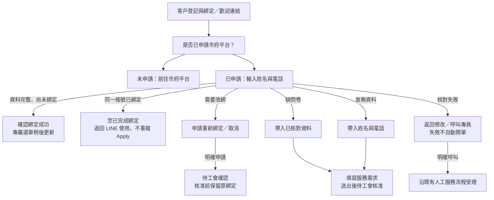
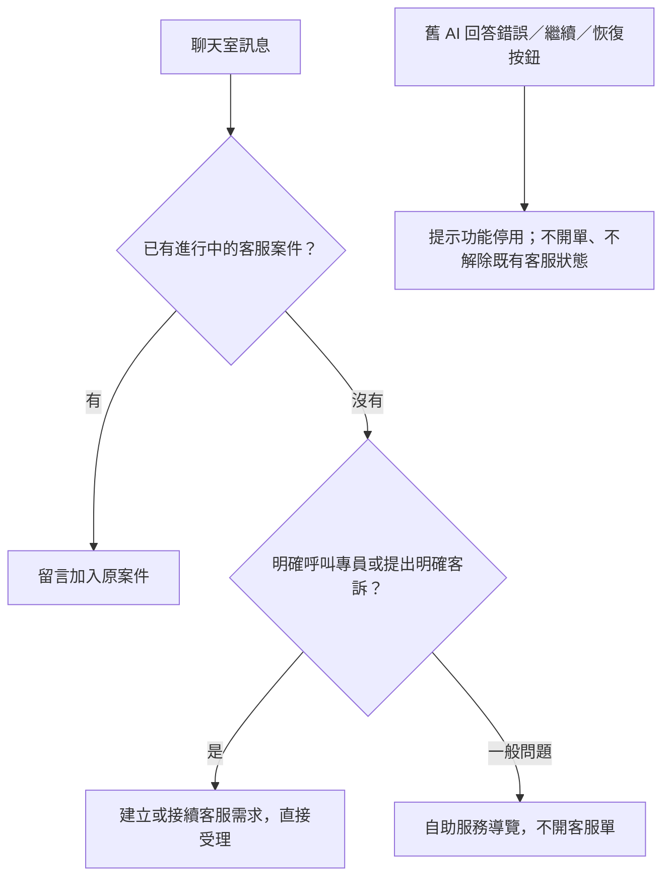
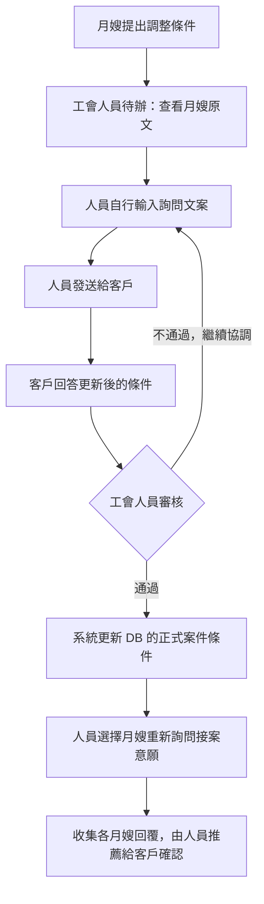
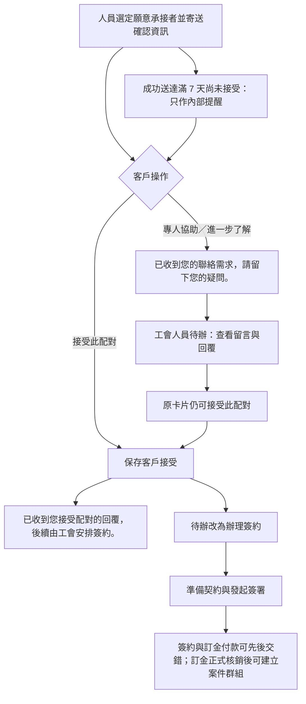

# LINE 四大模組 Eraser 流程圖轉錄與驗收基線

## 1. 用途、權威與執行邊界

本文件彙整 LINE 四大模組的流程與驗收。登記、身分綁定與人工服務依 current owner 正式規格維護；Eraser 原圖只作需求輸入，不覆蓋現行契約。

權威順序為最新人工裁決、current owner 正式規格、本文件的現行流程。原圖及歷史驗收只作證據，不保留與現行流程矛盾的需求或重新啟用已退役功能。跨 owner mutation 仍經正式 writer；本文件不授權 production、provider 或部署操作。

### 1.2 現行通知與設定驗收

現行可配置通知包含管理員個人重大異常／客訴告警、服務開始當天原群組詢問、第二期款到期提醒及核銷成功通知、正常完工問卷邀請。訂金、人工逾期提醒、日誌提醒及媒合互動依各自正式 owner 流程，不以舊 baseline 模板代替。
Gateway 失敗、staff retirement、deterministic router、舊 unresolved feedback、媒合成功與薪資異常的獨立通知模板已從目前設定與 bootstrap 移除。三日引導不再保留現行模板或排程。不可變歷史事件／receipt 繼續唯讀，development provenance 不構成現行規格。
驗收須區分設定可讀、preview、committed task 與 provider outcome；公版預覽不代表真實送達。LIFF 設定統一讀寫資料庫及歷史版本，詳見規格 20 §6.0。

媒合成功只提交媒合結果與內部稽核，不另外通知客戶或月嫂。契約簽署提醒由人員操作；
訂金計算資料與繳費資料完整後，人員由待辦點擊發送提醒。案號無法產生專屬帳號且無唯一匯入帳號時，
保留資料待確認，不寄出不完整繳費資訊。客戶可查看本案金額、期限、銀行代碼、複製帳號，
或直接點專人協助留下疑問。正式銀行核銷提交後才自動通知「已確認入帳」，可查看入帳狀態及日期；
同一核銷結果重試不重複建立通知。未綁定 LINE 時只保留人員人工通知待辦，不發群組通知。
客戶付款留言或截圖不等於核銷，群組邀請仍須正式訂金核銷通過原有資格驗證。
服務群組由工會人員在群內輸入 `綁定訂單 案件編號 邀請網址`，三段以空白、全形空白或換行分隔；網址自身不可拆行。設定只保存，不寄邀請。之後同群只輸入 `發送邀請`，以保存網址及目前核銷／身分資格排入私人邀請，無再次確認。更新網址重輸完整設定指令，保留成員歷史。格式錯誤回覆原因與正確範例，不保存或寄送；發送前資格或網址有變則取消舊工作。完整文案與錯誤提示依規格 17「服務群組設定與邀請指令」。
提醒與通知的完整文案、按鈕及身分邊界以規格 20 §6.7 為準。

2026-10-22 依現行人工協調流程退役「候選池為空／候選池協調建議」固定通知。無意願只保存月嫂回覆；零候選不建立協商。人員自行撰寫的詢問卡、客戶新條件與工會審核仍為現行流程。舊通知不再列入預覽、有效規則／模板或 fixture；既有 source intent 不得再建立投遞或互動憑證。歷史事件與 receipt 保留，不作現行需求依據。

current 目錄納入營運提醒：服務日誌連續缺漏超過 3 日時僅顯示工會內部待辦，由人員點「發送提醒」才寄至案件群組（規格 20 §5.5）、正式開工當天在原服務群組提醒第一期款並詢問當日排班月嫂服務狀況（規格 20 §6.8），以及第二期款到期當天原服務群組提醒／正式核銷成功通知（不需第二期或已結清不催款，規格 20 §6.9）。通知規則 UI
只以業務名稱選擇既有規則；event code 是 owner contract，不提供一般管理員改寫，也不提供
脫離 owner producer 的任意新增規則。請假依月嫂提交的協調結果處理，不詢問客戶同意；正式結果以無按鈕的案件群組日期表記錄。媒合成功不另行通知客戶或月嫂。
runtime／客訴告警只使用已設定管理員個人對象，呈現去敏摘要與需驗證身分的客服入口；不發送群組告警、不承諾尚未提供的安全審核卡片。
通知規則 UI 必須如實顯示上述載體與接通狀態，並鎖定由 owner 流程管理的收件者、排程、頻率與
啟用狀態；只有真正由 notification rule／template engine 產生的營運提醒提供文字內容編輯。

development-only reset/bootstrap 可由既有 Notification owner 的 typed fixture writer 建立上述最小 synthetic
owner-root recipient fixture／projection 與 source trigger event；fixture 只含 `lu_test_*` synthetic principal／binding、canonical
identity、source subject 與 revision，不建立假的 matching／leave decision、assignment、payroll obligation 或
production side effect。source trigger event 只保存 canonical event identity、trigger kind、source subject 與
producer reference，不捏造 business decision；若 trigger 語意依賴 owner decision，整合驗收時必須由該 owner
producer 提供 decision reference，P0 writer 不得直接補寫。fresh reset 必須能用相同 canonical IDs 重建，重跑必須 idempotent；既有 Notification Query
讀回 catalog／revision／selector，Preview 只預覽 source event→intent／task（零寫入），Apply 由 owner commit
intent／outbox 並回 receipt，public typed readback 再讀回 deterministic task、mock/local result 與 typed failure。
若 current owner 沒有 development-only typed source ingress，
只能由 owner fixture producer 在 reset/bootstrap 內產生 source event；不得新增 public route。任一 identity 漂移、
缺 source event、generic interactive decision、錯 recipient、重複 fixture、business root 被改動或 readback 不一致，
均為 P0 failure／`not_run`。

### 1.1 Eraser current identities

| 模組 | Diagram ID | 原圖標題 |
|---|---|---|
| M1 | 9vI_ssJZUHa59Yw7LXc0d | 模組一：LINE LIFF 表單架構與身分升級切換全流程圖 |
| M2 | xS5rOAuuQCUL139Tp4RA | 模組二：AI Agent 語意路由器與確定性 Harness 控制流程圖 |
| M3 | IXLp95YCVlOmYlkS1gBkl | 模組三：雙向智慧協調與派案博弈全流程圖 |
| M4 | bYdfiEJlAm-XhTLuLoJ- | 模組四：工會管理端、異常通報與客訴轉真人全流程圖 |

## 2. 後續逐節點驗收方法

每個節點與箭頭必須回填下列欄位，未取得直接證據不得標示 passed：

| 欄位 | 驗收要求 |
|---|---|
| 原圖 identity | 模組、group、node 或 edge identity |
| actor／trigger | 真實操作者、入口、前置條件 |
| current owner | 正式規格 owner、根事實與唯一 writer |
| public contract | typed Query／Preview／Apply／receipt／readback，或 ingress／durable worker |
| UI／API evidence | current route、client、頁面與實際顯示 |
| side-effect boundary | commit、outbox、provider、retry、manual recovery |
| disposition | aligned／conflict／superseded-by-current-spec／unimplemented／blocked／not_run／passed |
| acceptance evidence | Chrome 實點、focused test、receipt 或明確 blocker |

Chrome 驗收須實際點擊 UI；mutation 不得以 API 直接呼叫替代。LINE 真 provider 未獲授權時固定
`not_run` 且不阻塞 Task 96；仍須取得 committed delivery task 與 mock/local adapter result／typed readback，不得以未持久化 queue 或本機預覽冒充已完成的 delivery decision。

## 3. 模組一：LINE LIFF 表單與身分綁定

本節的登記及身分綁定流程以 current LINE Identity、Case Import 正式規格為準。

### 3.1 訪客入口與身分核對

- 只有成功查核才依狀態分流；API 失敗不冒充查無資料，也不自動轉往填表。
- 「申請重新綁定」沿原 Customer Preview／Apply 建立待審需求；取消零 mutation，核准前保留原綁定。
- 成功畫面只顯示真實案件編號；沒有案件編號時不填入範例，不宣稱選單已發布或訊息已送達。
- 第一次、第二次及後續失敗均只提示修正；點選「呼叫專員」或在官方聊天室明確呼叫後才建立客服需求。

### 3.2 產婦問卷登記與資料異動

| Node | 原圖顯示文字 |
|---|---|
| Register_Form | 服務需求表單包含基本資料、照護環境、飲食、居家設備及費用與同意條款；必要欄位及退費閱讀同意檢查後才可送出 |
| Save_Direct | 已有案件但缺問卷者送出後保存需求申請，顯示待工會核准，不自動宣稱正式歸戶或媒合完成 |
| Save_Staging | 新客送出後保存需求申請及申請編號，工會核准後才由 owner 建立正式客戶與對應綁定 |
| Profile_Update_Page | profile_update.html 資料異動申請；5 大分類折疊；敏感欄位檔期影響彈窗；依訂單狀態鎖定欄位 |
| Ticket_Update | 送出異動申請後產生 Diff 差異工單，等待工會專員審核，不直接覆蓋主表 |

箭頭：State_B／State_C → Register_Form；Register_Form → Save_Direct（狀態 B）／
Save_Staging（狀態 C）；Profile_Update_Page → Ticket_Update。

### 3.3 月嫂身分綁定、查單與排班調休

| Node | 原圖顯示文字 |
|---|---|
| Staff_Binding_Page | 點選「月嫂身分綁定」，或輸入「我是月嫂／我要綁定月嫂」，進入同一姓名、身分證字號與生日驗證頁 |
| Staff_Auto_Check | 唯一吻合且無衝突時綁定，專屬選單稍後更新；已綁其他 LINE 帳號時回 typed conflict，不以人工審核繞過改綁限制 |
| Staff_Order_View | staff_order_search.html；高對比大字版 Flex 卡片；可檢視曾徵詢且未指派案件並重新表達意願 |
| Staff_Schedule_View | staff_schedule.html；查看本人班表、選擇案件與受影響服務日，提交已協調順延或代班需求 |
| Staff_Leave_Result | 月嫂填入雙方協議的新日期；系統無衝突即更新正式日期、排班與帳務，寄群組日期表 |
| Leave_Exception_Todo | 需要代班或排程衝突才交工會記錄新協議或安排代班，不負責協調 |

箭頭：Staff_Binding_Page → Staff_Auto_Check；Staff_Schedule_View → Staff_Leave_Result → 正式結果或 Leave_Exception_Todo。

### 3.4 工會帳密綁定與手機審核中心

| Node | 原圖顯示文字 |
|---|---|
| Admin_DM_Command | 工會人員於 1 對 1 私訊輸入「綁定後台帳號」；群組發送拒絕；發放 15 分鐘一次性 Token |
| Admin_Binding_Page | identity.html?purpose=admin_binding；輸入後台帳號＋密碼；5 次防爆破鎖定 |
| Admin_Success | 帳密正確後綁定 admin_users、升級 union_staff、啟用工會 3 頁籤管理選單 |
| Mobile_Admin_Center | mobile_admin.html 工會手機審核中心；依各業務 owner 分組顯示待辦與操作 |
| Review_1 | 客戶資料異動：新舊值 Diff 一鍵核准 |
| Review_2 | 重新綁定申請：防冒領轉移審核 |
| Review_3 | 月嫂認證／重綁異常審核 |
| Review_4 | 請假排程衝突／代班待辦；記錄雙方結果、詢問人選意願、寄原群組邀請並在加入後記錄日期 |

箭頭：Admin_DM_Command → Admin_Binding_Page → Admin_Success → Mobile_Admin_Center；
Mobile_Admin_Center → Review_1／Review_2／Review_3／Review_4；Save_Staging → Review_2；
Ticket_Update → Review_1；Leave_Exception_Todo → Review_4。

### 3.5 雙身分切換與退役權限回收

| Node | 原圖顯示文字 |
|---|---|
| Dual_Role_Trigger | 月嫂兼產婦時輸入「服務登記」，觸發二次驗證並同時擁有 staff_id 與 client_id |
| Dual_Menu | 啟用 staff_customer_menu 雙頁籤選單，可在月嫂工作與我的月子間切換 |
| Auto_Restore | 產婦案件結案退款歸檔後，自動恢復為單一月嫂選單 |
| Admin_Retire_Staff | 工會後台辦理月嫂退役；清空 staff_id、降級為 customer、切換一般選單並回收查單權限 |

箭頭：Dual_Role_Trigger → Dual_Menu → Auto_Restore；Mobile_Admin_Center → Admin_Retire_Staff。

## 4. 模組二：自助服務與明確呼叫專員

官方帳號採自助服務。一般聊天室留言不啟動 AI，不因「問題／其他問題／詢問／5／6」建立客服單；這些輸入只開啟服務導覽。專用 AI／常見問答 LIFF 由規格 29 管理，不等於聊天室 AI。

固定導航、登記／身分及已驗證資料異動仍走原 owner 流程；LIFF 不直接修改業務根事實。呼叫後的受理回覆、正式結案通知與同一案件留言依規格 29 §9。管理員身分綁定只接受官方帳號私訊入口，不由一般文字或 query string 授權。

收費說明使用現行補助分類：補助市民最高 40 小時、社福最高 120 小時，實際補助金額依本案服務資料計算。實際回覆與公版預覽共用文案。

## 5. 模組三原圖轉錄：雙向智慧協調與派案博弈

原圖說明：一對多精準重探、拒接原因降維撮合、調休順延閉環與改期協調。

### 5.1 派案階段：條件差異與候選月嫂精準重探

| Node | 原圖顯示文字 |
|---|---|
| Client_Term_Update | 客戶在媒合中途修改需求 Term Diff，例如由需料理三餐改為外送月子餐／不下廚 |
| Diff_Analyzer | 系統計算條件差異與候選人拒接歷史 |
| Group_1_Willing | 第一群：原本願意接案者因條件變更需重新確認；發送新條件再確認卡片 |
| Group_2_Resolved | 第二群：原本拒接但痛點已解決；發送條件已改善重探卡片 |
| Group_3_Ignored | 第三群：拒接痛點未解決且與新條件無關；靜默排除、零打擾 |

箭頭：Client_Term_Update → Diff_Analyzer；Diff_Analyzer → Group_1_Willing（原本願意者）／
Group_2_Resolved（痛點已解決者）／Group_3_Ignored（無關者）。

### 5.2 多人意願與人工條件協調

| Node | 目前行為 |
|---|---|
| Willing_Pool_Check | 可同時有多位月嫂願意，人員決定推薦人選，再交客戶確認；不得因已有願意者阻擋其他回覆 |
| No_Interest | 月嫂勾選「沒有意願」後按「送出回應」，頁面顯示「已送出，謝謝您的回應。」；人員端標示「無意願」、備註「沒有意願」，不顯示內部代碼。不另發聊天室訊息、不建立協調待辦、不通知客戶、不影響其他候選或自動結案 |
| Staff_Adjustment_Todo | 月嫂提出調整條件就建立人員待辦，不等待全池完成、不因滿 24 小時自動詢問客戶 |
| Client_Compromise_Push | 人員查看月嫂原文，自行輸入詢問文案並按發送；系統不擬草稿、不直接轉發原文 |
| Client_Compromise_Answer | 客戶填寫更新後的條件；原文、詢問與回答只供人員審核，不直接改單 |
| Union_Manual_Followup | 人員審核不通過即重新輸入文案、再次詢問；通過時由系統更新 DB 正式案件條件，再由人員選擇月嫂重新詢問。不設「是否需要修改」分支，不發群組通知 |
| Response_Reminder | 成功送達滿 24 小時仍未回覆時，只顯示內部待辦提醒，不阻擋月嫂回覆、不自動記為沒有意願 |

審核更新借用 Orders Terms canonical writer 及其既有 `apply_in_current_uow`，與本輪協調審核事件共用單一 outer UoW；寫入失敗不留下成功審核。客戶回答、審核及重新詢問綁定 exact round／answer 與 resulting order version；stale 或冪等衝突須零重複效果。工會人員 current binding、enabled Admin 與 matching capability 驗證不省略，操作不限定 system_admin。可修改欄位沿用現有正式 Terms 契約，不由月嫂分類或自由文字自動推測。

### 5.2.1 推薦月嫂給客戶確認

客戶推薦由人員選定願意承接者並主動寄送確認資訊。專人協助回覆「已收到您的聯絡需求，請留下您的疑問。」，人員從待辦查看與回覆，原卡片仍可接受配對；接受時回覆「已收到您接受配對的回覆，後續由工會安排簽約。」，待辦改為辦理簽約，簽約與訂金付款可先後交錯，訂金正式核銷後即可由人員建立案件群組。成功送達滿 7 天未接受僅作內部提醒，不阻擋回覆、不發群組通知。本人、current binding 與有效方案驗證不省略，取消、更換或最終決定的方案不能重用；履歷下載仍沿原短效憑證規則。

### 5.3 服務進行中：月嫂提交請假協調結果

雙方在案件群組自行協調 → 月嫂由官方帳號一對一聊天室開啟「排班資訊與請假」 → 選案及原服務日。

- 已協調順延：填明確新日期 → fresh conflict check → 無衝突即 canonical 更新正式日期、排班及相關帳務 → 日期表至原案件群組，無再次確認。
- 需要代班或衝突：工會內部待辦 → 記錄雙方新協議並重檢，或選代班人選 → 詢問意願 → 不願意改選 → 願意才寄本案群組邀請 → 確認加入 → 人員填實際日期 → canonical 更新與群組日期表。

工會只記錄結果或找人代班，不負責協調；原資料在衝突時維持不變。完整契約依規格 20 §5.3。

### 5.4 服務開始、排班與代班

本段依規格 02 SSTART-01～08，使用現行流程，不保留 profile_update 改期、先寄日期確認卡或人員再次核准的原圖規則。

| 節點 | 現行流程與驗收 |
|---|---|
| 客戶提出／雙方協調 | 客戶在原服務群組提出希望日期，客戶與月嫂自行協調；客戶 LIFF 移除既有「服務日期／天數」選項與新日期申請能力，Bot 不監控聊天。 |
| 月嫂觸發 | 本人經 LIFF 接受並填約定日期，或不接受請工會安排代班；無檔期衝突不能冒充本人同意。 |
| 正常自動完成 | 檔期無衝突且正式條件通過，系統更新日期、排班及第一期款到期日；人員不用核准或關注。 |
| 工會代班 | 拒絕或檔期衝突才建立待辦；人員確認需替代區段、選人詢問意願。不願意改問其他人，願意後由工會代班頁按「寄送本案群組邀請連結」，只寄該人；UI／API 的願意資格及送達／加入回讀皆須驗收。 |
| 入群／日期保存 | 代班月嫂點連結加入原群組後，由工會直接填日期並接正式保存；不用代班月嫂再開 LIFF 提交。 |
| 群組結果表 | 正式保存成功後寄原群組，列各月嫂負責日期；無再次確認按鈕，送達不作排班 gate。 |

驗收需覆蓋無人員介入正常路徑、不願意改選、先願意再邀請、加入證據、人員填日期、再次衝突、多月嫂／局部代班、權限、原子 rollback、replay 與寄送失敗不回滾業務結果。

## 6. 模組四原圖轉錄：工會管理端、異常通報與客訴轉真人

原圖說明：兩大管理端協同、（群組告警已依 2026-10-22 人工裁決退役）、客訴轉真人 SOP 與代班自動拆帳。

### 6.1 兩大核心管理端協同

| Node | 原圖顯示文字 |
|---|---|
| Desktop_Web_Admin | 工會電腦版 Web 後台：媒合排班、代班／換人處理、財務核銷／請款清冊、明確客服需求與管理員個人告警 |
| Mobile_Ops_Group | LINE 手機行動管理端，包含通知協調層與執行審核層 |
| Mobile_Admin_Page | mobile_admin.html：專員一鍵核准／退回，原圖聚焦資料異動、舊客重綁、月嫂重綁 |

工會人員由管理入口開啟手機待辦；重大告警只沿已設定管理員個人通知，不經群組告警。

### 6.2 群組告警已取消

2026-10-22 人工裁決取消整個群組告警功能。原圖的群組登錄、單一鎖定、重設、重新啟用及群組審核連結不再是現行需求或驗收。保留管理員個人通知與案件服務群組；不得以原圖恢復群組告警。

### 6.3 明確客服需求與重大異常處理

明確呼叫專員或符合固定客訴入口者，沿 Customer Service 正式 writer 建立或接續客服案件。受理使用既有固定文案，不啟動聊天室 AI。一般問題、回答錯誤及身分核對失敗不自動開單。重大 escalation 的去敏摘要及客服入口只通知已設定管理員個人；無有效對象時保留內部處理結果，不猜收件人。

### 6.4 工會手機待辦與管理流程圖

工會 LINE 手機待辦同步提供各期繳款逾期與日誌連續缺漏分類，沿用網頁後台的 Query／Send、權限、冪等與發送前複核；查詢不建立通知，點擊才建立工作，工作受理不等於送達。管理端 LINE 訊息流程完整呈現簽約提醒、月嫂提交日期與日期表、各期逾期人工提醒及代班／換人共用流程；自助與內部操作不偽裝成 LINE 通知。

| Node | 原圖顯示文字 |
|---|---|
| Review_Diff | 客戶資料異動審核 profile_update；紅綠 Diff，一鍵核准後更新 clients |
| Review_Client_Rebind | 舊客重綁防冒領；有原綁定衝突時送審，核准後轉移 line_user_id |
| Review_Staff_Rebind | 月嫂換手機／LINE 帳號後進行身分重綁審核並啟用月嫂選單 |

箭頭：Mobile_Admin_Page → Review_Diff／Review_Client_Rebind／Review_Staff_Rebind。

### 6.5 代班／換人及帳務更新

工會確認需替代區段 → 選人並詢問意願 → 不願意改問其他人 → 願意才寄原案件群組邀請 → 確認加入 → 工會記錄實際服務日／交接日 → 沿既有 Scheduling、Payroll、Finance writer 更新剩餘排班與帳務 → 發無再次確認按鈕的日期表到原案件群組。無衝突順延仍由月嫂直接提交結果，不增加工會確認。

原月嫂與接任月嫂各依正式服務量形成整筆應付，不拆成補助薪資、自費薪資或兩次付款。補助退還客戶及政府整期核銷依 Client Finance／Government Subsidy 正式規格處理，LINE 不新增付款義務或成功通知。

## 7. 全系統四大模組精髓總覽原圖轉錄

### 7.1 模組一：安全表單與身分自動流動

User_Entry（進入 LINE 官方帳號並點擊服務登記／身分綁定）→
Gateway_Flow（姓名＋手機的身分先行核對）→
Auto_Bind_Client（舊客喚醒案件並啟用客戶選單）或
New_Reg_Form（新客預填問卷與條款確認）。

### 7.2 模組二：自助與人工服務

自助選單／固定導航 → 對應 LIFF 或核准說明；明確呼叫專員 → 客服案件 → 同案留言及人員回覆 → 正式結案。一般問題不自動開單，舊 AI 按鈕只提示停用。

### 7.3 模組三：意願、推薦與協議結果

人員詢問多位月嫂 → 願意者由人員選定推薦給客戶 → 客戶接受 → 簽約與訂金付款可先後交錯 → 訂金正式核銷後建群 → 月嫂提交協議日期。條件調整由人員撰文詢問與審核，通過即更新案件條件；不自動從無意願推測新條件。

### 7.4 模組四：工會待辦與帳務

工會手機／電腦待辦 → 依原 owner 處理；各期逾期與日誌連續缺漏由工會逐次決定是否提醒。代班／換人沿意願、原群組邀請與加入後日期記錄。正常完工通知原案件群組一次，問卷網址先留空；退款、補助與月嫂付款沿既有帳務，不另發成功 LINE。

## 8. Current 正式契約對照

本節只裁決已由 current 正式規格明確回答的差異。尚未回答者列入第 9 節，
不在本輪發明契約。

| 原圖主張 | Current 裁決 | Disposition | 正式 owner |
|---|---|---|---|
| Gateway 直接查 clients，吻合後直接升級角色 | verified token 進 LINE Identity application；line_identity_bindings 是唯一 binding writer，onboarding 是 projection outcome，不是 role promotion | superseded-by-current-spec | 17、23 |
| query-string userId 或頁面參數可作授權 | query string 只可導航；授權必須由 server verified token／session 衍生 | superseded-by-current-spec | 17、20、23 |
| provisional registration 由 LINE 擁有 | provisional registration 由 Case Import 擁有，LINE 只保存平台身分與驗證 evidence | superseded-by-current-spec | 17 |
| profile_update 核准後直接更新 clients | 已由 Client owner 的 typed Query／Preview／Apply／receipt／readback承接；LINE只驗token／binding與轉送，1021 additive successor已形成，runtime DB／verified-token Browser另依gate驗收 | repository-local-complete | 20 §6.1、23、96 CUR-LIFF-PROFILE-01 |
| 月嫂提交已協調順延 | Scheduling fresh-lock 後無衝突即同交易更新正式日期、排班及帳務並寄群組日期表；衝突或代班才進工會待辦 | current | 02、20 |
| Admin 綁定即「升級 union_staff」 | 綁定只建立 Access／LINE identity projection；不得由 LIFF 自行變更業務角色根事實 | superseded-by-current-spec | 17、23、25 |
| 滿意度直接寫資料庫並統計 | Feedback owner、exact response subject、`resolved|unresolved`、receipt、privacy與Customer Service linkage契約已裁決；尚未到Task 96 implementation順位，本機點擊不得假造 | contract-ready | 20 §6.3、96 CUR-LINE-AI-FEEDBACK-01 |
| 客戶同意降維後自動更新訂單並派案 | M3 只保存 criteria／candidate／decision lineage；accepted 後 fresh-read，產生 Assignment conversion／rematch request，不寫 Orders／Assignment | superseded-by-current-spec | 02、17 |
| 月嫂同意改期後自動更新合約與日期 | 必須分別由 Contract／Orders／Scheduling owner 依 typed command 與 fresh facts 推進，M3 不跨 owner 寫入 | superseded-by-current-spec | 02、17、21 |
| alert_group_id 重設為 NULL | current runtime target 採 history-preserving disable、active singleton、opaque CAS，不清除歷史 root | superseded-by-current-spec | 17 M4 amendment |
| HIGH 告警卡附完整姓名／電話／摘要 | 對 LINE 群與一般管理投影只允許 masked typed projection；不得傳完整 PII 或 raw provider payload | superseded-by-current-spec | 17、20 |
| 代班完成後由 LINE 自動拆薪 | LINE 不擁有薪資；Scheduling 建立正式代班 assignment，Payroll 依有效 assignment 與服務日計算義務 | superseded-by-current-spec | 02、03 |

## 9. Task 96 required flow gaps（current SPEC_READY disposition）

下列原圖需求已由 current owner／UoW 邊界唯一收斂為 SPEC_READY 的 observable contract；列入 SPEC_READY
不等於 runtime 已完成。每項都必須以 `lu_test_*` no-auth Browser 或 verified-token LIFF 直接操作，並取得
committed root／intent／outbox、deterministic delivery task、retry/manual fallback、mock/local result 與
typed readback；缺任一 required evidence 即為 implementation `not_run`，不是新的 Authority blocker。

| Gap | 原圖來源 | Observable acceptance | Failure／not accepted |
|---|---|---|---|
| Gateway 失敗提示與明確呼叫 | M1 Retry_Fail、M4 Trigger_Anomaly | 連續失敗不自動開單；返回修改零客服副作用，明確呼叫後才沿既有人工服務建立或沿用需求。 | 未呼叫就建立 ticket／escalation／通知、取消仍變更綁定，或未受理卻宣稱已開單，均 failure。 |
| dual-role 選單切換與案件結束後恢復 | M1 Dual_Role_Trigger／Dual_Menu／Auto_Restore | 雙角色使用者可選 active context，選單投影與 binding intent 對應該 context；案件 closure 後恢復預設 role，並由 typed readback 證明。 | context 過期、選單與 active role 不一致、closure 不恢復、跨 owner 直寫或無 intent/readback，均 failure。 |
| staff retirement 的根事實與 LINE 權限回收 | M1 Admin_Retire_Staff | Staff owner retirement Apply 產生 receipt；binding projection／LINE 權限與 Rich Menu 失效，open assignment blocker 明確回報，無法退休時 typed failure 可讀回。 | LINE adapter 自行改 Staff root、仍可操作受限 menu、open assignment 被靜默覆蓋或無 blocker/readback，均 failure。 |
| deterministic navigation／event catalog | M2 Nav_Command | server-owned revision 的 command／event 以 protected alias 命中正確 tier、source citation、durable reply/event receipt；unknown 與 fallback 亦有 typed result。 | alias 漂移、unknown 誤命中受保護 action、revision 不可讀、無 citation／receipt 或只回 HTTP 200，均 failure。 |
| feedback root／receipt／aggregate／ticket | M2 AI_Badge_Rating／Feedback_Analytics | feedback 以 owner root／event linkage 持久化並回 receipt；依固定 revision／window 可重算 aggregate；`unresolved` 產生 Customer Service ticket，Query 可讀回。 | local counter、無 root／receipt、aggregate 不可重算、unresolved 無 ticket、raw provider payload 穿透，均 failure。 |
| 人工條件協調與新條件審核 | M3 Client_Compromise_Push／Union_Manual_Followup | 月嫂原文只供人員查看；人員自行撰寫詢問，客戶提供更新後條件，不通過可反覆詢問。人員審核通過時同交易委派正式 writer 更新 DB 條件及協調審核事件，之後選擇月嫂重新詢問。24 小時只作內部提醒，不發群組通知。 | 自動轉問或擬草稿、二選一取代新條件、未審核改單、通過後另問是否需要修改、非當輪回答、DB 更新失敗卻審核成功、逾時阻擋回覆、群組通知、recipient 或冪等不符均 failure。 |
| 請假、順延與代班 | Staff_Leave_Result、Leave_Exception_Todo | 本人提交協議日期，無衝突自動更新與群組記錄；衝突只建內部待辦。代班須願意、邀請與 current 入群證據後才記錄日期。 | 私訊詢問客戶、無衝突仍需人工核准、未加入即代班、半套排班／帳務或重複投遞均 failure。 |
| 客訴 ingress／hold／HIGH ticket／alert | M4 Complaint_Explicit_Ingress | canonical complaint ingress 產生 Customer Service hold state、HIGH ticket、masked alert intent/outbox/delivery task／mock-local result；claim／release／timeout 與 manual recovery 可讀回。 | 只有 normalizer、無 canonical ingress、未 hold、無 HIGH ticket／alert、無 owner claim/release 或無 outbox/readback，均 failure。 |
| 代班後薪資／應付跨域完成證據 | M4 Substitute_Accounting_Result | Scheduling assignment readback 連到 Payroll obligation，再連到 Staff Payables evidence／anomaly projection；每段以 owner receipt、exact subject 與 version 可追溯。 | 缺任一 owner receipt、跨域直接寫 root、assignment／obligation 不一致、只有 typed GET 或無 anomaly readback，均 failure。 |

### 9.1 B／C current owner-safe contract amendments（2026-09-01）

#### 群組審核連結驗收退役

依 2026-10-22 人工裁決，群組告警及其專用審核連結已取消，不再要求簽發或兌換。歷史 Query／撤銷保留。管理員客服入口是需驗證身分的導航，不宣稱為短效一次性安全審核連結。

#### `R1-LIFECYCLE`：案件 terminal closure 自動恢復

Orders 是 terminal closure event 的唯一 source owner；event identity 由 `case_no`、
`terminal_kind` 與 resulting Orders lifecycle version 組成，並由 Orders outer UoW 同交易保存
immutable event／receipt／post-commit outbox。若 closure 依賴其他 owner 的退款／歸檔結果，只能
攜帶 typed receipt reference，不可跨 owner 直寫。LINE Identity 是唯一 consumer，透過既有
role-scoped Query／Apply 檢查同一 LINE User ID 的全部 active client-role cases 與 staff binding。

只有 staff binding 仍為 `active` 且全部 active client-role cases 已由 owner readback 證明 terminal，
才可提交一次 staff default/menu intent；仍有 active client case 時回 typed no-op，不得 restore。
staff retirement／revocation pending／revoked 優先且不得恢復 revoked role。Replay 回原 receipt，
payload mismatch、source／binding／menu version stale、subject 或 capability mismatch 固定
fail closed；transient storage error 才可 bounded retry，其餘由 owner Query／manual reconciliation
與必要 manual fallback 處理。Consumer 不得寫 Orders、Staff、Client 或 Scheduling root。

## 10. 驗收停止條件

1. 只因頁面、API 或測試存在，不得將原圖節點標示 passed。
2. 原圖的自動化若缺人工介入入口、fresh validation、receipt 或 readback，固定未完成。
3. 真 provider send／真人效果、production、schema、migration、DDL、deployment 與 entry switch 仍需各自新授權；provider receipt 不是 Task 96 terminal gate，但 intent／outbox／deterministic task／mock-local result／readback 仍是。
4. 本文件第 9 節是 Task 96 的 required acceptance gaps；不因列入驗收而授權 code、schema、provider
   或 production mutation，完成仍須以直接 UI／ingress 操作與 current owner readback 為準。
5. 每個 gap 施工前，均須先核對最新人工裁決與 current 正式規格，再建立有界工作包；本文件不自行
   授權 implementation 或外部 effect。
