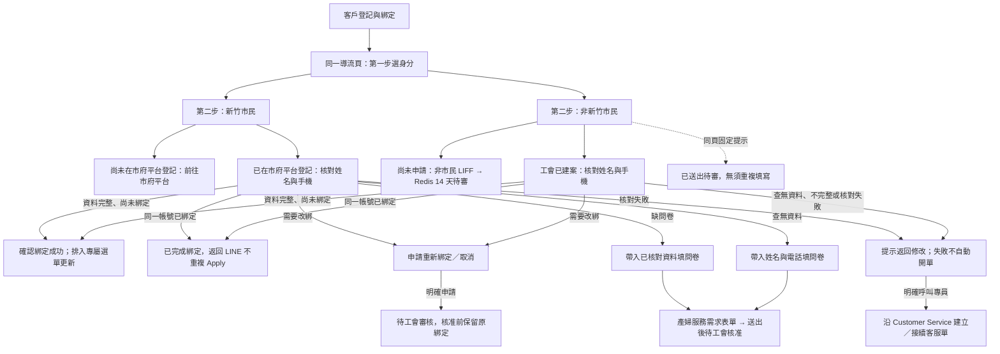
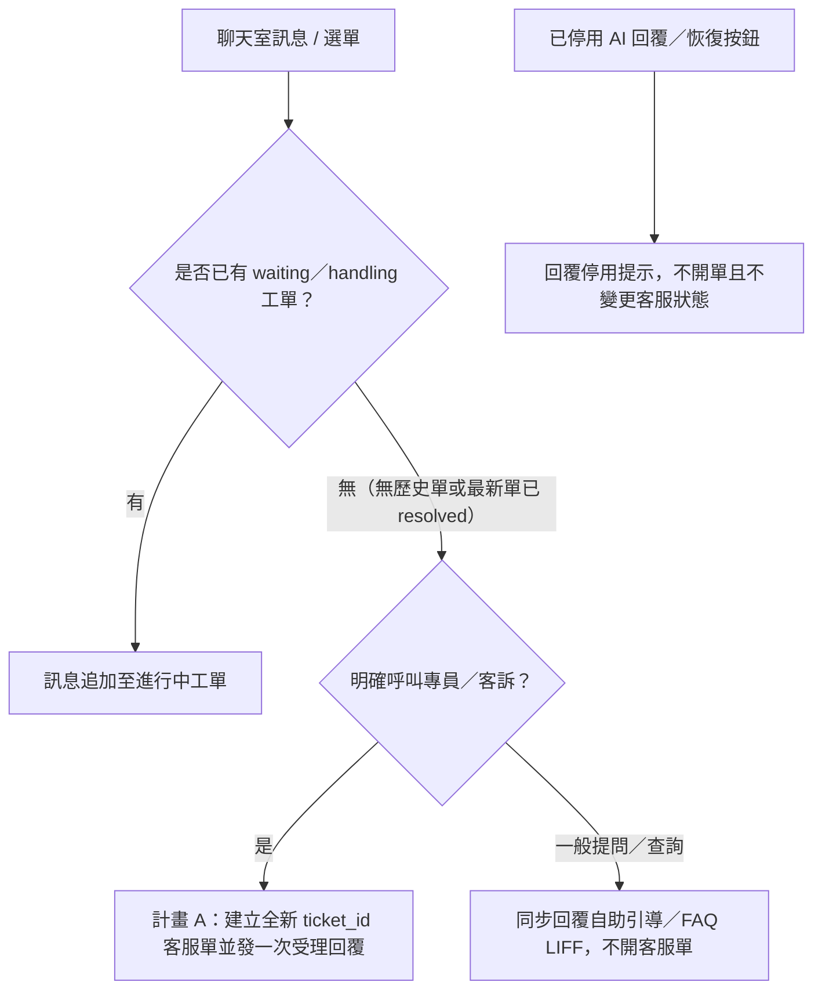
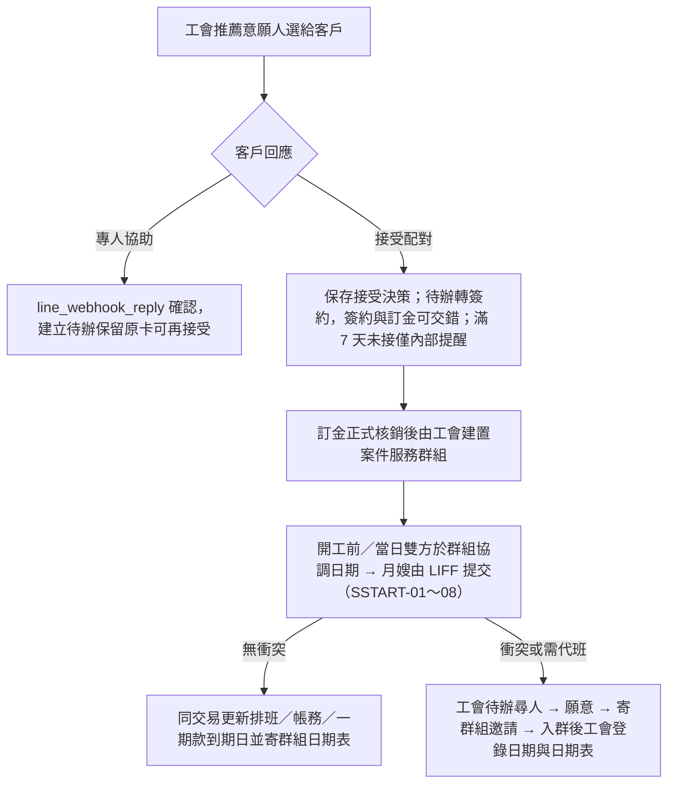

# LINE 四大模組流程圖轉錄與整合驗收基線

## 1. 範圍、權威與現行通知驗收基線

本文件彙整 LINE 四大模組（M1～M4）的端到端業務流程轉錄與逐節點整合驗收口徑。圖示原型僅作結構需求參考；任何衝突、owner 歸屬、唯一 writer 與細節文案皆以各現行 owner 正式規格為唯一權威（權威鏈：最新人工明確裁決 → 現行 owner 正式規格 → 本文件流程對照）。跨 owner mutation 固定經各自 canonical writer 與單一 outer UoW 提交。

### 1.1 Eraser 模組對照索引

| 模組 | Diagram ID | 對應能力範圍與現行 Owner |
|---|---|---|
| M1 | `9vI_ssJZUHa59Yw7LXc0d` | LINE LIFF 表單、身分綁定與角色選單切換（[`17B_Case_Import與非市民Redis待審正式規格.md`](17B_Case_Import與非市民Redis待審正式規格.md)、[`23_LINE身分管理與解除正式規格.md`](23_LINE身分管理與解除正式規格.md)、[`29_LINE服務說明、客服互動與選單角色正式規格.md`](29_LINE服務說明、客服互動與選單角色正式規格.md)） |
| M2 | `xS5rOAuuQCUL139Tp4RA` | 自助導覽、專用 FAQ／AI LIFF 與明確客服升級（[LINE 客服與月嫂自助服務](20_LINE客服與月嫂自助服務正式規格.md)、[LINE 服務說明與選單角色](29_LINE服務說明、客服互動與選單角色正式規格.md)） |
| M3 | `IXLp95YCVlOmYlkS1gBkl` | 雙向媒合協調、推薦確認、簽約訂金交錯與排班／代班閉環（[Assignments / Scheduling Domain](02_Assignments_Scheduling_Domain.md)、[媒合候選池與客戶決定及通勤](02A_媒合候選池與客戶決定及通勤規格.md)、[Contract Signing 正式規格](21_Contract_Signing_Commitment與正常驗收資料鏈正式規格.md)） |
| M4 | `bYdfiEJlAm-XhTLuLoJ-` | 工會管理端（桌面／手機）、重大個人告警、客訴轉真人與代班帳務拆算（[LINE 客服與月嫂自助服務](20_LINE客服與月嫂自助服務正式規格.md)、[LINE Gateway 與通知投遞](17A_LINE_Gateway_Inbox與通知投遞正式規格.md)） |

### 1.2 現行可配置通知與人工提醒驗收邊界

1. **Webhook Reply-Only vs Push 分工**：互動文字引導與五項互動 Postback 按鈕確認固定走純 `line_webhook_reply`（45 秒時窗、1 次嘗試、同事件／同聊天室檢核，禁止 fallback Push）；主動通知、卡片本體與定時排程走 `line_push_worker`（詳見 [`20_LINE客服與月嫂自助服務正式規格.md`](20_LINE客服與月嫂自助服務正式規格.md) §3）。
2. **現行可配置通知與退役項目**：
   - 保留可配置項目：管理員個人重大異常／客訴告警（不發群組）、`order.service_start_day` 服務開始當天原群組詢問、`second_payment_due`／`second_payment_settled`、正常完工通知（`LINE-SERVICE-COMPLETION-TEXT-V1`），以及獨立管理契約下的訂金／一期／二期人工逾期提醒與人工收據（`LINE-PAY-01`～`08`）。
   - 已全面退役項目：加入好友即時歡迎訊息（改由 LINE 官方帳號設定）、群組異常告警與群組一次性審核連結、三日延遲引導排程（`D+1`～`D+3`）、月嫂寶寶日誌表單與連續缺漏 3 天催繳提醒（改回 LINE 群組相簿人工查閱）、候選池為空固定推播、媒合成功／薪資異常／閒置客服自動推播，以及銀行核銷後自動代發收據。
3. **群組設定與合成 Fixture 驗收原則**：服務群組綁定指令（`綁定訂單 案件編號 邀請網址` 與 `發送邀請`）依 [`17A_LINE_Gateway_Inbox與通知投遞正式規格.md`](17A_LINE_Gateway_Inbox與通知投遞正式規格.md)；`development` 環境得依 [`10_Global_保留資料Migration與Cutover_Subsystem.md`](10_Global_保留資料Migration與Cutover_Subsystem.md) 於本機受控資料庫使用 owner typed fixture producer 建立含 canonical IDs 之測試實例，嚴禁由 Notification 端偽造媒合、請假或薪資業務決策。

## 2. 逐節點驗收欄位與通過基準

所有節點與路徑轉移須以真實互動介面（Browser／LIFF 實點，嚴禁以直接呼叫 API 代替操作）回填下表證據後始得標記 `passed`（真實外部 LINE provider 若未授權外發，provider step 標為 `not_run`，仍須完成 committed delivery intent／outbox／task 與 mock-local typed readback）：

| 欄位 | 驗收要求 |
|---|---|
| `原圖 identity` | 模組、Group、Node 或 Edge 唯一識別 |
| `actor／trigger` | 實際操作身分、前置條件與觸發動作 |
| `current owner` | 正式規格之根事實擁有者與唯一 canonical writer |
| `public contract` | typed Query／Preview／Apply／receipt／readback 或 ingress／worker 契約 |
| `UI／API evidence` | 現行路由、畫面顯示與回應欄位一致性 |
| `side-effect boundary` | 單一交易提交邊界、outbox、失敗隔離、重試與人工復原 |
| `disposition` | `aligned` / `conflict` / `contract_ready` / `passed` / `blocked` / `not_run` |
| `acceptance evidence` | Chrome／LIFF 操作記錄、focused test、receipt 與 typed readback |

## 3. 模組一（M1）：LINE LIFF 表單、身分綁定與角色切換

### 3.1 訪客入口與身分核對（Gateway）

- 送出姓名與手機後依實際核對結果分流。API 錯誤不得偽裝為查無資料或直接開表。核對失敗僅提示修正，明確點選聯絡專員後方才建立客服單。使用者可從兩個第二步畫面返回第一步。

#### 3.1.1 兩步導流修正後的驗收

| 驗收項目 | 操作與通過條件 |
|---|---|
| 導流畫面 | 從圖文選單開啟同一導流頁，實點四個選項並核對各目的地。兩個第二步畫面皆可返回第一步，重選後只顯示新身分選項。固定待審提示只出現在非新竹市民的第二步。 |
| 市民與既有連結 | 已在市府平台登記者維持既有核對與問卷分支，尚未登記者前往市府平台。既有 LIFF 直接連結仍開啟原目的地。 |
| 非市民綁定 | 以手動建案資料實點綁定並核對正式綁定結果。驗證同帳號已綁定、明確改綁申請，以及查無資料、資料不完整、核對錯誤等情境。後三種情境留在綁定頁，無一般問卷跳轉、綁定寫入或自動客服單。 |
| 非市民新申請 | 尚未申請者開啟非市民專用表單。送出依既有待審回執顯示結果，導流選擇與待審提示本身皆無業務寫入。 |
| LIFF 設定與預覽 | 驗證新站台初始設定及既有站台版本更新皆能呈現四條路徑。檢查既有版本讀取與還原、版本衝突、重複套用，以及後台預覽與正式畫面的選項和目的地一致。 |

### 3.2 問卷儲存隔離、資料異動、月嫂與工會手機審核

| 模組節點群組 | 現行規格契約與邊界 |
|---|---|
| `Register_Form` / 待審儲存 | 依 [`17B_Case_Import與非市民Redis待審正式規格.md`](17B_Case_Import與非市民Redis待審正式規格.md) `REG-BOUNDARY`／`REG-REDIS`／`REG-EXPIRY`：表單送出後存於無 MySQL 憑證之專用持久化 Redis（14 天自動到期清理）；待工會核准時才經 Case Import writer 寫入 MySQL 正式客戶／訂單並依回執刪除待審資料，拒絕亦立即刪除。 |
| `Profile_Update_Page` / `order_update` | 聯絡資訊與退費欄位由 `profile_update` 負責；服務地址、縣市、居住型態由 `order_update`（純 URI 入口，無五按鈕與服務天數）申請並產生 Diff 工單，依訂單鎖定狀態檢核，經工會核准後方更新對應 owner（不適用 14 天 Redis 清理）。 |
| `Staff_Binding_Page` / 自助頁 | 月嫂以姓名、身分證字號、生日綁定；衝突退為 typed conflict。整合 `staff_order_search`、`staff_schedule`（`leave-v1`／`SSTART-01`～`08`）與 `staff_payout`（`staff_payout.html`）；**寶寶日誌頁（`staff_baby_log.html`）已退役並回傳 `410`**。 |
| `Admin_DM_Command` / `mobile_admin` | 一對一私訊輸入「綁定後台帳號」發放 15 分鐘一次性 Token → `identity.html?purpose=admin_binding` 驗證帳密（5 次防爆破）→ 綁定 `union_staff_menu` 開啟 `line-mobile-admin` 四頁籤；群組輸入拒絕發放。 |
| 雙身分與退役回收 | 月嫂兼產婦啟用 `staff_customer_menu` 雙頁籤切換；所屬客戶案全數終結後依 `R1-LIFECYCLE` 自動恢復 `staff_menu`。後台辦理月嫂退役時清除有效 `staff_id` 投影，選單降回 `customer_menu` 或 `default_menu` 並回收查詢權限。 |

## 4. 模組二（M2）：自助導覽、FAQ LIFF 與明確呼叫專員

- 專用 AI／常見問答統一由 `?target=ai_assistant` 提供（6 大分類、`document/line/AI客服QA題庫.jsonl` 54 題、`authoritative=false`，未命中回 `UNSUPPORTED` 並提供轉專人按鍵）。詳見 [`29_LINE服務說明、客服互動與選單角色正式規格.md`](29_LINE服務說明、客服互動與選單角色正式規格.md)。

## 5. 模組三（M3）：媒合重探、人工條件協調與簽約排班閉環

### 5.1 條件差異重探與多人意願推薦

- **條件更新重探（`Group_1_Willing` / `Group_2_Resolved` / `Group_3_Ignored`）**：客戶修改媒合需求（如調整下廚條款）後由系統比對歷史拒絕原因；原願意者重送確認卡、痛點已被排除者重送改善重探卡、無關痛點者靜默略過不打擾。
- **多人意願與「沒有意願」**：同一案件可收多位願意人選並由工會決定推薦對象；月嫂送出「沒有意願」僅顯示「已送出，謝謝您的回應。」並記為無意願（Postback ack 走 `line_webhook_reply`），不通知客戶或另立協調待辦。
- **人工條件協調閉環**：月嫂提出調整條件時建立工會待辦 → 工會檢視原文並自行撰文發問客戶 → 客戶答覆新條件 → 工會審核不通過可續問，審核通過時**與 Orders Terms canonical writer 在同交易更新 DB 正式條件**（不設二選一問項、不發群組通知），後續由工會選定月嫂重問意願。滿 24 小時未回覆僅顯示內部待辦提醒。

### 5.2 推薦確認、簽約訂金交錯與服務日排班閉環

- 正式服務中請假同樣採 `leave-v1`（見 [`20_LINE客服與月嫂自助服務正式規格.md`](20_LINE客服與月嫂自助服務正式規格.md) §4.2）；任何排班與協調決策不得跨過 Scheduling／Orders canonical writer 直接修改表單根欄位。

## 6. 模組四（M4）：工會雙管理端、個人告警與代班拆帳

- **雙管理端協同**：電腦版 Web 後台處理媒合排班、代班／換人、財務對帳（`WF-01`～`06`）、客戶客服清單、推播佇列追蹤與 `LINE-PAY-01`～`08` 繳款提醒／人工收據；手機端 `line-mobile-admin` 提供 `staff_review`、`customer_service`、`order_tracking` 與 `dashboard`（頂端含已退役系統告警之收合系統狀態摘要卡）。
- **個人化安全告警**：群組告警與群組一次性審核連結已全面取消。重大客訴或 `LINE-006` 異常只針對已設定管理員個人對象投遞去敏摘要及需驗證之管理入口；當下無有效個人設定對象時保留內部事件追蹤，嚴禁猜測發往任意群組。
- **代班與換人帳務邊界**：代班確認加入並於 Scheduling 登錄實際服務日／交接日完成後，各自依正式服務區段由 [`03_Payroll_Domain.md`](03_Payroll_Domain.md) 獨立生成當事人整筆應付義務（不拆半、不以「補助薪資／自費薪資」分次發薪）；客戶補助扣抵、退款與政府整期核銷沿 [`04_Client_Finance_Domain.md`](04_Client_Finance_Domain.md)、[`14_Government_Subsidy_Domain.md`](14_Government_Subsidy_Domain.md) 與 [`16_Staff_Payables與Client_Refund正式規格.md`](16_Staff_Payables與Client_Refund正式規格.md) 處理，LINE 端不計算任何金額亦不補發額外財務完成推播（收據僅按 `LINE-PAY-08` 人工發送）。

## 7. Current 正式契約對照與架構不變量

| 原圖設計假設 | 現行正式契約裁決 | 唯一 Owner 規格 |
|---|---|---|
| Gateway 直查主表直接升級角色 | verified token 進 LINE Identity application，`line_identity_bindings` 為唯一 binding writer | [LINE Gateway 與通知投遞](17A_LINE_Gateway_Inbox與通知投遞正式規格.md)、[LINE 身分管理與解除](23_LINE身分管理與解除正式規格.md) |
| query string `userId` 當授權 | query string 僅供導航 hint，授權強制由伺服器驗證 session／token 衍生 | [LINE Gateway 與通知投遞](17A_LINE_Gateway_Inbox與通知投遞正式規格.md)、[LINE 客服與月嫂自助服務](20_LINE客服與月嫂自助服務正式規格.md)、[LINE 身分管理與解除](23_LINE身分管理與解除正式規格.md) |
| LINE 擁有未審新客暫存表 | 未核准前資料由 Case Import 專用持久化 Redis 14 天保管，核准始寫 MySQL | [Case Import 與非市民待審](17B_Case_Import與非市民Redis待審正式規格.md) |
| `profile_update`／請假／改期直寫多表 | 一律透過 Client／Orders／Scheduling 各自 typed Query／Preview／Apply 提交，共用單一 UoW | [Orders Domain](01_Orders_Domain.md)、[Assignments / Scheduling Domain](02_Assignments_Scheduling_Domain.md)、[LINE 客服與月嫂自助服務](20_LINE客服與月嫂自助服務正式規格.md) |
| M3／M4 直接跨模組改排班或拆薪 | 僅產生轉換請求或提交經辦協調事件，實際異動與薪資由 Scheduling／Payroll 依有效日重算 | [Assignments / Scheduling Domain](02_Assignments_Scheduling_Domain.md)、[Payroll Domain](03_Payroll_Domain.md) |
| 群組重大告警＋一次性免登入連結 | 改採去敏管理員個人告警＋需登入驗證後台入口（個人物件具歷史保存停用機制） | [LINE Gateway 與通知投遞](17A_LINE_Gateway_Inbox與通知投遞正式規格.md)、[LINE 客服與月嫂自助服務](20_LINE客服與月嫂自助服務正式規格.md) |
| 月嫂填寫系統寶寶日誌與缺漏催繳 | 系統端表單與催繳完全退役（`410`），回歸 LINE 服務群組相簿與人工巡檢 | [LINE 客服與月嫂自助服務](20_LINE客服與月嫂自助服務正式規格.md)、[LINE 服務說明與選單角色](29_LINE服務說明、客服互動與選單角色正式規格.md) |
| **`R1-LIFECYCLE` 雙身分自動還原** | `Orders` 提交終結狀態 outbox（只帶 receipt ref）→ `LINE Identity` 驗證當事人無其他活躍產婦案且 staff `active` 時切回 `staff_menu`；退役／撤銷優先且禁止還原 | [Orders Domain](01_Orders_Domain.md)、[LINE 身分管理與解除](23_LINE身分管理與解除正式規格.md) |

## 8. 驗收停止條件

1. 不得以程式碼、路由或單元測試存在直接判定原圖節點 `passed`；所有互動項目須具實際 UI／LIFF 操作與 typed readback 證據。
2. 凡缺乏新鮮事實驗證、單一 UoW receipt、committed outbox／task，或缺少人工介入失敗恢復路徑之流程，一律維持未完成。
3. 正式環境 LINE 外部真傳送、正式資料庫異動、Schema DDL 執行與對外切流均受各自執行門授權管制；本驗收基線不授權任何未經核准之外部副作用。
