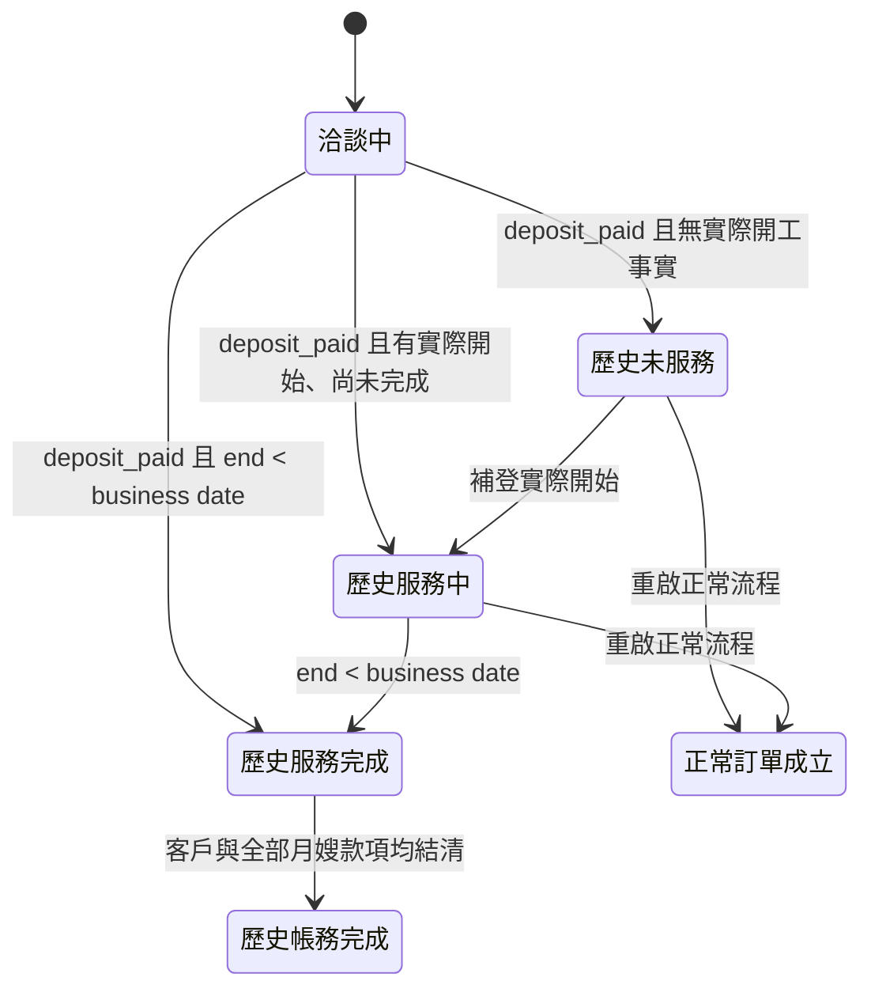

# 歷史訂單生命週期與服務天數帳務正式規格

> 2026-11-05 操作入口整併最新裁決：使用者核准將「歷史訂單實際服務天數設定」由原本左側主選單獨立頁面（historical-service-accounting）正式移入「客戶名冊」詳情抽屜（ClientRegistryDetailEditor）之案件帳務區塊。當案件屬於歷史訂單分支時，直接於客戶名冊抽屜原地核對資料並填寫月嫂實際服務天數，儲存後重算帳務；左側獨立導航入口退役。

> 2026-11-06 人工裁決：歷史訂單匯入承接原帳務，實際服務天數重算由人員另行發起。原先於採納時按預設天數建立基準帳務的規則由本文件 §6 取代。本輪只修訂規格。

## 1. 文件狀態與權威

- 狀態：`approved-formal-specification`
- 帳務承接最新人工裁決日期：2026-11-06
- 適用範圍：Historical Orders workbook 採納、Orders 歷史生命週期分支、歷史服務天數確認、
  Client Finance／Payroll／Staff Payables impact、帳務結清及重啟天數精算。
- 本文件是上述範圍的 current SSOT；較早要求歷史案件必須先建立逐日正式服務日才能計算帳務的文字，
  在本範圍內由本文件 supersede。
- 本規格授權後續依明確人工指示建立實作與驗收依據；本文件本身不授權 production DB、migration、
  deployment、銀行外部操作、Git commit／push 或其他 external effect。

本文件不改變既有 Domain owner。Orders 擁有 lifecycle 與歷史來源採納，Scheduling 擁有正式逐日
服務日期與歷史指派的服務時段，Payroll 擁有月嫂義務，Client Finance 擁有客戶義務與核銷，Staff Payables 擁有月嫂出款
與結清。跨 Domain mutation 仍由單一 application workflow 擁有 outer Unit of Work。

## 2. 目標與非目標

### 2.1 目標

1. 將可辨識的舊系統訂單推進到明確的歷史生命週期分支，不偽造正常流程不存在的簽約、排班或銀行事實。
2. 歷史案件採納時承接可證實的原帳務，依一般帳務規則呈現各款項的餘額與核銷結果。
3. 歷史來源可提供服務量及原計價依據；以原有效條款處理既有帳務，今日政策不回溯套用。
4. 歷史完成訂單的實際天數與登記天數不同時，工會人員使用「歷史訂單實際服務天數設定」建立新版天數，差異交由各帳務 owner 的正式更正流程處理。
5. 只有客戶與全部月嫂款項均實際結清後，才可進入「歷史訂單－帳務完成」。

### 2.2 非目標

- 不以 `actual_service_days` 反推或偽造任何逐日 `staff_schedule`。
- 不由歷史訂單狀態偽造 Finance Import 銀行流水、allocation、付款日期或外部匯款結果。
- 不讓 UI 傳入任意 target lifecycle status、費率、應收總額、應付總額或樓層費結果。
- 不改變正常訂單的正式服務日、雙薪、請假代班、取消、AutoComplete 或結清規則。
- 不以重啟精算覆蓋既有義務、付款證據或 immutable accounting history。

## 3. 名詞與根事實

### 3.1 歷史生命週期狀態

Orders 新增下列正式 lifecycle branch：

| 穩定識別 | 顯示文字 | 意義 |
|---|---|---|
| `historical_unserved` | 歷史訂單－未服務 | 舊系統斷言訂金已付，但沒有可採納的實際開工事實 |
| `historical_in_service` | 歷史訂單－服務中 | 已有實際開始事實，尚未到達歷史完成條件 |
| `historical_service_completed` | 歷史訂單－服務完成 | 歷史結束日嚴格早於目前 business date；原帳務依 §6 承接，缺項待確認 |
| `historical_accounting_completed` | 歷史訂單－帳務完成 | 歷史服務天數已確認，客戶與全部月嫂款項均已實際結清 |

歷史狀態是 Orders lifecycle 的正式分支。即使案件經精算回到正常 lifecycle，正式來源關聯、
異動事件與既有帳務事件仍可追溯。整份與逐列匯入暫存依規格 `01` HIST-IMPORT-03 於操作結束後清除。

### 3.2 歷史服務天數事實

`HistoricalActualServiceDayCountFact` 是按案件與唯一月嫂／歷史 assignment 保存的服務天數事實。預設來源是 Orders 原 `service_days`；完成後若發現實際天數不同，則由「歷史訂單實際服務天數設定」建立較新的 revision 取代目前投影。至少包含：

- `case_no`
- `staff_id`
- historical assignment／pairing identity
- 正整數 `actual_service_days`
- actor、reason、correlation、expected owner versions
- 正式歷史服務來源識別，可連回採納的 Orders 與 Scheduling 資料
- fingerprint、idempotency identity、immutable event／receipt identity

歷史訂單匯入契約只接受一位月嫂，因此預設服務天數直接取 Orders 原 `service_days`，不得設計不存在的多月嫂分配阻擋。此事實可作歷史帳務的服務量權威，但不是正式服務日期或 Scheduling occupancy。

採納歷史完成訂單時可將 Orders 原服務天數保存為初始服務量；服務量事實本身不建立帳務義務。實際天數不同時，由人員使用既有「歷史訂單實際服務天數設定」建立較新 revision，保留舊 revision 與已完成狀態。帳務差異依 §6.3 由原 owner 處理。

### 3.3 歷史訂金已付斷言

舊系統 `deposit_paid` 可建立受限 `historical_deposit_paid_assertion`，供 Orders 進入歷史分支；它不等於
Finance Import bank fact，也不得偽造收款日、金額或 allocation。客戶帳務是否結清仍只由 Client Finance
ledger／allocation，或其正式 Historical Payment Evidence／Settlement command 決定。

## 4. Workbook 列分類與採納

### 4.1 唯一結果分類

每一來源列只可得到下列其中一種業務結果：

1. `not_adopted`：不採用。
2. `matching_pending_deposit`：配對中、未付訂金。
3. `historical_unserved`：訂金已付、尚未服務。
4. `historical_in_service`：訂金已付、服務中。
5. `historical_service_completed`：訂金已付、服務完成。

`historical_accounting_completed` 不是 workbook 匯入結果；只能在服務天數確認、正式義務建立及雙邊款項
實際結清後，由 Orders lifecycle projection 產生。

### 4.2 不採用

來源案件編號空白、來源訂單狀態空白、來源列代表舊系統取消而本次不需補建，或無法唯一命中既有
Order 時，結果為 `not_adopted`：

- 不寫 Orders、Matching、Scheduling、Client Finance、Payroll 或 Staff Payables 根事實。
- 不建立 `review_required`、review outbox 或帳務異常。
- 當次檢查與匯入結果回傳由後端計算的 `not_adopted` 筆數，供操作者核對來源列數。

非空但不屬版本化 allowlist 的狀態、無效日期文字、結束早於開始、同名月嫂不唯一或來源班次衝突，
須提供可區分的驗證或衝突原因。適用的列級排除與零寫入依規格 `01` HIST-SHIFT-01 和 HIST-IMPORT-02。
檔案層級驗證失敗時全檔零寫入。任一正式寫入失敗時，已執行的檔內更新及檔外取消一併回滾。

### 4.3 配對中、未付訂金

來源仍屬洽談、月嫂姓名能唯一解析，而開始日空白時：

- Orders lifecycle 維持正常 `洽談中`。
- Matching 推進為「配對中、未付訂金」。
- Orders 原本 `planned_start_date`／預計服務開始日期維持不變。
- 不寫 `actual_start_date`、`actual_end_date`，不建立歷史訂金斷言、歷史服務天數或帳務義務。

月嫂姓名空白、找不到或同名不唯一時不得猜 `staff_id`；依 §4.2 回不採用或 typed validation，取決於
是否為真正空白來源或非空矛盾來源。

### 4.4 訂金已付、尚未服務

來源斷言 `deposit_paid` 且符合以下任一情形時，進入 `historical_unserved`：

- 來源開始日空白；或
- 來源開始日等於 Orders `planned_start_date`。

此時預計服務開始日期維持不變，`actual_start_date`／`actual_end_date` 不寫入或維持 `NULL`。不得由來源
結束日、合約 `service_days` 或假日政策推定已開工。

### 4.5 訂金已付、服務中

來源斷言 `deposit_paid`，來源開始日不等於 `planned_start_date`，且結束日空白或結束日大於等於目前
business date 時，進入 `historical_in_service`：

- 直接以來源開始日寫入 `actual_start_date`。
- 來源結束日可解析時直接寫入 `actual_end_date`；空白則維持 `NULL`。
- 寫入結束日不代表已完成；完成判定只依 §4.6。
- 不依合約天數延展、縮短或替換來源區間。

### 4.6 訂金已付、服務完成

來源斷言 `deposit_paid`、來源開始日不等於 `planned_start_date`、結束日有效，且：

```text
source_actual_end_date < BusinessClock.today()
```

時，進入 `historical_service_completed` 並直接保存來源實際起訖。判定使用 strict less-than：假設系統日為
2026-09-01，結束日 2026-08-31 已完成；結束日 2026-09-01 或更晚仍是服務中。

## 5. 歷史生命週期轉換



任何 caller 都不得直接提交 target status。Import、日期補登、歷史帳務結清投影及重啟精算各自由 typed
command 依 fresh authoritative facts 計算合法 after status。

歷史服務完成後不倒退為服務中。已確認天數或帳務有差異時，由人員依 §6.3 發起更正，補收、退款或沖正沿原帳務 owner 的正式流程處理。原版本、已結算事件及核銷關聯保留供追溯。

<a id="historical-accounting-carry-forward"></a>

## 6. 歷史帳務承接與服務天數更正

### 6.1 匯入承接原帳務

歷史訂單沿用一般帳務規則。採納時由各正式帳務 owner 承接可證實的原訂金、第一期、第二期、月嫂應付、退補助款，以及既有收付與核銷關聯。原期款、到期日、有效實收實付及沖正按來源保存，餘額由各 owner 依一般規則計算。已承接的同一筆原義務或收付證據在重匯時沿用原身分，避免重複建帳或重複計入收付。

匯入及依服務迄日推進歷史服務完成時，均不得按歷史身分、預設服務天數或整案總額另建基準帳務，也不得重跑一般進件的期款生成來補造原分期。服務量可獨立保存，原有效的付款條款可作查核與計價依據。

### 6.2 原帳務資料不完整

匯入先承接有證據的部分。只對原應收及有效收款歸屬有依據的款項呈現待收餘額；整案餘額無法確認時，顯示「整案待收未確認」，列出缺少的來源或衝突。未知金額、日期、餘額及已付狀態維持未知。

| 來源情況 | 處理方式 |
|---|---|
| 期款與收款歸屬可證實 | 依原應收及有效已收款計算餘額。例如第一期應收 NT$12,000、已證實該期實收 NT$8,000，待收為 NT$4,000。 |
| 收款可證實，期別待確認 | 保留原收款及來源。依規格 `22` 能唯一配對時走一般核銷；其餘由人員依原紀錄確認分配。確認前不列為任何一期的已收。 |
| 只有整案總額，缺少原期款紀錄 | 整案總額供查閱，無法證實的期款維持待確認。後續找到能直接證明原期別、金額或日期的紀錄時，沿正式流程承接已證實的欄位。若證據顯示當時未分期，依原款項處理。 |
| 只有舊系統「已付」標記，或來源互相矛盾 | 保留原標記及衝突證據，只將受影響款項列待確認。依規格 `04` 的 Historical Payment Evidence／Settlement 契約確認，其他已有充分依據的款項仍可核銷。 |

資料缺項的待確認結果與正式寫入失敗分開處理。採納與可承接的正式異動沿同一 outer UoW；正式 writer 失敗時整筆回滾。Preview 零寫入，Apply 重新讀取並核對 owner 事實與版本。工作簿重匯依規格 `01` HIST-IMPORT-01～04。

工會人員可從案件帳務的「待確認」項目開啟同案、同款項的查核入口，查看缺少欄位、既有來源與下一步。客戶原期款查核只承接有證據的原款項；單憑整案總額、服務天數或一般分期公式，無法據以建立原期款。缺正式應付、付款日期或其他帳務依據時，由原帳務 owner 依可證實的原紀錄補登或更正，證據不足時保留待確認。已有流水但款項歸屬不明時，帶原流水至銀行對帳確認分配。實際已收付且需要補登交易時，依規格 `22` §19 或規格 `04`、`05` 的歷史付款證據契約處理。月嫂未列入付款清冊時，另依[規格 16 的未列入查核入口](16_Staff_Payables與Client_Refund正式規格.md#historical-payables-review-entry)查核。

### 6.3 人工發起服務天數更正

工會人員透過「歷史訂單實際服務天數與帳務」確認更正時，依唯一有效 assignment 驗證天數；跨案、無 assignment、重複或非正整數回明確錯誤。依確認後的服務量、原有效付款條款及適用計價依據重算總額，與原帳務比較。重算結果供比較；差異由 Client Finance／Payroll／Staff Payables 沿各自的正式更正流程處理。

涉及已核銷款項的金額差異，由原 owner 以有來源關聯的補收、退款或沖正承接。若正式更正以新義務取代原期款，原期款退出待收及可核銷清單；原款項、收付款、核銷及取代關聯供追溯。同一筆款項只保留一個有效待核銷來源。單純重算總額不取代原期款。

### 6.4 既有基準應收與原期款並存

基準應收與原期款若經來源及核銷關係證實為同一筆債權，以可證實的原分期及其有效已收款認定餘額，由 Client Finance 透過正式更正將重複的基準應收退出待核銷清單，保留原義務及核銷紀錄。若關係尚未證實，列受影響款項待確認。金額相等只作查核線索。

## 7. 帳務完成投影

`historical_accounting_completed` 必須同時滿足：

1. 案件目前為 `historical_service_completed`。
2. 每位有效歷史 assignment 都有已採用的 `actual_service_days` 事實。
3. Client Finance 已確認原客戶應收、退款及其有效更正，全部應結清款項餘額為 0。
4. Staff Payables 已確認各月嫂原應付及其有效更正，全部應結清款項餘額為 0。
5. 不存在影響結清的資料缺項、歸屬、金額、版本、退匯／沖正或核銷關聯疑義。缺少義務或付款證據不得視為已結清。

「義務已計算」不是帳務完成；客戶款項及月嫂款項必須真的都已結清。Client Finance 與 Staff Payables
各自輸出 typed settlement facts，Orders 只投影 lifecycle，不得自行查表猜餘額或代替帳務 Domain 核銷。

既有 lifecycle event 不刪除。帳務尚未完成時可接受較新的天數 revision，差額義務由 Client Finance／Payroll owner 建立，Orders 不自行改寫結清事實。

## 8. 重啟正常流程與完成後天數修正

「重啟精算天數」只供 `historical_unserved`／`historical_in_service` 在服務完成前退出歷史分支。
這個 command 只負責退出歷史分支，兩種來源狀態都回到正常 `訂單成立`；它不得同時精算、確認或建立
正式服務日期，也不得建立 Scheduling assignment、Client Finance／Payroll 金額結果或 actual-start
reconfirmation。成功後 historical provenance 與已採納的來源實際日期仍保留在 adoption evidence／event；
Orders 的 current actual start／end root 均清空，避免來源日期被誤認為已經走完正常確認流程。

回推後，工會人員在原本的訂單工作台輸入實際開始日時，Actual Start Preview 必須直接以該日、目前服務模式、休假日與歷史唯一月嫂證據計算正式服務日與排班影響；Actual Start Apply 在同一 outer Unit of Work 建立 current Scheduling generation 與 Orders actual start／end。此步驟只更正日期、排班及 lifecycle，不得新增、沖正或重算既有 Client Finance／Payroll 金額，兩者版本保持原值。UI 可在單次「確認實際開始日」操作內完成 Preview／Apply，不要求操作者另按「檢查影響」或重複確認；後端仍須使用 PreviewFingerprint、expected versions 與 idempotency。不得要求操作者先用計畫開始日建立一份中繼排班，也不得將 Preview 分拆成先寫入正式服務日再重排。若需人工調整排休，仍可先使用正式服務日確認介面。歷史採納已唯一解析的月嫂是此案既定服務人員；重啟後仍由 Scheduling 透過
historical pairing／assignment evidence 持有該 binding，不重新建立候選池、不重新詢問意願，也不重新
推薦客戶。Orders 不新增 `staff_id` 根欄位；待辦投影必須把候選、詢問與推薦顯示為已由歷史綁定滿足
或不適用，並把服務日期確認列為目前可辦事項。
六欄歷史來源沒有固定排休欄位時，原本日期精算 UI 以其既有 `週休1日` 預設載入；這只提供後續正常
精算的輸入，不在重啟 command 內建立或確認任何服務日期，人工仍可在原日曆覆寫固定排休日。

成功重啟後，案件目前正常 lifecycle 可追溯至 immutable `orders_historical_precision_restart` event；
此 provenance 是後續 Actual Start lifecycle 判斷的正式輸入，不得由 UI flag、案件編號或目前日期猜測。
工會人員完成正式服務日期、正式排班及 Actual Start Preview／Apply，且確認的 `actual_start_date` 不晚於
目前 business date 時，Orders 必須直接由正常 `訂單成立` 推進為 `服務中`，不得再以訂金核銷狀態或
契約完成事件缺漏阻擋。此例外只適用前述成功重啟且仍可追溯的歷史案件，只移除 lifecycle transition
predicate；不得建立、補寫、核銷或視為已具備任何 Client Finance／契約 owner fact。一般訂單仍依
既有訂金、契約與 Actual Start 條件判斷。日期精算、正式日期確認或正式排班本身不推進 lifecycle；
未確認 Actual Start 或確認日仍晚於 business date 時維持 `訂單成立`。完工、取消、服務資料鎖及帳務
規則均不因本例外改變。

Apply 必須鎖定 Orders、Scheduling 及歷史天數 revision，撤銷該案件原本的有效 Scheduling generation 與
current confirmed-service-date root，讓後續日期與排班從乾淨狀態重建；Scheduling owner 可建立無正式
service date 的有效 tombstone generation 表示等待重建，但必須保留唯一歷史月嫂 binding 的可追溯
current readback，不得把 tombstone 當成尚未媒合或要求另選候選月嫂。不得刪除歷史
generation、歷史事件與採納 provenance。已完成的 `historical_service_completed` 不得使用重啟 command；實際天數與登記天數不一致時，改用「歷史訂單實際服務天數設定」Q/P/A，依 §6.3 處理。`service_data_locked` 或無法保存既有付款 lineage 時仍 fail closed。

## 9. API 與管理 UI

客戶名冊一律使用同一個 Scheduling Assignment Plan Query 讀取 `case_staff_assignments`。歷史服務中／完成／帳務完成案件以目前有效的正式歷史來源關聯，精確連到同案、同月嫂且未取消或被替換的 assignment。沒有 generation 或逐日排班仍須回傳已保存的 assignment identity 與期間。歷史服務天數與 Payroll 義務共用該 assignment identity。沒有逐日服務日顯示「未建立排班」。正式寫入仍須驗證服務日期。舊採納紀錄的遷移與清除依 §12.1。

管理端的歷史帳務介面顯示已承接的原帳務及其來源：

1. 顯示原期款、有效收付、可確認餘額、待確認原因及對應操作入口，依 §6.2 區分未知與零元。
2. 歷史完成訂單的實際天數不同時，直接在「客戶名冊」詳情抽屜的案件帳務區塊預覽並套用。帳務差異依 §6.3 處理。

未服務／服務中的「重啟正常流程」入口必須放在既有訂單工作台；成功後沿用同一工作台既有的日期精算、
正式排班與實際開工 UI，不建立歷史訂單專用的日期輸入介面，也不得重新導向候選月嫂流程。

後端是一個 bounded API resource／command family；因人工確認與 stale protection，Preview 與 Apply 可為
同一資源下的不同 HTTP operation，不得為追求單一 HTTP call 省略 PreviewFingerprint、expected versions
或 idempotency。UI 不計算 lifecycle、完成日、總天數、雙薪、時數、樓層費或金額，只顯示 server result。

Query／Preview 至少回傳：目前歷史狀態、來源實際起訖、business date、原合約天數、逐月嫂確認天數、
總實際天數、單薪時數、樓層費、逐月嫂應付、客戶義務方向與金額、雙邊 settlement 狀態、blockers、
owner versions 及 fingerprint。

## 10. Stable failure semantics

至少包含：

- `historical_order_source_status_invalid`
- `historical_order_date_range_invalid`
- `historical_order_staff_not_unique`
- `historical_order_source_schedule_conflict`
- `historical_order_lifecycle_transition_invalid`
- `historical_actual_service_days_required`
- `historical_actual_service_days_invalid`
- `historical_actual_service_days_assignment_mismatch`
- `historical_actual_service_days_candidate_stale`
- `historical_accounting_obligation_binding_invalid`
- `historical_client_settlement_incomplete`
- `historical_staff_settlement_incomplete`
- `historical_accounting_completion_blocked`
- `historical_precision_restart_not_eligible`
- `historical_precision_restart_candidate_stale`
- `idempotency_conflict`
- `transaction_failed`

Validation／domain blocker 固定零寫入；version／fingerprint drift 回 typed conflict，不得回 generic 500；暫時性
DB／lock failure依 Global typed unavailable 契約處理。

## 11. 驗收情境

1. 案件編號或來源狀態空白列：`not_adopted`，0 review、0 Domain write，aggregate count 守恆。
2. 洽談列、唯一月嫂、開始日空白：Orders 維持洽談中，Matching 顯示配對中未付訂金，預計日保留。
3. deposit-paid、開始日空白：進入歷史未服務，actual 起訖維持 null。
4. deposit-paid、開始日等於預計日：進入歷史未服務，不把預計日偽造為 actual start。
5. business date 2026-09-01、來源結束日 2026-09-01：歷史服務中。
6. business date 2026-09-01、來源結束日 2026-08-31：歷史服務完成。
7. 原合約 40 日、單月嫂歷史完成：採納時承接有證據的原義務及核銷，0 新基準應收、0 正式逐日服務日期；重匯不增加義務或已收付。
8. 原服務天數由 40 日更正為 26 日：由人員發起，預覽顯示重算與差異。正式更正取代某筆原期款時，原列退出待核銷清單，原付款及核銷仍可追溯。
9. 歷史來源期間包含今日政策的雙薪日：沿原有效計價依據；今日政策不回溯改寫既有金額。
10. 只有義務建立、尚未付款：維持歷史服務完成，不得進帳務完成。
11. 原客戶與月嫂義務及有效更正已確認，全部待結清餘額為 0 且無影響結清的缺項：推進歷史帳務完成。
12. 歷史來源無法唯一辨識月嫂時依採納規則處理。人工更正天數為 0／負數／小數時回明確錯誤，0 partial write。
13. 歷史未服務重啟正常流程成功：回正常訂單成立，historical provenance 保留；0 正式服務日期、0 新帳務結果。
14. 歷史未服務／服務中明確重啟精算成功：回正常訂單成立；來源實際起訖只保留於歷史 evidence／event，Orders
    current actual start／end 均清空；原有效 Scheduling generation 與 current confirmed-service-date root 均撤銷。後續由正常訂單 UI 確認實際開工，或先人工調整服務日期；新的正式排班必須沿用歷史唯一月嫂，不重跑媒合。既有歷史天數、義務及付款 lineage 保留供差額核對。
15. 歷史服務完成／帳務完成的狀態變更須沿用 Orders 正式流程。歷史工作簿重匯依規格 `01` HIST-IMPORT-01 重新判定可採納的狀態，並保留既有帳務事實及付款關聯。一般 caller 不得繞過 owner 規則變更狀態。
16. 任一跨 Domain writer 或正式 outbox 寫入失敗時，Orders、天數、義務及版本全部回滾。
17. 歷史天數再次 Preview／Apply：以 expected revision 與 fingerprint 防 stale；成功建立下一版，帳務差異依 §6.3 處理。
18. 歷史未服務／服務中成功重啟後，Actual Start Apply 已依唯一月嫂證據建立正式服務日期與排班，且確認日不晚於 business date，
    即使訂金核銷或契約完成事實缺漏，仍推進正常 `服務中`；Client Finance／契約事實保持原值且不得補造。
19. 同一重啟案件只有日期精算、正式日期或排班，尚未確認 Actual Start，或確認日仍晚於 business date：
    維持正常 `訂單成立`。
20. 非歷史重啟的一般訂單缺少訂金核銷或契約完成事實：不得套用本例外；既有 lifecycle gate 維持不變。
21. 歷史重啟後 current Scheduling 為空 tombstone 且存在唯一月嫂證據：Actual Start Preview 直接依輸入日計算正式服務日與排班，Apply 以單一交易建立 current generation 及 actual start／end；不產生計畫開始日中繼排班。歷史 evidence 沒有舊 assignment identity 時，新排班不得虛構 lineage，仍以 case payroll policy 建立費率快照。
22. 前項歷史重啟 Actual Start：Client Finance／Payroll actions 均為空，resulting version 等於 expected version；既有應收、應付、付款與結清事實不變。歷史 evidence 即使保留已退役 generation 的 assignment identity，也不得將該 identity 當成 current assignment 取消，新的 current generation 不繼承虛構 lineage。
23. 完全相同的 Excel 主動重匯時重新評估全部來源列。同一月嫂的 `09:00–13:00`、`13:30–17:30` 可同日寫入，實際重疊列附對造列號與重疊起訖並排除。曾採納但目前狀態不同的合格列更新正式狀態，業務事實一致的列不重建指派、帳務或異動事件。
24. 同檔重匯時，上次匯入後新增且本次檔外的未取消訂單仍依原規則取消。檔內排除列不列入檔外取消。檔案層級驗證失敗時零更新、零取消。檔內更新或檔外取消任一正式寫入失敗，兩者一併回滾。
25. 成功後只剩正式業務資料，查不到新增的整份結果快照或逐列匯入結果。回應中斷時顯示結果未確認，零自動重送。清除舊匯入紀錄後，工會甘特圖、案件排查、月嫂 LINE LIFF 排班與請假順延、歷史服務天數、帳務與待更正案件皆須可依正式來源查詢或操作。
26. 第一期原應收 NT$12,000、已證實本期實收 NT$8,000，但另一筆收款無法辨識期別：第一期待收 NT$4,000，未分配收款保留待確認；整案資料不足時不顯示已結清。
27. 只有總額或舊系統「已付」標記：承接可證實的原帳務，缺項列待確認；0 推定期款、0 推定收款。
28. 舊基準應收 NT$18,000 與原分期 NT$6,000、NT$12,000 並存：先查來源與核銷關係；查證為同一筆債權並正式更正後，基準應收退出待核銷，原分期及已收款供餘額計算，既有核銷可追溯。
29. 歷史月嫂款缺正式應付或付款日：付款清單可查未列入原因並回到同案補登或更正，會計 Excel 不列該待確認款。正式應付及付款條件確認後，重新查詢才依原日期與未付餘額判定是否列入。

## 12. 實作與資料升級邊界

後續實作先盤點既有 Orders 歷史 lifecycle、Scheduling 指派與服務時段、逐指派歷史天數和帳務版本能否承接正式資料。
新增結構與業務資料搬遷採保留資料升級，並涵蓋全新安裝。舊匯入資料清除按 §12.1 分開執行。
不得以 reset DB 取代 migration 證據，也不得猜測或自動補造 `actual_service_days`。

既有 `actual_service_days` query／Payroll 值是由 `staff_schedule.is_work_day` 或正式 `service_dates` 衍生的
projection，不是本規格的人工歷史根事實。實作不得共用同一無 provenance 欄位而讓 count-based 與
date-based 來源無法辨識；Query 必須公開 calculation basis 與 source revision。

完成實作至少需要 Orders、Scheduling、Payroll、Client Finance、Staff Payables 的 owner-local tests，
跨 Domain 交易／回滾／同檔重匯測試、API 契約測試，以及 React 管理端與 LINE LIFF 的讀回驗收。

### 12.1 舊匯入紀錄的搬遷及清除（2026-11-06 人工確認）

1. Orders 保存正式歷史狀態、實際起訖、作業進度與來源異動關聯。Scheduling 保存正式指派、可證實的歷史服務時段與跨日標記。保留歷史服務天數、費率、義務、付款、結清、待更正與已更正關聯。正式業務資料依原 owner 的保留契約管理。
2. 搬遷前備份並驗證可還原。在隔離的真 MySQL 對照搬遷前後的案號、指派、時段、作業進度、金額、付款與結清，核對待更正案件及待投遞事件，並驗全新安裝。歷史資料只搬遷可證實的值。缺少時段或服務日的來源維持未知，不據此產生逐日班表。
3. 完成讀寫來源切換及對帳後，分開執行舊整份匯入結果快照和逐筆採納紀錄的清除。未轉接的外鍵、仍引用舊資料的查詢、無法對應的指派或待處理事件均阻擋清除。清除只涵蓋歷史訂單匯入資料，排除其他功能的命令紀錄及正式業務事件。備份、升級與清除均受規格 `10` §9 的資料庫執行門約束。
4. 本節為已確認規格。現行程式與既有資料庫尚未依本節搬遷或清除。
