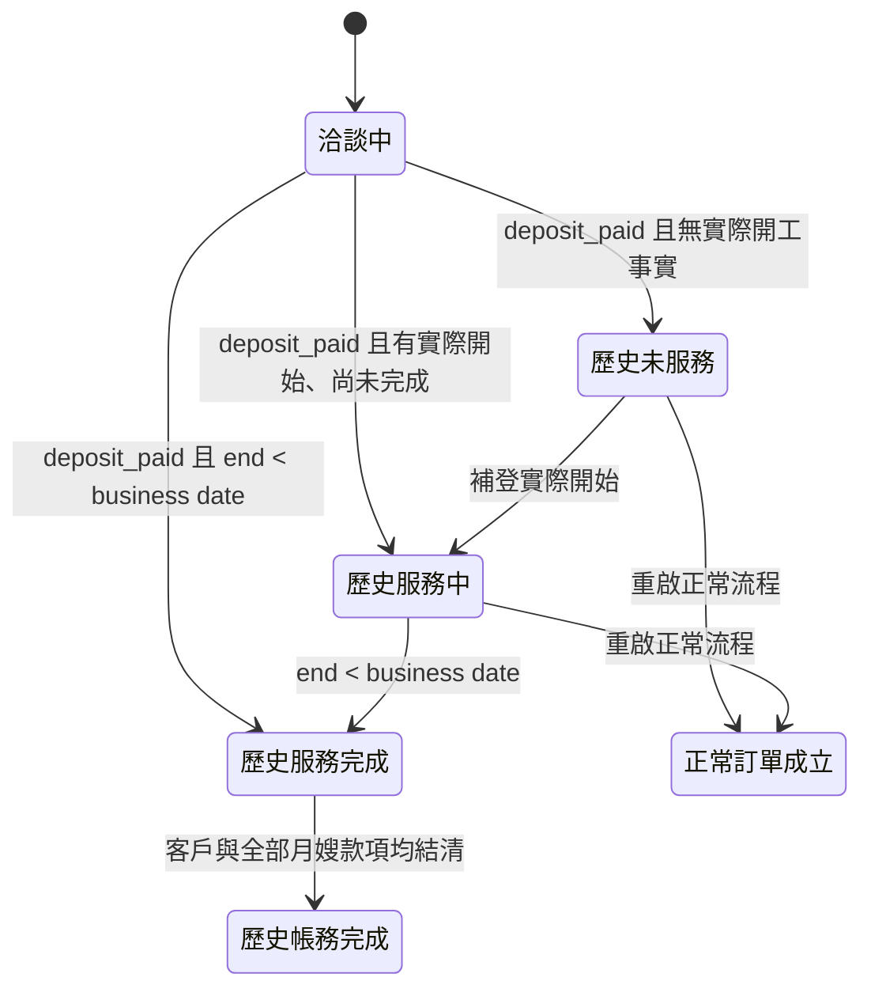

# 歷史訂單生命週期與服務天數帳務正式規格

## 1. 文件邊界與所有權

- 狀態：`current-spec`
- Owner：Orders（歷史採納與生命週期分支）／Client Finance・Payroll・Staff Payables（原帳務承接與差額更正）
- 單一負責範圍：Historical Orders workbook 採納規則、Orders 歷史生命週期分支、歷史實際服務天數與樓層費更正規則、歷史帳務承接、結清投影與重啟正常流程契約。
- 關聯引用：見 [Global 共同契約](00_Global_共同契約.md)、[Orders Domain](01_Orders_Domain.md)、[Client Finance Domain](04_Client_Finance_Domain.md)、[Global Migration 與 Cutover](10_Global_保留資料Migration與Cutover_Subsystem.md)、[Staff Payables 與 Client Refund](16_Staff_Payables與Client_Refund正式規格.md)、[銀行流水對帳與手動補登](22_銀行流水匯入與帳務異常處理正式規格.md)、[案件與月嫂整合名冊正式規格](33_案件與月嫂整合名冊正式規格.md)

本文件不改變既有 Domain owner：Orders 擁有 lifecycle 與歷史訂單來源採納，Scheduling 擁有逐日服務日期與歷史指派服務時段，Payroll 擁有月嫂義務，Client Finance 擁有客戶義務與核銷，Staff Payables 擁有月嫂出款與結清。跨 Domain mutation 由單一 application workflow 擁有 outer Unit of Work。

## 2. 目標與非目標

- **目標**：(1) 將可辨識舊系統訂單推進至明確歷史生命週期分支；(2) 歷史案件採納時承接可證實的原帳務與原有效付款條款；(3) 實際天數與登記天數不同時由人員透過「歷史訂單實際服務天數設定」建立新版天數並交原 owner 更正差額；(4) 只有客戶與全部月嫂款項實際結清後才進入 `historical_accounting_completed`。
- **非目標**：不以 `actual_service_days` 反推或偽造逐日 `staff_schedule`；不由歷史狀態偽造銀行流水或日期；不允許 UI 傳入任意 target status／費率／金額；不以重啟精算覆蓋既有義務或付款證據；不依預設服務天數或歷史身分另建基準帳務。

## 3. 名詞與根事實

### 3.1 歷史生命週期狀態

| 穩定識別 | 顯示文字 | 意義 |
|---|---|---|
| `historical_unserved` | 歷史訂單－未服務 | 斷言訂金已付，但無可採納的實際開工事實 |
| `historical_in_service` | 歷史訂單－服務中 | 已有實際開始事實，尚未到達歷史完成條件 |
| `historical_service_completed` | 歷史訂單－服務完成 | 歷史結束日嚴格早於目前 business date；原帳務依 §6 承接，缺項待確認 |
| `historical_accounting_completed` | 歷史訂單－帳務完成 | 歷史服務天數已確認，客戶與全部月嫂款項均已實際結清 |

整份與逐列匯入暫存依 [Orders Domain](01_Orders_Domain.md) `HIST-IMPORT-03` 於操作結束後清除。

### 3.2 歷史服務天數事實與訂金斷言

- `HistoricalActualServiceDayCountFact` 按案件與唯一月嫂／歷史 assignment 保存（預設取 Orders 原 `service_days`），包含 `case_no`、`staff_id`、historical assignment identity、正整數 `actual_service_days`、actor／reason／correlation／versions、歷史服務來源識別、fingerprint、idempotency 與 immutable event／receipt。它可作歷史帳務服務量權威，但不是 Scheduling occupancy；天數不同時由人員建立較新 revision（保留完成狀態），差異依 §6.3 處理。
- `historical_deposit_paid_assertion` 僅供 Orders 進入歷史分支，不等於 Finance Import bank fact；客戶帳務結清仍只由 Client Finance ledger／allocation 或其 Historical Payment Evidence／Settlement 決定。

## 4. Workbook 列分類與採納

每一來源列只可得到下列其中一種結果：

1. `not_adopted`：來源案號／狀態空白、舊系統取消不需補建，或無法唯一命中既有 Order → 0 Domain write、0 review，回傳筆數供核對。非空無效狀態、日期反轉、同名不唯一或來源班次衝突依 [Orders Domain](01_Orders_Domain.md) `HIST-SHIFT-01`／`HIST-IMPORT-02` 提供可區分原因；檔案層級失敗全檔零寫入，任一寫入失敗整檔回滾。
2. `matching_pending_deposit`：洽談中、月嫂唯一且開始日空白 → Orders 維持 `洽談中`，Matching 推進為「配對中、未付訂金」，不寫實際日期或帳務。
3. `historical_unserved`：斷言 `deposit_paid`，且開始日空白或等於 `planned_start_date` → 維持 `actual_start_date`/`actual_end_date` 為 `NULL`。
4. `historical_in_service`：斷言 `deposit_paid`，開始日不等於 `planned_start_date`，且結束日空白或 `>= BusinessClock.today()` → 寫入 `actual_start_date`（及可解析的 `actual_end_date`）。
5. `historical_service_completed`：斷言 `deposit_paid`，開始日不等於 `planned_start_date`，結束日有效且嚴格小於系統日（`source_actual_end_date < BusinessClock.today()`）→ 直接保存來源實際起訖。

`historical_accounting_completed` 不是匯入結果，僅由 §7 結清投影產生。

## 5. 歷史生命週期轉換

任何 caller 不得直接提交 target status。歷史服務完成後不倒退為服務中；天數或帳務差異依 §6.3 發起更正。

## 6. 歷史帳務承接與更正

### 6.1 匯入承接原帳務

採納時承接可證實的原訂金、第一期、第二期、月嫂應付、退補助款及既有收付核銷關聯，並沿用原身分防重匯重複建帳；不得按歷史身分、預設天數或整案總額另建基準帳務或重建一般分期。

### 6.2 原帳務資料不完整處理矩陣

| 來源情況 | 處理方式 |
|---|---|
| 期款與收款歸屬可證實 | 依原應收及有效已收款計算餘額。 |
| 收款可證實，期別待確認 | 保留原收款及來源；依 [銀行流水對帳與手動補登](22_銀行流水匯入與帳務異常處理正式規格.md) 能唯一配對時核銷，其餘待人員確認分配。 |
| 只有整案總額，缺少原期款紀錄 | 總額供查閱，無法證實的期款維持待確認；證據顯示未分期時依原款項處理。 |
| 只有舊「已付」標記或來源矛盾 | 保留標記與衝突證據，受影響款項列待確認；依 [Client Finance Domain](04_Client_Finance_Domain.md) Historical Payment Evidence／Settlement 確認。 |

人員可從案件帳務「待確認」開啟同案同款查核入口，由原 owner 補登（如 [手動補登 §6](22_銀行流水匯入與帳務異常處理正式規格.md#case-manual-accounting-supplement) 或 Client Finance／Staff Payables 歷史付款證據契約）；月嫂未入清冊另依 [Staff Payables 與 Client Refund](16_Staff_Payables與Client_Refund正式規格.md) 查核。

### 6.3 人工發起服務天數更正與已結案樓層費／個案計價更正

- **服務天數更正**：依唯一有效 assignment 驗證正整數天數，重算總額與原帳務比較，差異由各帳務 owner 正式更正流程承接（以新義務取代原期款時原列退出待核銷，已收付款可追溯）。
- **已結案樓層費與個案計價更正**：歷史服務／帳務完成案件，漏填樓層費走 Terms `floor_fee_correction=true`、個案補助時數／費率走個案計價 Apply。只借用已採納的唯一歷史指派與服務量（有人工 revision 用 revision，否則用原契約天數），不產生逐日日期、不重建一般分期。樓層費依本 Domain 歷史服務量比例計算；價格差額優先更正最後一筆有證據原期款（較大減額再向前分攤），保持原期款身分與期限；月嫂應付沿 Payroll 金額更正，原已付義務保持，由來源關聯差額承接。缺少可證實原期款／原應付或唯一歷史指派時阻擋，樓層費 Preview 綁定服務量 revision 防 stale。

### 6.4 基準應收與原期款並存處理

經來源與核銷關係證實為同一筆債權時，以可證實原分期及有效已收款認定餘額，由 Client Finance 將重複基準應收退出待核銷；未證實前並列待確認。

## 7. 帳務完成投影

`historical_accounting_completed` 須同時滿足：(1) 目前為 `historical_service_completed`；(2) 每位有效歷史 assignment 具已採用的 `actual_service_days`；(3) Client Finance 所有應結清款項餘額為 0；(4) Staff Payables 所有應結清款項餘額為 0；(5) 不存在未解資料缺項、歸屬、金額、版本、退匯／沖正或核銷疑義。Orders 僅依雙邊 typed settlement facts 投影，不自行查表猜餘額。

## 8. 重啟正常流程

- 「重啟精算天數」只供 `historical_unserved`／`historical_in_service` 在完成前退出歷史分支回到正常 `訂單成立`。Apply 鎖定 Orders、Scheduling 及歷史天數 revision，撤銷原有效 Scheduling generation 與 confirmed-service-date root，建立無正式服務日的 tombstone generation（保留唯一歷史月嫂 binding 與採納 provenance，不得要求另選候選月嫂或顯示未媒合），並清空 Orders current `actual_start`/`actual_end`。
- 回推後於訂單工作台輸入實際開始日（單次「確認實際開始日」內執行 Preview／Apply）：依該日、服務模式（六欄缺固定排休時 UI 預設載入 `週休1日` 供覆寫）、歷史唯一月嫂計算正式服務日與排班，**不新增或重算既有 Client Finance／Payroll 金額**。
- 成功重啟並留下 `orders_historical_precision_restart` provenance 後，若已完成正式服務日期、排班與 Actual Start Apply 且 `actual_start_date <= BusinessClock.today()`，Orders 直接推進正常 `服務中`（不受訂金核銷或契約完成事件缺漏阻擋，亦不補造該等事實）。已完成的 `historical_service_completed` 禁止重啟，改走 §6.3。

## 9. API、管理 UI 與失敗語意

- **管理端操作入口**：歷史訂單實際服務天數設定與重算內嵌於「客戶名冊」詳情抽屜（`ClientRegistryDetailEditor`）案件帳務區塊（見 [案件與月嫂整合名冊正式規格](33_案件與月嫂整合名冊正式規格.md)）；「重啟正常流程」位於訂單工作台。客戶名冊一律以同一 Scheduling Assignment Plan Query 讀取有效歷史指派（無逐日排班時顯示「未建立排班」）。
- **API 與並行保護**：Query／Preview／Apply 採 PreviewFingerprint、expected versions 與 idempotency，UI 不計算金額或狀態；Query／Preview 回傳歷史狀態、起訖、原／確認天數、服務工時、樓層費、雙邊金額與狀態、blockers、versions 與 fingerprint。
- **Typed errors**：`historical_order_source_status_invalid`、`historical_order_date_range_invalid`、`historical_order_staff_not_unique`、`historical_order_source_schedule_conflict`、`historical_order_lifecycle_transition_invalid`、`historical_actual_service_days_required`、`historical_actual_service_days_invalid`、`historical_actual_service_days_assignment_mismatch`、`historical_actual_service_days_candidate_stale`、`historical_accounting_obligation_binding_invalid`、`historical_client_settlement_incomplete`、`historical_staff_settlement_incomplete`、`historical_accounting_completion_blocked`、`historical_precision_restart_not_eligible`、`historical_precision_restart_candidate_stale`、`idempotency_conflict`、`transaction_failed`。

## 10. 驗收標準與資料遷移邊界

### 10.1 核心驗收情境

1. 空白案號／狀態列 `not_adopted`（0 write）；洽談＋開始日空白維持洽談配對中；`deposit_paid` 依開始／結束日及 `source_actual_end_date < BusinessClock.today()` 精確進入 unserved／in_service／service_completed。
2. 採納僅承接可證實原帳務，0 新基準應收、0 逐日服務日；原期款／收款明確者正確扣抵餘額，缺項待確認、不補造或推測已結清；同檔主動重匯依 `01` HIST-IMPORT-01～04 原子更新與檔外取消並清除暫存。
3. 天數更正與已結案樓層費／個案更正不重建逐日班表，由原 owner 承接差額且新義務取代原期款時保持原收付追溯；雙邊結清且無疑義才進 `historical_accounting_completed`。
4. 重啟正常流程清空 current 日期與 generation、保留歷史月嫂 binding，Actual Start Apply 不改既有帳務金額且不因訂金／契約缺漏阻擋進入 `服務中`；任一跨域寫入失敗全數回滾。

### 10.2 資料遷移與舊匯入清除邊界

- 業務資料升級涵蓋全新安裝與保留資料升級：Orders 保存歷史狀態、起訖與進度，Scheduling 保存指派與可證實服務時段（缺日來源維持未知，不補造逐日班表），保留天數、費率、義務、付款與更正關聯。
- 切換讀寫來源並於隔離 MySQL 核對搬遷前後所有業務表後，才分開執行舊整份快照與逐筆採納紀錄的清除；仍存在未轉接 FK、引用查詢或未對應事件時阻擋清除。所有資料庫備份、升級與清除受 [Global Migration 與 Cutover §6](10_Global_保留資料Migration與Cutover_Subsystem.md) 執行門約束。
