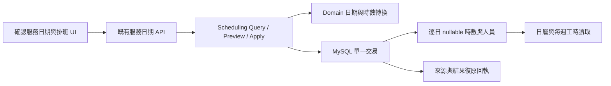
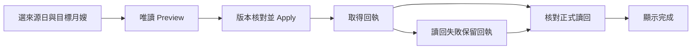

# 服務日期合併、分裂與復原

本工作包由本次功能實作與獨立驗證使用，完成驗收後將穩定事實同步回既有需求書及架構節點。使用者授權本機實作、隔離 DB 驗證、前端 E2E、黑箱及猴子測試；不包含 commit、push、正式資料或外部通知。

## 基準與範圍

- 基準 `main@28820bfc40d6107a846c0d628cae315f64493609`，保留開工時所有既有 dirty／untracked 成果。報表、案件生命週期、BeClass 及部署相關工作另在並行修改，不覆寫其變更。
- 業務與驗收：Scheduling §3.4.2、Admin UI §2.4、Orders 日期確認 §3.2、Reporting 逐日工時段落。實作不自行增加相鄰、同週同月、同來源月嫂或只能復原最新一次等限制。
- 資料形狀：逐日日期／月嫂／nullable 時數覆寫，加上單次來源與結果配對。NULL 沿原訂時數／時段，明確值顯示協調文字；復原精確恢復原值。

## ADDED

- Scheduling 純轉換與明確復原命令，事前與正式排班共用單次配對規則。
- `1082_service_date_adjustments.sql` additive 逐日欄位與專用不可變 receipt，fresh／preserve-data 同步。
- 需求導向 domain、API／MySQL、React 及瀏覽器驗證，沿既有 owner test roots。

## MODIFIED

- 正式純日期調整保留原 generation／assignment／費率／帳務參照，版本遞增；舊日班停止生效但不刪除。
- 事前確認及首排承接 nullable 時數、人員與異動配對。
- 日曆只讀有效日班，週報／XLSX 按逐日時數加總。只修改相關 hunk，保留並行需求。

## 實作架構

正式調整保留 generation／assignment identity。Apply 依 Case／aggregate、月嫂 mutex、child facts 的順序鎖定，讀取最新版本後一次提交。事前調整先保存確認版本；首排沿回執鏈還原原訂計價基準，再於同一交易承接實際日班。後續 Actual Start、普通排班及請假流程承接逐日時數，不重算本功能之外的帳務。

## 審查裁決

- 已修正：復原配對選取後改點獨立日期時，重置來源，避免隱藏的舊配對混入新命令。新增同 owner 的 4 個互動案例。
- 不採用縮短占用上界的建議：沒有結束日的暫停服務依正式規格為無期限，`all_day` 與自行協調日班的 producer 形狀不同，不可把合法無期限占用放寬成單日。
- 不新增不可達形狀防護：1082 CHECK 要求明確時數覆寫必有月嫂，合法事前資料不會形成 `staff_id=NULL` 且有覆寫的組合。合併／分裂均保留非零總時數，不會產生整案零工作日；空世代的歷史重啟語意沿用原流程。
- 各項靜態審查均與實際測試分列；工具回條不完整的歷史輪次保留為 blocked，不能替代合格的後續結果。

## REMOVED

- 本功能沿用日期數必等於合約天數、週工時必等於日期數乘原訂時數的假設。
- 獨立時段模式欄位及重送命令會反覆切換狀態的設計。

## 驗證及停止條件

| 驗證 | 直接 oracle |
|---|---|
| Domain／API／MySQL | 4＋4 合 8、8 拆 4＋4、跨月跨人、重新載入後精確復原、stale／非法歸屬零部分寫入、同鍵重送不切換。 |
| 帳務保留 | 同一候選的前後金額、受款人、來源、核銷、費率、原訂 terms 與 lifecycle 事件不變。 |
| 前端 E2E／黑箱 | 真實頁面、API、隔離 DB 保存及讀回；原訂天數不變、實際日數／逐日時數／協調文字與復原正確。分清正常登入與測試身份覆蓋。 |
| 猴子測試 | 固定 seed、限定合併／分裂／復原／取消／換月／重載操作，檢查零未處理錯誤、總時數守恆、單案單日一人及原帳務不變。 |
| 文件與結構 | scoped diff check、spec hygiene、既有結構驗證入口及 map readback，不把靜態通過當行為通過。 |

只允許 localhost `lu_test_*` 或專案規則明確准許的本機目標異動。現行 `.env` 指向 `lu_nas_upgrade_*`，本工作不在該資料庫操作、不修改共用 `.env`。固定測試由目前 owner 配置的 Flash medium 執行，合格不可用才派新 Luna high fallback；程式修正與獨立審查分工，每次修正／重試用新代理。

結果只涵蓋固定來源雜湊及已執行的驗證範圍。成功驗收後停止，不擴成全 repository 清理或無關修復。臨時 API／Vite／browser 在驗證結束釋放，保留必要測試與 DB 回復證據。

## 目前交接狀態

2026-11-23 使用者先要求暫停與建立 checkpoint，後續已明確指示「繼續任務」。恢復時 HEAD、工作區指紋、功能測試與資格來源雜湊均吻合。共用 checkpoint 槽後來由另一任務使用，未覆寫或關閉該任務的紀錄；本任務以以下精確來源與回條續作。

- 現行 HEAD 為 `main@44ae0fb238dca83e32e191abb6abe5705606337d`；原開工基準為 `28820bfc40d6107a846c0d628cae315f64493609`。其他作業曾更新 HEAD，沒有由本任務 commit／push。保留整個混合 dirty 工作區。
- 應用程式 R4 已凍結。逐日時數承接、Actual Start 零日指派、首排原計價基準、復原鏈、完工入口、讀回恢復及來源切換均已修正。各輪 `*-input/candidate.json` 保存精確來源 SHA-256；檔案清單位於 `scratch/service-date-adjustment-20261123/feature-files.json`。
- 全部執行證據均位於 `scratch/service-date-adjustment-20261123/`。下表 run ID 對應 `runs/cross-cli-runs/<ID>/report.json`；Flash medium 執行固定測試，Gemini Hydrogen medium 執行獨立來源審查，沒有以測試失敗作為 fallback 理由。

| 驗證 | 已讀回結果 | 合格 run ID |
|---|---|---|
| Python focused | passed，155 例 | `ace89997cfa54cfc939c269cde4bb6a1` |
| Schema 反向 contract | passed，4 例 | `081d133a90364f33bd5cf86cd8356557` |
| React／TypeScript／Vite | passed，119 例、app/config 型別檢查及建置成功 | `45052541968b4920a3c27c37651846f7` |
| 真實 HTTP 黑箱 | passed，正式 4h、正式 8h、事前三案 | `70d0914d08a74f7c8a0d735ae867a184` |
| 前端 E2E | passed，正常帳密與 TOTP、跨月保存／重載／復原、取消零寫入 | `4680949c55ba43f585a046af8ff13f3e` |
| 猴子 | passed，seed 20261123，102 次操作，302670ms；時間上限停止 | `26d64d33e57d4634a536370690ae3ca0` |
| Compact fresh 生成 | passed，401 tables／2 views／389 triggers | `a1b6ef7ab0b848d4a52aa7de3141e58a` |
| 保留資料升級資格 | passed，沿既有三庫接續，預覽 ready／daily_additive | `0a9e93b201c8449888fb25da63c2ccf4` |
| 修正後選取互動獨立來源審查 | passed，未發現具證據缺陷；不冒充執行測試 | `7c8f613934b34d83b94f21c0f19cbb44` |

- E2E 明細及畫面：`harness/runtime/e2e-df52ad02/`。猴子明細：`harness/runtime/monkey-3a70537b/report.json`。瀏覽器、console、相關 API 錯誤皆為 0，原帳務與 lifecycle 雜湊不變。猴子結束時 `activeCases=[split]`，隔離 DB 保留這個已知示例；若後續再跑假設原始班表的案例，須先按原 report 核對，不能盲目重送或 reset。
- 歷史 E2E 已知 split receipt 15 曾在畫面核對時中止，已由限定復原腳本核對並復原，回執 16；合格 reconciliation run 為 `df84f15ce70e4df8953d98053c171080`。後續合格 E2E 已完整復原其操作。
- `validation/receipts/PROV-service-date-adjustments-local-additive-qualification-20261123.json` 已發布。本機三庫為 `lu_test_sda_preserve_q1082r2_{source,candidate,fresh}`，原欄位資料及備份綁定均已核對。現用 `.env`、`lu_nas_upgrade_*` 與正式庫未異動。舊 q1082r1 及其他失敗紀錄保留，不覆寫；不能重新執行已建庫／已發布的 setup、preserve 或 resume 腳本。
- 已停止本任務 API 8027／Vite 5197，暫停時 `services.json` 實際讀回 stopped，兩個 port 無 listener。暫停期間保留 private 登入檔供續跑，不輸出其內容；最終移除與程序讀回結果列於 `scratch/service-date-adjustment-20261123/final-verification.json`。

### 收尾驗證與交付邊界

- 最終範圍由 `owned-all-paths.json` 固定。R5 的 Orders `cancellation.md`、`lifecycle-authoritative-facts.md`、`order-terms.md` 及 Reporting `weekly-operations-report.md` 只修正跨模組測試引用及重複宣告，未改產品、測試或實際 owner。
- 最終 UTF-8、`git diff --check`、4 份正式規格 hygiene、scoped architecture closure、來源身份及資源釋放結果，以 `scratch/service-date-adjustment-20261123/final-verification.json` 及其中指向的實際 runner 回條為準。所有必要項目讀回 passed 才完成交付。
- 前輪 `329567fd28b141f2a6a5ef219b1df2c5` 保留為歷史失敗，不覆寫；4 個來源宣告缺漏及 5 筆跨模組測試歸屬重複已修正，沿原入口重驗。
- R5 凍結 SHA-256：cancellation `1c38a61bb9774b4408cd884a6e7a3251e46665c468d0b66d3f41458b3633e58c`；weekly report `30c35de08fa84d77e04b9b738c0b55bef5e5374916d9d71c41f35a0b907d8f49`；lifecycle facts `1ad14d3951159fb5dd6da57013019df572e06fdf34729554461c83208b234b23`；order terms `dcd6919d96ce5fdec6c6ea0665eaf3cbc1fc17017428dc176ecbf1b13a820469`。
- 本次沒有 commit、push、部署或升級現用 DB。交付不代表現用 API／資料庫已載入新功能；後續環境套用需走既有升級入口與對應授權。必要驗收完成即停止。
